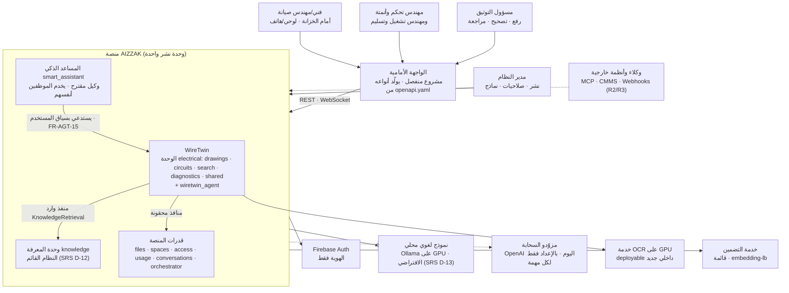
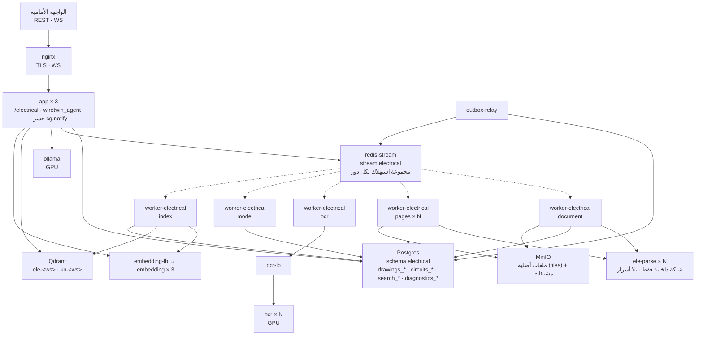
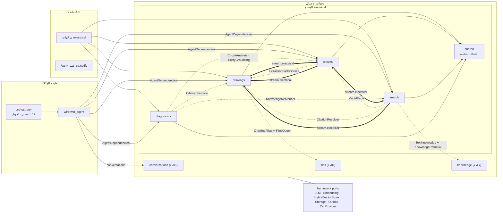
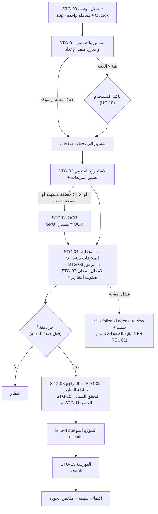
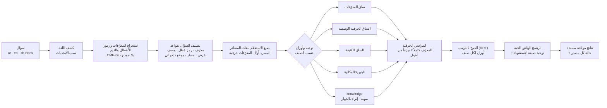
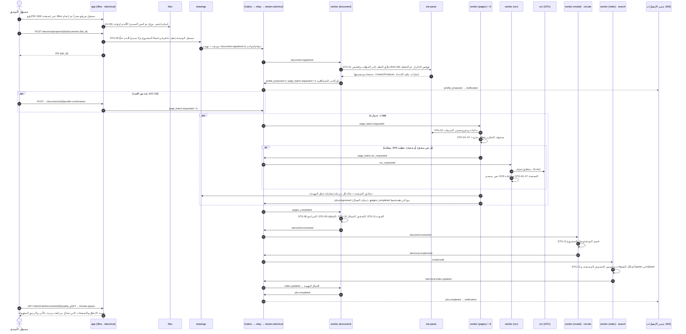
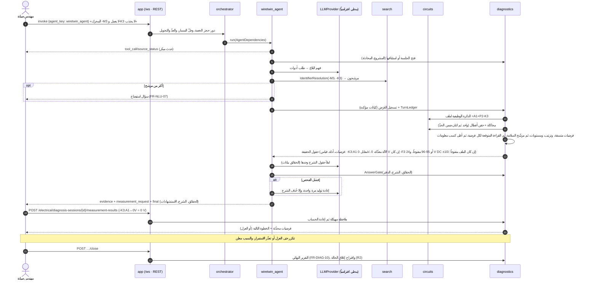
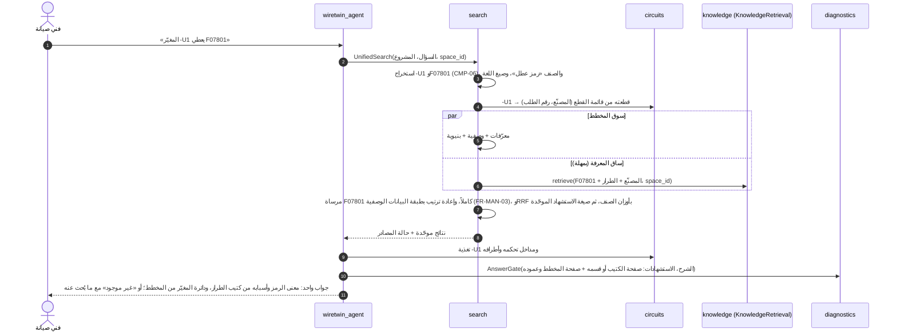
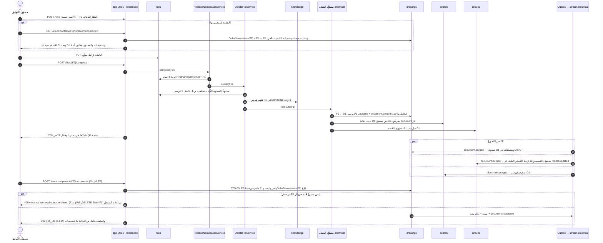
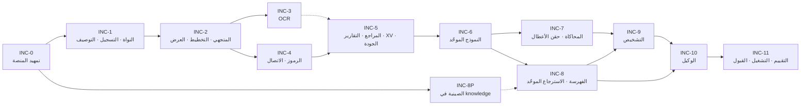

<div dir="rtl">

# التصميم عالي المستوى (HLD): WireTwin، وكيل فهرسة المخططات الكهربائية المتجهية وتحليل الأعطال

| البند | القيمة |
|---|---|
| المعرّف | `electrical-drawings` |
| المنتج | WireTwin (المعرّف `wiretwin`) |
| نوع الوثيقة | تصميم عالي المستوى فقط: مكوّنات ومنافذ وعقود على مستوى المورد والحدث. **لا شيفرة ولا DDL ولا تواقيع** |
| الإصدار | 0.16 (مسودة للمراجعة، بعد الجولة الثانية من إعادة العمل) |
| التاريخ | 2026-10-29 |
| المدخل الملزم | [`requirements.md`](requirements.md) الإصدار 0.15؛ القرارات SRS D-01..D-31 محسومة |
| المدخل المساند | [`../research/ele-open-source/`](../research/ele-open-source/) (`00-summary.md`، `02-techniques-matrix.md`، `01-catalog.md`، `03-datasets-and-benchmarks.md`) |
| الوثائق الحاكمة | `CLAUDE.md`، `docs/architecture.md` (arch D‑01…D‑26)، `docs/design/00…12`، `docs/design/openapi.yaml`، `.importlinter`، `docker-compose.yml`، `docker-compose.gpu.yml`، `docs/deploy-server.md` |
| الحالة | مسودة. لا قرار ⚠️ معلّقاً كاملاً. بقي قرار محسوم جزئياً (DEC‑07، §18.3: بقي محرك OCR وترقية التضمين)، وهو يحجب INC‑3 وINC‑8P وحدهما. وسبعة عشر قراراً محسوماً (DEC‑01..DEC‑06، DEC‑08..DEC‑18). وفي §18.4 صفوف التعارض التسعة بين SRS ووثائق المنصة كلها محسومة: واحد بـSRS D-22، وواحد بـDEC‑02، وواحد بـDEC‑08، وواحد بـDEC‑10، وواحد بـDEC‑11، وواحد بـDEC‑12، وواحد بـDEC‑15، وواحد بـDEC‑17، وآخر في التصميم |

**سجل الإصدارات**

| التاريخ | الإصدار | التغيير |
|---|---|---|
| 2026-10-28 | 0.1 | المسودة الأولى |
| 2026-10-28 | 0.2 | إعادة العمل 1: DEC‑01 (ب)، WireTwin. وحدة واحدة `app.modules.electrical` بأربعة أقسام و`shared` بدل أربع وحدات وحزمة `app.kernels`؛ عقود import-linter (§5.6)؛ schema ومجرى وسلسلة هجرات واحدة؛ إعادة عدّ بنود `PLT‑nn`؛ اسم المنتج WireTwin والوكيل `wiretwin_agent`؛ المخاطر RSK‑14..16؛ والقرار الجديد DEC‑16 |
| 2026-10-29 | 0.4 | تحرير بطلب المالك: بند «المشكلة» في القرارات DEC‑11..DEC‑16 وDEC‑18 (§18.3)، يشرح ما يعالجه كل قرار. وكان البند قائماً في DEC‑17. لا تغيير في الخيارات ولا التوصيات ولا ما يحجبه كل قرار |
| 2026-10-28 | 0.3 | إعادة العمل 2. **(أ) SRS D-22 (SRS 0.7) يحسم DEC‑03:** لا مراجعات. الوثيقة ملف مرفوع واحد، 1:1 مع `file_id`، ومعرّفاتها الحتمية مشتقة من `file_id` (§8.7). صارت أحداث المجموع `revision` أحداثاً للمجموع `document`، وأُزيل حدث تغيير المراجعة الفعالة (`electrical.document.effective_revision_changed.v1`)، وأُضيف `electrical.document.purged.v1` (§7.8). وصار قسم النموذج لكل وثيقة، وبادئة MinIO بالوثيقة. وأُضيف التطهير بمرحلتين (§8.8)، وتدفق الاستبدال بالاسم ومعاينته وحارس التسجيل (§8.11، §14.4). أُزيل `PLT‑02` وأُضيف `PLT‑24`. وأُعيدت صياغة RSK‑08، وأُضيف RSK‑17 وRSK‑18 والقراران DEC‑17 وDEC‑18. **(ب) أُلغي مشروع staging على RunPod** (قرار المالك 2026-10-28، `CLAUDE.md` «Staging & deploy»): بقي هدفان، المكدّس المحلي وخادم GPU وفق `docs/deploy-server.md` (§4.4). أُزيل RSK‑10 وبند (هـ) من DEC‑15، وعُدّلت DEC‑04 وDEC‑07 وDEC‑08 وDEC‑14 وPLT‑10 وPLT‑17 وINC‑11 دون حسمها |
| 2026-10-29 | 0.5 | قرار المالك: **DEC‑02 حُسم بالخيار (ب)**، رفع الحدود العامة في `Limits` (1 GB لكل ملف، وحصة فضاء أكبر) مع بقاء الرفع المجزأ القابل للاستئناف. عُدّل `PLT‑01` (§5.7) وADR‑29 (§15) وINC‑0 (لم يعد محجوباً بـDEC‑02) وصف التعارض 1 (§18.4) |
| 2026-10-29 | 0.6 | قرار المالك: **DEC‑04 حُسم بالخيار (أ)**، خدمة `ele-parse` معزولة على شبكة Docker داخلية، مع تأكيد إلغاء النشر على RunPod. عُدّل ADR‑04 (§15) وINC‑1 (لم يعد محجوباً بـDEC‑04) |
| 2026-10-29 | 0.7 | قرارات المالك: **DEC‑05 (أ)** مخزن الرسم في Postgres تحت RLS؛ و**DEC‑06 (أ)** الحساب المتزامن داخل `app` بتفريغ إلى خيط وسقف تزامن و`429`؛ و**DEC‑07 جزئياً**: كرت GPU واحد بميزانيات VRAM (أ)، والنموذج المحلي من عائلة Qwen، وبقي محرك OCR وترقية التضمين؛ و**DEC‑08 (أ)** امتدادات في السجل عبر Loki. عُدّلت ADR‑11 وADR‑21 وADR‑26 وADR‑28 (§15)، وما تحجبه INC‑6 وINC‑9 وINC‑10 وINC‑11 (§16)، وصف التعارض 4 (§18.4) |
| 2026-10-29 | 0.8 | قرار المالك: **DEC‑09 حُسم بخيار رابع (د)** (SRS D-23، SRS 0.8): تقييم جودة التحليل والاسترجاع في مهمة مستقلة خارج CI، ونتائجه ليست شرطاً للدمج بل لتفعيل إصدار أو نموذج، ويبقى في CI SBOM وفحص التراخيص والثغرات. عُدّل صف التقييم في §13.7، وM-25 وM-26 في §11، وADR‑27 (§15)، وINC‑0 وINC‑11 (§16)، وR-06 (§18.1) |
| 2026-10-29 | 0.9 | قرار المالك: **DEC‑10 حُسم بالتأجيل** (SRS D-24، SRS 0.9): لا يُعدَّل الترخيص الآن، فيبقى `Proprietary`، ولا يُبنى مسار عرض الشيفرة؛ وسيقرر المالك لاحقاً تغيير الترخيص أو استبدال المكتبات المرخصة بـAGPL، مع تذكير قبل الإطلاق في الإنتاج. عُدّل PLT‑19 (§5)، وجدول المسارات (§12)، و§13.8، وADR‑32 (§15)، وINC‑0 وINC‑11 (§16)، وR-03 (§18.1)، وDEC‑13، وصف التعارض 5 (§18.4) |
| 2026-10-29 | 0.10 | قرار المالك: **DEC‑11 حُسم** (SRS D-25، SRS 0.10): لا أدوار جديدة ولا أدوار خاصة بالفني أو المهندس أو غيرهم؛ صلاحيات `electrical:*` على أدوار المنصة القائمة. ويعمل `wiretwin_agent` مع الوكيل المقترح «المساعد الذكي» لخدمة الموظفين، والمساعد يستطيع استدعاء كل الوكلاء ومنهم `wiretwin_agent` (SRS FR-AGT-15). عُدّل جدول الفاعلين والشكل 1 (§3)، وPLT‑13 وأُضيف PLT‑25 (§5)، وأُضيف §11.11، و§12.3، وADR‑31 (§15)، وINC‑0 وINC‑10 (§16)، وأُضيف RSK‑19 (§18.2)، وصف التعارض 3 (§18.4) |
| 2026-10-29 | 0.11 | قرار المالك: **DEC‑12 حُسم بالتوصية**: تُقَرّ حزمة تغييرات عقود المنصة الإضافية مرة واحدة (`PLT‑03`، `PLT‑04`، `PLT‑05`، `PLT‑09`، `PLT‑10`، `PLT‑11`، `PLT‑12`، `PLT‑15`)، وكلٌّ يُنفَّذ في زيادته مع اختبار عقده. لا تغيير في SRS. عُدّلت أعمدة العقود في §5، و§9 (القراءة بالمعرّف)، وINC‑8P وINC‑10 (§16)، وصف التعارض 6 (§18.4) |
| 2026-10-29 | 0.12 | قرار المالك: **DEC‑13 حُسم بالتوصية** (SRS D-26، SRS 0.11): تُقَرّ قائمة الاعتماديات الجديدة، ويُقَرّ OFL-1.1 للخطوط صراحةً. عُدّلت أعمدة التراخيص في §6، و§13.4 و§13.8، وADR‑05 وADR‑06 وADR‑12 وADR‑15 وADR‑16 وADR‑24 (§15)، وINC‑1 وINC‑4 وINC‑8 (§16) |
| 2026-10-29 | 0.13 | قرار المالك: **DEC‑14 حُسم بخيار جديد** (SRS D-27، SRS 0.12): كل القياس على المضيف المحلي (نحو 13 GB، و10 أنوية، وRTX 4060 Laptop بـ8 GB)، ولا قياس خارجه، وكل اختبار قياس يُحجَّم ليناسبه. عُدّل جدول الهدفين (§4.4)، ومقاييس الإشباع (§13.2)، و§13.3، وصف التقييم (§13.7)، والنموذج المحلي (§11.6)، وINC‑11 (§16)، وR-19 وأُضيف R-22 وR-23 (§18.1)، وRSK‑01 (§18.2) |
| 2026-10-29 | 0.14 | قرار المالك: **DEC‑16 حُسم بإعادة دراسة NFR-PRIV-01** (SRS D-28، SRS 0.13): بيانات المستخدم لا تُحذف تلقائياً أبداً، ولا تُحذف إلا بفعل صريح من المستخدم؛ وسجل التدقيق لا يُحذف أبداً؛ ولا يُكنس تلقائياً إلا البيانات التقنية المؤقتة بمدة ثابتة للنظام. فلا يمنح `retention_sweeper` إلا جداول تلك البيانات، بنمط الخيار (أ). عُدّل `ops-scheduler` (§4)، وPLT‑04 وPLT‑14 وPLT‑22 (§5.7)، والأدوار (§8.2)، والمشتقات (§8.3)، و§8.8، وجدول المسارات (§12)، وINC‑11 (§16)، وجدول التتبّع (§17)، وأُضيف R-24 (§18.1) |
| 2026-10-29 | 0.15 | قرار المالك: **DEC‑17 حُسم بخيار رابع (د)** (SRS D-29، SRS 0.14): الوكيل المتاح للمستخدمين مستقبلاً هو «المساعد الذكي» وحده، ويفهرس WireTwin و`knowledge` على مستوى الفضاء (المنطقة) بوسوم النظام والمعدّة والقسم. والاستبدال بالاسم صار مشروطاً بتطابق الوسوم، وهو تغيير في `files` يشترك فيه المساعد الذكي (FR-31 وFR-32 فيه). وبالتوصيات: مشروع واحد لكل فضاء، ونوع الملف لا يدخل في التطابق، وإعادة الوسم تكنس كإعادة التسمية. أُضيف `PLT‑26` وRSK‑20، وعُدّل `PLT‑24` و§8.11 وجدول المسارات (§12) وعزل الفضاء (§13) وADR‑30 وINC‑1 وجدول التتبّع والصف 8 في §18.4 |
| 2026-10-29 | 0.16 | قرارا المالك بالتوصية: **DEC‑15** (SRS D-30): تُقَرّ التفسيرات الأربعة (أ..د)، وعُدّلت في SRS NFR-I18N-01 وFR-INT-07 وNFR-SCAL-05. و**DEC‑18 (أ)، الحدّ الضيق** (SRS D-31): ما يبقى بعد حذف الملف أو استبداله اعتمده إنسان أو هو سجلّ لما جرى، ولا يُسترجع منه شيء ولا يُستشهد به بوصفه مخططاً حياً. وعُدّلت في SRS FR-ING-03 وFR-INT-13 وFR-GRD-06 وDATA-07. عُدّلت §4.3 و§8.6 و§8.8 وجدول §8.11 و§9.6 و§11.6 و§12.4 و§13.7، وADR‑30 (§15)، وINC‑4 وINC‑9 وINC‑11 (§16، بلا حاجب)، وR-21 (§18.1)، والصف 7 في §18.4 |

## 0. كيفية قراءة الوثيقة

**اسم المنتج.** ما زالت SRS تسمّي المشروع `ele-drw` (`requirements.md` السطر 6، «الاسم المؤقت للمشروع»). وتستعمل هذه الوثيقة اسم **WireTwin** (والمعرّف `wiretwin`) بقرار المالك في 2026-10-28 (`status.md`، «قرارات وتصعيدات»). ويبقى اسم الوحدة `electrical` (تسمية بالقدرة كما في `knowledge`)، ويبقى اسم الخدمة `ele-parse` وبادئة صناديق Qdrant `ele-<workspace_id>` كما هما.

**أسماء الأقسام.** `drawings` و`circuits` و`search` و`diagnostics` و`shared` أقسام داخل الوحدة الواحدة `app.modules.electrical` (§5.2)، لا وحدات. وتُكتب مجرّدة اختصاراً، فـ`drawings` تعني `app.modules.electrical.drawings`. والصيغة `<قسم>.<منفذ>`، مثل `drawings.EvidenceLookup`، تعني منفذاً وارداً يعلنه ذلك القسم. أما أسماء الأحداث فكلها تبدأ بـ`electrical.` (§7.8).

**الإحالة لا التكرار.** تحيل الوثيقة إلى معرّفات SRS ولا تعيد صياغة المتطلبات. وكل ادعاء عن المنصة القائمة مسنود بمسار ملف قُرئ.

**المعرّفات.** تتصادم قرارات SRS (`D-01..D-21`) مع قرارات المنصة (`D‑01…D‑26`)، وتتصادم قيود SRS المعمارية (`AC-01..AC-10`) مع ترميز معايير القبول. لذلك:

| الصيغة | المعنى | مثال |
|---|---|---|
| `FR-…` · `NFR-…` · `DATA-…` · `UC-…` · `M-…` · `P-…` · `R-…` · `I-…` · `T-…` · `L-…` · `G-…` | معرّفات SRS كما كُتبت فيها (شَرطة ASCII) | `FR-INT-13` |
| `SRS D-nn` | قرار من SRS §11.1 | `SRS D-13` |
| `SRS AC-nn` | قيد معماري من SRS §3.3 (لا معيار قبول) | `SRS AC-09` |
| `arch D‑nn` | قرار من `docs/architecture.md` §13 | `arch D‑13` |
| `ق‑n` · `ح‑n` · `د‑n` | قرارات واختناقات وقياسات خطة السعة (`docs/capacity-*.md`) | `ق‑1` |
| `CMP‑nn` | مكوّن في هذا التصميم (§5) | `CMP‑02` |
| `STG‑nn` | مرحلة في خط الاستيعاب (§7) | `STG‑03` |
| `PLT‑nn` | بند عمل في المنصة خارج الوحدة الجديدة (§5.7) | `PLT‑05` |
| `ADR‑nn` | قرار معماري مرشّح (§15) | `ADR‑11` |
| `INC‑n` | زيادة تسليم، كلٌّ منها ميزة `/company:deliver` مستقلة (§16) | `INC‑6` |
| `RSK‑nn` | خطر تصميمي جديد (§18.2) | `RSK‑04` |
| `DEC‑nn` | قرار ⚠️ يحتاج إنساناً (§18.3) | `DEC‑05` |

**المعرّفات المزالة.** على اصطلاح SRS §0: لا يُحذف معرّف من معرّفات هذه الوثيقة ولا يُعاد استعماله. يبقى صفّه بنص يبدأ بـ«أُزيل في الإصدار …» مع القرار وسببه، لتبقى الإشارات إليه قابلة للحل. مثالاه `PLT‑02` و`RSK‑10`.

**«وثيقة» و«مراجعة».** منذ الإصدار 0.3 (SRS D-22) الوثيقة ملف مرفوع واحد سُجّل في مشروع، ولا مراجعات لها. فكلمة «مراجعة» هنا تعني المراجعة البشرية وحدها («تحتاج مراجعة»، «طابور المراجعة»). والاستثناء «رقم المراجعة المطبوع» في كتلة العنوان، وهو حقل وصفي (FR-LAY-02).

**العلاقة بقالب التصميم.** القالب (`skills/deliver/templates/design.md`) بمستوى LLD. وُفِّق هنا إلى مستوى HLD: «الملفات» صارت تفكيك مكوّنات (§5)، و«العقود» صارت منافذ وموارد وأحداثاً (§6، §7.8، §12)، و«البيانات» صارت تخصيص مخازن ومسؤولية (§8)، و«خطة الاختبار» صارت إطار التقييم وطبقات الاختبار (§13.7)، و«ترتيب التنفيذ» صار خارطة الزيادات (§16)، و«المخاطر والقرارات» بقيت كما هي (§18). أما الملفات الدقيقة والتواقيع والـDDL فتأتي في تصميم كل زيادة.

## 1. الملخص والنطاق وتأطير الإصدارات

### 1.1 الملخص

يُبنى WireTwin امتداداً داخل منصة AIZZAK لا تطبيقاً منفصلاً (SRS AC-09، SRS D-19). ويتكوّن من:

1. **وحدة أعمال جديدة واحدة** `app.modules.electrical` (DEC‑01، محسوم بالخيار (ب))، لها schema واحد `electrical` وسلسلة هجرات واحدة ومجرى أحداث واحد `stream.electrical`. ترتيبها بالأقسام أولاً، ولكل قسم `domain/` و`application/` و`ports/` و`adapters/` (§5.2):
   - `drawings`: الاستيعاب والاستخراج والأدلة والجودة والتصحيحات.
   - `circuits`: النموذج الكهربائي الموحّد واستعلاماته ومحاكاته.
   - `search`: الفهرسة والاسترجاع الموحّد مع وحدة المعرفة.
   - `diagnostics`: جلسات التشخيص وبوابة الإسناد.
2. **نواة مشتركة نقية داخل الوحدة** `app.modules.electrical.shared` لمحلّل المعرّفات الموحّد (FR-ID-12) والتطبيع والكميات والتصنيف الدلالي، بلا حزمة عليا جديدة.
3. **وكيل إضافة واحد** `wiretwin_agent` («WireTwin Agent») يكتشفه `PluginLoader` (arch D‑13).
4. **خدمتان منفصلتان**: محلّل PDF معزول `ele-parse`، وخدمة OCR على GPU `ocr`.

الاستيعاب عمل ثقيل يجري خارج مسار الطلب عبر Outbox وRedis Streams (arch D‑04، D‑18، D‑19، D‑20)، في عمّال من صورة التطبيق نفسها. ولكل مرحلة ثقيلة مجموعة استهلاك خاصة تتوسّع وحدها (NFR-SCAL-04). المسار المتجهي يعمل على CPU وحده (P-05). الـOCR خدمة GPU خلف منفذ إطار جديد. والنموذج اللغوي المحلي يُستدعى عبر منفذ `LLMProvider` القائم وجدول توجيهه.

النواة الحتمية في طبقتي النطاق والتطبيق للأقسام، وتشمل: الاستخراج، والاتصال، والتتبّع، والمحاكاة ثلاثية القيم، والتشخيص بالاتساق، واختيار القياس، وبوابة الإسناد. أما النموذج اللغوي في الوكيل فيفهم البلاغ ويختار الأدوات ويكتب حقول الشرح فقط (P-04، SRS D-21).

وتحتاج المنصة تغييرات خارج الوحدة الجديدة. هي مجموعة في بنود `PLT‑nn` (§5.7)، وكل ما يمسّ عقداً من عقودها معلّم ⚠️ (§18.3).

### 1.2 نطاق R1 (كل متطلبات M)

| القدرة (SRS ملحق ب) | المكوّنات | الزيادة |
|---|---|---|
| الامتداد داخل AIZZAK بقواعدها ومنافذها | كل المكوّنات، و`PLT‑*` | INC‑0 |
| تقرير توصيف العينات (FR-EVAL-14) واكتشاف ملف الإعداد (FR-ING-12) | `drawings`، `ele-parse`، `shared` | INC‑1 |
| الاستيعاب المتجهي وتحليل الصفحة والمعرّفات بكل اصطلاحاتها وعناوين Siemens | `drawings`، `shared`، `ele-parse` | INC‑1، INC‑2 |
| النص الصيني وOCR للنص المرسوم خطوطاً | `drawings`، `ocr`، `OcrProvider` | INC‑3 |
| الرموز متعددة المعايير بنموذج محايد، والاتصال | `drawings`، `shared` | INC‑4 |
| المراجع وصفحات التقارير والتحقق المتبادل ومؤشرات الجودة والتصحيحات | `drawings` | INC‑5 |
| النموذج الموحّد واستعلاماته | `circuits` | INC‑6 |
| المحاكاة ثلاثية القيم وحقن الأعطال وتحليل الأثر | `circuits` | INC‑7 |
| الفهرسة الهجينة للإنجليزية والصينية، والتكامل مع وحدة المعرفة والاسترجاع الموحّد المرتبط بالجهاز، والحذف المتزامن وثبات الاستشهاد | `search`، و`PLT‑04..06` | INC‑8 |
| دعم الصينية في وحدة المعرفة (FR-INT-15) | `knowledge` (تغيير منصة `PLT‑05`) | INC‑8P |
| التشخيص بالاتساق واختيار القياس الفاصل وحلقة القياس | `diagnostics`، `circuits` | INC‑9 |
| الوكيل بنموذج محلي افتراضي وسحابي بالإعداد، والإسناد وحقول الحقيقة، والحد الأدنى للسلامة، وفهم البلاغ بثلاث لغات ومسرد المصطلحات | `wiretwin_agent`، `diagnostics`، `search` | INC‑10 |
| إطار التقييم والمجموعة الذهبية ومهمة التقييم المستقلة، والتدقيق، والتوسّع بالموارد، وREST وWebSocket | كل المكوّنات، و`PLT‑*` | INC‑1..INC‑11 (يتراكم) |

### 1.3 R2 وR3 والمؤجل: نقاط توسعة فقط

لا يُبنى منها شيء في R1. يحجز التصميم لكلٍّ منها موضعاً لا يكسر عقداً حين يُبنى.

| البند | الإصدار | نقطة التوسعة في التصميم |
|---|---|---|
| الكلفة الرقمية للقياس (FR-DIAG-15) | R2 | دالة المفاضلة في `diagnostics` تقبل أوزان كلفة من ملف الإعداد؛ R1 يستعمل كسر التعادل وحده (FR-DIAG-05) |
| ربط مقاطع المعرفة بالكيانات ومزامنتها بالأحداث (FR-INT-06، FR-INT-11) | R2 | جدول روابط في `search`، ومجموعة استهلاك جديدة على `stream.knowledge` (`PLT‑08`) |
| توسيع عقد `RetrievedChunk` بالبيانات الوصفية والترشيح (FR-INT-14) | R2 | `PLT‑07`؛ وحتى ذلك الحين طبقة البيانات الوصفية في `search` (FR-MAN-03) |
| البحث المنظم برموز الأعطال (FR-MAN-02، FR-ID-11) | R2 | أنماط رموز الأعطال في `shared`، وفهرس في `search` |
| الامتناع المعاير (FR-GRD-05) | R2 | `AnswerGate` في `diagnostics` يقبل عتبة معايرة لكل (نموذج، نوع سؤال)، وتنتجها أداة التقييم |
| كشف الرموز والأسلاك على الصور (FR-RAS-02، FR-RAS-03) | R2 | منفذ إطار `SymbolDetector` (§6)، وفرع في STG‑06 مفعّل بالإعداد |
| النموذج البصري (FR-RAS-04 بصفته مدققاً، FR-NLU-06) | R2 | منفذ إطار `VisionLanguageProvider` (§6) |
| أسطورة الرموز (FR-SYM-12) والمصنّف المتجهي القابل للتدريب (FR-SYM-09) | R2 | مصادر إضافية لمكتبة رموز الوثيقة في `drawings` |
| وسم دوائر الأمان (FR-KG-07) | R2 | وسم على الكيانات في `circuits`، وترتيب طابور المراجعة في `drawings` يقرؤه |
| التعلم من الحالات (FR-LRN-01..03، FR-LRN-05) | R2/R3 | مكتبة الحالات والاحتمالات المسبقة المحدّثة في `diagnostics` |
| مقارنة المراجعات (FR-ING-11) | — | أُزيل في الإصدار 0.3 (SRS D-22): أُزيلت FR-ING-11 من SRS، ولا مراجعات تُقارَن، فلا نقطة توسعة لها |
| سجل HMAC (FR-ADM-06)، واعتماد التصحيحات بصلاحية لا بدور (FR-HIL-06، DEC‑11)، ونقاط المراجعة بين المراحل (FR-HIL-04) | R2 | سجلات التدقيق append-only في كل قسم (ADR‑25)، وحالة «بانتظار اعتماد» في طبقة التصحيحات |
| MCP والتصدير والـWebhooks (FR-API-05..07، FR-KG-08) | R2 | الأدوات نفسها خلف خادم MCP للقراءة فقط، وكتّاب تصدير في `circuits`، وأحداث `*.completed` مصدراً للـWebhooks |
| التوجيه لكل مهمة وميزانية المشروع (FR-AGT-08، FR-ADM-05) | R2 | مفاتيح قدرة إضافية في جدول التوجيه، و`PLT‑09` (أكثر من نموذج في دور واحد) |
| قبول PDF محمي بكلمة مرور (FR-ING-07) | R2 | كلمة المرور تمرّ إلى `ele-parse` عابرة ولا تُخزَّن |
| استنتاج قوالب كتلة العنوان (FR-LAY-05) والمسار المزدوج للمقارنة (FR-RAS-06) | R2/R3 | مرحلة اختيارية في STG‑04، وتشغيل الفرعين على الصفحات نفسها |
| صيغ PLC لمورّدين آخرين (FR-ID-14)، والاسترجاع البصري (FR-IDX-12)، ومطابقة صور الرموز (FR-SYM-11)، والمعايير العامة (FR-EVAL-10)، وCMMS (FR-LRN-05) | R3 | قواعد إضافية في `shared`، وساق استرجاع إضافية، وإضافات بالإعداد (NFR-MNT-04) |
| سياسة السلامة والموافقة الحاجبة (FR-SAF عدا 04 و09)، واستيراد ECAD وجداول Siemens وبرامجها (FR-SRC-01..06، FR-DIAG-09) | W | نوع رسالة WS قابل للإضافة (FR-API-02)، و`FR-SRC-07` يبني الدمج متعدد المصادر من R1 |

### 1.4 خارج النطاق

كما في SRS §1.2. ويضيف التصميم: لا واجهة أمامية في المستودع، والعميل يُولّد أنواعه من `docs/design/openapi.yaml` (§12.5). ولا يعيد WireTwin بناء أي قدرة في المنصة (SRS AC-10).

## 2. محرّكات المعمارية

### 2.1 القيود المعمارية (SRS AC-01..AC-10)

| القيد | التكتيك | الموضع |
|---|---|---|
| SRS AC-01 (Python 3.12) | كل شيفرة المنصة وخدمتاها الجديدتان (`ele-parse`، `ocr`) بايثون؛ والخدمتان بصورتين منفصلتين لتبقى اعتمادياتهما الثقيلة خارج رسم استيراد `app.*`، على سابقة خدمة التضمين (انحراف arch D‑14) | §4 |
| SRS AC-02 (Modular Monolith) | وحدة واحدة `electrical` بأربعة أقسام و`shared`، لها schema واحد بجداول مسبوقة باسم القسم، وسلسلة هجرات واحدة، ومجرى أحداث واحد؛ لا FK عابر بين schemas (`docs/design/01-data-model.md` §0) ولا بين جداول قسمين؛ كل قسم يقرأ جداوله ويكتبها وحده؛ التواصل بين الأقسام، كما بين الوحدات، بمنافذ واردة يعلن المستهلك شكلها (سابقة `files/ports/spaces.py` و`knowledge/ports/files.py`) أو بأحداث؛ فصل الوحدة، أو قسم منها، إلى خدمة لاحقاً يستبدل محوّل الربط في جذر التركيب ولا يمسّ منطقها | §5 |
| SRS AC-03 (Hexagonal) | كل اعتماد خارجي خلف منفذ (جدول §6). نطاق كل قسم و`shared` stdlib فقط (عقد `domain-purity` بعد توسيعه، §5.6)، والخوارزميات الحسابية الثقيلة خلف منافذ للقسم | §6 |
| SRS AC-04 (نواة قابلة للاختبار بمحوّلات وهمية) | محوّل وهمي لكل منفذ جديد، والمحاكاة والتشخيص والمحلّل في النطاق النقي، ومسجّلة لاستدعاءات النموذج (cassettes) لاختبارات حتمية | §13.7 |
| SRS AC-05 (FastAPI) | موجّهات تحت `/api/v1/electrical`، وأنواع رسائل تُضاف إلى بروتوكول `/api/v1/ws` القائم | §12 |
| SRS AC-06 (Compose بأمر واحد) | خدمات جديدة في `docker-compose.yml` خلف ملفات تشغيل (`electrical`، `electrical-ocr`)، وتراكب GPU في `docker-compose.gpu.yml`، على هدفَي Compose: المكدّس المحلي وخادم GPU (§4.4) | §4 |
| SRS AC-07 (قواعد الاعتماد في CI) | إدخال الوحدة والوكيل في عقدَي الاستقلال القائمين، وتوسيع `domain-purity` و`application-boundaries` لتبلغا الأقسام، وعقد طبقات داخلي يفصل الأقسام بعضها عن بعض ويحرس `shared`، وعقد يمنع الوكيل من استيراد الوحدة، **دون أي `ignore_imports`** | §5.6 |
| SRS AC-08 (ADR) | سجل مرشّح في §15، يتحول كل صفّ فيه إلى ADR في تصميم الزيادة التي تحتاجه | §15 |
| SRS AC-09 (امتداد يلتزم قواعد المنصة) | قالب الوحدة السداسي (`docs/design/12-module-authoring-guide.md`) وقالب الوكيل (`docs/design/11-agent-authoring-guide.md`)؛ RLS بصيغة `NULLIF` واختبار RLS لكل مستودع؛ هجرات عبر `app.ops.provision`؛ أخطاء RFC 9457 من `ERROR_CATALOG`؛ لا أسرار جديدة خارج Vault؛ البوابات الست | §5، §8، §13 |
| SRS AC-10 (إعادة استعمال المنافذ) | يُعاد استعمال منافذ المنصة وخدماتها حيث تكفي (جدول §6). ويدخل R1 منفذ إطار جديد واحد فقط (`OcrProvider`)، ويأتي منفذان آخران في R2 | §6 |

### 2.2 المبادئ الحاكمة (P-01..P-08)

| المبدأ | التكتيك |
|---|---|
| P-01 مساعد لا صاحب قرار | مفردات القياس لا تحوي فعل تجاوز أصلاً، فيستحيل اقتراحه بنيوياً. وحالة الآلة حقل إلزامي في كل خطوة قياس. وصياغة FR-SAF-09 في التعليمات تحرسها مجموعة انحدار M-25 |
| P-02 الدقة قبل التغطية | لكل حقيقة ثقة معايرة وحالة (`auto` · `confirmed` · `corrected` · `disputed`). «المجهول» في المحاكاة لا يُفترض أبداً. وبوابة الإسناد ترفض عند نقص الأدلة |
| P-03 كل حقيقة مرتبطة بدليل | سجل الدليل (DATA-01) تملكه `drawings`، وكل كيان وعلاقة وإجابة تحمل معرّفات أدلة. ومسار «افتح على الصفحة» يحلّ الدليل إلى صورة الصفحة وطبقة التظليل |
| P-04 نواة حتمية | الاستخراج والاتصال والتتبّع والمحاكاة والتشخيص واختيار القياس في نطاقات الأقسام النقية. وحقول الحقيقة يملؤها `diagnostics`، والنموذج يملأ حقول الشرح |
| P-05 المتجه أولاً | المرحلة الأساسية تقرأ هندسة الـPDF ونصّه. وأما الصورة فللعرض، ولـOCR مناطق موسومة فقط (FR-VEC-10) |
| P-06 لا فشل صامت | لكل زوج (صفحة، مرحلة) حالة وسبب. والمهمة العالقة تكشفها مهمة دورية وتنبيه |
| P-07 قابلية القياس | إطار التقييم يُبنى من الزيادة الأولى، وكل زيادة تشحن مقاييسها وبواباتها |
| P-08 السلطة للإنسان | طبقة تصحيحات فوق الاستخراج الآلي تتقدم عليه، وتبقى عند إعادة استيعاب الملف نفسه، وتُحذف معه إن استُبدل بالاسم (FR-HIL-02، FR-HIL-03، R-21) |

### 2.3 أصعب المتطلبات غير الوظيفية

| المتطلب | لماذا هو صعب | التكتيك | الموضع |
|---|---|---|---|
| NFR-PERF-01: 3 ث للصفحة، و500 صفحة في 25 دقيقة على CPU | المسار المتجهي كثيف هندسياً (عشرات آلاف البدائيات للصفحة) | توازي على مستوى دفعات الصفحات؛ مجمّع عمليات في `ele-parse` بحجم الأنوية؛ لا تحويل إلى صورة؛ مشتقات ثنائية في MinIO؛ كتابة الحقائق دفعةً لكل صفحة | §7.3 |
| NFR-PERF-02: بحث المعرّف ≤ 300 ms، والتتبّع ≤ 1 ث (p95، 5,000 صفحة) | مليون نقطة اتصال | جدول أشكال تطبيع بفهرس B-tree مقيّد بالمشروع؛ وإسقاط «توصيل» على مستوى الشبكة لتتبّع مقيّد العمق؛ ومسرّع مقيس عند الحاجة (DEC‑05) | §8.5، §9.7 |
| NFR-PERF-05: صفحة OCR في ≤ 15 ث لكل GPU | الـGPU مشتركة مع النموذج المحلي | OCR للمناطق الموسومة فقط؛ تقطيع ودفعات بإعداد لكل محرك؛ طابور مرحلة مستقل (DEC‑07) | §7.1 |
| NFR-PERF-06 وNFR-PERF-03 | ساق المعرفة ساق خارجية عن الوحدة | تشغيل السوقين بالتوازي بمهلة، ودمج O(k)، وأحداث تقدّم مبكرة قبل أي عمل حاجب | §9.2 |
| NFR-PERF-07: تشخيص عطل واحد ≤ 2 ث | حقن عطل لكل عنصر ثم محاكاة | تقييد الحساب بالدائرة الوظيفية، ومحاكاة تزايدية، وتخبئة القراءات المتوقعة لكل فرضية، وتنفيذ مقيّد التزامن (DEC‑06) | §10.11 |
| NFR-SCAL-01..05 | 100,000 جهاز ومليون نقطة، وتوسّع بكفاءة ≥ 0.8 | مجموعة استهلاك لكل مرحلة ثقيلة؛ عدد النسخ من الإعداد؛ الاستيعاب يصطفّ عند الذروة ويُعلن موضعه؛ الطلبات التفاعلية تُرفض عند التشبّع بـ`429` و`Retry-After` (سياسة `ق‑6`) | §4.3 |
| NFR-REL-01..04 | صفحة سيئة، أو عامل يسقط، أو مزوّد معطل | عزل لكل صفحة؛ Outbox ومجارٍ دائمة مع `XAUTOCLAIM` (`infrastructure/messaging/redis_streams.py`)؛ أنماط تدهور معلنة | §7.6، §11.9 |
| NFR-SEC-02 وNFR-SEC-05 | ملفات من موردين مجهولين، ونصوص تُقرأ على النموذج | محلّل معزول بلا شبكة (DEC‑04)؛ فصل البيانات عن التعليمات؛ أدوات بصلاحيات المستخدم؛ بوابة مخرجات | §11.7، §13.1 |
| NFR-ACC-02 (ECE ≤ 0.05) | الثقة الخام من القواعد ليست احتمالاً | طبقة معايرة لكل نوع حقيقة تُلائَم على المجموعة الذهبية وتُصدَر بإصدار (ADR‑38) | §13.7 |
| NFR-REP-01..03 | سلسلة مراحل طويلة ونموذج لغوي غير حتمي | بصمة إصدار على كل حقيقة وإجابة؛ مراحل حتمية؛ cassettes | §13.6 |
| NFR-I18N-01..04 | ثلاث لغات أسئلة ولغتا مصدر في الصفحة نفسها | تقطيع صيني يحمي المعرّفات اللاتينية؛ تطبيع للبحث مع حفظ الأصل؛ عزل ثنائي الاتجاه؛ خطوط CJK بديلة | §13.4 |
| NFR-LIC-06 وNFR-LIC-07 | المنصة كلها تُتاح بـAGPL-3.0 (أُجّل بـSRS D-24: يبقى `Proprietary` حتى يقرر المالك) | فحص تراخيص وSBOM في CI (DEC‑09)؛ ولا مسار لعرض الشيفرة الآن (DEC‑10) | §13.8 |
| NFR-OBS-02 وNFR-OBS-03 | المنصة بلا تتبّع موزّع (`docs/design/07-nfr-slo.md` §7)، والخادم الصغير قد يُشغَّل دون المراقبة (`docs/deploy-server.md` §2) | سجلات امتدادات مرتبطة بمعرّف الارتباط، أو OpenTelemetry (DEC‑08)؛ مقاييس إشباع لكل مرحلة | §13.2 |

## 3. منظور السياق (C4 · L1)

WireTwin ليس نظاماً مستقلاً في السياق: هو جزء من منصة AIZZAK، ويظهر في مخططها L1 (`docs/architecture.md` §03) قدرةً داخلها. يعرض المخطط أدناه الفاعلين (SRS §3.1) والأنظمة المحيطة.



*الشكل 1. السياق. المتقطع يعني «بالإعداد فقط» أو «في R2». الفاعلون فئات احتياج لا أدوار: كلهم موظفون بأدوار المنصة القائمة (DEC‑11).*

| الفاعل أو النظام | التفاعل | الحدّ |
|---|---|---|
| فني ومهندس الصيانة | بلاغ عطل، أسئلة، حلقة قياس، فتح الاستشهادات على الصفحة | عبر الواجهة الأمامية؛ دور المنصة `member`، وفيه `electrical:read` و`electrical:diagnose` |
| مهندس التحكم ومهندس التشغيل | تتبّع، عناوين PLC، تقارير التحقق المتبادل | دور المنصة `member` (`electrical:read`) |
| مسؤول التوثيق | رفع المخططات وتسجيلها في المشروع، تأكيد ملف الإعداد، التصحيحات، طابور المراجعة | دور المنصة `admin` أو `owner` (`electrical:manage`) |
| المساعد الذكي (`smart_assistant`، مقترح) | وكيل آخر يخدم الموظفين أنفسهم من قاعدة المعرفة المركزية | يستطيع استدعاء كل الوكلاء ومنهم `wiretwin_agent`، بسياق المستخدم نفسه (§11.11، SRS FR-AGT-15، DEC‑11) |
| مدير النظام | النشر، الصلاحيات، توجيه النماذج، الحصص | قدرات المنصة القائمة (`access`، `usage`، `PROVIDER_ROUTING`) |
| النظام القائم (`knowledge`) | يفهرس الوثائق النصية ويسترجعها | في العملية نفسها، عبر `KnowledgeRetrieval` وحده (FR-INT-01) |
| Firebase | الهوية | يُورث كما هو (FR-ADM-01) |
| Ollama على GPU | فهم البلاغ، اختيار الأدوات، الشرح، الترجمة | عبر `LLMProvider` وجدول التوجيه (arch D‑15، D‑16) |
| مزوّد سحابي | المهام نفسها، بإعداد صريح لكل قدرة | التحويل إلى المحلي عبر `LlmFallback` (FR-AGT-14) |
| خدمة OCR | نص المناطق المرسومة خطوطاً، والصفحات النقطية، والنص الصيني المشوّه | عبر منفذ `OcrProvider` الجديد |
| مسؤول السلامة، وMCP، وCMMS | مؤجلة | نقاط توسعة (§1.3) |

## 4. منظور الحاويات والنشر (C4 · L2)

### 4.1 الخدمات والعمليات

القاعدة الحاكمة (`docs/architecture.md` §01): لا تقنية تدخل مسار الطلب إلا خلف منفذ في `framework/ports/`، ولكل خدمة سقف موارد في الدفتر (`deploy/resource-budget.sh`).

| الخدمة أو العملية | قائمة أم جديدة | الدور في WireTwin | تتوسّع بـ | المورد المحدِّد |
|---|---|---|---|---|
| `nginx` | قائمة | TLS، وتمرير WS، والروابط الموقّعة لصور الصفحات | — | — |
| `app` (× 3، gunicorn) | قائمة وتُوسَّع | موجّهات `/api/v1/electrical`، والوكيل، وجسر الإشعارات للمجاري الجديدة، والحساب المتزامن (تتبّع، محاكاة، تشخيص؛ DEC‑06) | النسخ | CPU |
| `worker-electrical` بدور `document` | جديدة | STG‑01 وSTG‑08..11، وتقدّم المهمة واكتمالها | النسخ | CPU، ذاكرة |
| `worker-electrical` بدور `pages` | جديدة | STG‑02 وSTG‑04..07، واستخراج صفوف التقارير (STG‑09) | النسخ، وهي الأكثر | CPU (عبر `ele-parse`) |
| `worker-electrical` بدور `ocr` | جديدة | STG‑03 | النسخ، بقدر سعة `ocr` | GPU (عبر الخدمة) |
| `worker-electrical` بدور `model` | جديدة | STG‑12 (بناء النموذج وتحديثه تزايدياً) | النسخ | CPU، Postgres |
| `worker-electrical` بدور `index` | جديدة | STG‑13 | النسخ | التضمين، Qdrant |
| `ele-parse` | deployable جديد | تحليل PDF وتصييره معزولاً (PyMuPDF): بلا شبكة خارجية ولا أسرار، بحدود زمن وذاكرة لكل صفحة (DEC‑04) | النسخ | CPU |
| `ocr` (× N) + `ocr-lb` | deployable جديد | OCR صيني وإنجليزي مختلط على GPU، بدفعات (DEC‑07) | نسخ خلف موازن، على سابقة `embedding-lb` | GPU |
| `ollama` | قائمة | النموذج اللغوي المحلي، بنموذج أكبر مما هو اليوم (DEC‑07) | طابور Ollama (`OLLAMA_NUM_PARALLEL`) | GPU |
| `embedding` (× 3) + `embedding-lb` | قائمة | تضمين النصوص الوصفية للمخططات | النسخ | CPU/GPU |
| `postgres` + `pgbouncer` | قائمة | schema جديد واحد `electrical` | — | — |
| `redis-stream` | قائمة | مجرى جديد واحد `stream.electrical` (ومعه `stream.electrical.dlq`) | — | ذاكرة |
| `redis-cache` | قائمة | تخبئة قابلة لإعادة البناء (متجه الاستعلام قائم؛ ولقطات الدوائر إن لزم، DEC‑05) | — | ذاكرة |
| `minio` | قائمة | مشتقات الصفحات تحت بادئة مساحة العمل | — | قرص |
| `qdrant` | قائمة | صندوق `ele-<workspace_id>` (RSK‑03) | — | ذاكرة |
| `outbox-relay` | قائمة | ينشر الأحداث الجديدة؛ نسخة واحدة (arch §14) | — | — |
| `ops-scheduler` | قائمة | مهام دورية جديدة: كنس البيانات التقنية المؤقتة (NFR-PRIV-04)، وتنظيف الملفات المؤقتة، وكشف المهام العالقة | — | — |
| `migrate` | قائمة | سلسلة الهجرات الجديدة الواحدة `electrical` | — | — |
| المراقبة (Prometheus، Grafana، Loki، Alertmanager) | قائمة | مقاييس وتنبيهات جديدة | — | — |

**عامل واحد بأدوار.** `worker-electrical` أمر واحد في الصورة نفسها (`python -m app.workers.electrical_worker`)، ومتغيّر بيئة يختار أدواره (مجموعات الاستهلاك التي يشترك فيها). في الإنتاج لكل دور خدمة Compose بعدد نسخها. وفي التطوير المحلي عملية واحدة بكل الأدوار. والتزامن وأحجام الدفعات تُقرأ من الإعداد (NFR-SCAL-05)، على نهج `WORKER_CONCURRENCY` القائم.



*الشكل 2. الحاويات. المتقطع استهلاك من المجاري.*

### 4.2 مسار CPU وحده، وملفات التشغيل

| ملف التشغيل | ما يُقلعه | الغرض |
|---|---|---|
| `electrical` | `worker-electrical` بكل الأدوار عدا `ocr`، و`ele-parse` | المسار المتجهي الكامل على CPU وحده (FR-VEC-10، SRS D-09) |
| `electrical-ocr` (مع `docker-compose.gpu.yml`) | `ocr`، و`ocr-lb`، ودور `ocr` | الفرع النقطي ونص SHX والنص الصيني المشوّه |
| `local-llm` (قائم) | `ollama` و`ollama-pull` | التشغيل دون إنترنت بالنماذج المحلية وحدها (NFR-DEP-01، NFR-DEP-03) |

دون `electrical-ocr` لا تفشل الصفحة التي تحتاج OCR بصمت. تنتهي مرحلتها بحالة `needs_review` وسبب `ocr_unavailable` (P-06)، وتُعاد معالجتها حين تتوفر الخدمة (FR-ING-05).

### 4.3 التوسّع لكل مرحلة (NFR-SCAL-03..05)

| المرحلة | مجموعة الاستهلاك | وحدة التوسّع | مقياس الإشباع الذي يُبنى عليه القرار |
|---|---|---|---|
| الفحص والمراحل على مستوى الوثيقة (STG‑01، STG‑08..11) | `cg.electrical.document` | نسخ `worker-electrical/document` | عمر أقدم مدخل في المجموعة، CPU العملية |
| المراحل على مستوى الصفحة (STG‑02، STG‑04..07، STG‑09) | `cg.electrical.pages` | نسخ `worker-electrical/pages` + نسخ `ele-parse` | عمر أقدم مدخل، CPU لـ`ele-parse`، زمن الصفحة |
| OCR (STG‑03) | `cg.electrical.ocr` | نسخ `ocr` (GPU) | استعمال GPU وذاكرتها، طول الدفعة، زمن الصفحة |
| النموذج الموحّد (STG‑12) | `cg.electrical.model` | نسخ `worker-electrical/model` | زمن البناء لكل وثيقة، CPU، زمن معاملات Postgres |
| الفهرسة (STG‑13) | `cg.electrical.index` | نسخ `worker-electrical/index` + نسخ `embedding` | إنتاجية التضمين، زمن upsert في Qdrant |
| الطلبات التفاعلية | — | نسخ `app` | زمن الطلب والقبول، ورفض `429` |

المجموعات الخمس كلها على المجرى الواحد `stream.electrical`. ويبقى التوسّع لكل مرحلة (NFR-SCAL-04) لأن وحدة التوسّع مجموعةُ الاستهلاك ونسخ دورها، لا عدد الوحدات ولا عدد المجاري: كل مجموعة تقرأ المجرى مستقلة عن غيرها (سلوك يثبته `test_two_groups_on_one_stream_each_independently_receive_the_entry` في `tests/integration/test_stream_consumer_live.py`)، وتُقِرّ الأنواع التي لا معالج لها فيها دون مطالبة (`framework/events/topology.py`، الجزء (d)). والكلفة أن كل مجموعة تقرأ كل أحداث الوحدة ثم تتخطّى ما ليس لها، وهي بالمئات لكل وثيقة (§7.8).

مهام الاستيعاب تصطفّ عند الذروة ولا تُرفض. يُعلن موضع المهمة وزمنها المتوقع من عمر الطابور ومعدّل الإنجاز المقيس (NFR-SCAL-05). وهذا يختلف عن ضغط الفهرسة العكسي في `knowledge` (`api/middleware/queue_backpressure.py`) الذي يرفض الرفع الجديد بـ`429` حين يتجاوز انتظار أقدم مدخل 120 ث. لا يُرفض تسجيل وثيقة في WireTwin بسبب الحمل إلا عند حدّ حماية أعلى بكثير، يحمي `redis-stream` (`noeviction`) من الامتلاء، وهو حدّ إعداد. فالطابور معلن الموضع والزمن، لا صامت (✅ DEC‑15 (د)، SRS D-30). أما الطلبات التفاعلية فتتبع سياسة المنصة: رفض فوري بـ`Retry-After` (`ق‑6`).

### 4.4 التطوير المحلي مقابل خادم GPU

لا هدف staging: أُلغي مشروع RunPod بقرار المالك (2026-10-28، `CLAUDE.md` «Staging & deploy»)، فلا يخطط هذا التصميم لنشر عليه. يبقى هدفان، كلاهما Docker Compose بالملفات نفسها: المكدّس المحلي للتطوير والاختبار الحي، وخادم لينكس بكرت NVIDIA وفق `docs/deploy-server.md`. والنشر على أي خادم قرار بشري.

| الجانب | المضيف المحلي (WSL، ~13 GB) | خادم GPU (`docs/deploy-server.md`) |
|---|---|---|
| الإقلاع | `docker compose` بملف `electrical`، وعملية عامل واحدة بكل الأدوار، ونسخة `ele-parse` واحدة | `docker compose` نفسه بملفّي `electrical` و`electrical-ocr` مع `docker-compose.gpu.yml`، وخدمة لكل دور بعدد نسخها. والصور صور إصدار تُسحب بالبصمة، والحجم حجم الخادم (`deploy/release/`، `deploy/sizes/`؛ `PLT‑17`) |
| GPU | لا يُفترض توفرها؛ الفرع النقطي معطّل والصفحات المعنية تحمل `ocr_unavailable` | كرت تتقاسمه Ollama والتضمين (وهما عليه في خطة الخادم، `docs/server-gpu-plan.md` §0) وOCR، بميزانية VRAM لكل منها (DEC‑07) |
| النموذج اللغوي | نموذج صغير لاختبارات الدخان فقط | النموذج المحلي المختار (DEC‑07) |
| العزل | `ele-parse` على شبكة Docker داخلية (DEC‑04) | الشبكة الداخلية نفسها. لها سابقة على الخادم: الشبكة `gpu-metrics` بـ`internal: true` في `docker-compose.gpu.yml`. وحدّ Docker Engine الأدنى (26.0.0)، الذي يفرضه `deploy/gpu-preflight.sh`، يحمي الشبكات الداخلية (CVE‑2024‑29018، `docs/deploy-server.md` §1.4) |
| المراقبة | Prometheus وGrafana وLoki قائمة | مفعّلة افتراضياً (`COMPOSE_PROFILES=local-llm,monitoring`)، ومعها مصدّر الكرت `nvidia-gpu-exporter` (`docs/deploy-server.md` §2). فقياسات الإشباع تُؤخذ هناك، إلا على خادم صغير شُغّل دون المراقبة |
| القياس | **كل القياس هنا (✅ DEC‑14، SRS D-27)** بأحجام تناسب المضيف: المسار المتجهي، والاستعلامات، وأهداف GPU (NFR-PERF-05) على كرت RTX 4060 Laptop (8 GB)، والوكيل بالنموذج المحلي، والتوسّع حتى أكبر مضاعف يتسع له، والتقييم المستقل | لا قياس عليه (✅ DEC‑14) |

**قيد الذاكرة المحلي حاكم.** المكدّس محجّم لمضيف 64 GB، والمضيف المحلي 13 GB. لذلك يبقى ملف `electrical` معطّلاً افتراضياً على المكدّس الحي إلى أن يُقبل R1، ويُفعَّل عند العمل عليه فقط (RSK‑01).

## 5. تفكيك المكوّنات

### 5.1 خريطة المكوّنات

| المعرّف | المكوّن | النوع | الموضع | المسؤولية في سطر |
|---|---|---|---|---|
| CMP‑01 | `drawings` | قسم في الوحدة `electrical` | `src/app/modules/electrical/drawings/` | المشاريع والوثائق، وخط الاستخراج حتى الجودة، والأدلة، والتصحيحات |
| CMP‑02 | `circuits` | قسم في الوحدة `electrical` | `src/app/modules/electrical/circuits/` | النموذج الكهربائي الموحّد واستعلاماته، والمحاكاة، وحقن الأعطال |
| CMP‑03 | `search` | قسم في الوحدة `electrical` | `src/app/modules/electrical/search/` | الفهارس، والاسترجاع الموحّد مع `knowledge`، والمسرد، والترجمة |
| CMP‑04 | `diagnostics` | قسم في الوحدة `electrical` | `src/app/modules/electrical/diagnostics/` | جلسات المساعد والتشخيص، والفرضيات، واختيار القياس، وبوابة الإسناد |
| CMP‑05 | `wiretwin_agent` | وكيل إضافة («WireTwin Agent») | `src/app/agents/wiretwin_agent/` | فهم البلاغ، واختيار الأدوات، وكتابة حقول الشرح، والبثّ |
| CMP‑06 | `shared` | نواة مشتركة نقية داخل الوحدة | `src/app/modules/electrical/shared/` | محلّل المعرّفات الموحّد، والتطبيع، والكميات والوحدات، والتصنيف الدلالي |
| CMP‑07 | `ele-parse` | deployable معزول | `services/ele-parse/` | تحليل PDF وتصييره بلا شبكة خارجية |
| CMP‑08 | `ocr` + `OcrProvider` | deployable + منفذ إطار | `services/ocr/`، `framework/ports/` | OCR على GPU، تشترك فيه `drawings` و`knowledge` |
| CMP‑09 | `worker-electrical` | عملية عامل بأدوار | `src/app/workers/` | جذر تركيب للعملية ومستهلكو المجاري لكل مرحلة |
| CMP‑10 | موجّهات `/electrical` | محوّل قيادة | `src/app/api/` | REST وDTO وحرّاس RBAC، بلا منطق أعمال |
| CMP‑11 | مقاعد المنصة | خدمات تنسيق عند جذر التركيب | `src/app/framework/di/`، `framework/agent_runtime/` | تسلسلات الحذف العابرة للوحدات، ومقاعد الوكيل البنيوية |
| CMP‑12 | إطار التقييم | أدوات اختبار وتشغيل | `tests/eval/electrical/`، أداة في `app/ops/` | المجموعة الذهبية والمقاييس ومعيار حقن الأعطال وبوابات CI |

### 5.2 الوحدة `electrical` وأقسامها الأربعة

وحدة أعمال واحدة مرتّبة بالأقسام أولاً (context-first). كل قسم يتبع القالب السداسي (`docs/design/12-module-authoring-guide.md` §2) داخل مجلده، و`shared` حزمة مسطّحة بلا طبقات:

```
src/app/modules/electrical/
├── shared/        ← CMP‑06: محلّل المعرّفات والتطبيع والكميات والفئات الدلالية (stdlib فقط، بلا I/O)
├── drawings/      ← CMP‑01: domain/ application/ ports/ adapters/
├── circuits/      ← CMP‑02: domain/ application/ ports/ adapters/
├── search/        ← CMP‑03: domain/ application/ ports/ adapters/
└── diagnostics/   ← CMP‑04: domain/ application/ ports/ adapters/
```

- **النطاق** في كل قسم stdlib فقط، ويجوز له استيراد `shared` وحده من داخل الوحدة.
- **نقاط الربط الثلاث** (`12` §4) مرة واحدة للوحدة: جذر التركيب، ومدخل واحد في عقد `modules-independent`، وسلسلة هجرات واحدة. وتُضاف إليها عقود الأقسام في §5.6.
- **المسؤوليات** ومجالات FR والمنافذ الواردة والصادرة لكل قسم هي نفسها التي كانت لكل وحدة في الإصدار 0.1؛ تغيّر الموضع لا الحدود.

**التواصل بين الأقسام** على النمطين القائمين في المنصة بين الوحدات، لا ثالث لهما، حتى يمكن لاحقاً ترقية أي قسم إلى وحدة مستقلة أو خدمة دون إعادة كتابته (SRS AC-02):

- **متزامن:** القسم المستهلك يعلن في `ports/` الشكل الضيّق الذي يحتاجه، ويربطه جذر التركيب ربطاً بنيوياً بالمنفذ الوارد للقسم الآخر، وmypy يفحص الربط في موضعه. هذا نمط `files/ports/spaces.py` و`knowledge/ports/files.py` نفسه. ولا يستورد قسم قسماً آخر أبداً (عقد الطبقات الداخلي، §5.6).
- **غير متزامن:** حدث عبر Outbox على مجرى الوحدة `stream.electrical`، للعمليات الثقيلة فقط (`docs/design/04-event-catalog.md`، EVT‑10). وأن ينتج القسم حدثاً ويستهلكه قسم آخر من الوحدة نفسها له سابقة: `knowledge.document.registered.v1` ينتجه API المعرفة ويستهلكه عاملها على مجراها (`04` §4).

**كل قسم يقرأ جداوله ويكتبها وحده.** جداول القسم في schema الوحدة ببادئة اسمه (`drawings_*`، `circuits_*`، `search_*`، `diagnostics_*`، §8.2)، ولا FK بين جداول قسمين. ولا يفحص import-linter نصوص SQL، فهذه القاعدة يحرسها الاستعراض واختبارات المستودعات: اختبار RLS لكل مستودع يمسّ جداول قسمه وحدها، ويُستحسن اختبار معماري صغير في `tests/architecture/` يتحقق من أن جداول ORM في محوّلات كل قسم تحمل بادئته (يُحسم في LLD الزيادة INC‑1).

#### CMP‑01 `drawings`: الاستيعاب والاستخراج

| الجانب | المحتوى |
|---|---|
| المسؤولية | المشروع وملف إعداده؛ الوثيقة، وهي ملف واحد في `files` (1:1، §8.7)؛ حارس التسجيل ومعاينة الاستبدال بالاسم (§8.11)؛ مهمة الاستيعاب؛ المراحل STG‑00..STG‑11؛ سجل الأدلة؛ حالة كل صفحة؛ التحقق المتبادل؛ الجودة وطابور المراجعة؛ طبقة التصحيحات؛ مكتبات الرموز و«علّم مرة»؛ تقرير التوصيف؛ تسميات المجموعة الذهبية |
| مجالات FR المملوكة | FR-ING (01..06، 08، 10، 12)، FR-VEC (كلها)، FR-LAY (01..04، 06)، FR-ID-02 وتحقق المعرّفات على مستوى الصفحة، FR-SYM (01..08، 10، 13)، FR-CON على مستوى الصفحة (01..04، 06، 08..11)، FR-XREF (01..05)، FR-REP (كلها)، FR-XV (01..04)، FR-QA (كلها)، FR-RAS-01 (تنسيقه) وFR-RAS-04 (قيداً)، FR-SRC-07، FR-HIL (01..03)، FR-IDX-03 (الفهرس المكاني على حقائق الصفحة)، FR-API-04، FR-EVAL-14، تخزين تسميات FR-EVAL-02 |
| البيانات المملوكة | جداول `electrical.drawings_*`: المشاريع، وإصدارات ملفات الإعداد، والوثائق (مرجع منطقي إلى `files.files.id`، ووثيقة حية واحدة لكل ملف)، والمهام، وحالات (صفحة، مرحلة)، وسجلات الصفحات، وحقائق الصفحات (ظهورات المعرّفات، ومثيلات الرموز، وقطع الأسلاك، وقرارات الوصل، والمراجع، ونقاط الانقطاع، وسجلات التقارير)، وسجلات الأدلة، والاختلافات، ومؤشرات الجودة، والتصحيحات، ومكتبات الرموز، وتقارير التوصيف، والتسميات الذهبية، وسجل تدقيقها. وفي MinIO: مشتقات الصفحات (§8.3) |
| المنافذ الواردة | `ProjectCatalog` (المشاريع ووثائقها الحية، وحلّ `file_id` إلى وثيقته) · `IngestionControl` (تسجيل وثيقة، ومعاينة الاستبدال، وتأكيد ملف الإعداد، إعادة معالجة صفحات، إلغاء، استئناف، حالة المهمة وأحداثها بعد `seq`) · `PageViews` (بيانات الصفحة، ومراجع المربعات، وهندسة التظليل، والبحث المكاني) · `EvidenceLookup` (حلّ معرّفات الأدلة إلى موضعها وهندستها وطريقتها ونسختها) · `ExtractionFacts` (حقائق وثيقة أو صفحات لمن يبني النموذج) · `QualityReports` (ملخص الجودة، وطابور المراجعة، والاختلافات وحكم المهندس عليها) · `Corrections` · `SymbolTeaching` (FR-SYM-03) · `DrawingFileOwnership` (هل الملف وثيقة مخطط؟) · `DrawingsContentPurge` (منفذ تطهير القسم بمرحلتيه: وسم الوثيقة ثم كنسها، يدخل مشارك الحذف المركّب `electrical`، §8.8) |
| المنافذ الصادرة | `DrawingFiles` (يُربط بـ`FilesQuery`) · `OlderNamesakes` (يُربط بحالة الاستعمال `FindNamesakes` في `files`، `PLT‑24`، §8.11) · `PdfExtraction` و`PageRendering` (منفذان للقسم، ومحوّلاهما عميلان لـ`ele-parse`) · `OcrProvider` (إطار) · `ArtifactStore` (فوق `StorageProvider`) · `GeometryKernel` (منفذ للقسم) · المستودعات · `UnitOfWork` · `EventOutbox` |
| الأحداث | تُنتج أحداث المجاميع `document` و`page_batch` و`corrections` و`job` (`electrical.<aggregate>.*`، §7.8)، ومنها `electrical.document.purged.v1` من مشارك الحذف. وتستهلك `electrical.model.built.v1` و`electrical.model.build_failed.v1` و`electrical.index.updated.v1` و`electrical.index.failed.v1` لتقدّم المهمة واكتمالها، و`electrical.document.purged.v1` لكنس صفوفها ومشتقاتها (§8.8) |

#### CMP‑02 `circuits`: النموذج الموحّد والمحاكاة

| الجانب | المحتوى |
|---|---|
| المسؤولية | بناء النموذج الموحّد (STG‑12) من حقائق الوثيقة وتصحيحاتها، وتحديثه تزايدياً؛ مفاتيح الكيانات على مستوى المشروع؛ الأجيال على مستوى المشروع، وإخراج قسم الوثيقة المطهَّرة منها (§8.8)؛ الاستعلامات البنيوية؛ استخراج الدائرة الوظيفية؛ المحاكاة ثلاثية القيم؛ حقن الأعطال وتحليل الأثر والتحليل المشروط؛ التصدير (R2) |
| مجالات FR المملوكة | FR-KG (01..06، 09..11؛ و07، 08 في R2)، FR-SYM-06 (تجميع الأجزاء في جهاز عبر الصفحات)، FR-CON-05 وFR-CON-07 وFR-XREF-04 (دمج الشبكات عبر الصفحات والفرق بين الفيزيائية والمنطقية)، قدرتا FR-DIAG-01 وFR-DIAG-07 يقدّمهما لـ`diagnostics` |
| البيانات المملوكة | جداول `electrical.circuits_*`: أقسام النموذج (قسم لكل وثيقة)، وأجيال المشروع، والكيانات بمفاتيح ثابتة، والعلاقات، والظهورات (مراجع إلى أدلة `drawings`)، وإسقاط التوصيل على مستوى الشبكة، وجداول سلوك الفئات الدلالية بإصدارات، والروابط بين أقسام النموذج، ومجموعات التغيير للفهرسة التزايدية |
| المنافذ الواردة | `CircuitQueries` (الكيان وتفاصيله وظهوراته، الجيران، المسار، التغذية صعوداً، الأحمال هبوطاً، عناصر شبكة أو جهد، السلسلة المتوالية) · `CircuitAnalysis` (الدائرة الوظيفية، تقييم المحاكاة، حقن عطل، تحليل الأثر، التحليل المشروط) · `ModelChanges` (ما تغيّر منذ جيل معيّن) · `CircuitsContentPurge` · `ModelExport` (R2) |
| المنافذ الصادرة | `ExtractionFactsSource` (يُربط بـ`drawings.ExtractionFacts`) · مستودع الرسم (§8.5، DEC‑05) · `UnitOfWork` · `EventOutbox` |
| الأحداث | تستهلك `electrical.document.extracted.v1` و`electrical.corrections.applied.v1` و`electrical.document.purged.v1` (كنس القسم وإعادة ربط الأقسام الباقية، §8.8). وتُنتج أحداث المجموع `model`: `electrical.model.built.v1` و`electrical.model.updated.v1` و`electrical.model.build_failed.v1` |

#### CMP‑03 `search`: الفهرسة والاسترجاع الموحّد

| الجانب | المحتوى |
|---|---|
| المسؤولية | الفهرسة (STG‑13) وتحديثها تزايدياً؛ ساق المعرّفات الحرفية، والساق الحرفية للنصوص الوصفية، والساق الكثيفة متعددة اللغات؛ تصنيف السؤال والمراسي والمطابقة التقريبية؛ الدمج مع `knowledge` في ترتيب واحد مسند؛ ربط الإشارات في البلاغ بكيانات الرسم؛ المسرد والترجمة؛ طبقة البيانات الوصفية لوثائق المعرفة؛ التحقق من ثبات الاستشهاد بها |
| مجالات FR المملوكة | FR-IDX (01، 02، 04..08، 10، 14، 15؛ و11، 13 في R2؛ و12 في R3؛ وأُزيل FR-IDX-09 في SRS 0.7)، FR-INT (01..10، 12، 16، ومشاركته في 13؛ و06، 11 في R2)، FR-MAN-03، FR-MAN-05 (وFR-MAN-02 في R2)، الجزء الحتمي من FR-NLU-02 وFR-NLU-03، FR-NLU-04، FR-NLU-08، FR-NLU-09 |
| البيانات المملوكة | جداول `electrical.search_*`: أشكال المعرّفات المفهرسة، وسجل نقاط المتجهات، والمسرد بإصدارات، وطبقة البيانات الوصفية لوثائق المعرفة، وتخبئة الترجمات. وفي Qdrant: الصندوق `ele-<workspace_id>` (§8.4) |
| المنافذ الواردة | `UnifiedSearch` · `IdentifierResolution` (مرشحون مع طلب التأكيد عند الالتباس) · `EntityLinking` (الأوصاف الوظيفية بأي لغة) · `Glossary` · `Translation` (صيغ الاستعلام بلغات المصادر، وترجمة العرض الموسومة) · `KnowledgeMetadataOverlay` · `KnowledgeRefVerification` (FR-INT-16) · `SearchContentPurge` |
| المنافذ الصادرة | `TextKnowledge` (يُربط بـ`KnowledgeRetrieval`، FR-INT-01) · `ModelFacts` (يُربط بـ`circuits.CircuitQueries` و`ModelChanges`) · `CitationResolver` (يُربط بـ`drawings.EvidenceLookup`) · `EmbeddingProvider` · `HybridVectorStore` · `LLMProvider` عبر `ProviderResolver` (للترجمة) · `RerankProvider` (R2) · المستودعات |
| الأحداث | تستهلك `electrical.model.built.v1` و`electrical.model.updated.v1`، و`electrical.document.purged.v1` لكنس صفوف فهرس الوثيقة (§8.8). وتُنتج أحداث المجموع `index`: `electrical.index.updated.v1` و`electrical.index.failed.v1`. وفي R2 تستهلك أحداث `knowledge.document.*` (`PLT‑08`) |

#### CMP‑04 `diagnostics`: الجلسات والتشخيص وبوابة الإسناد

| الجانب | المحتوى |
|---|---|
| المسؤولية | جلسة المساعد بنمطيها (سؤال وجواب، وتشخيص) مربوطةً بمحادثة في `conversations` وبمشروع؛ العَرَض والملاحظات المهيكلة؛ التشخيص بالاتساق وترتيب الفرضيات ومستوياتها؛ اختيار القياس التالي وقيوده؛ حلقة القياس؛ التقرير النهائي؛ دفتر نتائج الأدوات في كل دور؛ تجميع حقول الحقيقة؛ **بوابة الإسناد الواحدة لكل المسارات**؛ محاسبة كلفة الجلسة |
| مجالات FR المملوكة | FR-DIAG (01..08، 10، 11، 13، 14؛ و12، 15 في R2)، FR-AGT-01 (تجميع حقول الحقيقة)، FR-AGT-05 (الحاسبات)، FR-AGT-06 (الفحص)، FR-AGT-09، FR-AGT-11، FR-NLU-05 (العزل)، FR-GRD (01..04، 07، 08؛ و05 في R2)، الجزء الحتمي من FR-SAF-04 وFR-SAF-09، FR-LRN (R2)، DATA-07، DATA-08، NFR-CST-02 للجلسة |
| البيانات المملوكة | جداول `electrical.diagnostics_*`: الجلسات، وسجل أحداث الجلسة مرقّماً بـ`seq`، والأعراض، والملاحظات، ولقطات الفرضيات، وخطوات القياس ونتائجها، والاستشهادات (ومنها مراجع المعرفة ببصمة نصها)، والتقارير، والأدوار (النموذج، والمزوّد، وإصدار التعليمات، والرموز، والكلفة)، وإصدارات الاحتمالات المسبقة، وسجل التدقيق. وفي R2: الحالات المغلقة |
| المنافذ الواردة | `DiagnosisSessions` (فتح واستئناف، تسجيل العَرَض، ملاحظة مؤكدة، نتيجة قياس، رفض خطوة، الحالة وحقول الحقيقة، الإغلاق والتقرير) · `TurnLedger` (يسجّل منفّذ أدوات الوكيل كل نتيجة أداة في الدور) · `AnswerGate` (الفحص، والعزل ثنائي الاتجاه) · `Calculations` (FR-AGT-05) · `SessionLog` (الأحداث بعد `seq`) · `DiagnosticsContentPurge` · `CaseLibrary` (R2) |
| المنافذ الصادرة | `CircuitAnalysis` و`EntityGrounding` (يُربطان بمنفذَي `circuits`) · `CitationResolver` (يُربط بـ`drawings.EvidenceLookup`) · `KnowledgeRefVerifier` (يُربط بـ`search.KnowledgeRefVerification`) · المستودعات · `UnitOfWork` |
| الأحداث | لا شيء في R1: الحساب متزامن بحدّ زمني (DEC‑06). وفي R2: `electrical.case.closed.v1` للتعلّم والـWebhooks |

### 5.3 CMP‑05: الوكيل `wiretwin_agent`

إضافة وفق `docs/design/11-agent-authoring-guide.md`: `manifest.py` و`agent.py` و`tools/` و`prompts/`، في المجلد `src/app/agents/wiretwin_agent/`. واسم المجلد هو `key` في `METADATA` نفسه (`wiretwin_agent`)، لأن `PluginLoader` يشترط أن يكون المفتاح snake_case مطابقاً لاسم المجلد (`src/app/agents/rag_agent/manifest.py`)؛ والاسم المعروض «WireTwin Agent». الوكيل عديم الحالة: كل ما يتذكّره يأتي من `diagnostics` و`conversations` لكل طلب. ولا يستورد وحدة ولا وكيلاً آخر، ولا `app.modules.electrical.shared` نفسه (العقد 6 في §5.6)، ويصل إلى أقسام الوحدة عبر حقل `AgentDependencies` البنيوي (`PLT‑09`). وتفصيل أدواته ودوره في §11. ويملك من SRS: FR-AGT (تنسيقها)، والجزء اللغوي من FR-NLU، والتعليمات في FR-SAF-04 وFR-SAF-09، وبثّ FR-API-02.

### 5.4 CMP‑06: النواة المشتركة `app.modules.electrical.shared`

FR-ID-12 يطلب محلّل معرّفات **واحداً** تستعمله مراحل الاستخراج والفهرسة وفهم البلاغات والتحقق من المخرجات، وهي موزّعة على الأقسام الأربعة. ولأن الأقسام الأربعة في وحدة واحدة (DEC‑01، (ب))، توضع المعرفة النطاقية المشتركة في حزمة نقية داخل الوحدة نفسها، هي الطبقة السفلى في عقد الطبقات الداخلي (§5.6): تستوردها الأقسام الأربعة، ولا تستورد هي أيّاً منها، ولا حزمة عليا جديدة خارج الطبقات الخمس. ويحرس نقاءها عقد `domain-purity` بعد إضافتها إلى مصادره. وتحوي:

1. قواعد المعرّفات: IEC 81346 وGB/T 5094 بجوانبها وهرميتها؛ أكواد الحروف الصينية التقليدية (`KM1`، `1KM`)؛ NFPA/JIC.
2. الأطراف والجسور، وأرقام الأسلاك، وعناوين Siemens S7 بكل صيغها، والمراجع المتقاطعة، وتسميات نقاط الاتصال وأدوارها، والجهود (FR-ID-01، 03..10، 13).
3. أنماط رموز الأعطال (R2، FR-ID-11)، وصيغ المورّدين الآخرين (R3، FR-ID-14).
4. أشكال التطبيع، ومنها الحروف كاملة العرض (FR-ID-09، NFR-I18N-03)، مع حفظ الشكل الأصلي (DATA-06).
5. الكميات والوحدات: SI مع الوحدة الأصلية (DATA-05).
6. تصنيف الفئات الدلالية وأدوار الأقطاب (FR-SYM-13).
7. اشتقاق المعرّفات الحتمية (uuid5) والبصمات (FR-VEC-07، FR-KG-03).

قواعد المعرّفات **بيانات** في ملفات قواعد بإصدارات، فيضاف اصطلاح جديد دون تعديل الشيفرة (NFR-MNT-04). يقرأ الملفاتِ محوّلٌ في القسم المستهلك ويمرّرها إلى `shared` قيماً، فتبقى بلا I/O. ولـ`shared` مجموعة اختبارات تغطي كل صيغة في ملحق أ من SRS. ولها رقم إصدار يدخل بصمة الإصدار (NFR-REP-01).

**الوكيل لا يستورد `shared`** (العقد 6 في §5.6). يصل إلى التحليل الحتمي عبر منافذ الأقسام: `search` لاستخراج المعرّفات من البلاغ، و`diagnostics` للحاسبات والعزل ثنائي الاتجاه وفحص المخرجات. والسبب أن `shared` بلا I/O يأخذ قواعده قيماً من محوّل قسم، فلو استورده الوكيل لاحتاج محمّلاً ثانياً لملفات القواعد، فيتباعد الإصدار المطبَّق بين الوكيل والأقسام وتنكسر وحدة المحلّل التي يطلبها FR-ID-12.

**`knowledge` لا تستورد `shared` أيضاً**، فهي وحدة أخرى (عقد `modules-independent`). فما يحتاجه `PLT‑05` من قواعد حماية المعرّفات اللاتينية في التقطيع الصيني يُكرَّر في نطاق `knowledge` (§9.3، RSK‑16). وهذا ثمن معروف للخيار (ب): لو احتاجت وحدة ثالثة المحلّل نفسه، يُعاد النظر في موضعه بقرار جديد.

### 5.5 مخطط المكوّنات والتواصل



*الشكل 3. المكوّنات. الخط المنقّط منفذ يعلنه المستهلك ويربطه جذر التركيب، بين الأقسام كما بين الوحدات؛ والخط العريض حدث عبر Outbox والمجرى الواحد `stream.electrical`؛ والخط المتصل إلى `shared` استيراد مسموح من الأقسام إلى الطبقة السفلى وحده.*

### 5.6 تغييرات عقود import-linter

كلها إضافات إلى عقود قائمة أو عقود جديدة، **ولا `ignore_imports` في أي منها** (CLAUDE.md). وحُذف العقدان اللذان اقترحهما الإصدار 0.1 لحزمة `app.kernels`، فلا حزمة عليا جديدة.

**لماذا يلزم توسيع عقدين قائمين.** في import-linter تطابق `*` مكوّناً واحداً من اسم الوحدة لا أكثر (صنف `ModuleExpression` في `importlinter/domain/imports.py`، النسخة المثبّتة 2.13). فـ`app.modules.*.domain` تطابق `app.modules.knowledge.domain`، ولا تبلغ `app.modules.electrical.drawings.domain`. ودون مصادر صريحة يخرج نطاق الأقسام وطبقة تطبيقها من حراسة العقدين `domain-purity` و`application-boundaries`. هذا توسيع يزيد ما تمنعه العقود، لا `ignore_imports` ينقصه.

| # | العقد | التغيير | النوع | يدخل في |
|---|---|---|---|---|
| 1 | `modules-independent` | إلحاق مدخل واحد `app.modules.electrical`، كما تشترط ترويسة العقد لكل وحدة جديدة | إضافة إلى عقد قائم | INC‑0 |
| 2 | `domain-purity` | إضافة مصدرين: `app.modules.electrical.*.domain` و`app.modules.electrical.shared`. فيُمنع نطاق كل قسم و`shared` كله من `app.framework` و`app.infrastructure` و`app.api` و`app.agents` وقائمة التقنيات نفسها | توسيع عقد قائم | INC‑0 |
| 3 | `application-boundaries` | إضافة مصدر `app.modules.electrical.*.application` | توسيع عقد قائم | INC‑0 |
| 4 | جديد: `electrical-contexts` («أقسام WireTwin مستقلة و`shared` في القاع») | `layers` بحاوية `app.modules.electrical` وطبقتين: العليا `drawings \| circuits \| search \| diagnostics`، والسفلى `shared`؛ مع `exhaustive = True`. والفاصل `\|` يجعل الأشقاء في الطبقة مستقلين، وهو مدعوم في 2.13 (`_INDEPENDENT_LAYER_DELIMITER` في `importlinter/contracts/layers.py`) | عقد جديد | INC‑0 |
| 5 | `agents-independent` | إلحاق `app.agents.wiretwin_agent` | إضافة إلى عقد قائم | INC‑10 |
| 6 | جديد: `wiretwin-agent-via-ports` («وكيل WireTwin لا يستورد الوحدة») | `forbidden`: المصدر `app.agents.wiretwin_agent`، والممنوع `app.modules.electrical`، والاستيراد غير المباشر ممنوع أيضاً (الافتراضي) | عقد جديد | INC‑10 |
| — | `layers`، و`agents-no-api-no-infra`، و`infra-only-via-composition-root`، و`framework-kernel` | بلا تغيير. تذكر `app.modules` و`app.agents` بأسماء كاملة لا بنجمة، فتشمل الوحدة الجديدة والوكيل بكل ما تحتهما. واستثناء جذر التركيب `app.modules.**` القائم يغطي ربط الأقسام | — | — |

**أثر العقد 4.** لا يستورد قسم قسماً آخر، مباشرة ولا بسلسلة. ولا يستورد `shared` أي قسم. ويجوز لكل قسم استيراد `shared`. ومع `exhaustive = True` يفشل العقد إن ظهر تحت `app.modules.electrical` قسم أو ملف لم يُعلن فيه، فلا يدخل قسم خامس دون قصد. وتشترط 2.13 لهذا الخيار حاويةً (`containers`)، ولذلك يُكتب العقد بحاوية لا بأسماء كاملة؛ والأثر واحد.

**لماذا العقد 6، ولماذا لا تكفي العقود القائمة.** القرار: يبقى الوكيل ممنوعاً من استيراد الوحدة كلها، ومنها `shared` (السبب في §5.4). والعقود القائمة لا تمنع ذلك، وقد تُحقّق منه في `.importlinter`:
- عقد `layers` يضع `app.agents` فوق `app.modules`، فيجيز لها استيرادها. والمُنسِّق يفعل ذلك فعلاً (`agents/orchestrator.py` يستورد منافذ `access` و`conversations` و`usage`).
- `agents-independent` لا يذكر الوحدات، و`agents-no-api-no-infra` يمنع `app.api` و`app.infrastructure` وحدهما.
- الوكلاء الخمسة القائمون لا يستوردون أي وحدة اصطلاحاً لا عقداً: لا سطر `from app.modules` تحت `src/app/agents/` إلا في `orchestrator.py`.

فالقاعدة تحتاج عقداً صريحاً، وهذا هو العقد 6.

**توقيت الإدخال.** يرفض import-linter 2.13 عقداً يسمّي وحدة غير موجودة: «`Module '…' does not exist`» في `contracts/independence.py` و`contracts/forbidden.py`، و«`Missing layer`» في `contracts/layers.py`. لذلك:
- تدخل العقود 1..4 في INC‑0 مع هيكل الوحدة الفارغ (`__init__.py` لـ`electrical` و`shared` وللأقسام الأربعة وطبقاتها)، فتحرس الحدود قبل أول سطر منطق.
- ويدخل العقدان 5 و6 في INC‑10 مع مجلد الوكيل. ولا يُنشأ مجلد وكيل فارغ قبل ذلك، لأن `PluginLoader` يمسح `app/agents/*` عند كل إقلاع.
- يصير عدد العقود عشرة بدل ثمانية، فتُحدَّث الإشارات إلى «8 عقود» في `CLAUDE.md` (بوابة 4) و`docs/architecture.md` (D‑17 والملخص) و`docs/quickstart.md` و`docs/stack-commands.md` (`PLT‑16`، `PLT‑23`).

وحرّاس خارج import-linter يتأثرون: `tests/unit/test_stream_topology.py` (المجموعات الجديدة)، و`tests/unit/test_error_catalog.py` (الرموز الجديدة)، و`tests/unit/test_resource_budget.py` (الخدمات الجديدة)، و`tests/architecture/test_import_contracts.py`.

### 5.7 بنود العمل في المنصة (خارج الوحدة الجديدة)

بعد DEC‑01 (ب) صار كل بند كان يتكرّر لكل وحدة بنداً واحداً للوحدة `electrical`: مدخل واحد في كل جدول تسجيل، ومشارك واحد في كل تسلسل حذف، ومجرى واحد. وبقيت المعرّفات `PLT‑01..PLT‑23` كما هي؛ تغيّر مضمون `PLT‑04` و`PLT‑09` و`PLT‑11` و`PLT‑14` و`PLT‑16` و`PLT‑18` و`PLT‑20` و`PLT‑23`. وفي الإصدار 0.3 أُزيل `PLT‑02` (SRS D-22) مع بقاء صفّه، وأُضيف `PLT‑24`، وتغيّر مضمون `PLT‑04` و`PLT‑10` و`PLT‑17`. وفي الإصدار 0.15 أُضيف `PLT‑26` (DEC‑17، SRS D-29)، وتغيّر مضمون `PLT‑24`.

| المعرّف | البند | السبب | الموضع في المنصة | يمسّ عقداً؟ | الزيادة |
|---|---|---|---|---|---|
| PLT‑01 | رفع الحدود العامة (`max_upload_bytes` إلى 1 GB، و`max_space_bytes`)، ورفع مجزأ قابل للاستئناف | FR-ING-02 | `files` (حالات الاستعمال، `Limits`، المسارات، `openapi.yaml`)، و`StorageProvider` (توقيع الرفع متعدد الأجزاء)، و`docs/design/07-nfr-slo.md` §4 | نعم (✅ DEC‑02، الخيار ب) | INC‑0 |
| PLT‑02 | أُزيل في الإصدار 0.3 (SRS D-22، وبه حُسم DEC‑03): كان استثناء ملفات المراجعات من قاعدة الاستبدال بالاسم. صارت قاعدة س‑29 تسري دون تغيير، ويشارك WireTwin فيها بمشارك الحذف (`PLT‑04`) وبربط فحص السميّ (`PLT‑24`) | — | — | — | — |
| PLT‑03 | قراءة متدفقة أو مجزأة من التخزين | `StorageProvider.get` يعيد البايتات كاملة (`docs/design/02-port-contracts.md` §1.6)، والملف حتى 1 GB | `framework/ports/storage_provider.py` و`MinioStorage` | إضافة (✅ DEC‑12) | INC‑1 |
| PLT‑04 | مشارك واحد للوحدة في تسلسلات الحذف والتطهير | FR-INT-13، FR-ING-03، NFR-PRIV-03 | `framework/di/file_deletion.py` و`space_deletion.py`: مشارك واحد `electrical` في كلٍّ منهما، يركّبه جذر التركيب من منافذ تطهير الأقسام بترتيب ثابت (§8.8). و`DeleteFileService` يقبل اليوم مشاركاً واحداً (`knowledge`)، فيُضاف إليه معامل ثانٍ بالبروتوكول `FileContentPurge` نفسه؛ والاستبدال بالاسم يصله دون تغيير، لأن `ReplaceNamesakesService` يحذف بـ`DeleteFileService` (`file_replacement.py`)؛ وخدمة تسلسل لحذف المشروع في `framework/di/`؛ و`app/ops/purge.py`: مدخل واحد للـschema `electrical` في `_SCHEMA_ORDER` وصناديق `ele-`؛ و`app/ops/payload_indexes.py` و`app/ops/embedding_migration.py`: أسرة صناديق `ele-` مرة واحدة. ونطاق النسخ الاحتياطي لا يتغيّر: `backup_operator` يملك `pg_read_all_data` و`BYPASSRLS` فيشمل كل جدول جديد دون منح (`deploy/postgres/initdb/10-roles.sh`) | إضافة | INC‑1 يضيف المشارك المركّب ومنفذ `drawings`؛ ثم تضيف كل زيادة منفذ تطهير قسمها إلى المركّب نفسه دون مسّ ملفي التسلسل |
| PLT‑05 | دعم الصينية في `knowledge` | FR-INT-15 | `knowledge/domain/tokenization.py` (تقطيع CJK يحمي المعرّفات اللاتينية، وكشف `zh`)، و`knowledge/adapters/parsers/image_ocr.py` (اليوم `ara+eng` عبر tesseract)، وقياس نموذج التضمين وترقيته عبر `app.ops.embedding_migration` | سلوك (✅ DEC‑12) | INC‑8P |
| PLT‑06 | منع ازدواج الفهرسة | FR-INT-07 | `knowledge`: الفهرسة اليدوية تسأل منفذاً يعلنه عن ملكية الملف، ويربطه جذر التركيب بـ`drawings.DrawingFileOwnership` | إضافة | INC‑8 |
| PLT‑07 | توسيع `RetrievedChunk` و`KnowledgeRetrieval` بالبيانات الوصفية والترشيح | FR-INT-14 (S) | `knowledge/ports/*`، و`deps_ports.RetrievedChunkView`، و`RetrievedChunkOut` في `openapi.yaml`، و`tests/unit/test_retrieved_chunk_contract.py` | نعم | R2 |
| PLT‑08 | مستهلك لأحداث المعرفة | FR-INT-11 (S) | مجموعة جديدة على `stream.knowledge` في `STATIC_CONSUMER_TOPOLOGY` | إضافة | R2 |
| PLT‑09 | مقعد الوكيل | SRS AC-09، FR-AGT-* | حقل اختياري واحد `electrical` في `AgentDependencies` (على سابقة `knowledge: KnowledgeAccess`، حقل لكل وحدة)، ببروتوكول بنيوي جديد في `framework/agent_runtime/deps_ports.py` يجمع منافذ الأقسام التي يحتاجها الوكيل؛ و`agents/orchestrator.py` يملؤه، وجذر التركيب يربطه | إضافة (✅ DEC‑12) | INC‑6 (منافذ `circuits`)، INC‑10 (البقية) |
| PLT‑10 | منفذ `OcrProvider` وخدمة `ocr` | FR-RAS-01، FR-VEC-08، FR-INT-15 | `framework/ports/`، ومحوّل في `infrastructure/ai_providers/`، و`services/ocr/`، وCompose وتراكب GPU، وصورة إصدار جديدة (`PLT‑17`) | منفذ جديد (DEC‑07، ✅ DEC‑12) | INC‑3 |
| PLT‑11 | الطوبولوجيا والإشعارات ومخططات الأحداث | §7.8 | `framework/events/topology.py`: مجرى واحد `stream.electrical` في `PUBLISHED_STREAMS`، وخمس روابط (مجموعة لكل دور) في `STATIC_CONSUMER_TOPOLOGY` بأنواع أحداثها؛ ومفتاح واحد في `_NOTIFY_STREAMS` في جذر التركيب؛ وملف JSON Schema لكل نوع في `docs/design/events/schemas/`؛ والجدولان §2 و§4 في `04-event-catalog.md`؛ و`tests/unit/test_stream_topology.py`. ومراقبة `stream.electrical.dlq` (ت‑6) يفعّلها دور واحد فقط، لأن الأدوار الخمسة تقرأ المجرى نفسه (`infrastructure/messaging/consumers/engine.py`) | إضافة | INC‑1 فصاعداً |
| PLT‑12 | أنواع رسائل WebSocket جديدة بحقل `seq` | FR-API-02، FR-API-03 | `03-api-spec.md` §3.2، وطبقة WS في `api/` | إضافة (✅ DEC‑12) | INC‑10 |
| PLT‑13 | صلاحيات RBAC جديدة، بلا أدوار جديدة | FR-ADM-01 | كتالوج الصلاحيات في `access` (صفوف `electrical:*` على الأدوار القائمة)، و`05-rbac-config-secrets.md` §1.3 | نعم (✅ DEC‑11) | INC‑1 |
| PLT‑14 | التجهيز والمنح | SRS AC-09 | هجرة في سلسلة `platform` تنشئ schema `electrical` (سابقة `migrations/versions/platform/0004_spaces_schema.py`: السلسلة لا تنشئ schema جدول نسخها)؛ وسطر `migrations/versions/electrical` في `version_locations` في `alembic.ini`؛ ومدخل واحد في `MIGRATION_CHAINS` وفي `_MODULE_SCHEMAS`، وجداول الأقسام المستأجَرة في `_TENANT_TABLES` (`app/ops/provision.py`)؛ ومنح `app_rw` تأتي منها؛ ومنح `workspace_purger` في `PURGE_GRANTS`؛ ومنح `retention_sweeper` على جداول البيانات التقنية المؤقتة وحدها (المهام المنتهية وسجلات الصادرات)، ولا منح له على جداول بيانات المستخدم (§8.8، ✅ DEC‑16)؛ ولا منح لـ`backup_operator`؛ ولا دور جديد في `10-roles.sh`؛ وامتداد `pg_trgm` إن اختير (`deploy/postgres/initdb/20-extensions.sh`) | إعداد نشر (DEC‑13)؛ والكنس التقني (✅ DEC‑16) | INC‑1، والكنس التقني في INC‑11 |
| PLT‑15 | رموز أخطاء `electrical.*` | FR-API-08 | `ERROR_CATALOG` في `framework/errors.py`، و`03-api-spec.md` §4 | إضافة | كل زيادة |
| PLT‑16 | عقود import-linter | SRS AC-07 | `.importlinter` (§5.6): مدخل في `modules-independent`، وتوسيع `domain-purity` و`application-boundaries`، وعقد `electrical-contexts`، ومدخل في `agents-independent`، وعقد `wiretwin-agent-via-ports`؛ مع هيكل الوحدة الفارغ؛ ثم تحديث عدد العقود (8 ← 10) حيث يُذكر (`PLT‑23`) | نعم (DEC‑01، محسوم) | INC‑0 (العقود 1..4)، INC‑10 (5، 6) |
| PLT‑17 | النشر | SRS AC-06، NFR-DEP-01 | على هدفَي Compose (§4.4): `docker-compose.yml` (خدمات، وملفات تشغيل، وشبكة داخلية، وحجم مؤقت)، و`docker-compose.gpu.yml`، ودفتر الموارد، وأحجام الخادم (`deploy/sizes/`). وخط صور الإصدار: صورتا `ele-parse` و`ocr` في `deploy/release/build-push.sh` و`.github/workflows/release.yml`، وفي `deploy/release/bundle.sh` الذي يقبل اليوم ثلاث صور فقط (`app` و`embedding` و`embedding-cuda`)، وبصمتاهما في `VERSION` (`docs/deploy-server.md` §3) | إعداد نشر وCI (DEC‑04، DEC‑07) | INC‑1، INC‑3 |
| PLT‑18 | المراقبة | NFR-OBS-01..03 | مقاييس، وقواعد تنبيه بأقسامها في `docs/runbooks/alerts.md` وحالات `promtool` (ومنها تنبيه DLQ واحد لـ`stream.electrical.dlq`)، ولوحة Grafana، والتتبّع (DEC‑08) | إضافة | كل زيادة، وINC‑11 |
| PLT‑19 | التراخيص والسلسلة البرمجية | NFR-LIC-02، NFR-LIC-06، NFR-LIC-07، NFR-SEC-04 | SBOM وفحص التراخيص والثغرات في `.github/workflows/ci.yml`. ولا يُمسّ `license` في `pyproject.toml` (يبقى `Proprietary`)، ولا ملف `LICENSE`، ولا مسار عرض الشيفرة (DEC‑10، تذكير للمالك) | نعم (DEC‑09، DEC‑10) | INC‑0 |
| PLT‑20 | توجيه النماذج | FR-AGT-07، FR-AGT-14 | `PROVIDER_ROUTING` (مفتاح القدرة `wiretwin_agent`)، و`LLM_FALLBACK_ROUTE`، و`LLM_PRICES`، و`ollama-pull` | إعداد (DEC‑07) | INC‑10 |
| PLT‑21 | قسم إعداد جديد | NFR-CFG-01، NFR-SCAL-05 | `framework/settings/settings.py`، و`infrastructure/config/env_settings.py`، و`.env.example` (بلا أسرار) | إضافة | INC‑1 |
| PLT‑22 | مهام دورية جديدة | NFR-PRIV-04، P-06 | كتالوج `framework/observability/scheduled_tasks.py` و`TaskLedger`: كنس البيانات التقنية المؤقتة، وتنظيف المؤقت، وكشف المهام العالقة، وكشف الوثائق المستبعدة وبقايا الكنس (§8.8، §8.11) | إضافة | INC‑5، INC‑11 |
| PLT‑23 | الوثائق الحاكمة | SRS AC-09 | `docs/architecture.md` (وحدة جديدة واحدة ومنافذها وخدماتها، وعدد العقود في D‑17)، و`docs/design/01..05، 07`، و`openapi.yaml`، وذكر «8 عقود» في `docs/quickstart.md` و`docs/stack-commands.md` و`CLAUDE.md` (الأخير بموافقة بشرية) | — | كل زيادة |
| PLT‑24 | ربط فحص السميّ الأقدم | FR-ING-03، FR-INT-13 (§8.11) | جذر التركيب وحده: يُربط المنفذ `OlderNamesakes` الذي يعلنه `drawings` بحالة الاستعمال القائمة `FindNamesakes` في `files`، وهي نفسها التي يسألها `ReplaceNamesakesService`. فلا تُعاد صياغة قاعدة «الاسم والوسوم نفسها» في WireTwin، وتطابق الوسوم يأتي من `FindNamesakes` بعد `PLT‑26`. ويضيف الربط إلى جوابها السميّين بوسوم مختلفة، للمعاينة وحدها (RSK‑20) | لا (ربط) | INC‑1 |
| PLT‑25 | استدعاء وكيل من وكيل | SRS FR-AGT-15، SRS D-25 | `agents/orchestrator.py`: يستدعي المساعد الذكي وكيلاً آخر عبر المنسّق لا بالاستيراد (عقد `agents-independent` في `.importlinter`)، بسياق المستخدم الأصلي، مع فحص صلاحيات الوكيل المستدعى. واليوم لا آلية لذلك: محرّك الـWorkflows ثابت بالكود وكتالوجه فارغ (`docs/architecture.md`). **تملكه ميزة المساعد الذكي وتصميمها**، لا WireTwin | نعم (عقد المنسّق) | خارج زيادات WireTwin؛ وINC‑10 يجهّز جانب WireTwin |
| PLT‑26 | وسوم التصنيف على الملف ونطاق الاستبدال بالاسم | SRS FR-ING-13، FR-ING-03، SRS D-29 (DEC‑17) | `files`: وسوم النظام والمعدّة والقسم على صفّ الملف، تُحدَّد في `registerFile` وتُعدَّل بنداء إعادة وسم، ويحملها `files.file.uploaded.v1` (إضافة)؛ و`live_namesakes` يطابق الاسم والوسوم معاً، والوسم الغائب لا يطابق إلا غائباً، فالملفات بلا وسوم تتبع القاعدة كما كانت؛ وإعادة الوسم تكنس كما تكنس `renameFile`؛ و`openapi.yaml` و`01-data-model.md` §2.6. **بند واحد يخدم WireTwin والمساعد الذكي (FR-31 وFR-32 فيه)،** ويُبنى مرة واحدة: في م‑2 من المساعد الذكي، أو في زيادة منصة تسبقهما | نعم (عقد `files` وس‑29) | قبل INC‑1 |

### 5.8 لماذا وحدة واحدة بأربعة أقسام

قرار المالك في 2026-10-28 (DEC‑01، الخيار (ب)). وتبقى الحدود الأربعة كما كانت، لأنها تختلف في البيانات ودورة حياتها ونمط حملها: `drawings` حجم كبير يُكتب مرة لكل وثيقة، و`circuits` رسم يُبنى ويُستعلم بكثافة، و`search` فهارس قابلة لإعادة الاشتقاق، و`diagnostics` جلسات تفاعلية صغيرة وكثيرة. ما تغيّر هو أن هذه الحدود أقسام في وحدة واحدة لا وحدات. والأسباب:

1. **سابقة `knowledge`.** المنصة تبني القدرة الكاملة وحدةً واحدة. و`knowledge` وحدها 46 ملفاً و19,508 أسطر، أكثر من مجموع بقية مجلدات `src/app/modules/` الاثني عشر (نحو 15,400 سطر)، وفيها الاستيعاب والفهرسة والاسترجاع والتلخيص معاً. وWireTwin قدرة واحدة من الحجم نفسه.
2. **لا عزل أدوار يضيع.** كل الوحدات تتصل بقاعدة البيانات بالدور المشترك `app_rw`، ولا دور لكل وحدة. والأدوار الأخرى وظيفية: `outbox_relay`، و`retention_sweeper`، و`metrics_reader`، و`transit_rotator`، و`workspace_purger`، و`backup_operator` (`deploy/postgres/initdb/10-roles.sh`). فلم يكن الخيار (أ) يعطي عزلاً في قاعدة البيانات بين الوحدات الأربع. كان الفصل سيبقى بالـschema والاستعراض، كما هو الآن بالبادئة والاستعراض.
3. **التوسّع لكل مرحلة لا يحتاج وحدات.** وحدة التوسّع دور العامل ومجموعة استهلاكه (§4.3)، لا عدد الوحدات ولا المجاري. فيبقى NFR-SCAL-04 متحققاً بخمس مجموعات على مجرى واحد.
4. **الفصل لاحقاً ممكن (SRS AC-02).** تُفصل الوحدة كلها إلى خدمة باستبدال محوّلات الربط في جذر التركيب. وكذلك كل قسم منفرداً: لا يستورد قسماً آخر (العقد 4)، ولا يلمس جداول غيره، ولا FK بين البادئات، ويتواصل بالمنافذ والأحداث وحدها. فترقيته إلى وحدة تنقل مجلده، وجداول بادئته إلى schema وسلسلة خاصّين به.
5. **لا حزمة عليا جديدة.** `shared` داخل الوحدة ويحرسه عقد الطبقات الداخلي، فلا تُضاف حزمة خارج الطبقات الخمس.
6. **نقاط ربط أقل بالمنصة.** schema واحد، وسلسلة واحدة، ومجرى واحد، ومشارك حذف واحد، ومدخل واحد في كل جدول تسجيل، بدل أربعة من كلٍّ (§5.7).

**لماذا الأقسام أولاً، لا الطبقات أولاً كما في `knowledge`.** `knowledge` مرتّبة بالطبقات: `domain/` و`application/` و`ports/` و`adapters/`، وفي كلٍّ منها ملفات. لو رُتّبت `electrical` كذلك لتوزّع كل قسم على أربعة مجلدات، ولتعذّر التعبير عن استقلال الأقسام بعقد نظيف: عقد الطبقات يعمل على حزم، والقسم حينها ملفات متفرقة في أربع حزم. أما الأقسام أولاً فتجعل كل قسم حزمة واحدة يسمّيها العقد 4، وتجعل ترقيته لاحقاً نقل مجلد واحد.

**ما يكلّفه الخيار.**
- سلسلة هجرات واحدة لأربعة أقسام، ومجرى واحد تقرأ كل مجموعاته كل أحداثه ثم تتخطّى ما ليس لها (§4.3).
- قاعدة «كل قسم يملك جداوله» لا يفحصها import-linter (§5.2، RSK‑15).
- `knowledge` لا تستطيع استيراد `shared` (§5.4، RSK‑16).
- توسيع عقدين قائمين، لأن `*` لا تبلغ عمق الأقسام (§5.6).

**الخيارات المرفوضة** (§18.3): (أ) أربع وحدات وحزمة عليا `app.kernels.electrical` بعقدين جديدين؛ و(ج) النواة داخل `app.framework`؛ ووحدة واحدة مرتّبة بالطبقات أولاً.

## 6. المنافذ والمحوّلات

كل اعتماد خارجي في SRS AC-03، ومعه ما يُعاد استعماله بحكم SRS AC-10. «إطار» يعني منفذاً في `src/app/framework/ports/`، ومحوّله في `src/app/infrastructure/` ولا يستورده إلا جذر التركيب. و«قسم» يعني منفذاً في `ports/` لقسم من أقسام `electrical`، ومحوّله في `adapters/` له، على سابقة محلّلات `knowledge` (`knowledge/ports/content_extractor.py` ومحوّلاتها في `knowledge/adapters/parsers/`). ولكل منفذ جديد محوّل وهمي للاختبار (SRS AC-04) وطقم اختبار عقد مشترك بين محوّلاته (`docs/design/09-testing-strategy.md` §5). ولكل منفذ تقنيّ جديد ترخيص يُفحص (NFR-LIC-01، NFR-LIC-07؛ والترخيص AGPL-3.0 مقبول، SRS D-01 وSRS D-18).

| الاعتماد (SRS AC-03) | القرار | المستوى | المحوّلات المرشحة | الترخيص |
|---|---|---|---|---|
| تحليل PDF | **منفذ جديد** `PdfExtraction`: بدائيات، وأحرف وكلمات، وطبقات OCG، وXObjects، وروابط، وإشارات مرجعية، وبيانات وصفية، وإشارات تصنيف الصفحة | قسم (`drawings`) | عميل لـ`ele-parse` الذي يشغّل PyMuPDF؛ ومحوّل وهمي من ملفات مثبّتة | PyMuPDF AGPL-3.0 (مستعمل اليوم في `knowledge/adapters/parsers/pdf_text.py`)؛ بديل احتياطي pypdfium2 (Apache-2.0/BSD-3) |
| التصيير إلى صور | **منفذ جديد** `PageRendering`: مستويات تكبير ومربعات، وتصيير منطقة للـOCR | قسم (`drawings`) | الخدمة نفسها `ele-parse` (PyMuPDF)، بخطوط CJK بديلة | AGPL-3.0؛ الخطوط OFL-1.1 (✅ DEC‑13، SRS D-26) |
| OCR | **منفذ إطار جديد** `OcrProvider`: التعرّف على مناطق بلغات محددة، بدفعات، مع الثقة والصناديق والزاوية | إطار، لأن `drawings` و`knowledge` تستعملانه (FR-INT-15) | `ExternalOcrProvider` إلى `ocr-lb` ثم نسخ `ocr`: نماذج PP-OCRv5 عبر PaddlePaddle أو RapidOCR/ONNX Runtime؛ وخط أساس Tesseract `chi_sim+eng` على CPU | Apache-2.0 (PaddleOCR وPaddlePaddle وRapidOCR وTesseract)، MIT (ONNX Runtime). الاختيار بالقياس (M-29، M-30، L-06؛ DEC‑07) |
| كاشف الرموز النقطي | **منفذ إطار جديد** `SymbolDetector` في R2 (FR-RAS-02)؛ لا شيء في R1 | إطار (R2) | RF-DETR مع SAHI؛ أو Ultralytics YOLO | Apache-2.0، MIT؛ أو AGPL-3.0 (مقبول) |
| النموذج اللغوي (محلي وسحابي) | **إعادة استعمال** `LLMProvider` و`ProviderResolver` و`LlmFallback` و`LlmPricing` وطبقات المُنسِّق (`_MeteredLLM`، `_BilledRoute`) | إطار (قائم) | `OllamaLLM` محلياً (افتراضي)، و`OpenAILLM` سحابياً بالإعداد. محوّلات Claude وGemini وOpenRouter ملفات فارغة اليوم (`docs/architecture.md` §15) | — |
| النموذج البصري | **منفذ إطار جديد** `VisionLanguageProvider` في R2 (FR-RAS-04 بصفته مدققاً، وFR-NLU-06)، أو توسيع رسائل `LLMProvider` بأجزاء صور، وهذا تغيير عقد | إطار (R2) | نموذج رؤية محلي عبر Ollama؛ أو OpenAI | يُحدَّد ترخيص النموذج حجماً بحجم (NFR-LIC-04) |
| الترجمة | **منفذ جديد** `QueryTranslation` تقوده سياسة «المسرد أولاً وحفظ المعرّفات حرفياً» في نطاق `search`، ومحوّله يستدعي `LLMProvider` | قسم (`search`)؛ لا تقنية جديدة، فلا منفذ إطار | المحلي عبر مفتاح قدرة في جدول التوجيه | — (يُتجنَّب NLLB لترخيصه CC-BY-NC، NFR-LIC-04) |
| التضمين | **إعادة استعمال** `EmbeddingProvider` (`embedding-lb` ثم ثلاث نسخ، ومتجه الاستعلام مخبّأ في `redis-cache`) | إطار (قائم) | النموذج الحالي `paraphrase-multilingual-MiniLM-L12-v2` يُقاس على M-21. والمرشحان للترقية: BGE-M3، multilingual-e5 (DEC‑07) | Apache-2.0، MIT |
| الفهرس الحرفي | **منفذ جديد** `IdentifierIndex` (مستودع للقسم). والساق الحرفية للنصوص الوصفية تعيد استعمال `HybridVectorStore.search_sparse` | قسم (`search`) + إطار (قائم) | جدول أشكال في Postgres بفهرس B-tree، والمطابقة التقريبية بـ`pg_trgm` (✅ DEC‑13)؛ وBM25 متفرّق في Qdrant بتقطيع CJK | PostgreSQL License؛ Apache-2.0 |
| مخزن المتجهات | **إعادة استعمال** `HybridVectorStore` (`QdrantVectorStore`)، بصندوق `ele-<workspace_id>` على نمط `kn-` و`mem-` | إطار (قائم) | Qdrant | Apache-2.0 |
| مخزن الرسم | **منفذا مستودع** للقسم: `GraphStore` (الكتابة والقراءة) و`TraversalQueries` (التتبّع) | قسم (`circuits`) (DEC‑05) | جداول Postgres تحت RLS مع استعلامات تكرارية مقيّدة (موصى به)؛ وبدائل: Apache AGE، أو Neo4j، أو مسرّع داخل العملية | PostgreSQL License؛ AGE Apache-2.0؛ Neo4j Community GPL-3.0 (خارج القائمة المسموحة)؛ rustworkx Apache-2.0 |
| النظام القائم (`knowledge`) | **منفذ يعلنه المستهلك** `TextKnowledge`، ويربطه جذر التركيب ببنية `KnowledgeRetrieval` (FR-INT-01). ولا استيراد لـ`knowledge` ولا قراءة لجداوله أو صندوق `kn-` | قسم (`search`) | `KnowledgeRetrievalService` القائم، مع اختبار عقد لما يُعتمد عليه (`retrieve` ومعه `space_id` إلزامياً، وحقول `RetrievedChunk`) | — |
| تخزين الملفات | **إعادة استعمال** `files` (منفذ يعلنه المستهلك `DrawingFiles` ويُربط بـ`FilesQuery`) و`StorageProvider`، مع قراءة متدفقة (`PLT‑03`) | إطار + وحدة | `MinioStorage` | AGPL-3.0 (MinIO خادماً مستقلاً) |
| طابور المهام | **إعادة استعمال** `EventOutbox` و`RedisStreamsPublisher` ومحرّك المستهلكين (`infrastructure/messaging/consumers/engine.py`) و`processed_events` وDLQ (N=5)، و`TaskLedger` للمهام الدورية | إطار (قائم) | — | — |
| المصادقة والصلاحيات | **إعادة استعمال** `AuthProvider` (`FirebaseAuth`) وحارس RBAC (`api/middleware/rbac.py`)، مع صلاحيات جديدة (`PLT‑13`) | إطار + `access` | — | — |
| الساعة ومولّد المعرّفات | **إعادة استعمال** `framework/clock.py` و`framework/identifiers.py` (UUIDv7). والمعرّفات الحتمية (uuid5) في `shared` | إطار + CMP‑06 | — | stdlib |
| إعادة الترتيب | **إعادة استعمال** `RerankProvider` في R2 (FR-IDX-13) | إطار (قائم) | `ExternalRerankProvider` | — |
| الاستهلاك والحصص | **إعادة استعمال** المنفذين الواردين في `usage`: الحجز ثم الشحن، وميزانية الكلفة. يستدعيهما المُنسِّق للمحادثات، وجذر تركيب العامل لأي استدعاء نموذج في العمّال (سابقة `workers/summary_metering.py`) | `usage` (قائم) | — | — |
| المراقبة | **إعادة استعمال** السجلّ المهيكل بمعرّف الارتباط، وسجلّ المقاييس، و`TaskLedger`، وقواعد التنبيه | إطار (قائم) | — | — |
| النوى الحسابية (فهرس مكاني لقطع الصفحة، مطابقة مثلى، أشكال هندسية) | **منفذ جديد** `GeometryKernel` حتى يبقى النطاق stdlib، ويكون للنواة الحتمية بديل وهمي | قسم (`drawings`) | تنفيذ بايثون نقي أولاً؛ وShapely (STRtree)، وSciPy (`linear_sum_assignment`)، وNumPy إن أثبت القياس الحاجة (NFR-PERF-01) | BSD-3 (✅ DEC‑13) |

**ما لا يُضاف عمداً.** لا إطار وكلاء خارجي (LangChain أو LangGraph)، فالمنصة تملك `BaseAgent` و`ToolRegistry` (arch D‑08). ولا محرّك بحث جديد (OpenSearch أو Elasticsearch)، فـQdrant الهجين وPostgres يكفيان. ولا قاعدة رسم في R1 إلا بقرار DEC‑05.

## 7. خط الاستيعاب

### 7.1 المراحل

«الحبيبية» هي وحدة العمل والتكرار: وثيقة، أو دفعة صفحات، أو منطقة، أو مشروع.

| المرحلة | الاسم | الحبيبية | المكوّن والدور | المخرج الرئيسي | المتطلبات |
|---|---|---|---|---|---|
| STG‑00 | تسجيل الوثيقة | وثيقة | `drawings` في `app` | وثيقة لملف واحد (1:1 مع `file_id`) ومهمة، بعد التحقق من أن الملف جاهز في فضاء المشروع، وليس وثيقة أصلاً، ولا سميَّ أقدم حياً له (§8.11) | FR-ING-03، DATA-03 |
| STG‑01 | الفحص والتصنيف واقتراح ملف الإعداد | وثيقة (يُجزَّأ عند الكبر) | `document` + `ele-parse` | بصمة SHA-256 تُحسب من البايتات المتدفقة، ورفض تكرارها في وثيقة حية من المشروع: `FileView` لا يحمل بصمة (`files/ports/inbound.py`)، وبصمة العميل عند الإتمام اختيارية. ثم عدد الصفحات، وCreator/Producer، وتصنيف كل صفحة (متجهية بنص، أو SHX أو منحنيات، أو نص مشوّه الترميز، أو نقطية، أو مختلطة)، واقتراح ملف إعداد بثقة، وبيانات تقرير التوصيف | FR-ING-02، FR-ING-06..08، FR-ING-12، FR-EVAL-14 |
| STG‑02 | الاستخراج المتجهي | دفعة صفحات | `pages` + `ele-parse` | البدائيات بعد CTM والدوران والقص، وخصائص الرسم، والنص على مستوى الحرف والكلمة، والروابط، وإعادة استعمال الكتل، ومعرّفات حتمية، وكشف النص المشوّه وتعليم مناطقه للـOCR، وتصيير المربعات | FR-VEC-01..07، FR-VEC-09..11 |
| STG‑03 | فرع OCR | منطقة أو صفحة | `ocr` + `OcrProvider` | نص بمصدر `OCR` وثقة أدنى للمناطق الموسومة والصفحات النقطية؛ ثم يُعاد تشغيل STG‑04..07 لتلك الصفحة | FR-VEC-08، FR-VEC-11، FR-RAS-01، FR-RAS-05 (R2) |
| STG‑04 | التخطيط | صفحة | `pages` | نوع الصفحة، وكتلة العنوان وحقولها، وشبكة الإحداثيات وتحويلها، والمناطق، والربط بين رقم الصفحة الظاهري والفعلي | FR-LAY-01..04، FR-LAY-06 |
| STG‑05 | المعرّفات | صفحة | `pages` + CMP‑06 | ظهورات المعرّفات بأشكالها الثلاثة (أصلي، مطبّع، كامل)، ودمج البنية الموروثة، ووسم غير الصالح | FR-ID-01..10، FR-ID-13 |
| STG‑06 | الرموز | صفحة | `pages` + `GeometryKernel` | مثيلات الرموز بفئاتها الدلالية ومواضع أقطابها، وربط النص بالرمز بمطابقة مثلى، والصناديق والربط الميكانيكي، والرموز المجهولة | FR-SYM-01..08، FR-SYM-10، FR-SYM-13 |
| STG‑07 | الاتصال المحلي | صفحة | `pages` | تصنيف البدائيات، ووصل القطع والتفرعات، وقرارات الوصل والتقاطع بأدلتها، ووصل الأسلاك بالأقطاب، وشبكات الصفحة، وأرقام الأسلاك، والأطراف والكابلات، وقواعد الصحة المحلية | FR-CON-01..04، FR-CON-06، FR-CON-08..11 |
| STG‑08 | المراجع المتقاطعة | وثيقة | `document` | حلّ كل مرجع إلى موقع وكائن، ومرايا الملامسات، ونقاط الانقطاع ونظائرها، وتأكيدها بالروابط الداخلية، وتقرير المراجع | FR-XREF-01..03، FR-XREF-05 (وFR-XREF-06 في R2) |
| STG‑09 | صفحات التقارير | صفوف لكل صفحة، ثم خياطة على مستوى الوثيقة | `pages` ثم `document` | سجلات منظمة لكل نوع تقرير بصفّها وموقعها، والجداول الممتدة على صفحات، والخلايا الموروثة، وبيانات القطع | FR-REP-01..05 |
| STG‑10 | التحقق المتبادل | وثيقة، ومشروع حين تتعدد الوثائق | `document` | مقارنات بخمسة تصنيفات وأدلة الطرفين، ورفع الثقة وخفضها، ونسب الاتفاق | FR-XV-01..04، FR-SRC-07 |
| STG‑11 | الجودة والصحة | صفحة ووثيقة | `document` | مؤشر صحة كل صفحة، والانتقال إلى «تحتاج مراجعة» بعتبات، وطابور مرتّب بالأثر، وملخص الجودة | FR-QA-01..04 |
| STG‑12 | النموذج الموحّد | قسم لكل وثيقة، ثم جيل للمشروع | `circuits` (دور `model`) | الأجهزة المجمّعة عبر الصفحات، والشبكات المدمجة عبر نقاط الانقطاع والجهود، والكيانات بمفاتيح ثابتة، والعلاقات بأدلتها وحالاتها، وإسقاط التوصيل | FR-KG-01..04، FR-SYM-06، FR-CON-05، FR-CON-07، FR-XREF-04، FR-QA-03 |
| STG‑13 | الفهرسة | مجموعة تغيير | `search` (دور `index`) | أشكال المعرّفات، والنصوص الوصفية (حرفي وكثيف بلغتها)، ونقاط Qdrant، وتحديث تزايدي | FR-IDX-01، 02، 14، 15 |

ترتيب STG‑04..07 داخل الصفحة ترتيب تبعية: المعرّفات تحتاج المناطق، والرموز تحتاج المعرّفات لربط النص، والاتصال يحتاج أقطاب الرموز. وكلها في نطاق `drawings` النقي، تعمل في العملية نفسها على مشتقات STG‑02 دون رحلة شبكة بينها.

### 7.2 التدفق والفرع النقطي



*الشكل 4. خط الاستيعاب.*

الفرع النقطي احتياط (P-05): لا يدخل الـOCR إلا ما وسمه STG‑01 أو STG‑02 بأنه يحتاجه. وكل نص من هذا الفرع يحمل مصدره وثقته (FR-VEC-08، DATA-01). ولا يكون النموذج البصري مصدراً وحيداً لحقيقة اتصال (FR-RAS-04)؛ وفي R1 لا نموذج بصرياً في الخط أصلاً.

### 7.3 التوزيع والتجميع (fan-out / fan-in)

1. ينشر STG‑01 (أو تأكيدُ ملف الإعداد حين يلزم) حدث `electrical.page_batch.requested.v1` لكل دفعة من N صفحة. وN من الإعداد، وتُحجَّم الدفعة لتبقى أحداث الوثيقة بالمئات لا بالآلاف.
2. يعالج دور `pages` الدفعة صفحةً صفحة. وتُكتب حقائق كل صفحة وحالة مراحلها في معاملة واحدة مع مطالبة `processed_events`، على نمط `workers/bootstrap.py`.
3. عند إغلاق كل دفعة يُقفل صفّ المهمة (`SELECT … FOR UPDATE` داخل وحدة العمل)، ويُعدّ ما بقي من صفحات غير منتهية. فإذا لم يبق شيء، يُلحق حدث `electrical.document.pages_completed.v1` في المعاملة نفسها. القفل يجعل حدث الاكتمال واحداً حتى حين تنتهي دفعتان معاً، والمستهلك اللاحق مثالي (idempotent) على أي حال.
4. لا عدّادات تقدّم مخزّنة: التقدّم يُشتقّ من جدول حالات (صفحة، مرحلة)، على مبدأ `INV-K5` في `knowledge` («التقدّم مشتقّ بحكم البناء»، `docs/design/02-port-contracts.md` §2).

### 7.4 المثالية والحتمية

- **المعرّفات الحتمية.** معرّف البدائية وكتلة النص مشتق من (الملف `file_id`، الصفحة، موضع العنصر في تدفق المحتوى) بـuuid5 (FR-VEC-07). ومعرّفات الحقائق والأدلة مشتقة من مدخلاتها. فإعادة التشغيل تكتب الصفوف نفسها لا نسخاً منها. أما الملف البديل بالاسم نفسه فمعرّفه جديد، فلا يصادف أيٌّ من معرّفاته معرّفاً من الملف المحذوف (FR-KG-03، §8.7).
- **مفتاح المخرَج.** كل مخرج مفتاحه (الوثيقة، الصفحة، المرحلة، `pipeline_version`، بصمة الإعداد). وإعادة التشغيل تستبدل مخرج المفتاح نفسه ذرّياً.
- **التسليم.** at-least-once مع مطالبة `processed_events` في معاملة الأثر، ثم DLQ بعد خمس محاولات (arch D‑19).
- **الحتمية (FR-ING-05، NFR-REP-02).** المراحل STG‑02 وSTG‑04..13 حتمية للمدخلات والإصدارات نفسها. أما STG‑03 فحتمي بإصدار النموذج ووزنه المثبّتين وإعداد تشغيله. وكل ما فيه عشوائية (الترتيب، التعادلات) يُحسم بترتيب ثابت.
- **بصمة الإصدار (NFR-REP-01).** على كل حقيقة: إصدار خط المعالجة، وإصدار `shared`، وإصدار مكتبة الرموز، وبصمة ملف الإعداد، وإصدار نموذج OCR إن وُجد.

### 7.5 إعادة المعالجة التزايدية

| المُحرِّك | ما يُعاد حسابه |
|---|---|
| إعادة معالجة صفحات محددة (FR-ING-05) | STG‑02..07 لتلك الصفحات، ثم STG‑08..11 للوثيقة، ثم STG‑12 لقسم الوثيقة، ثم STG‑13 لمجموعة التغيير |
| تصحيح بشري (FR-HIL-01) | لا يُعاد الاستخراج: يُطبَّق التصحيح طبقةً فوقه، ثم `electrical.corrections.applied.v1`، فتحديث تزايدي للكيانات المتأثرة في `circuits`، ففهرسة مجموعة التغيير وحدها (FR-IDX-14، UC-06) |
| تغيير ملف الإعداد أو تأكيده | من أول مرحلة تقرأ الحقل المتغيّر. خريطة «حقل الإعداد ← أول مرحلة تقرؤه» جزء من تصميم INC‑1 |
| استبدال ملف بالاسم (FR-ING-03، س‑29) | لا تحديث تزايدياً. تُطهَّر الوثيقة القديمة كلها (§8.8)، ثم يُستوعب الملف الجديد من البداية حين يُسجَّل، بلا تصحيحات ولا مطابقة كيانات (FR-KG-03، FR-HIL-03). والتدفق في §14.4 |
| إعادة تسمية ملف وثيقة | لا شيء: الاسم يُقرأ من `files` ولا يُنسخ (§8.7). وإن صار الاسم الجديد اسمَ ملف أقدم، طُهّر ذاك الأقدم كما في الصف السابق |
| إصدار جديد لمكتبة الرموز أو للنواة | إعادة معالجة اختيارية يطلبها المسؤول، ومهمة تشغيلية تكشف الوثائق المبنية بإصدار أقدم. والتصحيحات تبقى، لأنه الملف نفسه (FR-HIL-03، RSK‑08) |

### 7.6 الحالة لكل صفحة (P-06)

- لكل زوج (صفحة، مرحلة) حالة من خمس (FR-ING-10): `pending`، `running`، `succeeded`، `failed`، `needs_review`؛ ومعها سبب مصنّف (مثل `parse_timeout`، `garbled_text`، `ocr_unavailable`، `threshold_exceeded`)، وعدد المحاولات، والإصدار.
- **فشل صفحة لا يُفشل الملف** (NFR-REL-01). يُعالَج كل استثناء داخل الدفعة صفحةً صفحة. الخطأ العابر يُعاد بدفعة من صفحة واحدة حتى حدّ محاولات. والخطأ الدائم يُسجَّل `failed` بسببه ولا يُعاد.
- **حقائق الصفحة الفاشلة أو التي تحتاج مراجعة** تدخل النموذج موسومةً بحالتها، وتظهر الحالة في كل إجابة تعتمد عليها (FR-QA-03، FR-GRD-08).
- **مهمة دورية** تكشف المهمة العالقة (مرحلة في `running` بلا تقدّم مدة يحددها الإعداد)، وتكتب نجاحها في `TaskLedger`، ولها تنبيه (`PLT‑22`).

### 7.7 الإلغاء والاستئناف والاصطفاف

- **الإلغاء (FR-ING-04).** علم على المهمة يقرؤه كل معالج قبل أن يبدأ. الدفعة الجارية تنتهي أو تتوقف عند حدّ صفحة، ثم تصير حالات ما لم يبدأ `pending` وتُنسب إلى الإلغاء.
- **تطهير الوثيقة يلغي مهمتها ضمناً.** كل معالج يقرأ حالة الوثيقة أيضاً، فيُقِرّ حدث وثيقة غير حية دون عمل. ودور `index` يعيد الفحص بعد كل كتابة في Qdrant، ويحذف ما كتبه إن وُسمت الوثيقة أثناءها، فلا تبقى نقطة لوثيقة مطهَّرة (§8.8).
- **الاستئناف.** يعيد نشر الدفعات للصفحات غير المنتهية وحدها.
- **إعادة تشغيل الخدمات (NFR-REL-02).** الأحداث المعلّقة تستعيدها مجموعة الاستهلاك بـ`XAUTOCLAIM`، وما فقده Redis يُعاد من `platform.outbox` بأداة `app.ops.replay` القائمة.
- **الاصطفاف (NFR-SCAL-05).** المهام تنتظر بلا رفض، ويُعلن لكل مهمة موضعها وزمنها المتوقع (§4.3).

### 7.8 كتالوج الأحداث الداخلية

على اصطلاحات `docs/design/04-event-catalog.md` لوحدة واحدة:
- **الاسم** `electrical.<aggregate>.<event>.vN`، و`source` في المظروف `electrical`. وكل مجموع (aggregate) يملكه قسم واحد، فالقسم المنتِج معروف من اسم الحدث: `document` و`page_batch` و`corrections` و`job` لـ`drawings`، و`model` لـ`circuits`، و`index` لـ`search`، و`case` لـ`diagnostics` (R2).
- **المظروف** CloudEvents 1.0 بامتدادات `workspaceid` و`correlationid` و`causationid`، والنشر عبر Outbox في معاملة الأثر، وملف JSON Schema لكل نوع في `docs/design/events/schemas/`، وإضافة الحقل الاختياري لا تغيّر الإصدار.
- **مجرى واحد للوحدة** `stream.electrical` (arch D‑20، «مجرى لكل وحدة»)، وطابور موتى واحد `stream.electrical.dlq` (`<stream>.dlq`، `04` §2)، ومجموعة استهلاك لكل دور عامل.
- **الحمولات مراجع لا بيانات:** معرّفات ومجاميع فقط. فمجموعات التغيير والحقائق تُقرأ من القسم المالك عبر منافذه، لتبقى الأحداث صغيرة في `redis-stream` (`noeviction`).

| النوع | المنتِج ← المستهلك | المجموعة على `stream.electrical` | subject | الحمولة (مفاتيح) |
|---|---|---|---|---|
| `electrical.document.registered.v1` | `drawings` (API) ← `drawings` (`document`) | `cg.electrical.document` | document_id | `document_id`، `project_id`، `file_id`، `job_id` |
| `electrical.document.profile_proposed.v1` | `drawings` ← الإشعار | `cg.notify.*` | document_id | `job_id`، `confidence`، `needs_confirmation`، `mixed_standards` |
| `electrical.page_batch.requested.v1` | `drawings` ← `drawings` (`pages`) | `cg.electrical.pages` | job_id | `job_id`، `document_id`، `pages[]`، `attempt` |
| `electrical.page_batch.ocr_requested.v1` | `drawings` (`pages`) ← `drawings` (`ocr`) | `cg.electrical.ocr` | job_id | `job_id`، `document_id`، `page`، `region_refs[]` |
| `electrical.document.pages_completed.v1` | `drawings` (`pages`/`ocr`) ← `drawings` (`document`) | `cg.electrical.document` | document_id | `job_id`، `counts` حسب الحالة |
| `electrical.document.extracted.v1` | `drawings` (`document`) ← `circuits` (`model`) | `cg.electrical.model` | document_id | `job_id`، `pipeline_version`، `changed_pages?` |
| `electrical.document.extraction_failed.v1` | `drawings` ← الإشعار | `cg.notify.*` | document_id | `job_id`، `reason` |
| `electrical.corrections.applied.v1` | `drawings` (API) ← `circuits` (`model`) | `cg.electrical.model` | document_id | `correction_ids[]`، `scope` |
| `electrical.document.purged.v1` | `drawings` (مشارك الحذف `electrical`، §8.8) ← `drawings` (`document`)، و`circuits` (`model`)، و`search` (`index`) | `cg.electrical.document`، `cg.electrical.model`، `cg.electrical.index` | document_id | `document_id`، `project_id`، `file_id`، `generation_id` (الجيل الذي خرج منه قسمها) |
| `electrical.job.progressed.v1` | `drawings` ← الإشعار | `cg.notify.*` | job_id | `seq`، `stage`، `done`، `total`، `failed`، `needs_review`، `queue_position?` (مقيّد المعدّل لكل مهمة) |
| `electrical.job.completed.v1` | `drawings` ← الإشعار (وWebhooks في R2) | `cg.notify.*` | job_id | `job_id`، `document_id`، `status`، `quality_summary_ref` |
| `electrical.model.built.v1` | `circuits` ← `search` (`index`)، و`drawings` (`document`) | `cg.electrical.index`، `cg.electrical.document` | generation_id | `project_id`، `partition_id`، `document_id`، `generation_id`، `change_set_id`، `counts` |
| `electrical.model.updated.v1` | `circuits` ← `search` (`index`) | `cg.electrical.index` | generation_id | `change_set_id`، `cause` (تصحيح، أو تطهير وثيقة) |
| `electrical.model.build_failed.v1` | `circuits` ← `drawings` (`document`)، والإشعار | `cg.electrical.document`، `cg.notify.*` | document_id | `job_id?`، `reason` |
| `electrical.index.updated.v1` | `search` ← `drawings` (`document`)، والإشعار | `cg.electrical.document`، `cg.notify.*` | change_set_id | `generation_id`، `counts` |
| `electrical.index.failed.v1` | `search` ← `drawings` (`document`)، والإشعار | `cg.electrical.document`، `cg.notify.*` | change_set_id | `reason` |

**الطوبولوجيا الساكنة الجديدة** (`PLT‑11`):
- `PUBLISHED_STREAMS`: مجرى واحد `stream.electrical`.
- `STATIC_CONSUMER_TOPOLOGY`: خمس روابط على `stream.electrical`، لكلٍّ `event_types` التي لها معالج فيها (الأسماء هنا مختصرة بلا البادئة `electrical.` واللاحقة `.v1`):
  - `cg.electrical.document`: `document.registered`، و`document.pages_completed`، و`document.purged`، و`model.built`، و`model.build_failed`، و`index.updated`، و`index.failed`.
  - `cg.electrical.pages`: `page_batch.requested`.
  - `cg.electrical.ocr`: `page_batch.ocr_requested`.
  - `cg.electrical.model`: `document.extracted`، و`corrections.applied`، و`document.purged`.
  - `cg.electrical.index`: `model.built`، و`model.updated`، و`document.purged`.
- `_NOTIFY_STREAMS`: مفتاح واحد `stream.electrical` بأنواع الإشعار (`document.profile_proposed`، و`document.extraction_failed`، و`job.progressed`، و`job.completed`، و`model.build_failed`، و`index.updated`، و`index.failed`).
- كانت في الإصدار 0.1 ثلاثة مجارٍ وسبع روابط وثلاثة طوابير موتى وثلاثة مفاتيح إشعار؛ وصارت مجرى واحداً وخمس روابط وطابوراً واحداً ومفتاحاً واحداً.
- **كل رابطة تدخل الجدول في الزيادة التي تشحن مستهلكها، لا قبلها:** `document` في INC‑1، و`pages` في INC‑2، و`ocr` في INC‑3، و`model` في INC‑6، و`index` في INC‑8. فالمُرحِّل ينشئ كل مجموعة في الجدول قبل أول نشر (`workers/bootstrap.py`)، ومجموعة بلا مستهلك تحبس القصّ (البند التالي).
- **مجموعة بلا مستهلك تحبس قصّ المجرى كله.** القصّ الدوري (`XTRIM MINID ~`، `04` §2، خطة السعة `5.5`) لا يتجاوز أبطأ مجموعة، ولا يميّز عاملاً متوقفاً من مجموعة مهجورة (`app/ops/stream_trim.py`). فإذا لم يعمل دور `ocr` (ملف `electrical-ocr` معطّل، وهو الافتراضي محلياً، §4.2) بقيت `cg.electrical.ocr` بلا مستهلك، ولم يُقصّ `stream.electrical` حتى حدّ `MAXLEN` الاحتياطي. كانت المشكلة نفسها في الإصدار 0.1 على `stream.drawings`، ويكبر أثرها حين صار المجرى واحداً. المعالجة (RSK‑14): حين يكون الـOCR معطّلاً بالإعداد، يشترك العامل على CPU في `cg.electrical.ocr` بمعالج يسجّل الصفحة `needs_review` بسبب `ocr_unavailable`، وهو السلوك المعلن أصلاً في §4.2؛ فلا تبقى المجموعة بلا مستهلك أبداً. ويُحسم التفصيل في LLD الزيادة INC‑3.

**الحذف ليس حدثاً، والكنس حدث.** على سابقة `file_deletion.py` و`space_deletion.py`: إخراج الوثيقة من كل قراءة تسلسل متزامن مثالي عند جذر التركيب، لا حدث غير متزامن يترك نافذة يبقى فيها المحذوف قابلاً للبحث أو الاستشهاد. أما `electrical.document.purged.v1` فيُلحق في معاملة الوسم نفسها، ولا يكنس إلا صفوفاً صارت غير مرئية أصلاً (§8.8). ورابطته في كل مجموعة تدخل مع منفذ تطهير قسمها: `document` في INC‑1، و`model` في INC‑6، و`index` في INC‑8.

**الحجم.** وثيقة من 5,000 صفحة بدفعات من 25 تعطي نحو 200 حدث دفعة، ومثلها اكتمالاً، وبضع عشرات للتقدّم. هذا حجم صغير أمام دفعة المُرحِّل (`OUTBOX_RELAY_BATCH_SIZE=256` كل 500 ms، `docker-compose.yml`). وجسر الإشعارات، الذي يقرأ كل حدث في كل عملية API، قيس عند 100 حدث/ث بنحو 14٪ من نواة (`5.4`، `docs/capacity-status.md`). ويبقى حجم الدفعة إعداداً (RSK‑05).

## 8. معمارية البيانات

### 8.1 الكيانات المنطقية ومخازنها (SRS §6.1)

| مجموعة الكيانات | المالك | المخزن | ملاحظات |
|---|---|---|---|
| الوثائق: المشروع، ملفاته الإعدادية، الوثيقة (ملف مرفوع واحد، SRS D-22)، الصفحة، المنطقة، الموقع | `drawings` | Postgres (`electrical.drawings_*`) | الوثيقة ترجع إلى `files.files.id` منطقياً بلا FK (`docs/design/01-data-model.md` §0)، ووثيقة حية واحدة لكل ملف (§8.7). والملف الأصلي يبقى في `files` وحدها (FR-INT-07) |
| البدائية وكتلة النص (بلغتها ومصدرها) | `drawings` | MinIO (مشتقات ثنائية لكل صفحة) | الحجم: نحو 10⁸ بدائية لمشروع من 5,000 صفحة. لا تُخزَّن صفوفاً، وتُحلّ معرّفاتها عند الحاجة من مشتق الصفحة |
| الحقائق على مستوى الصفحة: ظهورات المعرّفات، ومثيلات الرموز، وقطع الأسلاك المجمّعة، وقرارات الوصل، والمراجع، ونقاط الانقطاع، وسجلات التقارير | `drawings` | Postgres | لكل منها صندوق إحاطة (أنواع Postgres الهندسية بفهرس GiST الأصلي، بلا امتداد) للبحث المكاني (FR-IDX-03) |
| الأجهزة والأجزاء والأقطاب والقطعة، والاتصال (السلك، الشبكة، الجهد، الطرف، الجسر، الكابل، العرق)، والأتمتة (محطة PLC، البطاقة، القناة، العنوان، الاسم الرمزي)، والموقع الفيزيائي | `circuits` | Postgres (جداول رسم `electrical.circuits_*`، §8.5) | الكيان مفتاحه ثابت، وله ظهورات تشير إلى أدلة `drawings` |
| المعرفة: مرجع وثيقة المعرفة ومقطعها، والرابط بين المقطع والكيان (R2)، ورمز العطل، ومصطلح المسرد | `search` (مراجع المقاطع في الجلسات يملكها `diagnostics`) | Postgres (`electrical.search_*`)، وQdrant للمتجهات | مراجع لا نسخ (DATA-08) |
| التشخيص: الجلسة، والبلاغ، والعَرَض، والملاحظة، والعطل المحقون، والفرضية ومستواها، وخطوة القياس، ونتيجتها، والحالة المغلقة، والسبب الجذري | `diagnostics` | Postgres (`electrical.diagnostics_*`) | العطل المحقون لا يُخزَّن، فهو حساب في الذاكرة (FR-KG-06)؛ وما يُخزَّن نتيجته في لقطة الفرضيات |
| الحوكمة: سجل الدليل، والتصحيح، والاختلاف، وحدث التدقيق، وسجل استدعاءات النماذج | الدليل والتصحيح والاختلاف في `drawings`؛ والتدقيق في كل قسم بجدوله (ADR‑25)؛ واستدعاءات النماذج في `diagnostics` (الأدوار) وفي `usage` (الاستهلاك) | Postgres | append-only حيث ينطبق (DAT‑07) |

### 8.2 الـschema والأدوار وRLS

- **schema جديد واحد `electrical`**، وجداول كل قسم فيه ببادئة اسمه: `drawings_*`، و`circuits_*`، و`search_*`، و`diagnostics_*`. كل قسم يقرأ جداوله ويكتبها وحده، ولا FK بين جداول قسمين، والمرجعية بالمعرّف فقط، على DAT‑02 بين الوحدات (§5.2).
- **سلسلة هجرات واحدة** في `migrations/versions/electrical/` بـ`version_table_schema` `electrical`. وينشئ الـschema نفسه هجرةٌ في سلسلة `platform`، لأن السلسلة لا تستطيع إنشاء schema جدول نسخها (سابقة `migrations/versions/platform/0004_spaces_schema.py`). وللسلسلة سطر في `version_locations` في `alembic.ini`، ومدخل في `MIGRATION_CHAINS` و`_MODULE_SCHEMAS`، وجداولها المستأجَرة في `_TENANT_TABLES` (`app/ops/provision.py`). تُطبَّق عبر `python -m app.ops.provision` وحده، ولا `alembic upgrade head` مباشرة (CLAUDE.md).
- **الأدوار.** لا أدوار لكل وحدة في المنصة: كل الوحدات تتصل بالدور المشترك `app_rw`، والأدوار الأخرى وظيفية (`outbox_relay`، و`retention_sweeper`، و`metrics_reader`، و`transit_rotator`، و`workspace_purger`، و`backup_operator`؛ `deploy/postgres/initdb/10-roles.sh`). يملك الجداول `aizzak_owner`. ويعمل `app_rw` تحت RLS بمنح CRUD تصدرها أداة التجهيز من `_TENANT_TABLES`. ويحتاج `workspace_purger` منحاً في `PURGE_GRANTS` (USAGE على `electrical`، وSELECT وDELETE على جداوله). ولا يحتاج `backup_operator` منحاً، فهو يملك `pg_read_all_data` و`BYPASSRLS`، فيشمل كل جدول جديد تلقائياً. ولا دور جديد في R1: الكنس التقني يجري بالدور القائم `retention_sweeper` (✅ DEC‑16)، والخدمة المعزولة `ele-parse` لا تتصل بقاعدة البيانات أصلاً (`PLT‑14`).
- **RLS.** كل جدول مستأجَر يحمل `workspace_id`، وعليه `ENABLE` و`FORCE ROW LEVEL SECURITY` وسياسة `tenant_isolation` بصيغة `NULLIF(current_setting('app.workspace_id', true), '')::uuid` (`docs/design/01-data-model.md` §3)، و`SET LOCAL` في كل معاملة.
- **الفضاء والمشروع.** يُرشَّح عليهما في `WHERE` كل مستودع، لا في سياسة، على قرار المنصة الصريح (§3 هناك). يحمل كل جدول مستأجَر `space_id` و`project_id` حيث ينطبق، بفهارس تتصدّرها `workspace_id` (`docs/design/01-data-model.md` §5).
- **أعمدة الترشيح المولَّدة.** أي عمود مطبّع يُرشَّح عليه تحت RLS يكون عموداً مولَّداً مخزّناً لا فهرس تعبير، لأن الدوال غير `LEAKPROOF` لا تصير شرط فهرس على جدول `FORCE ROW LEVEL SECURITY` (`docs/design/01-data-model.md` §2.6). وينطبق هذا على أشكال المعرّفات المطبّعة.
- **اختبار RLS لكل مستودع جديد** في `tests/integration/test_*_repository_rls.py` (CLAUDE.md).

### 8.3 MinIO: المشتقات

- كل مشتق تحت بادئة مساحة العمل: `<workspace_id>/ele/<document_id>/…`، فتطهير الوثيقة يمحو بادئتها (§8.8). وهي البادئة نفسها التي يمحوها `app/ops/purge.py` (`INV-F1`)، فيلحقها تطهير مساحة العمل دون منطق جديد.
- **المحتوى:** حزمة بدائيات ونص لكل صفحة (صيغة ثنائية بإصدار، ADR‑05)، ومخرجات OCR، ومربعات التصيير بمستوياتها، وصادرات المشروع (NFR-PRIV-03). والصادرات وحدها بيانات تقنية مؤقتة، تُكنس بعد انتهاء رابطها (NFR-PRIV-04)؛ وبقية المشتقات تبقى ما بقيت وثيقتها.
- **ليست نسخة من الملف.** المشتقات ليست الملف الأصلي، فلا تخالف FR-INT-07. أما النسخة المؤقتة التي يقرأ منها `ele-parse` فتعيش في حجم مؤقت مدة المهمة، وتمحوها مهمة دورية (`PLT‑22`).

### 8.4 Qdrant

- **صندوق لكل مساحة عمل:** `ele-<workspace_id>`، على نمط `kn-` و`mem-` (`knowledge/domain/collections.py`)، ويملكه قسم `search`. وCLAUDE.md («صندوق لكل مساحة عمل»، ق‑3) يتحقق هنا لكل وحدة.
- **مسار تبديل نموذج التضمين:** اسم مستعار ثابت للقراءة، وصناديق بإصدارات خلفه (`app.ops.embedding_migration`).
- **الحمولة:** `workspace_id`، و`space` (فهرس `is_tenant`، على `docs/design/07-nfr-slo.md` §5)، و`project_id`، و`document_id` (بفهرس حمولة)، و`entity_id` أو `page_ref`، و`lang`، و`kind` (وظيفة جهاز، أو وصف صفحة، أو ملاحظة، أو حقل تقرير، أو صفحة نصية). وكل نقطة لوثيقة واحدة، لا نقاط مدمجة من عدة وثائق.
- **الوثائق الحية وحدها.** نقاط الوثيقة المطهَّرة تُحذف بمرشّح `document_id` داخل تسلسل الحذف (§8.8). والاستعلام يرشّح أيضاً بوثائق المشروع الحية، فلا يظهر ما بقي إن انقطع التسلسل قبل تلك الخطوة.
- **لا `m=0` في HNSW،** على تحفّظ المنصة نفسه (`07 §5`).

### 8.5 تمثيل الرسم (DEC‑05)

**التوصية:** رسم خصائص في Postgres، ثلاث طبقات:

1. **جداول الرسم.** الكيانات (نوع، ومفتاح ثابت، والمعرّف بأشكاله الثلاثة، والفئة الدلالية، والثقة، والحالة) والعلاقات (نوع، وطرفان، وخصائص، وثقة، وحالة)، مقسّمة منطقياً بقسم لكل وثيقة («قسم النموذج» هنا تقسيم بيانات، partition، لا قسم من أقسام الوحدة). والجيل على مستوى المشروع قائمة أقسام وروابط بينها. وكل صفّ (كيان، علاقة، ظهور، حافّة إسقاط) مفتاحه قسمه أو رابط بين قسمين، والقراءة ترشّح بأقسام الجيل الحالي وروابطه. فتطهير وثيقة جيلٌ جديد يُخرج قسمها في كتابة واحدة، فيختفي كل ما فيه فوراً ولا يُعاد بناء المشروع. ثم يُعاد ربط الأقسام الباقية ويُكنس القسم لاحقاً (§8.8).
2. **إسقاط التوصيل.** جدول مشتق على مستوى الشبكة: كل عنصر ثنائي الطرف (ملامس، مصهر، ملف، طرف عابر، جسر) حافّة بين شبكتين، ومعه صنف سلوكه، ومفتاحها قسمها أو رابطها كما في الطبقة 1. عليه تجري استعلامات التتبّع التكرارية المقيّدة العمق (FR-KG-04)، فيصغر الرسم من مليون نقطة اتصال إلى عدد الشبكات.
3. **الدائرة الوظيفية في الذاكرة.** للمحاكاة والتشخيص يُستخرج الرسم الفرعي ذو الصلة (الدائرة الوظيفية للعَرَض، FR-DIAG-01) ويُحمَّل في نطاق `circuits` النقي. فالحساب لا يلمس قاعدة البيانات بعد التحميل.

**وإن لم يبلغ القياس NFR-PERF-02** تُضاف لقطة مضغوطة لإسقاط التوصيل لكل جيل في `redis-cache`، قابلة لإعادة البناء، ويتتبّعها مسرّع داخل العملية. لا تُضاف قاعدة رسم منفصلة إلا بقرار.

### 8.6 الدليل والإسناد (P-03، DATA-01)

- **المالك.** سجل الدليل كيان في `drawings`، ويحمل حقول DATA-01: الوثيقة (الملف المرفوع، SRS D-22)، ورقم الصفحة الفعلي والظاهري، والموقع (صفحة، عمود، صف)، والإحداثيات، ومعرّفات البدائيات أو كتل النص أو صف الجدول، والطريقة، والإصدار، والثقة، والزمن.
- **طرق الاستخراج** تعداد ثابت: هندسة متجهية، ونص متجهي، وجدول تقرير، ورابط داخلي، وOCR، ونموذج بصري (R2)، وإدخال بشري، ومصدر مستورد (W)، ومقطع من النظام القائم.
- **الإشارة إليه.** كل حقيقة في `drawings` وكل كيان وعلاقة في `circuits` يحمل معرّف دليل واحداً على الأقل (FR-KG-02، FR-CON-10). وتشير إليه `circuits` و`search` و`diagnostics` بالمعرّف، ويُحلّ عبر `EvidenceLookup`.
- **مسار «افتح على الصفحة» (FR-GRD-06، FR-API-04).** معرّف الدليل يقود إلى الصفحة والمربعات، ثم إلى طبقة التظليل: صناديق ومسارات في إحداثيات الصفحة، مع تحويلها إلى إحداثيات الصورة.
- **استشهاد المخطط ثابت بالبناء.** يشير إلى (وثيقة، دليل)، فيبقى صالحاً ما دام ملف الوثيقة قائماً. وبعد حذفه أو استبداله يُحلّ إلى «مصدر محذوف» ولا يُفتح (FR-INT-13). وفي الجلسة والتقرير تُحفظ معه لقطة استشهاد دنيا: المعرّف كما طُبع، ووسم الصفحة، واسم الملف، ونص قصير (✅ DEC‑18، SRS D-31).

### 8.7 الوثيقة والإصدارات والهوية (SRS D-22)

- **الوثيقة ملف واحد، ولا مراجعات.** الوثيقة سجلّ في `drawings` لملف واحد في `files` سُجّل في مشروع. ولها معرّفها `document_id` (UUIDv7)، لأنها تحمل ما لا يحمله الملف: المشروع، وملف الإعداد الخاص، والمهمة، والحالة. وعلاقتها بالملف 1:1، بفهرس فريد جزئي على الوثائق الحية (`workspace_id`، `file_id`). ومحتواها ثابت لأن بايتات الملف ثابتة (DATA-03).
- **الاسم لا يُنسخ.** يُقرأ اسم الملف من `files` عبر `DrawingFiles` (`names_for_files` للقوائم، `files/ports/inbound.py`)، فإعادة تسمية الملف لا تمسّ الوثيقة.
- **حالات الوثيقة الحية وغير الحية.** الوثيقة `active` تُقرأ. وتخرج من كل قراءة في الأقسام الأربعة حين تصير `purging` (وسمها في تسلسل الحذف، §8.8)، أو `excluded` (ملفها لم يعد مقروءاً، أو له سميٌّ أحدث لم يكتمل كنسه، §8.11).
- **المعرّفات الحتمية من `file_id`** (§7.4). فإعادة استيعاب الملف نفسه تعطي المعرّفات نفسها (FR-KG-03، FR-HIL-03)، والملف البديل لا يصادف معرّفاً من الملف المحذوف.
- **مفتاح الكيان على مستوى المشروع** (FR-KG-03) مشتق بـuuid5 من (المشروع، نوع الكيان، المعرّف الكامل المطبّع، ونقطة الاتصال عند الحاجة)، ليجمع ظهورات الجهاز نفسه في وثائق المشروع القائمة. وكل صفّ في `circuits` له قسمه، أي وثيقته (§8.5). فإن طُهّرت وثيقة لم ينتقل منها إلى بديلتها شيء: لا حالة، ولا ثقة، ولا تأكيد، ولا تصحيح. والاستشهاد والإسناد يحملان الوثيقة دائماً، فلا يُحلّ مفتاح كيان وحده إلى ملف بديل (FR-KG-03، FR-GRD-03).
- **الكيانات بلا معرّف** (سلك بلا رقم، أو شبكة بلا جهد مسمّى) يُشتق مفتاحها من مجموعة الأقطاب المعرّفة الموصولة بها. وقد يتغيّر بين تشغيلين للملف نفسه إن تغيّر إصدار خط المعالجة أو ملف الإعداد، فيُعلَّق التصحيح على الدليل لا على هذا المفتاح وحده (RSK‑08).
- **رقم المراجعة المطبوع** في كتلة العنوان (FR-LAY-02) حقل وصفي للصفحة، يُستخرج ويُعرض كما طُبع، ولا يدخل في هوية شيء (FR-IDX-08).
- **إصدارات الإعداد.** ملفات إعداد المشروع والوثيقة، والمسرد، وإعدادات التكامل، وجداول السلوك، والاحتمالات المسبقة كلها بإصدارات، ويُسجَّل الإصدار المطبَّق على كل نتيجة (FR-ADM-04).

### 8.8 الاحتفاظ والتصدير والحذف المتزامن

- **الاحتفاظ: بيانات المستخدم لا تُحذف تلقائياً (NFR-PRIV-01، SRS D-28، ✅ DEC‑16).** لا مهمة دورية تحذف ملفاً أو وثيقة أو نموذجاً أو دليلاً أو تصحيحاً أو جلسة أو تقريراً، مهما طال عمرها. ولا يحذفها إلا فعل صريح من المستخدم: حذف ملف أو استبداله بالاسم، أو حذف المشروع، أو حذف الفضاء. وسجل التدقيق لا يُحذف أبداً. ولا مدة احتفاظ لكل مشروع.
- **كنس البيانات التقنية المؤقتة (NFR-PRIV-04).** مهمة دورية في `ops-scheduler` تحذف ثلاثة أنواع فقط: الصادرات بعد انتهاء رابطها (كائناتها في MinIO وصفوفها)، وسجلات المهام المنتهية، والنسخ المؤقتة التي يقرأ منها `ele-parse` (`PLT‑22`). والمدة ثابتة على مستوى النظام لكل نوع، في قسم الإعداد (`PLT‑21`)، على نمط نوافذ `app/ops/retention.py` (نافذة لكل جدول بحسب ما يقرؤه). تعمل المهمة بالدور القائم `retention_sweeper`، و`role_guard` يتحقق منه. وللدور SELECT وDELETE على جداول هذه الأنواع وحدها، ولا منح له على أي جدول لبيانات المستخدم، فلا يستطيع حذفها ولو أخطأ. يمرّ على مساحات العمل ويضبط `app.workspace_id` لكلٍّ منها تحت سياسة `tenant_isolation` العادية (نمط `workspace_purger` في `app/ops/provision.py`)، بلا سياسات `USING (true)`، فإن نسي الضبط حذف صفراً.
- **التصدير (NFR-PRIV-03).** حزمة كاملة للمشروع، تُبنى مهمةً ثقيلة وتُسلَّم برابط موقّع. والحزمة نسخة للتنزيل، فتُكنس بعد انتهاء رابطها، ويبقى المشروع نفسه.
- **حذف المشروع (NFR-PRIV-03).** بصلاحية `electrical:manage` وحدها (دور المنصة `admin` أو `owner`، ✅ DEC‑11)، وبتأكيد صريح في الطلب، ويُعرض على المستخدم تصدير المشروع قبله. ويبقى سجل التدقيق، ويُضاف إليه حدث للحذف نفسه. والتنفيذ خدمة تسلسل جديدة في `framework/di/` على شكل `space_deletion.py`. أولاً وسم المشروع، ثم تطهير `search` (نقاط Qdrant قبل الصفوف)، ثم `circuits`، ثم `diagnostics`، ثم `drawings` (كائنات MinIO قبل الصفوف). كل خطوة في معاملتها، وكلها مثالية، فإعادة التشغيل هي الإصلاح.
- **مشارك واحد للوحدة.** في تسلسلي حذف الملف والفضاء القائمين يدخل مشارك واحد `electrical`، يركّبه جذر التركيب من منافذ تطهير الأقسام بترتيب ثابت؛ فلا يعرف ملفا التسلسل الأقسام، ولا يستورد قسم قسماً. وتضيف كل زيادة منفذ قسمها إلى المركّب نفسه (`PLT‑04`).
- **حذف ملف أو استبداله بالاسم (FR-INT-13، FR-ING-03).** يُضاف المشارك `electrical` إلى `DeleteFileService` (`framework/di/file_deletion.py`) معاملاً ثانياً بعد `knowledge`، منفّذاً بروتوكول `FileContentPurge` نفسه. والاستبدال بالاسم يمرّ به نفسه، لأن `ReplaceNamesakesService` يحذف الملف الأقدم بـ`DeleteFileService` (`framework/di/file_replacement.py`). فلا يعرف المشارك أهو حذف أم استبدال، ولا يحتاج أن يعرف. ويعمل بمرحلتين:
  1. **مرحلة متزامنة تُخرج الوثيقة من كل قراءة**، داخل الطلب نفسه، بثلاث خطوات: يحلّ `drawings` الملف إلى وثيقته، فيسِمها `purging` ويُلحق `electrical.document.purged.v1` في المعاملة نفسها. ثم يحذف `search` نقاطها من صندوق `ele-` بمرشّح `document_id`. ثم يكتب `circuits` جيلاً للمشروع بلا قسمها (§8.5). كل خطوة صفّ واحد أو نداء واحد، فلا يطول `completeFile` ولا `renameFile` بحجم المخطط (RSK‑17). ولأن كل قراءة في الأقسام ترشّح بالوثائق الحية وأقسام الجيل الحالي، لا يبقى الملف قابلاً للبحث ولا للاستشهاد بعد الخطوة الأولى.
  2. **مرحلة لاحقة تكنس البيانات.** مستهلكو `document.purged` في الأدوار الثلاثة يحذفون: صفوف الوثيقة ومشتقاتها في MinIO (`drawings`)؛ وصفوف قسمها، ثم يعيدون ربط الأقسام الباقية فيصدر `model.updated` (`circuits`)؛ وصفوف فهرسها، مع إعادة حذف النقاط مثالياً (`search`). ومهمة دورية تتحقق أن لا صفوف بقيت لوثيقة مطهَّرة (`PLT‑22`).
  - **ما يُطهَّر:** كل ما مفتاحه الوثيقة، وهو أوسع ما تعدّه SRS (اتحاد FR-INT-13 وFR-ING-03): صفحاتها وحقائقها وأدلتها واختلافاتها وجودتها وتقرير توصيفها وملف إعدادها الخاص وتصحيحاتها وتسمياتها الذهبية الحية، وقسم نموذجها وروابطه، ونقاط فهرسها وصفوفه، ومشتقاتها في MinIO.
  - **ما يبقى** (✅ DEC‑18، الحدّ الضيق، SRS D-31): ما خرج من الملف إلى مستوى أعلى، واعتمده إنسان أو هو سجلّ لما جرى. وهو مدخل مكتبة رموز المشروع (قالب هندسي مطبّع، مصدره «مصدر محذوف»)، واللقطات الذهبية المصدَّرة (سجلّ لا يُشغَّل إلا ما دام ملفها ببصمته موجوداً، §13.7)، والجلسات المغلقة وتقاريرها بلقطة الاستشهاد الدنيا. ولا يُسترجع منها شيء ولا يُستشهد بها بوصفها مخططاً حياً.
  - **المثالية.** كل خطوة مثالية، وإعادة `DELETE /files/{id}` تكمل تسلسلاً انقطع، كما في المنصة. ولا تتعايش نسختان من الملف (§8.11).
- **سجل التدقيق يبقى** (NFR-PRIV-01). أحداث التدقيق append-only ولا يطهّرها حذف الملف. حدث التصحيح يحمل الفاعل والزمن والفعل ومعرّفات الهدف والسبب، ولا يحمل القيم المصحَّحة، فلا يصير نسخة من التصحيح. ويُضاف حدث تدقيق للتطهير نفسه: الملف والوثيقة والمشروع وعدد ما حُذف من تصحيحات وتسميات ذهبية. ولا يُحذف شيء منها أبداً (NFR-PRIV-01).
- **حذف فضاء.** يُضاف المشارك نفسه إلى `DeleteSpaceService` (`framework/di/space_deletion.py`)، ويضمّ هنا `diagnostics` أيضاً، قبل `files`.
- **تطهير مساحة العمل.** يمحو `app/ops/purge.py` صناديق `ele-` والـschema `electrical` (مدخل واحد في `_SCHEMA_ORDER` بجداول الأقسام بترتيب الحذف) مع ما يمحوه اليوم (`PLT‑04`).
- **الجلسات.** حذف الملف لا يحذف جلسة، أما حذف الفضاء فيحذفها.
  - **الجلسة المفتوحة** على مشروع طُهّرت منه وثيقة تحسب دورها التالي على الجيل الجديد. وتُسقط من فرضياتها ما لم يعد دليله يُحلّ، فالبوابة ترفضه أصلاً (FR-AGT-06 (ج)، FR-GRD-03)، وتعلن ذلك للمستخدم.
  - **الجلسة المغلقة** تبقى سجلاً، واستشهاداتها بالملف المحذوف تُحلّ إلى «مصدر محذوف» ولا تُفتح. وتحفظ هي وتقريرها لقطة الاستشهاد الدنيا، فيبقى التقرير المؤرشف مقروءاً (✅ DEC‑18).

### 8.9 ثبات الاستشهاد بوحدة المعرفة (FR-INT-16، DATA-08)

- **ما يُحفظ.** كل مرجع إلى مقطع معرفة يُحفظ في الجلسة بحقوله الدنيا (`chunk_id`، `document_id`، `file_name`، والصفحة أو القسم) وببصمة نصه، ونصّ المقطع المستشهد به فقط.
- **عند الفتح** تتحقق `search.KnowledgeRefVerification` من البصمة عبر `TextKnowledge`. فإن اختلفت بُحث عن المقطع بنصّه في الوثيقة نفسها، وإلا عُرض المرجع «قديماً» لا مكسوراً.
- **بلا قراءة بالمعرّف.** `KnowledgeRetrieval` لا يملك قراءة مقطع بمعرّفه، فقط `retrieve` و`answer` و`list_document_names` (`knowledge/ports/inbound.py`). لذلك يجري التحقق بحثاً بنص المقطع المحفوظ مقيّداً بالفضاء، ثم مطابقة `document_id` والبصمة في النتائج: المعرّف نفسه بالبصمة نفسها يعني «صالح»، ومعرّف آخر بالبصمة نفسها يعني «أُعيد توجيهه»، وغيابها يعني «قديم». وإضافة قراءة بالمعرّف إلى المنفذ تحسين اختياري إضافي، ليس من حزمة DEC‑12 المُقَرّة؛ يعود إلى المالك بنداً جديداً إن أثبت القياس الحاجة.
- **السبب.** معرّف المقطع حتمي من (الوثيقة، الترتيب) في `knowledge` (`knowledge/domain/collections.py`)، فقد يشير بعد إعادة الفهرسة إلى نص آخر.

### 8.10 النسخ الاحتياطي والاستعادة (NFR-REL-03)

- **ما يُحفظ احتياطياً:** الـschema `electrical`، ويشمل التصحيحات والجلسات والتدقيق والتسميات الذهبية، عبر آلية المنصة القائمة: PITR و`pg_basebackup` والدفعة المنطقية بدور `backup_operator`، دون منح جديد (`pg_read_all_data`، `10-roles.sh`).
- **ما يُعاد اشتقاقه ولا يُحفظ:** مشتقات MinIO وصناديق Qdrant، تُشتق من الملفات الأصلية في `files` ومن Postgres (DATA-04). ويُوثَّق إجراء إعادة الاشتقاق ويُختبر ضمن تمرين الاستعادة.
- **على الهدفين** (§4.4) يسري ما يسري على المنصة كلها: خدمة `backup` خلف ملف التشغيل `backup` في `docker-compose.yml`. ولا يضيف WireTwin حاجة خاصة.

### 8.11 الاستبدال بالاسم (س‑29، SRS D-22)

نطاق القاعدة الفضاء والاسم ووسوم النظام والمعدّة والقسم معاً (DEC‑17، SRS D-29). والوسوم ملك `files` (`PLT‑26`)، لأن الكنس يجري عند الإتمام قبل أن يعلم WireTwin بالملف. والوسم الغائب لا يطابق إلا غائباً، ونوع الملف لا يدخل في التطابق: كتيّب `knowledge` ومخطط بالاسم والوسوم نفسها ملف واحد محدَّث. ولا يغيّر WireTwin القاعدة ولا يعيد صياغتها. يشارك فيها من ثلاثة مواضع: مشارك الحذف (§8.8)، وحارس التسجيل، ومعاينة الاستبدال. والتسلسل كاملاً في §14.4.

**المسار.**
1. يسجّل العميل الملف الجديد في `files` (`registerFile`)، فيصير صفّاً بانتظار البايتات. التسجيل لا يحذف شيئاً.
2. **المعاينة (اختيارية، ويوصى بها العميل):** `GET /electrical/files/{file_id}/replacement-preview` يسأل `OlderNamesakes` (المربوط بـ`FindNamesakes`، `PLT‑24`). وجوابه: الملفات الأقدم بالاسم والوسوم نفسها في الفضاء، وهي التي ستُحذف؛ والملفات بالاسم نفسه ووسوم مختلفة، وهي باقية، ليتنبّه الرافع إلى وسم خاطئ (RSK‑20)؛ وما يخصّ WireTwin منها (المشروع، والوثيقة، وعدد التصحيحات والتسميات الذهبية التي ستُحذف)، وهل المحتوى مطابق إن أرسل العميل البصمة. والتراجع هنا لا يكلّف شيئاً.
3. يرفع العميل البايتات ثم يتمّ الرفع (`completeFile`). فيكنس `ReplaceNamesakesService` كل ملف أقدم بالاسم نفسه عبر `DeleteFileService`، ويطهّر المشارك `electrical` وثيقة كل منها بمرحلتيه (§8.8). وإعادة التسمية (`renameFile`) وإعادة الوسم (`PLT‑26`) تكنسان بالطريقة نفسها.
4. يسجّل العميل الملف الجديد وثيقةً في المشروع: `POST /electrical/projects/{id}/documents {file_id}`. فيُستوعب من البداية (§14.1)، بلا تصحيحات، وبلا مطابقة كيانات، وبلا نقل لملف الإعداد الخاص.

**الملف الجديد لا ينضمّ إلى المشروع وحده.** يُسجَّل بنداء صريح، على سابقة `indexFile` في `knowledge`: الإتمام لم يعد يبدأ الفهرسة، ولا شيء يُفهرس إلا بندائه (`docs/design/openapi.yaml`). والانضمام الآلي يحتاج ثلاثة أشياء غير متاحة دون تغيير منصة:
- مستهلكاً لـ`files.file.uploaded.v1` على `stream.files`، وهو حدث بلا مستهلك بقرار (`04-event-catalog.md` §4).
- أن يعرف المشارك أن الحذف استبدال، ولأيّ ملف، و`FileContentPurge` لا يحمل غير `file_id`.
- أن يميّز المخطط من كتيّب رُفع في الفضاء نفسه.

فالمطلوب من العميل أن يتذكّر المشروع الذي بدأ الرفع منه، والمعاينة تعيده إليه. وبين الإتمام والتسجيل لا يجد WireTwin شيئاً لهذا المخطط، وهذا أثر قبله المالك في R-21.

**حارس التسجيل.** يرفض STG‑00 بـ`409` (`electrical.namesake_not_replaced`، ومعه معرّف الملف الأقدم) كل ملف بقي له سميٌّ أقدم حيّ. فإن فشل كنس المنصة، وهو يُسجَّل ولا يُفشل الرفع (`file_replacement.py`)، لم تُسجَّل الوثيقة الجديدة بجانب القديمة. والعلاج مسار المنصة نفسه: `DELETE /files/{id}` للأقدم، ثم إعادة التسجيل. ويرفض الحارس أيضاً ملفاً ليس `ready`، أو من فضاء غير فضاء المشروع، أو صار وثيقة أصلاً.

**الوثيقة المستبعدة.** يبقى عطلان لا يمرّان بالحارس: كنسٌ انقطع بعد وسم الملف القديم وقبل وسم وثيقته، فبقيت وثيقة ملفها محذوف؛ وإعادة تسمية كنسُها فشل، فبقيت وثيقتان باسم واحد. يكشفهما `drawings` في ثلاثة مواضع: عند كل تسجيل في الفضاء، وعند كل بناء جيل للمشروع، وفي المهمة الدورية (`PLT‑22`). فعن اليتيمة يسأل `DrawingFiles.names_for_files` عن ملفات وثائقه الحية، والغائب منها غير مقروء. وعن السميّ يسأل `OlderNamesakes`. وفي الحالين يسِم الوثيقة المعنية (اليتيمة، أو الأقدم، وهو اتجاه س‑29 نفسه) `excluded`، فتخرج من كل قراءة فوراً، ويطلق تنبيهاً. ولا يحذف WireTwin ملفاً من `files` بنفسه، فإكمال الحذف بإعادة `DELETE /files/{id}` (RSK‑18).

**ما حُسم في التصميم من أسئلة الاستبدال** (الأسئلة التي جمعها محلّل الأعمال على SRS 0.7):

| # | السؤال | الحسم | الموضع |
|---|---|---|---|
| 1 | FR-INT-13 تعدّ النموذج والفهارس والروابط، وFR-ING-03 وSRS D-22 تضيفان الأدلة والتصحيحات | يحكم الأوسع: يُطهَّر كل ما مفتاحه الوثيقة في الأقسام ومشتقاتها في MinIO. وما خرج من الملف إلى مستوى أعلى يبقى بالحدّ الضيق (✅ DEC‑18). ووحّدت SRS 0.15 نصّ FR-INT-13 مع FR-ING-03 (D-31) | §8.8 |
| 2 | فشل الكنس يُسجَّل ولا يُفشل الرفع، فقد يتعايش ملفان بالاسم نفسه | حارس التسجيل، واستبعاد الوثيقة الأقدم أو اليتيمة حين تُكشف، وإكمال الحذف بمسار المنصة. بلا تغيير منصة (RSK‑18) | هنا |
| 3 | الملف نفسه بايتاً يُرفع بالاسم نفسه، فتحذف المنصة الأقدم قبل أن يفحص WireTwin التكرار (FR-ING-02) | استبدال عادي: يُستوعب من جديد، وتضيع التصحيحات (R-21). ولا يقع «صفر ملفات»، لأن الكنس يسبق التسجيل. ويبقى فحص FR-ING-02 للمحتوى نفسه باسم آخر في المشروع (STG‑01). والمعاينة تعلن تطابق المحتوى قبل الإتمام، فيمكن التراجع | STG‑01، هنا |
| 4 | نطاق س‑29 الفضاء، ونطاق FR-ING-02 المشروع، والفضاء قد يحمل مشاريع وكتيبات | ✅ DEC‑17 (د): مشروع واحد لكل فضاء، فيتطابق النطاقان؛ والاستبدال بالاسم والوسوم معاً (`PLT‑26`)؛ والكتيّب والمخطط بالاسم والوسوم نفسها ملف واحد محدَّث | §18.3 |
| 5 | إعادة التسمية وإعادة الوسم | تبقيان ضمن القاعدة كما في SRS (D-29 لإعادة الوسم). الوثيقة لا تنسخ الاسم، فتسمية ملفها لا تمسّها، والملف الأقدم الذي صار سميّاً يُطهَّر بالتسلسل نفسه. ولا معاينة لها، لأن `FindNamesakes` يسأل عن ملف باسمه الحالي لا عن اسم لم يُطبَّق | هنا، §7.5 |
| 6 | ما غذّته التصحيحات المعتمدة خارج الملف (مكتبة الرموز، المصنّف، المجموعة الذهبية) | ✅ DEC‑18 (أ): يبقى مدخل المكتبة قالباً مصدره «مصدر محذوف»، والنماذج المدرّبة بإصداراتها (R2)، واللقطات الذهبية المصدَّرة سجلاً لا يُشغَّل بعد حذف ملفه | §8.8، §18.3 |
| 7 | سجل تدقيق التصحيحات المحذوفة | يبقى (NFR-PRIV-01)، بلا القيم المصحَّحة، ومعه حدث تدقيق للتطهير نفسه | §8.8 |
| 8 | الجلسات والتقارير والحالات المغلقة تستشهد بالملف المستبدل، وFR-GRD-06 يطلب أن يُفتح كل استشهاد | الجلسة المفتوحة تعيد الحساب على الجيل الجديد، وتُسقط ما لم يعد يُحلّ وتعلنه. والمغلقة تُحلّ استشهاداتها إلى «مصدر محذوف»، لأن FR-INT-13 تمنع الاستشهاد بملف محذوف. وتُحفظ فيها وفي تقاريرها لقطة الاستشهاد الدنيا (✅ DEC‑18)، ويُقرأ FR-GRD-06 على الاستشهاد الحي (SRS D-31) | §8.8 |
| 9 | ملف الإعداد المؤكَّد للوثيقة | يُطهَّر مع الوثيقة ويُعاد اكتشافه في STG‑01، ولا يُنقل بالاسم: النقل بالاسم مطابقة بين ملفين، وFR-ING-03 تطلب الاستيعاب «من البداية». ويبقى ملف إعداد المشروع (FR-ING-01) ويبدأ منه الاقتراح، فإن طابقه الاكتشاف بثقة فوق العتبة لم يُطلب تأكيد (FR-ING-12) | STG‑01 |
| 10 | الفهرس المرحلي (FR-IDX-11، R2) يترك نافذة لا يُعثر فيها على المخطط | في R1 لا فهرس مرحلي، والنافذة هي ما قبله المالك في R-21: الحذف بعد الرفع لا بعد الاستيعاب. وفيها تعلن حالة المصادر أن في المشروع وثيقة قيد الاستيعاب، ولا يُقال «غير موجود» دون ذلك (FR-GRD-07). وفي R2 يمرّ محتوى الملف الجديد بالفهرس المرحلي، ولا يبقى القديم ليملأ النافذة (SRS D-22) | §9.2، §11.4 |

## 9. الاسترجاع والتكامل مع وحدة المعرفة

### 9.1 سوق الاسترجاع

| الساق | المخزن | ما تجيب عنه | المتطلبات |
|---|---|---|---|
| المعرّفات الحرفية | Postgres (`electrical.search_*`) | المعرّف الكامل وكل جانب ومكوّن وأشكال تطبيعه (`=A1+P2-K5:13` يُسترجع بـ`-K5` و`K5` و`K5:13` و`=A1` و`+P2`)، والمطابقة التقريبية (`k 5`، `K05`) | FR-IDX-01، FR-IDX-06، FR-IDX-07 |
| الحرفية للنصوص الوصفية | Qdrant، متجه متفرّق (BM25، والـIDF عند الخادم) | نصوص الوظائف، وأوصاف الصفحات، والملاحظات، وحقول التقارير، بالصينية والإنجليزية | FR-IDX-02، FR-IDX-15 |
| الكثيفة متعددة اللغات | Qdrant، متجه كثيف | الوصف حين لا تشترك الكلمات، والسؤال بلغة غير لغة المصدر | FR-IDX-02 |
| البنيوية | `circuits` عبر `ModelFacts` | الجيران والتغذية وظهورات الجهاز، لأسئلة المسار والموقع | FR-IDX-04، FR-KG-04 |
| المكانية | `drawings.PageViews` | ما عند موقع أو قربه، وأين يقع كيان | FR-IDX-03 |
| الوثائق النصية | `knowledge` عبر `TextKnowledge` | الكتيبات وأدلة المستخدم والإجراءات | FR-INT-02 |

### 9.2 خط الاستعلام



*الشكل 5. خط الاستعلام.*

- **التصنيف والتوجيه (FR-IDX-05).** بقواعد حتمية. أسئلة المعرّفات ورموز الأعطال تمنح الساق الحرفية الوزن الأعلى (L-03). وجدول الأوزان من الإعداد لكل صنف (FR-INT-03، NFR-CFG-01).
- **الدمج بالترتيب (FR-INT-03).** لا يفترض الدمج تطابق نماذج التضمين ولا مقاييس الدرجات. درجة `knowledge` رتبية اليوم (RRF داخلها، `knowledge/domain/fusion.py`)، فالدمج هنا بالترتيب بأوزان لكل صنف.
- **صيغ اللغة (FR-NLU-04، FR-INT-08).**
  - السؤال العربي يُرسَل بصيغتين: الإنجليزية والصينية.
  - الإنجليزي يُرسَل بالصينية، والصيني بالإنجليزية.
  - الأصل يُبحث به مباشرة في المصادر التي بلغته.
  - المعرّفات والوحدات تُحجب قبل الترجمة وتُعاد حرفياً.
  - المسرد يتقدّم على الترجمة الآلية عند التعارض (FR-NLU-09).
  - تُخبَّأ الترجمات بمفتاح (النص، إصدار المسرد، النموذج) لتقليل الكلفة.
- **التدهور (FR-INT-09، FR-IDX-10، NFR-REL-04).**
  - السوق تعمل بالتوازي، ولساق `knowledge` مهلة من الإعداد. إن تجاوزتها أو تعطلت عادت النتائج المتاحة، وأُعلنت حالة المصدر، ولا يُقدَّم غيابها على أنه «غير موجود».
  - متجه بأبعاد خاطئة أو صفري، أو مزوّد تضمين معطل: تُسقط الساق الكثيفة وتبقى الحرفية، مع إعلام.
  - وثيقة من المشروع قيد الاستيعاب، ومنها البديلة بعد استبدال بالاسم (§8.11): تُعلن في حالة المصادر، فلا يُقدَّم غياب ما فيها على أنه «غير موجود».
- **الفضاء (FR-INT-10).** الساقان تجريان بسياق المستخدم نفسه وبـ`space_id` نفسه. والطلب بلا فضاء يُرفض قبل أي بحث، على سابقة `retrieval.require_space_scope` في `knowledge`.

### 9.3 المقسّم النصي للمعرّفات والصينية (FR-IDX-01، FR-IDX-15)

- **مقسّم المعرّفات في `shared`.** يُصدر لكل معرّف شكله الكامل وجوانبه ومكوّناته وأشكال تطبيعه (حالة الأحرف، الفواصل، الأصفار البادئة، كامل العرض)، فلا يتباعد التقسيم بين الفهرسة والاستعلام.
- **النص الصيني.** يُقطَّع في نطاق `search` بخط أساس من n-gram حرفي (أحادي وثنائي) لا يحتاج اعتمادية. والمقاطع اللاتينية المضمّنة (`KM1` داخل `主轴电机KM1线圈`) تُعزل أولاً وتبقى وحدات كاملة. ومعجم المصطلحات الكهربائية الصيني قابل للإضافة. ويُقارن به مقطِّع كلمات (jieba، MIT) بالقياس على M-21 قبل اعتماده (DEC‑13).
- **العزل عن `knowledge`.** هذا المقسّم مملوك لقسم `search` وقواعد المعرّفات في `shared`. وتغيير مقسّم `knowledge` (`PLT‑05`) بند منصة مستقل. ولا تستطيع `knowledge` استيراد `app.modules.electrical.shared` (عقد `modules-independent`)، فتُكرَّر القواعد التي تحتاجها في نطاقها، لأن الوحدات لا تتشارك شيفرة؛ ويحرس التباعد بينهما اختبار مشترك الحالات (RSK‑16).

### 9.4 الاسترجاع المرتبط بالجهاز (FR-MAN-05، FR-INT-05، FR-MAN-03)

1. يُربط الجهاز المذكور في السؤال بقطعته من قائمة القطع: المصنّع ورقم الطلب، عبر `circuits` (FR-REP-05).
2. يُثرى استعلام `knowledge` بالمعرّف الكامل والمصنّع ورقم الطلب ونوع الجهاز ورمز العطل.
3. `knowledge` لا ترشّح بالبيانات الوصفية اليوم (حقول `RetrievedChunk` في `knowledge/ports/retrieval.py`)، فتُعاد ترتيب نتائجها هنا بطبقة البيانات الوصفية (FR-MAN-03). هذه الطبقة جدول في `search` يُسند إلى `document_id` في المعرفة: المصنّع، والطراز أو العائلة، ونوع الوثيقة، واللغة، والإصدار، ويحرّرها `electrical:manage`.
4. حين يُوسَّع العقد (`PLT‑07`، R2) يصير الإثراء ترشيحاً في `knowledge` نفسها، ولا يتغيّر عقد `UnifiedSearch`.

### 9.5 صيغة الاستشهاد الموحّدة (FR-INT-04، FR-IDX-08)

كل نتيجة، من أي ساق، تُحوَّل إلى غلاف واحد يخضع لبوابة الإسناد ومدقّق الاستشهاد بالقواعد نفسها (FR-GRD-01، FR-GRD-02):

| الحقل | المصدر: مخطط | المصدر: معرفة |
|---|---|---|
| النوع | `drawing` | `knowledge` |
| المعرّف الثابت | معرّف الدليل أو الكيان | `chunk_id` |
| الوثيقة | الوثيقة (الملف نفسه)، و«رقم المراجعة المطبوع» وصفاً إن وُجد ولا يدخل في الهوية (FR-IDX-08) | `document_id` و`file_name` |
| الموضع | الصفحة الفعلية والظاهرية، والعمود والصف، والإحداثيات | `page_number` أو `section`؛ فإن غاب الرقم وُسم الاستشهاد «بلا صفحة» |
| النص | المقطع المستخرج بلغته الأصلية | نص المقطع |
| الضمان | حالة الحقيقة وثقتها | بصمة النص (FR-INT-16) |

والنتيجة التي ينقصها الحد الأدنى من الحقول تُستعمل سياقاً ولا يُستشهد بها. وعند ظهور الوثيقة نفسها من المصدرين تُدمجان في نتيجة واحدة (FR-INT-07).

### 9.6 تغييرات المنصة المطلوبة لوحدة المعرفة

هذه بنود عمل منفصلة في المنصة، لكلٍّ تسليمه، ولا تُنفَّذ داخل الوحدة الجديدة:

| البند | المتطلب | المضمون | الإصدار |
|---|---|---|---|
| PLT‑05 | FR-INT-15 (M) | تقطيع BM25 صيني يحمي المعرّفات اللاتينية في `knowledge/domain/tokenization.py`؛ كشف `zh` في `detect_language` (اليوم عربي ولاتيني فقط)؛ OCR صيني في `image_ocr.py` (اليوم `ara+eng`)؛ قياس نموذج التضمين على M-21 وM-31، وترقيته عبر `embedding_migration` إن قصّر (DEC‑07) | R1 (INC‑8P) |
| PLT‑06 | FR-INT-07 (M) | الفهرسة اليدوية في `knowledge` ترفض ملفاً تملكه `drawings` بوصفه وثيقة مخطط، عبر منفذ يعلنه المستهلك. والصفحات النصية داخل ملفات المخططات تُفهرس في R1 في `search` بنوع `text_page`؛ وتوجيهها إلى `knowledge` يحتاج فهرسة جزء من ملف، وهي غير موجودة اليوم (R2، ✅ DEC‑15 (ج)) | R1 (INC‑8) |
| PLT‑04 (جزء) | FR-INT-13 (M) | مشاركون جدد في تسلسلي حذف الملف والفضاء (§8.8) | R1 |
| PLT‑07 | FR-INT-14 (S) | البيانات الوصفية والترشيح في `RetrievedChunk` و`KnowledgeRetrieval`، وتحديث `RetrievedChunkOut` واختبار عقده | R2 |
| PLT‑08 | FR-INT-11 (S) | مجموعة استهلاك على `stream.knowledge` لمزامنة الروابط | R2 |

### 9.7 الأداء (NFR-PERF-02، NFR-PERF-06)

- **بحث المعرّف ≤ 300 ms.** بحث دقيق على شكل مطبّع مقيّد بـ(مساحة العمل، المشروع) بفهرس B-tree، ثم حلّ الكيانات بالمفتاح، ولا متجهات في هذا المسار. والمطابقة التقريبية لا تعمل إلا حين يفشل الدقيق.
- **التتبّع ≤ 1 ث.** استعلام تكراري على إسقاط التوصيل مقيّد العمق، والمسرّع شرطي بالقياس (§8.5).
- **≤ 200 ms فوق أبطأ المصدرين.** السوق متوازية بمهل، والدمج خطي في عدد النتائج.
- **يُقاس** على مجموعة الأسئلة الذهبية بمشروع اصطناعي بحجم NFR-SCAL-01، ضمن INC‑8.

## 10. محرّك التشخيص

### 10.1 التوزيع بين القسمين

| القدرة | القسم | لماذا |
|---|---|---|
| الدائرة الوظيفية، والمحاكاة ثلاثية القيم، وحقن العطل، وتحليل الأثر، والتحليل المشروط | `circuits` | قدرات على النموذج نفسه، تُستعمل خارج التشخيص أيضاً («إذا انفتح X ما الذي يفقد التغذية؟»، FR-KG-06) |
| التشخيص بالاتساق، والترتيب، والمستويات، واختيار القياس، وحلقة القياس، والتقرير، وحقول الحقيقة، والبوابة | `diagnostics` | حالة الجلسة وملاحظاتها، وقرارات المفاضلة والسلامة |

كلاهما في نطاق نقي حتمي (P-04، SRS D-21). والنموذج اللغوي لا يقدّم فرضية ولا ترتيباً (FR-AGT-03).

### 10.2 نموذج المحاكاة (FR-KG-05، FR-KG-10)

- **المدخل.** دائرة وظيفية تُستخرج بتتبّع مسارات التغذية والتحكم من الجهاز المتأثر حتى المصادر (FR-DIAG-01): حمل، أو ملف، أو مدخل PLC.
- **التمثيل.** عُقَده شبكات، وحوافّه عناصر ثنائية الطرف بأصناف سلوك من جدول السلوك. والجدول مفتاحه الفئة الدلالية (FR-SYM-13)، وله إصدار.
- **القيم الثلاث.** كل حالة (ملامس، ملف، شبكة، مصدر) صحيحة أو خاطئة أو مجهولة. وقاعدة التوصيل بمنطق Kleene:
  - الشبكة مغذّاة «صحيح» إن وُجد مسار من المصدر كل عناصره «موصلة صحيحاً».
  - و«خاطئ» إن انقطعت كل المسارات قطعاً مؤكداً.
  - و«مجهول» فيما عدا ذلك.
- **الحساب.** يصحّ لأي شكل للدائرة، ومنه الجسرية والتغذيات المتعددة، لأنه وجود مسار لا تركيب توالٍ وتوازٍ. ويُكرَّر حتى الاستقرار بحدّ أقصى (الإمساك الذاتي)، فإن لم يستقر بقي الناتج «مجهولاً» وأُعلن السبب.
- **قاعدة الملف.** الملف «منشّط» فقط إن كان بين جهدين متقابلين، وليس على التوالي مع حمل آخر (مصباح، مقاومة، مرحل مراقبة).
- **المدخلات الصريحة (FR-KG-10).** حالتها من ملاحظة، وإلا بقيت مجهولة، ولا تُستنتج:
  - العناصر الحافظة لحالتها: الماسكة، والحماية الحرارية قبل إعادة الضبط، ومفاتيح الاختيار، ووضع القاطع.
  - الأجهزة المبرمجة صناديق سوداء: مداخلها أحمال، ومخارجها مجهولة ما لم تُلاحظ (SRS D-15).
  - ملامسات المؤقتات مجهولة؛ لا محاكاة زمنية.
  - وكل نتيجة اعتمدت على أحدها تذكر ذلك.
- **القيمة المتوقعة عند نقطة اختبار (FR-DIAG-07).** «جهد متوقع» يُشتق من حالة الشبكة واسم الجهد (`+24V`، `0V`، `L1`) وتفاوته من الإعداد، أو «مجهول».

### 10.3 حقن العطل وتحليل الأثر (FR-KG-06)

- **أنماط العطل:** فتح (مصهر محترق، قاطع مفصول، سلك مقطوع، ملف مفتوح)، وملامس عالق مفتوحاً أو مغلقاً، وقصر بين شبكتين يُنمذج بدمجهما.
- **الحقن** طبقة نسخ عند الكتابة فوق الدائرة في الذاكرة، والنموذج المحفوظ لا يتغيّر.
- **الأثر.** لكل مخرج متأثر: حالته قبل العطل وبعده، والمسار من العطل إليه بأدلته، و«فقدان الوظيفة» (لا أمر ولا وضع مفتاح يعيد تنشيطه). وتُعدَّد أوضاع المدخلات الصريحة بحدّ من الإعداد. والمخرج المعتمد على مجهول يُعرض «قد يتأثر».

### 10.4 التحليل المشروط (FR-KG-11)

- **المجاهيل المؤثرة.** حين يخرج الناتج مجهولاً، يُحدَّد ما يغيّر الناتج إن تغيّر: يُقلب كل مجهول على حدة، ويُقيَّد العدد.
- **التعداد.** إن كانت المجاهيل المؤثرة ضمن حدّ الإعداد، يُعرض الناتج لكل تركيبة منها.
- **الأكثر حسماً** (أكبر فصل بين النواتج) يُسمّى ليسأل عنه الوكيل (FR-NLU-07). ولا يُفترض أي منها.

### 10.5 التشخيص القائم على الاتساق (FR-DIAG-02)

1. **المرشحون:** عناصر الدائرة الوظيفية مضروبة في أنماط عطلها المسموحة في جدول السلوك.
2. **العطل الواحد أولاً:** يُحقن كل مرشح ويُحاكى. والفرضية «متسقة» إن لم تناقض أي ملاحظة. والقراءة المتوقعة «مجهول» لا تُقصي فرضية.
3. **التقليم:** تُستخرج مجموعات التعارض الدنيا من الملاحظات، فلا يُحاكى مرشح خارجها، على نهج GDE ولا مكتبة جاهزة له (`02-techniques-matrix.md` §5).
4. **عطلان:** إن لم يفسّر عطل واحد الملاحظات، تُفحص الأزواج داخل التعارضات بحدّ زمني من الإعداد. ويُعلن بلوغ الحدّ.
5. **التناقض:** إن لم يفسّر عطلان الملاحظات، فالنتيجة «الملاحظات تناقض المخطط»، مع الملاحظات المتعارضة وتنبيه بأن اللوحة قد لا تطابق مخططها (R-12). ولا تُفرض فرضية.
6. **لكل فرضية:** عناصرها وأنماطها، وسبب ترشيحها، وأدلتها، وقراءاتها المتوقعة عند نقاط الاختبار، وأضعف حالة تحقق (FR-KG-02) على مسارها.

### 10.6 الترتيب (FR-DIAG-03)

- **الاحتمالات المسبقة.** لكل (نوع عنصر، نمط عطل)، من الإعداد بإصدار، وموسومة «تقدير أولي».
- **التحديث.** تُحذف الفرضيات المتناقضة ويُعاد تطبيع الباقي، ويُضرب بمعامل يعاقب الاعتماد على حقائق غير مؤكدة.
- **ما بعد R1.** يضيف R2 تاريخ الحالات المعتمدة (FR-LRN-03) ومعرفة الكتيبات ورموز الأعطال، بوصفها عوامل إضافية في الدالة نفسها.

### 10.7 اختيار القياس التالي (FR-DIAG-04..07، FR-DIAG-13)

1. **القياسات المرشحة.** نقاط الاختبار (أطراف وأقطاب في الدائرة الوظيفية) مضروبة في أنواع القياس: جهد بين نقطتين أو مقابل مرجع، واستمرارية أو مقاومة على دائرة معزولة، وملاحظة حالة (مصباح، علم، وضع مفتاح).
2. **مرشّح السلامة شرط لا وزن (FR-DIAG-05، FR-SAF-04).**
   - مفردات القياس لا تحوي فعل تجاوز (تجسير، تعطيل حماية، فرض مخرج)، فلا يمكن توليده.
   - كل قياس يحمل حالة الآلة المطلوبة: معزولة أو مغذّاة.
   - القياسات غير المسموحة بالإعداد تُحذف قبل المفاضلة.
3. **التنبؤ.** لكل قياس متبقٍّ وتحت كل فرضية قائمة، تُحسب القراءة المتوقعة بالمحاكاة. والقراءة «مجهول» تحت فرضية لا تفصلها.
4. **المعيار.** أعلى كسب معلومات متوقع موزوناً باحتمالات الفرضيات. وعند التقارب يُفضَّل بالترتيب: أطراف متاحة في الخزانة، فقياس دون جهد إن كفى، فالأقل خطراً وزمناً. وفي R2 تُدخل الكلفة أرقاماً (FR-DIAG-15).
5. **المخرج (FR-DIAG-06).**
   - النقطتان بالمعرّف الكامل، والموقع الفيزيائي والوثائقي (الخزانة، صف الأطراف، الصفحة والعمود).
   - نوع القياس وحالة الآلة.
   - القيمة المتوقعة للدائرة السليمة وتحت كل فرضية، ومدى التفاوت.
   - ما يُقصيه كل ناتج، وسبب الاختيار.
6. **الرفض (FR-DIAG-13).** نقطة غير متاحة أو أداة غير متوفرة تُسجَّل قيداً في الجلسة، ويُختار التالي من المسموح المتاح.
7. **التنصيف** خط أساس في التقييم (M-23) لا قاعدة اختيار.

### 10.8 حلقة القياس (FR-DIAG-08، FR-DIAG-14)

- **الملاحظة مهيكلة** ومربوطة بكيانات النموذج: جهد بين نقطتين بقيمته (SI مع الأصل) ونوعه، أو حالة ملامس، أو مصباح، أو علم، أو وضع مفتاح أو قاطع.
- **النص الحر لا يدخل الحساب.** يحوّله الوكيل إلى ملاحظة مقترحة تُعرض على المستخدم، ولا تُحتسب إلا بتأكيده.
- **كل ملاحظة جديدة** تعيد حساب §10.5..§10.7 وتُلحق حدثاً مرقّماً بـ`seq` في سجل الجلسة.
- **التوقف بسبب معلن:** عزل (فرضية واحدة متسقة، تصير «مؤكدة» بملاحظة ميدانية مسجلة)، أو لا قياس مسموح متاح يفصل، أو تناقض مع المخطط، أو بلوغ حدود الجلسة.
- **ثم** تقرير الجلسة (FR-DIAG-10) واقتراح إغلاق الحالة (FR-LRN-01، R2).

### 10.9 مستويات الفرضية (FR-DIAG-11)

`possible` (في الدائرة الوظيفية)، و`consistent` (متسقة مع كل الملاحظات)، و`confirmed` (بملاحظة ميدانية مسجلة فقط). يحسبها المحرك وحده. والمسارات السببية المستخرجة من النصوص (R2) توسم «مستخرجة لا مثبتة» (L-10).

### 10.10 النواة الحتمية مقابل دور النموذج (P-04، FR-AGT-01، FR-AGT-06)

| حقول الحقيقة: يملؤها `diagnostics` بالنسخ من نتائج الأدوات في الجلسة | حقول الشرح: يكتبها النموذج |
|---|---|
| الفرضيات وعناصرها وأنماط عطلها ومستوياتها وترتيبها، وأدلتها وحالة تحققها، والقياس التالي وقراءاته المتوقعة وحكم السلامة عليه، والملاحظات المتعارضة، وحدود التحليل (المدخلات المجهولة، وبلوغ الحدّ الزمني)، وكل قيمة رقمية | شرح كل فرضية، والملخص، وصياغة خطوة القياس للمهندس بلغته |

تفحص البوابة `AnswerGate` قبل الإرسال (FR-AGT-06):

- **(أ)** الشكل وفق المخطط، والاستشهادات غير فارغة ولا مكررة، وحالة الآلة حاضرة.
- **(ب)** كل حقل حقيقة يطابق نتيجة أداته في دفتر الدور.
- **(ج)** كل معرّف دليل ظهر في نتيجة أداة في هذه الجلسة ومرتبط بالفرضية نفسها.
- **(د)** الشرح لا يرفع مستوى فرضية بالصياغة، ولا يذكر معرّفاً ولا رقماً خارج حقول الحقيقة. يُستخرج كلاهما من نص الشرح بمحلّل CMP‑06 ومحلّل الكميات.
- **(هـ)** كل قياس مقترح مرّ بالمرشّح.

عند الفشل يُعاد توليد الشرح مرة واحدة أو يُحذف. **ولا تُعدَّل الحقائق لتطابقه أبداً.**

### 10.11 الأداء والسعة (NFR-PERF-07، NFR-SCAL-02)

- **التقييد.** الحساب مقيّد بالدائرة الوظيفية لا بالمشروع.
- **التزايد.** المحاكاة تزايدية: يُعاد حساب ما يتأثر بالعطل المحقون فقط.
- **التخبئة.** القراءات المتوقعة لكل (فرضية، نقطة) محفوظة داخل الطلب.
- **التزامن.** مقيّد لكل عملية، والتشبّع يُجاب `429` بـ`Retry-After` (DEC‑06).
- **القياس.** هدف العطل الواحد ≤ 2 ث (p95) يُقاس على معيار حقن الأعطال (FR-EVAL-15) في INC‑9. وحالة العطلين محكومة بالحدّ الزمني المعلن، لا بهذا الهدف.

## 11. الوكيل والأدوات

### 11.1 الإضافة

- **التعريف.** `manifest.py` بمفتاح `wiretwin_agent` واسم معروض «WireTwin Agent»، وقدرات `chat` و`retrieval` و`streaming` و`diagnosis`. وصلاحياته `agents:invoke` و`electrical:read`، وتضيف أدوات التشخيص `electrical:diagnose`، ويُفحص كلٌّ قبل التشغيل.
- **المحادثات.** يعيش الوكيل في محادثات الفضاء كبقية الوكلاء (`conversations`، بمفتاح المساحة والوكيل).
- **الجلسة.** كل محادثة معه تقابلها جلسة في `diagnostics` بنمطها (سؤال وجواب، أو تشخيص) ومشروعها.
- **لا حالة في الذاكرة بين الطلبات** (`docs/design/11-agent-authoring-guide.md` §3). واستئناف الجلسة بعد الانقطاع (FR-AGT-09) يقرأ حالتها من `diagnostics` ونصّها من `conversations`.
- **مقعد جديد.** يصل الوكيل إلى أقسام الوحدة الأربعة عبر حقل جديد واحد `electrical` في `AgentDependencies` (`PLT‑09`)، ببروتوكول بنيوي في `deps_ports.py` على سابقة `KnowledgeAccess` و`FilesAccess` و`MediaRequesting`.

### 11.2 الدور الواحد

1. **قبل الوكيل.** يحجز المُنسِّق الحصّة ويحلّ مسار النموذج ويلفّه بطبقات العدّ والتسعير والتحويل (`agents/orchestrator.py`).
2. **حدث مبكر.** يبثّ الوكيل حدث تقدّم قبل أي عمل حاجب (NFR-PERF-03).
3. **الحلقة.** النموذج يفهم الطلب ويطلب أدوات بمعاملاتها. ومنفّذ الأدوات (شيفرة الوكيل لا النموذج) يتحقق من المعاملات بمخططها، وينفّذ عبر منفذ الوحدة بسياق المستخدم، ويسجّل النتيجة في `TurnLedger`، ويبثّ حدث الأداة.
4. **الحدود (FR-AGT-10).** حدّ لعدد الاستدعاءات والزمن والكلفة لكل طلب، وإنهاء آمن برسالة واضحة عند بلوغه.
5. **التجميع.** يطلب الوكيل من `diagnostics` حقول الحقيقة للدور، ثم يطلب من النموذج حقول الشرح وحدها وقد أُعطي الحقائق بيانات، ثم يمرّر الجواب على `AnswerGate`.
6. **الإرسال.** يبثّ `final` بحقول الحقيقة والشرح والاستشهادات معاً.
7. **السجل (FR-AGT-12).** يُسجَّل إصدار التعليمات والنموذج والمزوّد في الجلسة وفي بيانات الرسالة.

### 11.3 الأدوات (FR-AGT-02، FR-AGT-03، FR-AGT-05)

كل أداة محوّل رقيق فوق منفذ محقون (arch D‑08)، بمخطط إدخال وإخراج يُتحقق منه، وتحمل نتيجتها المعرّفات ومراجع الإسناد.

| الأداة | المنفذ | قراءة أم كتابة | الصلاحية |
|---|---|---|---|
| البحث عن كيان، والبحث الموحّد | `search.UnifiedSearch` | قراءة | `electrical:read` |
| حلّ معرّف أو إشارة (مع المرشحين) | `search.IdentifierResolution` و`EntityLinking` | قراءة | `electrical:read` |
| تفاصيل كيان، وظهورات جهاز | `circuits.CircuitQueries` | قراءة | `electrical:read` |
| الجيران، والمسار، وتتبّع التغذية والأحمال | `circuits.CircuitQueries` | قراءة | `electrical:read` |
| تقييم الدائرة بالمحاكاة | `circuits.CircuitAnalysis` | قراءة | `electrical:read` |
| تحليل الأثر | `circuits.CircuitAnalysis` | قراءة | `electrical:read` |
| حساب الفرضيات (لا يقبل فرضية ولا ترتيباً من النموذج) | `diagnostics.DiagnosisSessions` | قراءة لحالة الجلسة | `electrical:diagnose` |
| اختيار القياس التالي | `diagnostics.DiagnosisSessions` | قراءة | `electrical:diagnose` |
| تسجيل ملاحظة أو نتيجة قياس (تُقترح ولا تُحتسب إلا بتأكيد المستخدم) | `diagnostics.DiagnosisSessions` | كتابة مشروطة | `electrical:diagnose` |
| البحث في الوثائق النصية | `search.UnifiedSearch` بمصدر `knowledge` وحده | قراءة | `electrical:read` و`knowledge:read` |
| البحث عن رمز عطل | `search.UnifiedSearch` بصنف «رمز عطل» | قراءة | `electrical:read` |
| البحث في المسرد | `search.Glossary` | قراءة | `electrical:read` |
| طلب عرض صفحة مع تظليل | `drawings.PageViews` و`EvidenceLookup` | قراءة | `electrical:read` |
| الحاسبات: أوم، وهبوط الجهد، والمقاطع، وتحويل الوحدات | `diagnostics.Calculations` (دوال حتمية فوق كميات CMP‑06) | قراءة | `electrical:read` |

وضع اكتشاف الأدوات (FR-AGT-04، R2) يعرض على النموذج مجموعة فرعية لكل خطوة، ولا يغيّر الأدوات نفسها.

### 11.4 الإسناد و«استشهد أو ارفض» (FR-GRD-01..04، 06..08)

- **نقطة قرار واحدة لكل المسارات** هي `diagnostics.AnswerGate`، في السؤال والجواب وفي التشخيص.
- **الثقة** تُحسب من أدلة الاسترجاع والرسم في دفتر الدور، لا من النموذج.
- **الرفض يتجاوز التوليد.** والبوابة تُغلق عند فشل إعدادها (fail-closed).
- **مدقّق الاستشهاد** يحذف كل ادعاء لا يحمل معرّفات استشهاد مما استُرجع فعلاً، ويحسب نسبة التغطية، ويرفض تحت عتبة من الإعداد.
- **تأريض المعرّفات (FR-GRD-03).** كل معرّف في المخرج يُحلّ إلى كيان في وثائق المشروع الحية عبر `EntityGrounding`، لا في وثيقة مطهَّرة أو مستبعدة (§8.7)، وإلا حُذف أو وُسم. هدف M-18 صفر.
- **الأرقام (FR-GRD-04).** كل قيمة رقمية تقنية تأتي من أداة أو مصدر مستشهد به.
- **الإفصاح (FR-GRD-08).** الاعتماد على حقيقة غير مؤكدة أو صفحة تحتاج مراجعة يُعلن.
- **الغياب (FR-GRD-07).** «غير موجود في الوثائق المتاحة» مع ذكر ما بُحث عنه. وهو لا يُقال حين يكون مصدر متعطلاً (FR-INT-09)، ولا دون ذكر وثائق المشروع التي ما زالت قيد الاستيعاب (§8.11).

### 11.5 فهم البلاغ (FR-NLU-01..09)

| الجزء | من ينفّذه |
|---|---|
| المعرّفات، ورموز الأعطال، والقيم بوحداتها، والحالات، والزمن (FR-NLU-02) | محلّلات CMP‑06 الحتمية أولاً، عبر `search.EntityLinking`. والنموذج يكمّل ما لا تلتقطه الأنماط **اقتراحاتٍ** تمرّ بالمحلّلات نفسها |
| ربط الإشارات بالكيانات، ومنها الأوصاف الوظيفية بأي لغة (FR-NLU-03) | `search.EntityLinking`. وتعدد المرشحين يولّد سؤال استيضاح (FR-NLU-07) |
| الترجمة إلى لغات المصادر (FR-NLU-04) | `search.Translation` |
| الرد بلغة السائل (NFR-I18N-01) | النموذج يكتب الشرح بلغة السؤال أو بتفضيل المستخدم |
| العزل ثنائي الاتجاه للمعرّفات اللاتينية في النص العربي (FR-NLU-05) | معالجة لاحقة حتمية في `diagnostics.AnswerGate` تلفّ كل معرّف بعلامتي عزل Unicode دون تغيير حرف منه، وتتحقق أن المعرّف بقي حرفياً |
| النص الأصلي مع ترجمته (FR-NLU-08) | الاستشهاد يحمل النص الأصلي، والترجمة حقل مستقل موسوم «آلية»، والإسناد إلى الأصل |
| المسرد (FR-NLU-09) | `search.Glossary`، بإصدار، ويتقدّم على الترجمة الآلية |

### 11.6 توجيه النموذج والكلفة (FR-AGT-07، FR-AGT-14، NFR-CST-02، NFR-SEC-06)

- **الافتراضي محلي.** مفتاح القدرة `wiretwin_agent` في `PROVIDER_ROUTING` يشير افتراضياً إلى Ollama على GPU. والسحابة لا تُستعمل إلا بإعداد صريح لمفتاح بعينه، أو بتثبيت المحادثة على مسار سحابي (`PUT /conversations/{id}/model`)، وهذا إعداد صريح أيضاً.
- **ق‑1.** القرار «السحابي للتفاعلي» (`docs/capacity-status.md`) لا يغيّر هذا الافتراض لهذا الوكيل، لأن SRS D-13 قرار لاحق خاص بهذا النظام. وأقرّ المالك هذا التفسير (✅ DEC‑15 (ب)، SRS D-30).
- **التحويل (FR-AGT-14).** `LlmFallback` قبل أول مقطع، ويُخبَر المستخدم بإطار `notice` القائم.
- **في حلقة الأدوات** قد يحدث تعطل السحابة بعد بدء البثّ، فلا تحويل حينها بل قطع، وهذه سياسة المنصة (arch D‑16). ولذلك يحسم الوكيل اختيار الأدوات بنداءات غير مبثوثة، ولا يبثّ إلا الشرح النهائي (RSK‑07).
- **الحصص.** يحجز المُنسِّق ويشحن عبر `usage`، والميزانية النافدة توقف المحلي والسحابي معاً (`docs/architecture.md` §07).
- **كلفة الجلسة (NFR-CST-02).** تُجمع من أدوارها في `diagnostics`، ولها سقف من الإعداد. ميزانية المشروع والتوجيه لكل مهمة في R2 (FR-AGT-08).
- **النموذج المحلي.** الافتراضي اليوم `gemma3:1b` (`docker-compose.yml`)، ولا يكفي لاختيار الأدوات بثلاث لغات. اختار المالك عائلة Qwen (DEC‑07)، ويُختار الحجم بالقياس على المضيف المحلي (DEC‑14)، فالمرشح ما يتسع له كرته (8 GB) بجانب التضمين وOCR، أو يُقاس منفرداً، ويُفعَّل بعد اجتياز بوابات التقييم (FR-EVAL-12).

### 11.7 مقاومة حقن التعليمات (FR-AGT-13، NFR-SEC-05)

1. نصوص المخططات والكتيبات ونتائج المعرفة والمستخدمين الآخرين تدخل رسائل النموذج **بيانات مقتبسة موسومة بمصدرها** داخل نتائج الأدوات، ولا تدخل دور النظام أبداً.
2. **لا يملك النموذج صلاحية.** كل أداة تُنفَّذ بسياق المستخدم وRBAC الخاص به. ولا أداة كتابة إلا تسجيل الملاحظة، ولا تُحتسب الملاحظة إلا بتأكيد بشري.
3. **البوابة** تُسقط كل ما لا يُسند إلى نتيجة أداة، فيضيع أثر أي تعليمة مزروعة في المخرج.
4. **مجموعة اختبارات** بوثائق مزروعة بتعليمات (M-26) في التقييم المستقل (FR-EVAL-08، DEC‑09).

### 11.8 الحد الأدنى للسلامة (FR-SAF-04، FR-SAF-09، UC-08)

- **التجاوز مستحيل بنيوياً.** لا يوجد في مفردات القياس فعل تجاوز، فلا يستطيع المحرك اقتراحه (§10.7).
- **طلب التجاوز** يقابله رفض واضح وبديل تشخيصي (تتبّع سبب فصل دائرة الأمان) بتعليمات مُصدَرة، ويُسجَّل حدث تدقيق.
- **الصياغة.** لا يقول النظام إن دائرة آمنة للعمل؛ التحقق من انعدام الجهد مسؤولية الشخص المؤهل.
- **الاختبار.** مجموعة انحدار من 50 طلباً على الأقل بالعربية والإنجليزية (M-25) في التقييم المستقل (FR-EVAL-08، DEC‑09)، شرطاً لتفعيل أي إصدار أو نموذج.

### 11.9 التدهور (FR-AGT-11، NFR-REL-04)

| الغائب | ما يبقى |
|---|---|
| مزوّد النموذج | كل الأدوات الحتمية عبر REST: البحث، والرسم، والتتبّع، والمحاكاة، والجودة. وحلقة التشخيص كاملة بحقول الحقيقة دون شرح (`/electrical/diagnosis-sessions/*`) |
| مزوّد التضمين | الساق الحرفية وحدها مع إعلام (FR-IDX-10) |
| `knowledge` | ساق المخططات مع إعلان المصدر غير المتاح (FR-INT-09) |
| خدمة OCR | الصفحات المعنية `needs_review` بسبب `ocr_unavailable`، وتُعاد معالجتها لاحقاً |
| السحابة | التحويل إلى المحلي (FR-AGT-14) |

### 11.10 MCP (FR-API-05، R2)

خادم MCP للقراءة فقط، يعرض الأدوات نفسها بالصلاحيات نفسها. والمنصة اليوم تملك عميل MCP بعيداً لا خادماً (`docs/design/02-port-contracts.md` §1.12)، فهذا مكوّن جديد في R2 (ADR‑36).

### 11.11 الاستدعاء من المساعد الذكي (SRS FR-AGT-15، DEC‑11)

يستطيع الوكيل المقترح «المساعد الذكي» (`smart_assistant`، `docs/delivery/smart-assistant`) استدعاء كل الوكلاء، ومنهم `wiretwin_agent` (SRS D-25). وآلية الاستدعاء (`PLT‑25`) تملكها ميزة المساعد الذكي. وما يلتزم به WireTwin من جهته:

- **عبر المنسّق لا بالاستيراد.** الوكلاء مستقلون بعقد `agents-independent`، فلا يستورد المساعد شيئاً من `wiretwin_agent`، ولا العكس. ويُضاف `wiretwin_agent` إلى ذلك العقد.
- **سياق المستخدم الأصلي.** يعمل `wiretwin_agent` بسياق تنفيذ المستخدم نفسه: مساحة العمل، والفضاء، والصلاحيات (FR-INT-10). والمنسّق يفحص `agents:invoke` و`electrical:read` (و`electrical:diagnose` لأدوات التشخيص) على المستخدم لا على المساعد، فالاستدعاء لا يرفع الصلاحيات.
- **الإجابة تُنقل كما هي.** يعيد `wiretwin_agent` إجابته المنظمة بعد `AnswerGate` (§11.4): الاستشهادات، وحالة الثقة، وتحذيرات السلامة (§11.8). ولا يحذف المساعد شيئاً منها، ولا يعيد صياغة الحقائق أو القيم أو المعرّفات.
- **حلقة التشخيص.** الجلسة تبقى في `diagnostics` مرتبطة بالمستخدم والمشروع. والمساعد يمرّر نتائج القياس إليها، ولا يحسب الفرضيات ولا يرتّبها (FR-DIAG-08).
- **التدقيق والاستهلاك.** يُسجَّل في الحدث أن المستدعي `smart_assistant`، ولحساب أي مستخدم، ويُحسب الاستهلاك على الوكيلين كلٌّ بخطواته.
- **الحدود.** تسري حدود FR-AGT-10 (عدد الأدوات والزمن والكلفة) على الاستدعاء كما تسري على الطلب المباشر.

## 12. سطح الواجهات

### 12.1 موارد REST

كلها تحت `/api/v1/electrical` بمبادئ `docs/design/03-api-spec.md` §0:

- **القوائم:** `Page[T]` بترقيم keyset الأحدث أولاً، وتصفية وفرز (FR-API-09)، و`space_id` إلزامي في استعلام القوائم ذات الفضاء.
- **الأخطاء:** RFC 9457.
- **العمليات الثقيلة:** `202` مع `Idempotency-Key`.

الحقول والمخططات تأتي في تصميم كل زيادة.

| المورد | المسار الأساس | العمليات | الصلاحية | المتطلبات |
|---|---|---|---|---|
| المشاريع | `/electrical/projects` | سرد بالفضاء، إنشاء (و`409` إن كان للفضاء مشروع حيّ، بفهرس فريد جزئي، DEC‑17)، قراءة، تعديل، حذف (تسلسل، بتأكيد صريح في الطلب)، تصدير | قراءة: `electrical:read`؛ كتابة وحذف وتصدير: `electrical:manage` | FR-ING-01، FR-KG-09، NFR-PRIV-03 |
| ملف إعداد المشروع والوثيقة | `/electrical/projects/{id}/profile`، `/electrical/documents/{id}/profile` | قراءة، واستبدال بإصدار جديد (يُتحقق منه، NFR-CFG-02) | `electrical:manage` | FR-ING-01، FR-ADM-04 |
| الوثائق | `/electrical/projects/{id}/documents`، `/electrical/documents/{id}` | تسجيل وثيقة من `file_id` (`202` ومعها `job_id`؛ و`409` إن كان الملف وثيقة أصلاً أو بقي له سميٌّ أقدم حيّ، §8.11)، وسرد (الاسم من `files`) بحالة كل وثيقة، وقراءة، وتأكيد ملف الإعداد المقترح، وإعادة معالجة صفحات | قراءة: `electrical:read`؛ وغيرها: `electrical:manage` | FR-ING-02، 03، 05، 12 |
| معاينة الاستبدال | `/electrical/files/{file_id}/replacement-preview` | قراءة قبل `completeFile`: الملفات الأقدم بالاسم نفسه في الفضاء التي سيحذفها الإتمام، وما يخصّ WireTwin منها (المشروع، والوثيقة، وعدد التصحيحات والتسميات الذهبية)، وتطابق المحتوى إن أُرسلت البصمة. لمسار الرفع وحده (§8.11) | `electrical:read` | FR-ING-03، R-21 |
| مهام الاستيعاب | `/electrical/ingestion-jobs/{id}` | قراءة الحالة (لكل مرحلة وصفحة، والموضع في الطابور)، وإلغاء، واستئناف، وأحداث بعد `seq` | قراءة: `electrical:read`؛ تحكّم: `electrical:manage` | FR-ING-04، FR-ING-10، NFR-SCAL-05 |
| الصفحات والعرض | `/electrical/documents/{id}/pages`، `/electrical/pages/{id}`، `…/image`، `…/overlay`، `…/near` | سرد بالحالة والنوع، والتخطيط وكتلة العنوان، ورابط موقّع لمربع بمستوى تكبير، وطبقة تظليل لكيانات أو أدلة أو مسار، والبحث المكاني | `electrical:read` | FR-API-04، FR-GRD-06، FR-IDX-03، FR-LAY-* |
| الأدلة | `/electrical/evidence/{id}` | حلّ الدليل إلى موضعه وطريقته وإصداره | `electrical:read` | DATA-01، P-03 |
| الكيانات | `/electrical/projects/{id}/entities`، `/electrical/entities/{id}` | سرد بالنوع والحالة، وتفاصيل وظهورات وأدلة | `electrical:read` | FR-KG-01..03 |
| البحث | `/electrical/search`، `/electrical/identifiers/resolve` | بحث موحّد (المخططات والمعرفة) بنتائج مسندة وحالة المصادر؛ وحلّ معرّف أو إشارة إلى مرشحين | `electrical:read` (وساق المعرفة تحتاج `knowledge:read`) | FR-IDX-*، FR-INT-02..10 |
| استعلامات الرسم | `/electrical/projects/{id}/graph-queries` | استعلام بنوعه: جيران، مسار، تغذية، أحمال، شبكة أو جهد، سلسلة متوالية | `electrical:read` | FR-KG-04، UC-03 |
| المحاكاة وتحليل الأثر | `/electrical/projects/{id}/simulations`، `/electrical/projects/{id}/impact-analyses` | تقييم بمدخلات وملاحظات، وحقن عطل وأثره، والتحليل المشروط | `electrical:read` | FR-KG-05، 06، 11 |
| الجودة والتحقق المتبادل | `/electrical/documents/{id}/quality`، `/electrical/projects/{id}/review-queue`، `/electrical/documents/{id}/discrepancies` | ملخص الجودة، وطابور المراجعة، والاختلافات وتسجيل الحكم («تناقض حقيقي في التوثيق») | قراءة: `electrical:read`؛ الحكم: `electrical:manage` | FR-QA-*، FR-XV-*، UC-06 |
| تقرير التوصيف | `/electrical/documents/{id}/characterization`، `/electrical/projects/{id}/characterization` | قراءة | `electrical:read` | FR-EVAL-14 |
| التصحيحات | `/electrical/documents/{id}/corrections`، `/electrical/corrections/{id}` | إضافة، وسرد، وتراجع، وحالة التطبيق بعد إعادة استيعاب الملف نفسه (RSK‑08). ولا نقل بين ملفين (FR-HIL-03) | `electrical:manage` | FR-HIL-01..03 |
| مكتبات الرموز و«علّم مرة» | `/electrical/symbol-libraries`، `/electrical/projects/{id}/symbol-teachings` | سرد، ووسم مثيل، والمرشحون المكافئون، وقبولهم في مكتبة المشروع | قراءة: `electrical:read`؛ تعديل: `electrical:manage` | FR-SYM-02، FR-SYM-03 |
| المسرد | `/electrical/glossary` | سرد وبحث، وإضافة وتعديل بإصدار | قراءة: `electrical:read`؛ تعديل: `electrical:manage` | FR-NLU-09 |
| بيانات وثائق المعرفة الوصفية | `/electrical/knowledge-metadata/{document_id}` | قراءة واستبدال | قراءة: `electrical:read`؛ استبدال: `electrical:manage` | FR-MAN-03 |
| جلسات التشخيص | `/electrical/diagnosis-sessions`، `/electrical/diagnosis-sessions/{id}`، و`…/observations`، `…/measurement-results`، `…/steps/{step_id}/rejection`، `…/next-measurement`، `…/events`، `…/close`، `…/report` | فتح ضمن مشروع ومحادثة، وحالة الجلسة بحقول الحقيقة كاملة دون نموذج (FR-AGT-11)، وملاحظة، ونتيجة قياس، ورفض خطوة، والأحداث بعد `seq`، والإغلاق، والتقرير وتصديره | `electrical:diagnose` (والقراءة `electrical:read`) | FR-DIAG-*، FR-AGT-09، FR-AGT-11، DATA-07 |
| التقييم | `/electrical/eval/gold-labels`، `/electrical/eval/runs` | تسميات ذهبية لكل صفحة، ونتائج التشغيلات | `electrical:eval` | FR-EVAL-01..03، FR-EVAL-11..13 |
| التدقيق | `/electrical/audit-events` | سرد بالتصفية | `electrical:manage` | FR-ADM-03 |
| عرض الشيفرة (المنصة كلها) — **مؤجَّل، لا يُبنى الآن** | خارج `/electrical`، مثلاً `/api/v1/about/source` | بصمة الإصدار ورابط الشيفرة المطابقة | مستخدم مصادَق | NFR-LIC-06 (البند 2 معلّق، DEC‑10، SRS D-24) |

**الوكيل** يُستدعى عبر سطح المنصة القائم (`POST /agents/{key}/invoke` ورسالة `invoke` على `/ws`)، لا عبر مسار جديد.

### 12.2 WebSocket (FR-API-02، FR-API-03)

لا بروتوكول موازياً. تُضاف أنواع رسائل إلى بروتوكول `/api/v1/ws` (`docs/design/03-api-spec.md` §3.2)، وكلها **إضافية**: العميل الذي لا يعرفها يتخطّاها، كما يفعل مع `notice`.

| النوع | المحتوى | التسلسل |
|---|---|---|
| `tool_call` (قائم) يقابله `tool_result` (جديد) | بدء الأداة وانتهاؤها، وملخص النتيجة ومعرّفات الأدلة | `seq` الجلسة |
| `evidence` | استشهادات مرفقة بالجواب قبل `final` | `seq` الجلسة |
| `measurement_request` | خطوة القياس من حقول الحقيقة | `seq` الجلسة |
| `source_status` | توفر `knowledge` والمزوّد، والنموذج المستعمل | `seq` الجلسة |
| `notification` (قائم) بأحداث جديدة | `electrical.job.progressed.v1`، و`electrical.job.completed.v1`، و`electrical.document.profile_proposed.v1`، وما في §7.8 | `seq` المهمة |
| محجوزة | `safety_warning`، و`approval_request` (W، FR-SAF) | — |

**الاستئناف دون فقد أحداث.** لكل جلسة ولكل مهمة سجل أحداث دائم في القسم المالك، مرقّم بـ`seq`. فالعميل الذي انقطع يطلب ما بعد آخر `seq` رآه عبر REST (`…/events?after_seq=`)، ثم يكمل على WS. هذا لا يغيّر دلالة WS القائمة: المستهلك البطيء يُغلَق بـ`1013` ويعيد الاتصال، على `03 §3.2`. والرموز المبثوثة (`token`) عابرة؛ والجواب النهائي محفوظ في `conversations`.

### 12.3 الصلاحيات (FR-ADM-01؛ ✅ DEC‑11)

صلاحيات جديدة بصيغة `resource:action` على أدوار المنصة القائمة. **لا أدوار جديدة، ولا أدوار خاصة بالفني أو المهندس أو المراجع أو غيرهم** (SRS D-25). والمصفوفة الموقّعة في `docs/design/05-rbac-config-secrets.md` §1.3 تُضاف إليها صفوف فقط.

| الصلاحية | owner | admin | member | viewer | ما تتيحه |
|---|:--:|:--:|:--:|:--:|---|
| `electrical:read` | ✓ | ✓ | ✓ | ✓ | قراءة المخططات والبحث والتتبّع والمحاكاة |
| `electrical:diagnose` | ✓ | ✓ | ✓ | — | جلسات التشخيص وتسجيل القياسات |
| `electrical:manage` | ✓ | ✓ | — | — | رفع المخططات وتسجيلها، وملف الإعداد، والتصحيحات |
| `electrical:review` (R2، FR-HIL-06) | ✓ | ✓ | — | — | اعتماد التصحيحات قبل دخولها الإنتاج |
| `electrical:eval` | ✓ | ✓ | — | — | المجموعة الذهبية وتشغيلات التقييم |

- **فئات SRS §3.1 فئات احتياج لا أدوار.** الفني والمهندس يعملان بالدور نفسه (`member`)، ويختار المسؤول دور كل موظف.
- **مع المساعد الذكي.** يعمل `wiretwin_agent` مع الوكيل المقترح `smart_assistant` (`docs/delivery/smart-assistant`) لخدمة الموظفين، والمساعد يستطيع استدعاءه (§11.11). والاستدعاء لا يرفع الصلاحيات: تُفحص صلاحيات `electrical:*` للمستخدم الأصلي لا للمساعد. إن أضافت تلك الميزة أدواراً للموظفين في مساحة المؤسسة، أُضيفت إليها صفوف `electrical:*` بالطريقة نفسها، بلا أدوار لـWireTwin. وتفاصيل ذلك تُحسم في تصميم المساعد الذكي وتصميم INC‑0 التفصيلي (انظر DEC‑11).

### 12.4 الأخطاء (FR-API-08)

- **رموز جديدة** بنطاق `electrical.*` تُضاف إلى `ERROR_CATALOG` (`framework/errors.py`)، ويحرسها `tests/unit/test_error_catalog.py` في الاتجاهين. أمثلة:
  - `electrical.duplicate_document` (409): البصمة نفسها في وثيقة حية من المشروع. تُعاد متزامنةً إن أرسل العميل البصمة عند التسجيل، وإلا صارت سبب إنهاء المهمة في STG‑01.
  - `electrical.document_exists` (409): الملف وثيقة أصلاً.
  - `electrical.namesake_not_replaced` (409، ومعه معرّف الملف الأقدم): بقي للملف سميٌّ أقدم حيّ (§8.11).
  - `electrical.file_not_in_project_space` (422).
  - `electrical.profile_unconfirmed` (409).
  - `electrical.pdf_rejected` (422): ملف تالف أو مشفّر بلا كلمة مرور.
  - `electrical.ambiguous_reference` (409، ومعه المرشحون).
  - `electrical.measurement_not_allowed` (422).
  - `electrical.session_closed` (409).
  - `electrical.source_unavailable` (503).
  - `electrical.analysis_budget_exceeded` (422، بلوغ حدّ زمن الحساب).
- **رموز المنصة** تُستعمل حيث تكفي: `common.not_found`، و`authz.forbidden`، و`common.rate_limited`، و`usage.quota_exceeded`.
- **اللغة (NFR-I18N-01).** الرمز ثابت آلي. و`title` بالإنجليزية كما في المنصة، و`detail` بلغة المستخدم في مسارات `/electrical` حسب `Accept-Language`، والعميل يترجم بالرمز. أما توطين أخطاء المنصة كلها فخارج هذا العمل (✅ DEC‑15 (أ)، SRS D-30).

### 12.5 تغييرات `docs/design/openapi.yaml`

- **ما يُضاف:** وسم `electrical`، والمسارات والمخططات أعلاه، وأنواع رسائل WS في وصف `/ws`، ورموز الأخطاء في `Problem`.
- **الإصدار** بالمسار (`/api/v1`). وأي كسر لاحق يأتي بإصدار جديد للمسار لا بتعديل صامت.
- **اختبار العقد القائم** (`docs/design/09-testing-strategy.md` §5) يمنع الانحراف بين المخطط المولّد من FastAPI والملف.
- **ما يُعدَّل في `knowledge`:** لا شيء في R1. وفي R2 `RetrievedChunkOut` (`PLT‑07`).
- **العميل:** لا واجهة أمامية في المستودع. الواجهة المنفصلة تولّد عميلها وأنواعها من `openapi.yaml` في كل إصدار.

## 13. الجوانب العرضية

### 13.1 العزل والأمن

| الطبقة | التكتيك | المتطلب |
|---|---|---|
| مساحة العمل | RLS على كل جدول مستأجَر، و`flt` يحمل `workspace_id` دائماً في Qdrant، وبادئة مساحة العمل في MinIO، والعمّال يضبطون السياق من امتداد `workspaceid` في المظروف | FR-KG-09، arch D‑23 |
| الفضاء والمشروع | ترشيح في المستودعات، و`space` بفهرس `is_tenant` في Qdrant. المشروع ينتمي إلى فضاء واحد، وملفات وثائقه من الفضاء نفسه (يُتحقق منه عبر `DrawingFiles`). وللفضاء مشروع واحد (DEC‑17). والنظام والمعدّة والقسم وسوم من `files` (`PLT‑26`) تُكتب في الفهارس، ويُضيَّق بها البحث داخل الفضاء ولا توسّعه. ولا بحث ولا تتبّع يعبر الفضاء | FR-KG-09، FR-INT-10، FR-ING-13 |
| الملفات المرفوعة | `ele-parse` معزول: بلا شبكة خارجية ولا أسرار ولا قاعدة بيانات، ونظام ملفات للقراءة فقط، ومستخدم غير جذري، وحدود زمن وذاكرة لكل صفحة في عملية فرعية، ورفض الملف التالف برسالة واضحة (DEC‑04) | FR-ING-06، NFR-SEC-02 |
| النقل | TLS عند `nginx` على الهدفين، وأمامه Cloudflare على الخادم (`docs/deploy-server.md` §4). ولا جديد | NFR-SEC-01 |
| الأسرار | لا سرّ جديد في R1. مفاتيح السحابة تبقى في `credentials` عبر Vault Transit. و`.env.example` يتلقى أسماء الإعدادات غير السرية فقط | NFR-SEC-04 |
| السحابة | معطلة افتراضياً لكل قدرة، ولا تُفعَّل إلا بمسار صريح. ويُسجَّل النموذج والمزوّد في الجلسة وفي `usage` | NFR-SEC-06 |
| حقن التعليمات | §11.7 | NFR-SEC-05 |
| الثغرات والتراخيص | فحص في كل بناء (DEC‑09) | NFR-SEC-04، NFR-LIC-02 |
| التشفير الساكن | R2 (NFR-SEC-03 بأولوية S): تشفير MinIO من جهة الخادم وحجوم مشفّرة، بإعداد نشر | NFR-SEC-03 |
| ثغرات الخادم | لا فجوة خاصة بـWireTwin على هدفَي Compose: عزل `ele-parse` الشبكي يعمل على الخادم كما محلياً (DEC‑04)، والنسخ الاحتياطي آلية المنصة (§8.10). وأي ثغرة تظهر على الخادم تدخل «قائمة الأمان المؤجّلة» في `docs/deploy-server.md` برقم `ث‑N`، على قاعدة تلك الوثيقة | `docs/deploy-server.md` |

### 13.2 قابلية المراقبة (NFR-OBS-01..03)

- **السجلات.** مهيكلة بمعرّف الارتباط القائم، ومعها `job_id` و`document_id` و`page` و`session_id` حيث تنطبق، فيُبحث في Loki بأيٍّ منها عبر الحافة والتطبيق والعامل.
- **المقاييس** بالبادئة `aizzak_ele_`، في سجلّ المنصة:

  | العائلة | أمثلة |
  |---|---|
  | الاستيعاب | زمن كل مرحلة لكل صفحة، والصفحات حسب الحالة والسبب، ومدة المهمة، والمهام في الطابور |
  | المجموعات | عمر أقدم مدخل لكل مجموعة من المجموعات الخمس على `stream.electrical` (من مقاييس المجاري القائمة) |
  | OCR | زمن الصفحة، وطول الدفعة، والأخطاء |
  | المعزول | أعطال `ele-parse` وتجاوزاته للحدود |
  | الاسترجاع | زمن كل ساق، وتجاوز مهلة `knowledge` |
  | التشخيص | زمن الحساب، وبلوغ الحدّ الزمني، ورفض `429` |
  | البوابة | نسب الرفض والحذف وإعادة التوليد |
  | الاستهلاك | الرموز والكلفة لكل جلسة ولكل صفحة استعملت نموذجاً |

- **مقاييس الإشباع لكل مرحلة (NFR-OBS-03).** CPU والذاكرة لكل حاوية من cAdvisor (قائم خلف `--profile container-metrics`)، وGPU من مُصدِّر الكرت القائم على الخادم (`nvidia-gpu-exporter` في `docker-compose.gpu.yml`، `docs/deploy-server.md` §2). والقياس على المضيف المحلي وحده (DEC‑14)، فيُشغَّل المُصدِّر نفسه محلياً لحملات القياس، أو تُؤخذ قراءات `nvidia-smi` إن تعذّر. وهو يقيس الكرت كله لا كل خدمة (DEC‑08). عليها يُبنى قرار زيادة الموارد (SRS D-16).
- **التنبيهات.** تنبيه لكل مما يلي، ولكلٍّ قسم في `docs/runbooks/alerts.md` وحالتا `promtool` (تُشعله وتُصمته)، على قاعدة المنصة:
  - عمر الطابور فوق عتبة لكل مرحلة.
  - مهمة عالقة.
  - خدمة OCR ساقطة.
  - معدل أعطال المعزول.
  - تجاوز SLO بحث المعرّف أو التشخيص.
  - DLQ المجرى الجديد (`stream.electrical.dlq`).
- **التتبّع الموزّع (NFR-OBS-02).** المنصة بلا تتبّع اليوم (`docs/design/07-nfr-slo.md` §7). التوصية لـR1 «امتدادات في السجل»: كل مرحلة وأداة واستدعاء نموذج يكتب سطراً بالبداية والمدة والمعرّف الأب (`causationid`)، فيُعاد بناء الشجرة في Grafana من Loki، بلا خدمة جديدة. والبديل OpenTelemetry مع خلفية تتبّع (DEC‑08).

### 13.3 أهداف الأداء والسعة لكل وحدة موارد

العتاد المرجعي (SRS §5.2): 8 أنوية، و32 GB، وSSD، لعامل واحد. **وبيئة القياس الوحيدة المضيف المحلي (✅ DEC‑14، SRS D-27):** نحو 13 GB يتقاسمها مع المكدّس الحي، و10 أنوية، وكرت RTX 4060 Laptop بـ8 GB. وكل اختبار يُحجَّم ليناسبه: الهدف الذي يتجاوز قدرته يُقاس بأكبر حجم يتسع له، ويذكر التقرير الحجم المقيس (SRS R-23). وتتبع حملات القياس نظافة التشغيل المعتمدة في المنصة: تفريغ طابور الفهرسة، والإحماء، ورموز جديدة.

| الهدف | وحدة القياس | التكتيك | أداة القياس |
|---|---|---|---|
| NFR-PERF-01 | دور `pages` + `ele-parse` على المضيف المحلي | توازي الصفحات (§7.3) | أداة دفعات على مجموعة 500 صفحة (على نهج `deploy/load/backlog.js`) |
| NFR-PERF-02 | مشروع اصطناعي بأكبر حجم يتسع له المضيف، نحو NFR-SCAL-01 | §9.7، §8.5 | k6 (`--profile load`) على مسارات البحث والرسم |
| NFR-PERF-03، NFR-PERF-06 | دور واحد للوكيل | §11.2، §9.2 | قياس زمن أول حدث وأزمنة السوق |
| NFR-PERF-05 | كرت المضيف (RTX 4060 Laptop، 8 GB) | §7.1 (STG‑03) | مجموعة صفحات SHX ونقطية |
| NFR-PERF-07 | عملية `app` واحدة | §10.11 | معيار حقن الأعطال |
| NFR-SCAL-02 | أكبر عدد يتسع له المضيف، نحو 200 مشروع و50 جلسة متزامنة | تزامن مقيّد ونسخ | k6 |
| NFR-SCAL-03 (كفاءة ≥ 0.8) | من 1× حتى أكبر مضاعف يتسع له المضيف، نسخاً للمرحلة المختنقة | §4.3 | المضيف المحلي (✅ DEC‑14) |

### 13.4 اللغات والاتجاه (NFR-I18N-01..04)

- **لغات السؤال والجواب:** العربية والإنجليزية والصينية المبسطة. ولغة الجواب لغة السؤال أو تفضيل المستخدم.
- **لغات المصدر:** الإنجليزية والصينية المبسطة، منفردتين أو في الصفحة نفسها (SRS D-20). تُكشف لغة كل كتلة نص وكل صفحة وكل مجموعة، وتُخزَّن مع النص.
- **التطبيع للبحث** (ومنه الحروف كاملة العرض) مع حفظ النص الأصلي وحروف المعرّف كما ظهرت.
- **العزل ثنائي الاتجاه** في المخرجات العربية (§11.5).
- **خطوط CJK بديلة** مضمّنة في صورة `ele-parse` للتصيير دون إنترنت، ويُوسم كل استبدال خط في بيانات الصفحة (NFR-I18N-04؛ الترخيص OFL-1.1 مُقَرّ بـ✅ DEC‑13 وSRS D-26).
- **إضافة لغة** (الصينية التقليدية، الألمانية) بالإعداد: قوالب أنواع الصفحات، ورؤوس جداول التقارير، والمسرد، ولغات OCR (NFR-MNT-04).

### 13.5 الإعداد (NFR-CFG-01، NFR-CFG-02، NFR-SCAL-05)

| الطبقة | ما فيها | أين | التحقق |
|---|---|---|---|
| إعداد المنصة (بنية) | النسخ والتزامن، وأحجام الدفعات والمهل، وعناوين `ele-parse` و`ocr-lb`، وحدود الموارد، والمهل الخارجية | قسم جديد في `framework/settings/settings.py`، يُقرأ من البيئة عبر `infrastructure/config` وحدها (DD‑11) | عند الإقلاع؛ الإعداد الخاطئ يمنع الإقلاع |
| ملف إعداد المشروع والوثيقة (نطاق) | معيار الرموز، وقواعد المعرّفات، وصيغة المراجع، واصطلاح الوصل، ومورّد PLC، واللغات، وكل العتبات والتسامحات والأوزان والأنماط | `drawings`، بإصدارات، وقيم افتراضية موثّقة | عند الحفظ؛ الرفض برسالة واضحة |
| ملفات القواعد والبيانات | قواعد المعرّفات، ومكتبات الرموز، وقوالب التقارير، وجداول السلوك، والاحتمالات المسبقة، والمسرد | بيانات بإصدارات تحمّلها محوّلات الأقسام، وتمرّر ما يخصّ `shared` إليه قيماً | عند التحميل |

وكل نتيجة تحمل بصمة الإعداد الذي أنتجها (§7.4).

### 13.6 قابلية إعادة الإنتاج (NFR-REP-01..03)

- **بصمة الإصدار.** على كل حقيقة وإجابة: إصدارات المكوّنات (خط المعالجة، والنواة، ومكتبة الرموز، ونموذج OCR)، وبصمة الإعداد، ومعرّف النموذج وإصدار التعليمات حيث وُجدا.
- **الحتمية.** المكوّنات الحتمية تعطي النتيجة نفسها للمدخلات والإصدارات نفسها (§7.4)، ويحرس ذلك اختبار إعادة تشغيل على عيّنة ثابتة.
- **cassettes.** محوّل مسجّل لـ`LLMProvider` يُستعمل في الاختبار فقط، يسجّل الاستدعاءات ويعيد تشغيلها (FR-EVAL-06).
- **الأرقام.** كل رقم في تقارير التقييم مقرون بأمر وإعداد وبصمة مجموعة بيانات يعيد إنتاجه.

### 13.7 إطار التقييم (FR-EVAL، SRS §8)

| العنصر | التصميم |
|---|---|
| تقرير التوصيف (FR-EVAL-14) | ناتج STG‑01، مع تجميع بعد STG‑02 وSTG‑03، لكل مجموعة وثائق. يُشغَّل على العيّنات **أولاً** (INC‑1)، فيحدّد توزيع المجموعة الذهبية وترتيب مكتبات الرموز |
| المجموعة الذهبية (FR-EVAL-02، §8.3) | الملفات في مساحة عمل وفضاء مخصّصين للتقييم. والتسميات طبقة «ذهبية» في `drawings` بالشكل نفسه للتصحيحات (رمز، تاغ، اتصال، مرجع، حقل كتلة عنوان، نوع صفحة)، تُحرَّر بالواجهات نفسها بصلاحية `electrical:eval`. وتُصدَّر لقطة بإصدار وبصمة. والتسميات الحية تتبع وثيقتها: استبدال ملف ذهبي بالاسم يطهّرها (SRS D-22)، والمعاينة تعدّها قبل الإتمام (§8.11). ولقطاتها المصدَّرة تبقى سجلاً ببصمتها، ولا تُشغَّل إلا ما دام ملفها ببصمته موجوداً، ويذكر تقرير التقييم ما استُبعد منها (✅ DEC‑18) |
| الحقيقة شبه الآلية (FR-EVAL-03، R2) | السجلات المتفق عليها من مصدرين في STG‑10 تُقترح تسميات تنتظر اعتماداً بشرياً |
| حقن أخطاء التوثيق (FR-EVAL-04) | محوّل على مستوى الحقائق: حذف سلك، وتبديل مرجع، وتغيير رقم طرف، وحذف صف تقرير. يقيس STG‑10 وM-13 |
| معيار حقن الأعطال (FR-EVAL-15) | يستعمل `CircuitAnalysis` لحقن أعطال معروفة في نماذج المجموعة الذهبية ونماذج اصطناعية، ويولّد ملاحظاتها، ويدير جلسة `diagnostics` كاملة دون مهندس، ويجيب كل قياس مقترح بقراءته من العطل المحقون. يقيس M-22 وM-23 (مقابل الترتيب العشوائي والتنصيف) وM-33 وM-34. ويُشغَّل الوكيل بـcassettes أو بنموذج مزيّف يحاول تغيير الحقائق (M-35) |
| الاسترجاع متعدد اللغات (FR-EVAL-11، FR-INT-12) | 300 سؤال، منها 150 بثلاث صيغ، و50 مختلطاً. M-15 وM-16 وM-21 وM-31 |
| التفصيل (FR-EVAL-13) | كل مقياس مفصّل حسب معيار الرموز ولغة المخطط ونوع النص والمورّد، ولكل نموذج مُعدّ (FR-EVAL-12) |
| المعايرة (NFR-ACC-02، ADR‑38) | تُلائَم دوال معايرة لكل نوع حقيقة (اتصال، تاغ) على قسم من المجموعة الذهبية، وتُصدَر بإصدار، ويُقاس ECE (M-14) على قسم آخر |
| الكلفة والزمن (FR-EVAL-07) | لكل صفحة ولكل جلسة في كل تقرير |
| التقييم المستقل (FR-EVAL-08) | مهمة تقييم خارج CI على المضيف المحلي، وفيه GPU والمجموعة الذهبية (DEC‑14)، تُشغَّل يدوياً أو بجدول أو قبل الإصدار. تقارن بالحدود في SRS §8 وبالقياس السابق، وتُخرج تقريراً يذكر الالتزام المقيس. ولا تمنع الدمج؛ بل لا يُفعَّل إصدار ولا نموذج قبل تقرير ناجح (FR-EVAL-12). وتشمل M-25 وM-26 وM-35 (✅ DEC‑09، SRS D-23) |
| الحذف والبدائل (FR-EVAL-09، R2) | التشغيل نفسه بخيارات خط معالجة مختلفة، ويوثَّق السلبي كالإيجابي |
| الموضع | `tests/eval/electrical/` (بجانب `tests/eval/` القائم)، وأداة تشغيل في `app/ops/`، والنتائج JSON بإصدار في MinIO وفي المستودع للملخصات |

**طبقات الاختبار** (`docs/design/09-testing-strategy.md`):
- **وحدة:** النطاق والنواة والتطبيق بمنافذ مزيّفة. التغطية ≥ 85٪ لنواة المجال (NFR-MNT-01)، و≥ 90٪ هدف المنصة.
- **تكامل:** `live_*`، ومنه اختبار RLS لكل مستودع، واختبارات عقد لكل محوّل، واختبار عقد لـ`KnowledgeRetrieval` بما يعتمد عليه (FR-INT-01). وتُشغَّل في الحاضنة المعزولة لا على المكدّس الحي (CLAUDE.md).
- **معمارية:** import-linter والطوبولوجيا.
- **عقد:** OpenAPI ومخططات الأحداث.
- **تقييم:** أعلاه.

### 13.8 التراخيص (NFR-LIC-01..07)

- **في CI** (DEC‑09): SBOM وفحص تراخيص آلي يرفض غير المتوافق مع AGPL-3.0 (مثل GPL-2.0-only والمكتبات المملوكة المربوطة في العملية)، ويعلّم مكوّنات AGPL.
- **ترخيص المنصة (✅ DEC‑10، SRS D-24).** لا يُعدَّل الترخيص الآن: يبقى `license` في `pyproject.toml` على `Proprietary`، ولا يُضاف ملف `LICENSE`، ولا يُبنى مسار عرض الشيفرة. سيقرر المالك لاحقاً بنفسه تغيير الترخيص أو استبدال المكتبات المرخصة بـAGPL.
- **⏰ تذكير للمالك.** يُحسم الترخيص قبل الإطلاق في الإنتاج أو قبل إتاحة المنصة لمستخدمين عبر الشبكة. المكتبات المعنية: PyMuPDF (في `knowledge` اليوم، وفي `ele-parse`)، وUltralytics إن اختير في R2، وشيفرة MEPdetect إن نُقلت. ويبقى فحص التوافق مع AGPL في CI حتى يبقى الخياران مفتوحين.
- **ما لا يدخل الشيفرة المتاحة.** الأسرار والبيانات خارجها أصلاً: ملفات `deploy/load/*.json` وشهادات `deploy/nginx/certs/` في `.gitignore`.
- **الأنماط بلا ترخيص.** لا شيفرة من مستودعات بلا ترخيص (PanelPilot، CircuitDiagOCR، PIDCon): أنماط فقط (NFR-LIC-03).
- **النماذج والبيانات.** يُوثَّق ترخيص كل نموذج (OCR، LLM، تضمين) وكل مجموعة بيانات منفصلاً (NFR-LIC-04).
- **مكتبات رموز المصنّعين وصورها** لا تُضمَّن قبل التحقق من حق الاستعمال (NFR-LIC-05). فمجموعة `covaga` مثلاً أصل حقوقها غير واضح (`01-catalog.md` #2).
- **ترخيص خارج القائمة** يحتاج قرار مالك. وقد أُقرّ OFL-1.1 للخطوط وحدها (✅ DEC‑13، SRS D-26)، فيقبله فحص التراخيص في CI لملفات الخطوط فقط، ويرفضه لأي حزمة شيفرة.

### 13.9 الكلفة (NFR-CST)

- **المسار المتجهي** بلا كلفة خارجية: لا نموذج مدفوع في STG‑00..13 (M-28).
- **كلفة النموذج** تُحسب لكل جلسة ولكل صفحة استعملت نموذجاً (R2، حين يدخل النموذج البصري). وتُطبَّق ميزانية مساحة العمل في `usage`، وسقف الجلسة في `diagnostics`.
- **زيادة الموارد** يحكمها مقياس الإشباع وكفاءة التوسّع (R-19).

## 14. التدفقات الرئيسية

### 14.1 UC-01: استيعاب مشروع جديد



*الشكل 6. UC-01. كل سهم إلى `OB` كتابة في Outbox في معاملة الأثر نفسها.*

### 14.2 UC-04: حلقة التشخيص



*الشكل 7. UC-04. خطوات القياس تعمل عبر REST أيضاً دون النموذج (FR-AGT-11).*

### 14.3 UC-05: رمز عطل في مغيّر سرعة (استرجاع موحّد مرتبط بالجهاز)



*الشكل 8. UC-05.*

### 14.4 استبدال مخطط بالاسم (FR-ING-03، س‑29، SRS D-22)

المخطط F1 وثيقة حية D1 في المشروع P. ويرفع مسؤول التوثيق F2 بالاسم نفسه في الفضاء نفسه. القواعد والحالات الحدّية في §8.11.



*الشكل 9. الاستبدال بالاسم. الخطوات 7..15 تجري داخل طلب الإتمام، وكلها مثالية. وإعادة التسمية (`renameFile`) تمرّ بالخطوات 8..15 نفسها، والتسمية مكان الإتمام في الخطوة 8، دون رفع ولا تسجيل.*

## 15. سجل القرارات المعمارية المرشّحة (ADR)

صفّ لكل اختيار تقنية أو مكتبة أو نموذج (SRS AC-08). يتحول كل صفّ إلى ADR كامل في تصميم أول زيادة تحتاجه. والعمود الأخير: «⚠️ DEC‑nn» قرار بشري معلّق (§18.3)؛ و«✅ DEC‑nn» قرار حسمه المالك؛ و«لا» يعني أنه داخل قواعد المنصة والقرارات المحسومة.

| # | الموضوع | السياق | الخيار المقترح | البدائل | الترخيص | قرار بشري؟ |
|---|---|---|---|---|---|---|
| ADR‑01 | تفكيك الوحدات | SRS AC-02، SRS AC-09 | **المختار:** وحدة واحدة `app.modules.electrical` مرتّبة بالأقسام أولاً (`drawings` و`circuits` و`search` و`diagnostics`، لكلٍّ `domain/application/ports/adapters`)، وعقد طبقات داخلي يفصل الأقسام (§5.2، §5.6، §5.8) | مرفوضة: أربع وحدات وحزمة عليا `app.kernels.electrical`؛ والنواة في `app.framework`؛ ووحدة واحدة مرتّبة بالطبقات أولاً | — | ✅ DEC‑01، حسمه المالك في 2026-10-28 بالخيار (ب) |
| ADR‑02 | موضع محلّل المعرّفات المشترك | FR-ID-12 | **المختار:** `app.modules.electrical.shared`، حزمة نقية هي الطبقة السفلى في عقد `electrical-contexts`، ومصدر في `domain-purity` (§5.4، §5.6) | مرفوضة: حزمة عليا `app.kernels.electrical`؛ وداخل `app.framework` | — | ✅ DEC‑01 (محسوم) |
| ADR‑03 | مكتبة PDF | FR-VEC-01..11، L-02 | PyMuPDF، وهي مستعملة اليوم في `knowledge` | pypdfium2؛ pdfminer.six/pdfplumber (أضعف في CID والتصيير) | AGPL-3.0 (مقبول، SRS D-01، SRS D-18) | لا |
| ADR‑04 | عزل المحلّل | FR-ING-06، NFR-SEC-02 | خدمة `ele-parse` على شبكة داخلية فقط، وحجم مؤقت للقراءة فقط، وعمليات فرعية بحدود | عمليات فرعية داخل العامل؛ gVisor أو nsjail | — | ✅ DEC‑04 (أ) |
| ADR‑05 | صيغة مشتقات الصفحات | NFR-PERF-01، DATA-04 | ثنائية بإصدار (msgpack + zstd) | Arrow/Parquet (أثقل اعتمادية)؛ JSON + gzip (أبطأ وأكبر) | Apache-2.0، BSD-3 | لا (الاعتماديتان مُقَرّتان، ✅ DEC‑13) |
| ADR‑06 | النوى الحسابية الهندسية | FR-CON-02، FR-SYM-05، NFR-PERF-01 | خلف منفذ `GeometryKernel`: بايثون نقي أولاً، ثم Shapely وSciPy وNumPy إن أثبت القياس | NumPy كاملاً من البداية | BSD-3 | ✅ DEC‑13 (مُقَرّة، وتُضاف إن أثبت القياس) |
| ADR‑07 | ربط النص بالرمز | FR-SYM-05، T-08 | مطابقة مثلى (Hungarian) بدالة كلفة وسقف | جشعة (مرفوضة في SRS) | BSD-3 أو تنفيذ نقي | لا |
| ADR‑08 | التعرّف المتجهي على الرموز | FR-SYM-01..04، FR-SYM-13 | مطابقة قوالب على بدائيات بعد التطبيع (دوران، انعكاس، تحجيم)، ومكتبة لكل معيار تبدأ بـIEC 60617 وGB/T 4728، و«علّم مرة» بالتكافؤ الهندسي | مصنّف متجهي مدرَّب (FR-SYM-09، R2)؛ تضمين صور (R3) | — | لا |
| ADR‑09 | محرك OCR | FR-RAS-01، M-29، M-30، L-06 | نماذج PP-OCRv5 (عبر RapidOCR/ONNX Runtime أو PaddlePaddle) على GPU، وTesseract `chi_sim+eng` خط أساس | EasyOCR؛ docTR؛ OCR سحابي (مرفوض: كلفة، والمسار يجب أن يعمل محلياً) | Apache-2.0، MIT | ⚠️ DEC‑07 |
| ADR‑10 | نشر OCR | NFR-SCAL-04، SRS AC-10 | deployable منفصل خلف موازن، على سابقة التضمين (انحراف arch D‑14) | داخل صورة التطبيق (يُدخل أطر GPU في رسم الاستيراد) | — | ⚠️ DEC‑07 |
| ADR‑11 | مخزن الرسم | FR-KG-01..04، NFR-PERF-02، NFR-SCAL-01 | جداول Postgres تحت RLS، وإسقاط توصيل، واستعلامات تكرارية مقيّدة، ودائرة وظيفية في الذاكرة | Apache AGE؛ Neo4j Community؛ مسرّع داخل العملية | PostgreSQL؛ Apache-2.0؛ GPL-3.0 (خارج القائمة) | ✅ DEC‑05 (أ) |
| ADR‑12 | مسرّع التتبّع (شرطي) | NFR-PERF-02 | لقطة مضغوطة لكل جيل في `redis-cache` يتتبّعها rustworkx، فقط إن قصّر القياس | NetworkX (أبطأ) | Apache-2.0؛ BSD-3 | ✅ DEC‑13 (rustworkx مُقَرّ، ويُضاف إن قصّر القياس) |
| ADR‑13 | صيغة المحاكاة | FR-KG-05، FR-KG-10 | منطق Kleene ثلاثي القيم على رسم توصيل، ونقطة ثابتة بحدّ تكرار، وتنفيذ نقي | محاكي دوائر عددي (خارج النطاق؛ لا قيم مكوّنات) | — | لا |
| ADR‑14 | التشخيص واختيار القياس | FR-DIAG-02..07، G-06 | اتساق بتقليم التعارضات، وعطلان على الأكثر، وكسب معلومات متوقع بعد مرشّح السلامة، وتنفيذ نقي (لا تنفيذ مصان لـGDE، `02-techniques-matrix.md` §5) | شبكة بايزية (pgmpy، T-33، اختياري)؛ قواعد ثابتة (FaultTrace) | MIT (إن أُضيف pgmpy) | لا |
| ADR‑15 | فهرس المعرّفات الحرفي والمطابقة التقريبية | FR-IDX-01، FR-IDX-07، NFR-PERF-02 | جدول أشكال في Postgres بـB-tree، والمطابقة التقريبية بـ`pg_trgm` | مطابقة تقريبية داخل التطبيق على أشكال المشروع؛ n-gram حرفي متفرّق في Qdrant | PostgreSQL | ✅ DEC‑13 (`pg_trgm` مُقَرّ؛ يُضاف إلى `deploy/postgres/initdb/20-extensions.sh` في INC‑8) |
| ADR‑16 | الساق الحرفية الوصفية والتقطيع الصيني | FR-IDX-02، FR-IDX-15 | BM25 متفرّق في Qdrant الهجين، وn-gram حرفي صيني يحمي المعرّفات اللاتينية | jieba بمعجم كهربائي، بالقياس | MIT (jieba) | ✅ DEC‑13 (jieba مُقَرّ، ويُضاف بالقياس) |
| ADR‑17 | التضمين الكثيف | FR-IDX-02، FR-INT-15، M-21 | نموذج المنصة الحالي، يُقاس أولاً | BGE-M3؛ multilingual-e5؛ ترقية عبر `embedding_migration` | Apache-2.0؛ MIT | ⚠️ DEC‑07 (الترقية) |
| ADR‑18 | الدمج | FR-IDX-04، FR-INT-03 | RRF بالترتيب بأوزان لكل صنف سؤال | درجات مطبّعة (min-max أو z) | — | لا |
| ADR‑19 | كشف اللغة | FR-NLU-01، NFR-I18N-02 | نسب الأبجديات (Han، لاتيني، عربي)، توسيعاً لـ`detect_language` في `knowledge` | lingua-py؛ fastText LID (نموذجه CC-BY-SA) | stdlib | لا |
| ADR‑20 | الترجمة | FR-NLU-04، FR-NLU-08، FR-NLU-09 | النموذج المحلي عبر مفتاح قدرة، والمسرد أولاً، والمعرّفات محجوبة، والنتائج مخبّأة | Marian/OPUS-MT محلياً؛ NLLB (مرفوض: CC-BY-NC) | — | لا |
| ADR‑21 | النموذج اللغوي المحلي | FR-AGT-07، FR-EVAL-12، SRS D-09، SRS D-13 | نموذج تعليمات يجيد استدعاء الأدوات بالعربية والإنجليزية والصينية (عائلة Qwen، والمرشح Qwen3 بين 8B و32B)، ويُختار الحجم بالقياس على المجموعة الذهبية | نماذج أخرى مفتوحة الأوزان بترخيص مقبول؛ الإبقاء على `gemma3:1b` (لا يكفي) | Apache-2.0 للمرشح (يُتحقق لكل حجم، NFR-LIC-04) | ✅ DEC‑07 (عائلة Qwen) |
| ADR‑22 | إطار الوكيل | FR-AGT-02، arch D‑08 | `BaseAgent` و`ToolRegistry` في المنصة، ومنفّذ أدوات بمخططات | LangChain؛ LangGraph (اعتمادية ثقيلة مكرّرة لقدرة قائمة) | — | لا |
| ADR‑23 | الفهرس المكاني | FR-IDX-03 | أنواع Postgres الهندسية بفهرس GiST (أصلي، بلا امتداد) على صناديق الحقائق | PostGIS (امتداد ثقيل)؛ شبكة دلاء داخل التطبيق | PostgreSQL | لا |
| ADR‑24 | خطوط CJK البديلة | NFR-I18N-04 | Noto Sans/Serif CJK في صورة `ele-parse` | Source Han (الترخيص نفسه) | OFL-1.1 (مُقَرّ للخطوط، SRS D-26) | ✅ DEC‑13 |
| ADR‑25 | سجل التدقيق | FR-ADM-03، FR-ADM-06 (R2) | جدول أحداث append-only في كل قسم بشكل موحّد (لأن كل قسم يكتب جداوله وحده)، ومسار قراءة موحّد في API؛ وسلسلة HMAC في R2؛ واستدعاءات النماذج من الجلسة و`usage` | مرفق تدقيق مستأجَر في المنصة (`platform.*` ومنفذ إطار) يخدم كل الوحدات | — | لا (ويُستحسن عرضه على المالك مع DEC‑12 إن رُغب في مرفق منصة) |
| ADR‑26 | التتبّع الموزّع ومُصدِّر GPU | NFR-OBS-02، NFR-OBS-03 | امتدادات في السجل عبر Loki في R1، ومُصدِّر الكرت القائم على الخادم (`nvidia-gpu-exporter`) لمقاييس الإشباع | OpenTelemetry مع Jaeger أو Tempo | Apache-2.0 (Jaeger)؛ AGPL-3.0 (Tempo) | ✅ DEC‑08 (أ) |
| ADR‑27 | المجموعة الذهبية وبوابات CI | FR-EVAL-08، NFR-LIC-02، NFR-SEC-04 | تقييم الجودة في مهمة مستقلة خارج CI، ليس شرطاً للدمج بل لتفعيل إصدار أو نموذج؛ وفي CI يبقى SBOM وفحص التراخيص والثغرات | بوابات في CI شرطاً للدمج؛ المجموعة الذهبية في مخزن يجلبه CI؛ كل شيء في المستودع | — | ✅ DEC‑09 (د)، SRS D-23 |
| ADR‑28 | موضع الحساب المتزامن | NFR-PERF-03، NFR-PERF-07، NFR-SCAL-02 | في `app`، بتفريغ إلى خيط وسقف تزامن لكل عملية و`429` | deployable حساب مستقل؛ عبر المجاري (يكسر 2 ث) | — | ✅ DEC‑06 (أ) |
| ADR‑29 | حدود الرفع | FR-ING-02 | رفع الحدود العامة (1 GB لكل ملف، وحصة فضاء أكبر) ورفع متعدد الأجزاء | حدّ لكل غرض (PDF المخططات حتى 1 GB)؛ إبقاء الحدود | — | ✅ DEC‑02 (ب) |
| ADR‑30 | الوثيقة وقاعدة الاستبدال بالاسم | FR-ING-03، س‑29، SRS D-22، SRS D-29 | **المختار:** لا مراجعات؛ الوثيقة ملف واحد (1:1 مع `file_id`)، وقاعدة س‑29 بنطاق الفضاء والاسم والوسوم (`PLT‑26`)، ومشروع واحد لكل فضاء. ويشارك WireTwin فيها بمشارك الحذف `electrical` بمرحلتيه، وحارس التسجيل، ومعاينة الاستبدال (§8.7، §8.8، §8.11) | سقطت بقرار المالك: استثناء ملفات `drawings` من الاستبدال؛ واسم فريد لكل مراجعة؛ ومراجعة س‑29 | — | ✅ DEC‑03، حسمه المالك في 2026-10-28 (SRS D-22)؛ ونطاقه ✅ DEC‑17 (2026-10-29، SRS D-29)، وما يبقى بعد الاستبدال ✅ DEC‑18 (2026-10-29، SRS D-31) |
| ADR‑31 | الصلاحيات | FR-ADM-01، SRS D-25 | صلاحيات `electrical:*` جديدة على أدوار المنصة القائمة، بلا أدوار جديدة ولا أدوار خاصة بفئات المستخدمين | أدوار جديدة (فني، مهندس، مراجع توثيق) | — | ✅ DEC‑11 (أ) |
| ADR‑32 | عرض الشيفرة المصدرية | NFR-LIC-06، SRS D-18 | مؤجَّل: لا يُبنى مسار لعرض الشيفرة، والترخيص يبقى `Proprietary` حتى يقرر المالك (SRS D-24) | مسار مصادَق بأرشيف الشيفرة؛ مستودع عام مرآة | — | ✅ DEC‑10 (تأجيل) |
| ADR‑33 | الامتناع المعاير (R2) | FR-GRD-05، T-39 | conformal risk control بمجموعات Mondrian، بتنفيذ في `diagnostics` ومعايرة في أداة التقييم | عتبة ثابتة | MIT (مرجع maintenance-qa-agent) | لا (R2) |
| ADR‑34 | كاشف الرموز النقطي (R2) | FR-RAS-02 | RF-DETR مع SAHI خلف `SymbolDetector` | Ultralytics YOLO | Apache-2.0؛ AGPL-3.0 | يُقرَّر في R2 |
| ADR‑35 | النموذج البصري (R2) | FR-RAS-04، FR-NLU-06 | نموذج رؤية محلي عبر Ollama خلف `VisionLanguageProvider` | توسيع `LLMProvider` بالصور | يُتحقق لكل نموذج | يُقرَّر في R2 |
| ADR‑36 | خادم MCP (R2) | FR-API-05 | خادم HTTP/SSE للقراءة فقط بالصلاحيات نفسها | — | — | يُقرَّر في R2 |
| ADR‑37 | دقة أحداث التقدّم | FR-ING-04، arch §10 | لقطات مجمّعة مقيّدة المعدّل لكل مهمة، والتفصيل لكل صفحة عبر REST | حدث لكل (صفحة، مرحلة)، وهو عبء على كل عملية API تقرأ المجرى | — | لا |
| ADR‑38 | معايرة الثقة | NFR-ACC-02، M-14 | دوال معايرة رتيبة (isotonic) لكل نوع حقيقة تُلائَم على المجموعة الذهبية وتُصدَر بإصدار | Platt؛ بلا معايرة (يخالف NFR-ACC-02) | stdlib أو BSD-3 | لا |

## 16. خارطة التسليم

كل زيادة ميزة `/company:deliver` مستقلة بتصميمها التفصيلي (LLD) وفرعها. وكل زيادة تشحن ما يخصّها من:

- مسارات API ومخططاتها في `openapi.yaml`.
- اختبارات RLS لكل مستودع جديد.
- مقاييسها في إطار التقييم وبواباتها.
- تنبيهاتها وأقسام دليلها.
- منفذ تطهير قسمها في مشارك الحذف المركّب (`PLT‑04`).
- روابط مجموعات استهلاكها في `STATIC_CONSUMER_TOPOLOGY` (`PLT‑11`).

فالقياس يتراكم ولا يُؤجَّل إلى النهاية (P-07).

| الزيادة | الاسم | النطاق (معرّفات SRS) | تعتمد على | قرارات تحجبها | المقاييس التي تُفتح |
|---|---|---|---|---|---|
| INC‑0 | تمهيد المنصة | `PLT‑01`، `PLT‑13`، `PLT‑16` (العقود 1..4 مع هيكل الوحدة `electrical` الفارغ)، وفي `PLT‑19` SBOM وفحص التراخيص دون تغيير نص الترخيص (DEC‑10) (و`PLT‑02` أُزيل في الإصدار 0.3). يغطي جانب المنصة من FR-ING-02، وFR-ADM-01، وNFR-LIC-02 وNFR-LIC-07، وSRS AC-07 | — | — | — |
| INC‑1 | النواة والتسجيل والفحص والتوصيف | CMP‑06 `shared` (FR-ID-01، 03..10، 12، 13)؛ `drawings`: المشاريع وملفات الإعداد والوثائق والمهام وحالة الصفحة (FR-ING-01..06، 08، 10، 12)؛ الاستبدال بالاسم: مشارك الحذف ومنفذ `drawings` فيه بمرحلتيه، وحارس التسجيل، والمعاينة، والوثيقة المستبعدة (FR-ING-03، §8.11)؛ `ele-parse` وSTG‑00 وSTG‑01؛ FR-EVAL-14 على العيّنات؛ هيكل إطار التقييم (FR-EVAL-01)؛ `PLT‑03`، `PLT‑04` (المشارك المركّب `electrical` ومنفذ `drawings` فيه)، `PLT‑11`، `PLT‑14`، `PLT‑17` (ملف `electrical`)، `PLT‑21`، `PLT‑24`؛ وقراءة الوسوم وكتابتها في الوثيقة (FR-ING-13) | INC‑0، و`PLT‑26` في المنصة | — | M-04 (اختبارات النواة)، M-32، تقرير التوصيف |
| INC‑2 | الاستخراج المتجهي والتخطيط والعرض | STG‑02 وSTG‑04 وSTG‑05؛ نموذج الدليل (DATA-01..06)؛ FR-VEC-01..07، 09..11؛ FR-LAY-01..04، 06؛ FR-ID-02؛ FR-API-04؛ FR-IDX-03؛ NFR-I18N-03، 04؛ طبقة التسميات الذهبية (FR-EVAL-02) | INC‑1 | — | M-01..M-05، والجزء المتجهي من M-29، وجزء من NFR-PERF-01 |
| INC‑3 | OCR والنص الصيني المرسوم | `PLT‑10`، وSTG‑03 (FR-VEC-08، FR-VEC-11، FR-RAS-01)، وNFR-PERF-05 | INC‑2 | DEC‑07 (محرك OCR) | M-29 (الكشف)، M-30 |
| INC‑4 | الرموز والاتصال | مكتبات IEC 60617 وGB/T 4728 بترتيب تقرير التوصيف؛ STG‑06 وSTG‑07 (FR-SYM-01..08، 10، 13؛ FR-CON-01..04، 06، 08..11)؛ «علّم مرة» (FR-SYM-03)؛ `GeometryKernel` | INC‑2 (بالتوازي مع INC‑3) | — | M-06..M-09 |
| INC‑5 | المراجع والتقارير والتحقق المتبادل والجودة والتصحيحات | STG‑08..11 (FR-XREF-01..05، FR-REP-01..05، FR-XV-01..04، FR-QA-01..04، FR-SRC-07)؛ FR-HIL-01..03؛ UC-06؛ FR-EVAL-04؛ `PLT‑22` (كشف المهام العالقة والوثائق المستبعدة وبقايا الكنس) | INC‑4 (ويستفيد من INC‑3) | — | M-10..M-13، خط أساس M-14 |
| INC‑6 | النموذج الموحّد واستعلاماته | `circuits`: STG‑12؛ FR-KG-01..04، 09؛ FR-SYM-06؛ FR-CON-05، 07؛ FR-XREF-04؛ أجيال المشروع، وإخراج قسم الوثيقة المطهَّرة وإعادة ربط الباقية (FR-ING-03، §8.8)؛ API الرسم (UC-03)؛ منفذ تطهير `circuits` في المشارك المركّب (`PLT‑04`)؛ منافذ `circuits` في مقعد الوكيل (`PLT‑09`) | INC‑5 | — | تتبّع NFR-PERF-02، وNFR-SCAL-01 على مشروع اصطناعي |
| INC‑7 | المحاكاة وحقن الأعطال | FR-KG-05، 06، 10، 11؛ API المحاكاة والأثر؛ مولّد سيناريوهات FR-EVAL-15 | INC‑6 | — | جانب المحاكاة من M-33 |
| INC‑8 | الفهرسة والاسترجاع الموحّد | `search`: STG‑13؛ FR-IDX-01، 02، 04..08، 10، 14، 15؛ FR-INT-01..10، 12، 13، 16؛ FR-MAN-03، 05؛ FR-NLU-02 (الحتمي)، 03، 04، 08، 09؛ `PLT‑06`؛ منفذ تطهير `search` في المشارك المركّب (`PLT‑04`)؛ جانب البحث من UC-02 وUC-05 وUC-09 | INC‑6 (بالتوازي مع INC‑7) | — | M-15، خط أساس M-16، M-21، M-31، بحث المعرّف في NFR-PERF-02، NFR-PERF-06 |
| INC‑8P | دعم الصينية في وحدة المعرفة (تسليم منصة) | `PLT‑05` (FR-INT-15) | INC‑0؛ ويعيد استعمال `OcrProvider` إن سبقه INC‑3 | DEC‑07 (ترقية التضمين) | M-21 وM-31 لساق المعرفة |
| INC‑9 | التشخيص | `diagnostics`: FR-DIAG-01..08، 10، 11، 13، 14؛ FR-AGT-09، FR-AGT-11؛ نواة `AnswerGate`؛ REST الجلسات | INC‑7، INC‑8 | — | M-22، M-23، M-33، M-34، NFR-PERF-07 |
| INC‑10 | الوكيل | `wiretwin_agent`: FR-AGT-01..03، 05..07، 10، 12..15 (جانب WireTwin من الاستدعاء، §11.11)؛ FR-GRD-01..04، 06..08؛ FR-NLU-01..09؛ FR-SAF-04، FR-SAF-09؛ FR-API-02، 03؛ `PLT‑09`، `PLT‑12`، `PLT‑16` (العقدان 5 و6)، `PLT‑20`؛ UC-02 وUC-04 وUC-05 وUC-08 وUC-09 كاملة | INC‑8، INC‑9 | — | M-17..M-19، M-25، M-26، M-35، NFR-PERF-03 |
| INC‑11 | التقييم الكامل والتشغيل والقبول | توحيد FR-EVAL-01..08، 11..13 ومهمة التقييم المستقلة؛ NFR-OBS (التنبيهات واللوحات والتتبّع)؛ NFR-PRIV-01 وNFR-PRIV-03 وNFR-PRIV-04 (لا حذف تلقائي لبيانات المستخدم، والتصدير، وحذف المشروع عند الطلب، وكنس البيانات التقنية المؤقتة)؛ تمرين NFR-REL-03؛ إكمال FR-ADM-03 وFR-ADM-04؛ قياسات GPU على كرت المضيف المحلي؛ NFR-SCAL-03 حتى أكبر مضاعف يتسع له المضيف (DEC‑14) | كل ما سبق | — | M-27، M-28، وكل المقاييس على المجموعة الذهبية الكاملة (قبول R1، NFR-ACC-01) |



*الشكل 10. الزيادات. المتقطع تبعية تحسين لا حجب.*

**التوازي:**
- INC‑3 مع INC‑4.
- INC‑7 مع INC‑8.
- INC‑8P مع أي زيادة بعد INC‑0.
- إطار التقييم يتراكم في كل زيادة.
- **وأول نتيجة عملية:** تقرير التوصيف على عيّنات المالك في نهاية INC‑1. هو يحسم توزيع المجموعة الذهبية وترتيب مكتبات الرموز (FR-EVAL-14، SRS §8.3)، وقد يضيف أسئلة إلى SRS §11.2.

## 17. التتبّع

### 17.1 مجالات FR إلى المكوّنات

| المجال | المكوّن المالك | مكوّنات مساندة | الزيادة |
|---|---|---|---|
| FR-ING | `drawings` | `ele-parse`، `files` (`PLT‑01`، `PLT‑24`، `PLT‑26`)، و`framework/di` (FR-ING-03 عبر مشارك الحذف، `PLT‑04`) | INC‑0، INC‑1 |
| FR-VEC | `drawings` | `ele-parse`، `OcrProvider` | INC‑2، INC‑3 |
| FR-LAY | `drawings` | — | INC‑2 |
| FR-ID | CMP‑06 (القواعد)، و`drawings` (البنية الموروثة والتحقق في الصفحة) | `search`، `diagnostics` | INC‑1، INC‑2 |
| FR-SYM | `drawings` (الصفحة)، و`circuits` (FR-SYM-06) | CMP‑06 (التصنيف) | INC‑4، INC‑6 |
| FR-CON | `drawings` (الصفحة)، و`circuits` (الدمج عبر الصفحات) | `GeometryKernel` | INC‑4، INC‑6 |
| FR-XREF | `drawings`، و`circuits` (FR-XREF-04) | — | INC‑5، INC‑6 |
| FR-REP | `drawings` | — | INC‑5 |
| FR-XV | `drawings` | — | INC‑5 |
| FR-QA | `drawings` | `circuits` (الوسم)، والوكيل (الإفصاح) | INC‑5 |
| FR-RAS | `drawings` (STG‑03) | `ocr`؛ و`SymbolDetector` و`VisionLanguageProvider` في R2 | INC‑3 |
| FR-SRC | `drawings` (FR-SRC-07)؛ والباقي W | — | INC‑5 |
| FR-KG | `circuits` | `drawings` (الأدلة) | INC‑6، INC‑7 |
| FR-IDX | `search` (وFR-IDX-03 في `drawings`) | CMP‑06، Qdrant، التضمين | INC‑8 |
| FR-INT | `search` | `knowledge` (`PLT‑05..08`)، و`framework/di` (FR-INT-13) | INC‑8، INC‑8P |
| FR-MAN | `search` | `circuits` (القطع) | INC‑8 |
| FR-NLU | `wiretwin_agent` (اللغة)، و`search` (الربط والترجمة والمسرد)، و`diagnostics` (العزل ثنائي الاتجاه) | CMP‑06 | INC‑8، INC‑10 |
| FR-DIAG | `diagnostics` | `circuits` | INC‑9 |
| FR-AGT | `wiretwin_agent` | `diagnostics` (حقول الحقيقة والبوابة والحاسبات)، والمُنسِّق | INC‑10 |
| FR-GRD | `diagnostics` (`AnswerGate`) | `search`، `circuits` | INC‑9، INC‑10 |
| FR-SAF (04، 09) | `diagnostics` (المفردات والمرشّح)، و`wiretwin_agent` (التعليمات) | إطار التقييم (M-25) | INC‑9، INC‑10 |
| FR-HIL | `drawings` | `circuits` (التحديث التزايدي) | INC‑5 |
| FR-LRN | `diagnostics` (R2) | — | R2 |
| FR-EVAL | CMP‑12 | كل الأقسام | INC‑1..INC‑11 |
| FR-API | CMP‑10 | `PLT‑12`، `PLT‑15` | كل زيادة |
| FR-ADM | `access` (`PLT‑13`)، والتدقيق في كل قسم | `usage` | INC‑0، INC‑11 |

### 17.2 المتطلبات غير الوظيفية الأساسية إلى التكتيكات

| المتطلب | التكتيك | القسم |
|---|---|---|
| NFR-ACC-01..03 | مجموعة ذهبية مفصّلة حسب الفئة، ومعايرة الثقة، وحالات الحقائق، والبوابة | §13.7، §11.4 |
| NFR-PERF-01 | توازي الصفحات، و`ele-parse` بمجمّع عمليات، ولا تحويل إلى صورة | §7.3، §13.3 |
| NFR-PERF-02 | جدول الأشكال، وإسقاط التوصيل، ومسرّع شرطي | §8.5، §9.7 |
| NFR-PERF-03، NFR-PERF-06 | حدث مبكر، وسوق متوازية بمهلة | §11.2، §9.2 |
| NFR-PERF-04، NFR-SCAL-03..05 | مجموعة استهلاك لكل مرحلة، ونسخ من الإعداد، واصطفاف الاستيعاب، و`429` للتفاعلي | §4.3 |
| NFR-PERF-05 | OCR للمناطق، ودفعات، وطابور مستقل | §7.1، DEC‑07 |
| NFR-PERF-07 | الدائرة الوظيفية، ومحاكاة تزايدية، وتخبئة | §10.11 |
| NFR-SCAL-01، 02 | أقسام الرسم، وتزامن مقيّد | §8.5، §10.11 |
| NFR-REL-01..04 | عزل الصفحة، ومجارٍ دائمة، وإعادة النشر، والتدهور، والنسخ الاحتياطي | §7.6، §7.7، §8.10، §11.9 |
| NFR-SEC-01..06 | RLS والفضاء، والمحلّل المعزول، وVault، والسحابة معطلة افتراضياً، ومقاومة الحقن | §13.1، §11.7 |
| NFR-PRIV-01..04 | لا حذف تلقائي لبيانات المستخدم وسجل التدقيق باقٍ، وتقليل البيانات الشخصية (معرّف المستخدم فقط في التدقيق)، والتصدير والحذف المتسلسل للمشروع عند الطلب، وكنس البيانات التقنية المؤقتة وحدها | §8.8 |
| NFR-OBS-01..03 | السجلات المرتبطة، والامتدادات، ومقاييس الإشباع، والتنبيهات | §13.2 |
| NFR-MNT-01..04 | قالب الوحدات داخل كل قسم، وعقود import-linter ومنها عقد الأقسام الداخلي، وقواعد وبيانات بإصدارات (معايير، واصطلاحات، وصيغ PLC، وقوالب، ولغات، ومحوّل استرجاع) | §5، §13.5 |
| NFR-REP-01..03 | بصمة الإصدار، والحتمية، وcassettes | §7.4، §13.6 |
| NFR-I18N-01..04 | ثلاث لغات، والتطبيع، والعزل، وخطوط CJK | §13.4 |
| NFR-LIC-01..07 | SBOM وفحص التراخيص، وعرض الشيفرة، وتوثيق النماذج | §13.8 |
| NFR-CST-01، 02 | مسار متجهي بلا كلفة، وميزانيات `usage`، وسقف الجلسة | §13.9 |
| NFR-CFG-01، 02 | ثلاث طبقات إعداد بتحقق | §13.5 |
| NFR-DEP-01..03 | ملفات تشغيل على هدفَي Compose (المحلي وخادم GPU)، وفحوص صحة، وهجرات عبر التجهيز، ونماذج مجهّزة مسبقاً، وصور إصدار | §4.2، §4.4 |

### 17.3 حالات الاستخدام إلى التدفقات

| الحالة | التدفق | المكوّنات | الزيادة التي تكملها |
|---|---|---|---|
| UC-01 استيعاب مشروع | §14.1 | `drawings`، `ele-parse`، `ocr`، `circuits`، `search` | INC‑6 (الرسم)، INC‑8 (الفهارس) |
| UC-02 «أين `-K5` وما ملامساته؟» | §9.2، ثم `CircuitQueries` (الظهورات)، ثم `PageViews` (التظليل) | `search`، `circuits`، `drawings`، الوكيل | INC‑10 |
| UC-03 «ما الذي يغذي `X1:14`؟» | `graph-queries` (تغذية) ثم التظليل عبر الصفحات | `circuits`، `drawings` | INC‑6 |
| UC-04 التشخيص | §14.2 | `diagnostics`، `circuits`، `search`، الوكيل | INC‑10 |
| UC-05 رمز عطل في مغيّر سرعة | §14.3 | `search`، `knowledge`، `circuits`، الوكيل | INC‑10 |
| UC-06 مراجعة التحقق المتبادل | `discrepancies`، ثم `corrections`، ثم `corrections.applied` فتحديث تزايدي | `drawings`، `circuits`، `search` | INC‑8 (الأثر في الفهارس) |
| UC-07 | أُزيل في الإصدار 0.3: أُزيلت UC-07 من SRS 0.7 (SRS D-22)، ولا مراجعات تُقارَن. والملف المعدّل يحلّ محل القديم بالاسم (§14.4) | — | — |
| UC-08 طلب تجاوز حماية | §11.8 | الوكيل، `diagnostics` (التدقيق) | INC‑10 |
| UC-09 سؤال عربي على مخطط صيني | §9.2 (`KM2` باصطلاح أكواد الحروف، وصيغ اللغة، والمسرد) ثم §11.5 (الأصل مع الترجمة الموسومة) | `search`، CMP‑06، الوكيل | INC‑10 |
| UC-10 معيار غير معروف | STG‑01 (الاقتراح)، ثم التأكيد، ثم «علّم مرة» | `drawings` | INC‑4 |

## 18. المخاطر والقرارات

### 18.1 مخاطر SRS وما يقابلها في التصميم

| الخطر | المعالجة في التصميم |
|---|---|
| R-01 تباين الموردين | اقتراح ملف الإعداد في STG‑01، وقواعد ومكتبات بيانات بإصدارات (NFR-MNT-04)، وتفصيل المقاييس حسب المورّد (§13.7) |
| R-02 نص نقطي أو SHX | تصنيف الصفحة في STG‑01، وفرع OCR في STG‑03، ووسم المصدر وثقة أدنى، ونسبة الحاجة في تقرير التوصيف |
| R-03 مخالفة AGPL | فحص التراخيص وSBOM في CI (DEC‑09). ولا مسار لعرض الشيفرة: الترخيص يبقى `Proprietary` حتى يقرر المالك تغييره أو استبدال المكتبات، والتذكير قبل الإطلاق في الإنتاج (DEC‑10، SRS D-24) |
| R-04 غياب بيانات تقييم عامة | المجموعة الذهبية وطبقتها، والتحقق المتبادل مؤشراً تقديرياً، وحقن الأخطاء (§13.7) |
| R-05 هلوسة النموذج | حقول الحقيقة من `diagnostics`، والبوابة، وM-35 بنموذج مزيّف (§10.10) |
| R-06 السلامة مع تأجيل سياستها | مفردات قياس بلا فعل تجاوز، وحالة الآلة إلزامية، وM-25 في التقييم المستقل شرطاً لتفعيل الإصدار (§11.8، DEC‑09) |
| R-07 أداء المشاريع الضخمة | أقسام الرسم، وإسقاط التوصيل، وتوازي الصفحات، والتزايد (§7، §8.5) |
| R-08 الاسترجاع العربي | صيغ اللغة، والمسرد، وM-21 مفصّلاً لكل زوج لغات (§9.2) |
| R-09 حقن التعليمات | §11.7، وM-26 |
| R-10 الثقة المفرطة | مستويات الفرضيات، والإفصاح عن غير المؤكد (§10.9، §11.4) |
| R-11 تعدد المعايير | ملف إعداد لكل وثيقة، وتصنيف دلالي محايد في CMP‑06، ومكتبة لكل معيار، وتفصيل المقاييس |
| R-12 انحراف التوثيق عن الواقع | نتيجة «الملاحظات تناقض المخطط» بدل فرض فرضية (§10.5)، وتمييز التناقض الحقيقي في التحقق المتبادل، والمخطط المحدّث المرفوع بالاسم نفسه يحلّ محل القديم (§8.11) |
| R-13 المعرفة بلا بيانات وصفية | طبقة البيانات الوصفية وإعادة الترتيب (§9.4)، و`PLT‑07` في R2 |
| R-14 فك ترميز الصينية | كشف النص المشوّه في STG‑02 وتوجيهه إلى OCR، وخطوط CJK (§13.4)، وM-29 |
| R-15 ترجمة المصطلحات | المسرد أولاً، والأصل مع الترجمة الموسومة (§11.5) |
| R-16 إرسال إلى السحابة دون قصد | المحلي افتراضي لكل قدرة، والسحابة بمسار صريح، والتدقيق و`usage` (§11.6) |
| R-17 المعرفة لا تدعم الصينية | `PLT‑05` تسليماً مستقلاً (INC‑8P)، وقياس M-21 وM-31 |
| R-18 تطوّر عقود المنصة | منافذ يعلنها المستهلك بربط يفحصه mypy عند جذر التركيب، واختبارات عقد (§6) |
| R-19 زيادة الموارد دون ضابط | مقاييس الإشباع، وكفاءة التوسّع على المضيف المحلي (DEC‑14) |
| R-20 اتساع R1 | اثنتا عشرة زيادة كلٌّ منها نافعة وحدها، وأقدم قيمة في INC‑1 (تقرير التوصيف) ثم INC‑2 وINC‑8 (§16) |
| R-21 الاستبدال بالاسم يحذف التصحيحات، والمشروع يبقى بلا نموذج للملف إن فشل استيعاب البديل | معاينة الاستبدال تعدّ قبل الإتمام ما سيُحذف وتعلن تطابق المحتوى، فيمكن التراجع (§8.11). والملف الجديد يمرّ بالجودة وطابور المراجعة (FR-QA-01، FR-QA-02)، والتصحيح يُعاد بالواجهة نفسها (FR-HIL-01). وحالة المصادر تعلن الوثيقة قيد الاستيعاب (§9.2). وما اعتمده المستخدم إلى مستوى المشروع (مدخل مكتبة الرموز) يبقى بعد الاستبدال (✅ DEC‑18) |
| R-22 انخفاض الجودة يُكتشف متأخراً | تقرير التقييم يذكر الالتزام ويقارن بالقياس السابق، وتشغيل بجدول، وتقرير ناجح قبل تفعيل إصدار أو نموذج (DEC‑09) |
| R-23 أهداف أكبر من المضيف المحلي لا تُثبت بالقياس | لا حدود مثبّتة في الشيفرة (NFR-SCAL-05)، ومقاييس الإشباع (§13.2)، وتقرير يذكر الحجم المقيس؛ وإعادة القياس على نشر أكبر قرار المالك (DEC‑14) |
| R-24 بيانات المستخدم لا تُحذف تلقائياً، فيكبر التخزين | حصص الفضاء (`Limits`، DEC‑02)، ومراقبة نمو الجداول (`app/ops/table_growth.py`) والتخزين (`PLT‑18`)، وحذف الملف أو المشروع بيد المستخدم، وكنس الصادرات وسجلات المهام المنتهية (§8.8، DEC‑16) |

### 18.2 مخاطر تصميمية جديدة

| المعرّف | الخطر | الأثر | المعالجة |
|---|---|---|---|
| RSK‑01 | المضيف المحلي 13 GB، والمكدّس محجّم لـ64 GB | لا يتسع لعمّال WireTwin وخدماته بجانب المكدّس الحي | ملف `electrical` معطّل افتراضياً، وعامل واحد بكل الأدوار في التطوير، ومسار GPU على خادم وفق `docs/deploy-server.md` (§4.4). والقياس كله محلياً (DEC‑14)، فحملات القياس تُحجَّم لتناسب المضيف، وقد تحتاج إيقاف خدمات لا تُقاس مؤقتاً |
| RSK‑02 | تزاحم الكرت على خادم GPU بين Ollama وOCR والتضمين | نفاد الذاكرة أو زمن أعلى من NFR-PERF-05 | ميزانيات VRAM وطوابير مستقلة، واختيار الـGPU في DEC‑07 |
| RSK‑03 | ذاكرة Qdrant، وهي اليوم أكبر مستهلك على المضيف | صناديق `ele-` تضغطها أكثر | فهرسة النصوص الوصفية ذات المعنى فقط لا كل كتلة، وتخزين على القرص أو تكميم بالإعداد، وقياس الحجم في INC‑8 |
| RSK‑04 | تتبّع على مليون نقطة في Postgres | تجاوز NFR-PERF-02 | الإسقاط على مستوى الشبكة، والقياس مبكراً في INC‑6، والمسرّع الشرطي (DEC‑05) |
| RSK‑05 | حجم الأحداث على مُرحِّل واحد وجسر إشعارات في كل عملية | تأخر النشر، وعبء على `app` | دفعات بحجم من الإعداد، وتقدّم مقيّد المعدّل، وتنبيه زمن دورة Outbox القائم |
| RSK‑06 | جودة النموذج المحلي في استدعاء الأدوات بالعربية والصينية | فشل M-17 وM-19 | الحقائق لا يملكها النموذج، والمسار REST دون النموذج، واختيار النموذج بالقياس (DEC‑07) |
| RSK‑07 | التحويل إلى المحلي لا يعمل بعد أول مقطع (arch D‑16) | انقطاع دور طويل الأدوات | نداءات اختيار الأدوات غير مبثوثة، ولا يُبثّ إلا الشرح، وإعادة المحاولة للمستخدم |
| RSK‑08 | مفتاح الكيان بلا معرّف (أسلاك وشبكات بلا اسم) مشتق من أقطابه المعرّفة، فقد يتغيّر بين تشغيلين للملف نفسه إن تغيّر إصدار خط المعالجة أو ملف الإعداد (أُعيدت صياغته في الإصدار 0.3: لا مقارنة ولا نقل بين ملفين بعد SRS D-22) | تصحيح معلّق على هذا المفتاح قد لا يجد هدفه بعد إعادة استيعاب الملف نفسه، وFR-HIL-03 يطلب بقاءه | التصحيح يُعلَّق على الدليل، أي البدائيات الحتمية من `file_id` (§7.4)، لا على المفتاح المشتق وحده. وما لم يعد يجد هدفه يُوسم «تعذّر التطبيق» ويُعرض للمراجعة ولا يُخمَّن |
| RSK‑09 | تغيّر عقود `KnowledgeRetrieval` أو `FilesQuery` أو `AgentDependencies` | انكسار التكامل | ربط بنيوي يفحصه mypy عند جذر التركيب، واختبارات عقد (R-18) |
| RSK‑10 | أُزيل في الإصدار 0.3 (إلغاء RunPod، قرار المالك 2026-10-28): كان غياب العزل الشبكي لـ`ele-parse` داخل حاوية RunPod الواحدة. وعلى هدفَي Compose يعمل العزل (DEC‑04، §4.4) | — | — |
| RSK‑11 | جهد وسم المجموعة الذهبية (300 صفحة باتصال كامل) | تأخر القبول | أدوات الوسم في INC‑2، والحقيقة شبه الآلية في R2، والبدء بتقرير التوصيف |
| RSK‑12 | الحساب الثقيل داخل عمليات `app` | يزاحم حلقة الأحداث ويرفع زمن بقية المسارات | سقف تزامن و`429`، والقياس، والانتقال إلى خدمة حساب إن لزم (DEC‑06) |
| RSK‑13 | ملفات حتى 1 GB تُقرأ كاملة في الذاكرة | نفاد ذاكرة العامل | قراءة متدفقة إلى الحجم المؤقت (`PLT‑03`)، وحدود ذاكرة لكل صفحة في `ele-parse` |
| RSK‑14 | مجموعة استهلاك بلا مستهلك على المجرى الواحد (أبرزها `cg.electrical.ocr` حين يكون ملف `electrical-ocr` معطّلاً) | القصّ لا يتجاوز أبطأ مجموعة (`04` §2، `app/ops/stream_trim.py`)، فيكبر `stream.electrical` حتى حدّ `MAXLEN` الاحتياطي في `redis-stream` (`noeviction`)، ويحبس أحداث الأقسام كلها لا OCR وحده | كل رابطة تدخل الطوبولوجيا مع مستهلكها؛ والعامل على CPU يستهلك `cg.electrical.ocr` حين يكون الـOCR معطّلاً فيسجّل `ocr_unavailable` (§7.8)؛ وتنبيه `AizzakStreamBackstopHigh` القائم و`python -m app.ops.stream_trim status` للتشخيص |
| RSK‑15 | قاعدة «كل قسم يقرأ جداوله ويكتبها وحده» في schema واحد لا يفحصها import-linter | استعلام من قسم إلى جداول قسم آخر يكسر الحدود بصمت، ويُفشل فصل القسم لاحقاً (SRS AC-02) | بادئة اسم القسم على كل جدول، ولا FK بين البادئات، والاستعراض، واختبارات المستودعات، واختبار معماري مقترح على أسماء جداول ORM لكل قسم (§5.2) |
| RSK‑16 | `knowledge` لا تستطيع استيراد `shared` | تتباعد قواعد حماية المعرّفات اللاتينية في التقطيع الصيني بين `search` و`knowledge` (`PLT‑05`) | مجموعة حالات اختبار مشتركة البيانات (ملف حالات يقرؤه اختباران) تُشغَّل على المقسّمين؛ وإعادة النظر في الموضع بقرار جديد إن احتاجت وحدة ثالثة المحلّل (§5.4) |
| RSK‑17 | التطهير يجري داخل طلب `completeFile` أو `renameFile`، لأن كنس المنصة متزامن (`framework/di/file_replacement.py`) | تطهير وثيقة من 5,000 صفحة صفاً صفاً يطيل الطلب أو يتجاوز مهلته، فيصير كنساً فاشلاً | المرحلتان (§8.8): المتزامنة وسمٌ وجيل جديد وحذف نقاط بمرشّح في Qdrant، والكنس بحدث. ويُقاس زمن المرحلة المتزامنة على وثيقة بحجم NFR-SCAL-01 في INC‑1 (`drawings`) وINC‑8 (Qdrant) |
| RSK‑18 | كنس فاشل يترك ملفين بالاسم نفسه، أو وثيقةً ملفها محذوف (`file_replacement.py` يسجّل الفشل ولا يُفشل الرفع) | تتعايش وثيقتان باسم واحد، خلافاً لـFR-INT-13 | حارس التسجيل (`409`)؛ واستبعاد الوثيقة الأقدم أو اليتيمة من كل قراءة حين تُكشف (عند التسجيل، وبناء الجيل، والمهمة الدورية)، مع تنبيه؛ وإكمال الحذف بـ`DELETE /files/{id}`، مسار المنصة نفسه (§8.11). ويبقى بين الفشل والكشف وقت أقصاه دورة المهمة الدورية |
| RSK‑19 | المساعد الذكي يستدعي `wiretwin_agent` (SRS FR-AGT-15) | يسقط استشهاداً أو تحذير سلامة حين ينقل الإجابة، أو يرى المستخدم عبره ما لا يملكه | صلاحيات المستخدم الأصلي تُفحص في كل استدعاء (§11.11)؛ والإجابة منظمة بعد `AnswerGate` وتُنقل كما هي؛ واختبار عقد بين الوكيلين يتحقق من بقاء الاستشهادات والتحذيرات، ويُضاف إلى التقييم المستقل (M-25) |
| RSK‑20 | الاستبدال مشروط بتطابق الوسوم (DEC‑17، SRS R-25) | مخطط محدَّث يُرفع بوسم خاطئ لا يحل محل القديم، فتبقى الوثيقتان حيّتين ويُستشهد بالقديمة | المعاينة تعرض السميّين بوسوم مختلفة قبل الإتمام (§8.11)؛ وإعادة الوسم تكنس كإعادة التسمية (`PLT‑26`)؛ والحذف بيد المستخدم |

### 18.3 القرارات ⚠️ (تحتاج إنساناً)

كل قرار ⚠️ هنا يحجب الزيادات المذكورة فيه حتى يُحسم. والتوصية رأي المعماري، لا قرار. وقد حسم المالك كل القرارات (✅) عدا بقية DEC‑07، وتبقى المحسومة هنا سجلاً.

**✅ DEC‑01: تفكيك الوحدات والنواة المشتركة (حسمه المالك في 2026-10-28)**
- **المصادر:** `.importlinter` (`modules-independent` و`domain-purity` و`application-boundaries`)؛ و`docs/architecture.md` §14 («إبقاء Framework نحيفاً»)؛ وFR-ID-12؛ وSRS AC-02.
- **القرار: الخيار (ب).** وحدة واحدة `app.modules.electrical` مرتّبة بالأقسام أولاً: `shared/` و`drawings/` و`circuits/` و`search/` و`diagnostics/`، ولكل قسم `domain/application/ports/adapters`، بلا حزمة عليا `app.kernels` (§5.2، §5.4).
- **الأسباب** (التفصيل في §5.8):
  - سابقة `knowledge`: وحدة واحدة لقدرة كاملة.
  - أدوار قاعدة البيانات مشتركة (`app_rw`)، فلم يكن في (أ) عزل أدوار.
  - التوسّع لكل مرحلة بأدوار العمّال ومجموعات الاستهلاك، لا بعدد الوحدات، فيبقى NFR-SCAL-04 متحققاً.
  - الوحدة كلها، وكل قسم منها، قابلان للفصل لاحقاً (SRS AC-02).
  - لا حزمة عليا جديدة.
- **ما ترتّب عليه:** تغييرات import-linter الست في §5.6، وإعادة عدّ بنود `PLT‑nn` في §5.7، وschema ومجرى وسلسلة هجرات واحدة (§7.8، §8.2)، والمخاطر RSK‑14..16.
- **الخيارات المرفوضة:**
  - (أ) أربع وحدات، وحزمة عليا جديدة `app.kernels.electrical`، وعقدان `forbidden` جديدان. وكانت توصية الإصدار 0.1.
  - (ج) النواة داخل `app.framework`، فيتضخّم الإطار بمعرفة نطاقية.
  - وحدة واحدة مرتّبة بالطبقات أولاً، كما في `knowledge`: لا يمكن معها التعبير عن استقلال الأقسام بعقد نظيف (§5.8).
- **يحجب:** لا شيء بعد الحسم.

**✅ DEC‑02: حدود الرفع وحصة الفضاء والرفع المجزأ القابل للاستئناف (حسمه المالك في 2026-10-29)**
- **المصادر:** FR-ING-02 (1 GB للملف، رفع مجزأ قابل للاستئناف). وفي المقابل: `Limits.max_upload_bytes` = 50 MB و`max_space_bytes` = 1 GiB (`framework/settings/settings.py`، `docs/design/07-nfr-slo.md` §4)، والرفع بعنوان PUT موقّع واحد (`03-api-spec.md` §1 Files).
- **القرار: الخيار (ب).** تُرفع الحدود العامة في `Limits` لكل الملفات، بلا حدّ لكل غرض:
  - `max_upload_bytes` إلى 1 GB، فيقبل كل رفع ملفاً بحجم PDF المخططات.
  - `max_space_bytes` فوق 1 GiB، لأن ملفاً واحداً بـ1 GB يملأ الحصة الحالية. وتُحدَّد القيمة في التصميم التفصيلي لـINC‑0 بحسب سعة MinIO.
  - يبقى الرفع المجزأ القابل للاستئناف (رفع S3 متعدد الأجزاء موقّع) في `files`، لأنه نص FR-ING-02 ولا يتعلّق بالخيار بين حدّ عام وحدّ لكل غرض.
- **ما ترتّب عليه:**
  - `PLT‑01` صار رفع الحدود العامة مع الرفع المجزأ (§5.7)، وADR‑29 (§15)، وحُسم صف التعارض 1 (§18.4).
  - تتغيّر وثيقة حاكمة: `docs/design/07-nfr-slo.md` §4 (أقصى حجم ملف، وحصة الفضاء)، ومعها `03-api-spec.md` §1 و`openapi.yaml` للرفع المجزأ.
  - الحدّ الأعلى يسري على كل أغراض الرفع، لا على المخططات وحدها. فيتّسع حجم الهجوم بالرفع، ويكبر ما قد يصل إلى محلّلات `knowledge` وغيرها. ويُراجع في INC‑0 أن كل مستهلك للملفات يقرأ متدفقاً أو يرفض ما يفوق طاقته (كما في RSK‑13 و`PLT‑03` لـWireTwin).
- **الخيارات المرفوضة:**
  - (أ) حدّ لكل غرض (PDF المخططات حتى 1 GB) وسياسة حصة لفضاءات المشاريع، وكانت توصية المعماري.
  - (ج) إبقاء الحدود، وهذا يخالف FR-ING-02.
- **يحجب:** لا شيء بعد الحسم.

**✅ DEC‑03: المراجعات الثابتة مقابل قاعدة الاستبدال بالاسم (حسمه المالك في 2026-10-28، SRS D-22)**
- **المصادر:** FR-ING-03 في SRS 0.6، وفيها أن المراجعة الجديدة لا تحذف السابقة. وفي المقابل س‑29 القاعدة 1: الملف الجديد بالاسم نفسه في الفضاء يحذف الأقدم مع فهرسه (`framework/di/file_replacement.py`، و`completeFile` و`renameFile` في `docs/design/openapi.yaml`).
- **القرار: لا خيار من الثلاثة.** أزال المالك ميزة المراجعات المتعددة (SRS D-22، SRS 0.7). المخططات المرفوعة هي المراجعة النهائية، وس‑29 تسري دون تغيير: الملف الأحدث بالاسم نفسه في الفضاء يحلّ محل الأقدم، ويُطهَّر كل ما اشتقّه WireTwin من الأقدم، ويُستوعب الجديد من البداية، وتضيع تصحيحات الأقدم (R-21).
- **الخيارات التي سقطت:**
  - (أ) استثناء الملفات التي يملكها قسم `drawings` من الاستبدال، وكانت توصية الإصدار 0.2.
  - (ب) اسم فريد لكل مراجعة يفرضه التسجيل.
  - (ج) مراجعة س‑29 للـPDF في فضاءات المشاريع.
- **ما ترتّب عليه:** إزالة `PLT‑02` وإضافة `PLT‑24`؛ والوثيقة ملف واحد بلا مراجعات (§8.7)؛ وأحداث المجموع `document` بدل `revision` (§7.8)؛ والتطهير بمرحلتين (§8.8)؛ وتدفق الاستبدال وحارسه ومعاينته (§8.11، §14.4)؛ والقراران الجديدان DEC‑17 وDEC‑18.
- **يحجب:** لا شيء بعد الحسم.

**✅ DEC‑04: آلية عزل محلّل الـPDF (حسمه المالك في 2026-10-29)**
- **المصادر:** FR-ING-06، وNFR-SEC-02 («دون صلاحيات شبكة»). وعلى الخادم: الشبكة الداخلية `gpu-metrics` (`internal: true`) في `docker-compose.gpu.yml`، و`docs/deploy-server.md` §1.4 (حدّ Docker Engine الأدنى 26.0.0 يحمي الشبكات الداخلية من CVE‑2024‑29018، ويفرضه `deploy/gpu-preflight.sh`).
- **القرار: الخيار (أ)، خدمة `ele-parse`.** خدمة مستقلة على شبكة Docker داخلية لا يصلها إلا عامل WireTwin (`worker-electrical`)، بلا أسرار ولا قاعدة بيانات ولا إنترنت، وحجم مؤقت للقراءة فقط، وعمليات فرعية بحدود زمن وذاكرة لكل صفحة.
- **الأسباب:**
  - يحقق نص NFR-SEC-02: المحلّل بلا صلاحيات شبكة.
  - ينطبق كاملاً على الهدفين (§4.4)، المكدّس المحلي وخادم GPU، لأنهما Compose واحد.
  - للخادم سابقة من الشبكة الداخلية (`gpu-metrics`)، وفحص ما قبل التثبيت يفرض إصدار Docker الذي يحميها.
  - أكّد المالك مع القرار أن النشر على RunPod أُلغي (2026-10-28). فلا هدف بحاوية واحدة يعجز عن شبكة داخلية، وهو ما كان يقيّد هذا الخيار قبل الإصدار 0.3 (RSK‑10 المُزال).
- **ما ترتّب عليه:** خدمة `ele-parse` (§4.1)، والعزل في §4.4 و§13، وADR‑04 (§15)، و`PLT‑17` (الشبكة الداخلية والحجم المؤقت في `docker-compose.yml` و`docker-compose.gpu.yml`، وصورة إصدار جديدة في خط الإصدار).
- **الخيارات المرفوضة:**
  - (ب) عمليات فرعية بحدود داخل العامل نفسه، ويبقى للعامل وصول شبكي، وهذا يخالف النص.
  - (ج) بيئة تشغيل معزولة (gVisor، nsjail) تغيّر المضيف.
- **يحجب:** لا شيء بعد الحسم.

**✅ DEC‑05: مخزن الرسم (حسمه المالك في 2026-10-29)**
- **المصادر:** SRS AC-03 («مخزن الرسم» خلف منفذ)، وNFR-PERF-02، وNFR-SCAL-01، و`docs/architecture.md` §01 (لا تقنية في مسار الطلب إلا خلف منفذ).
- **القرار: الخيار (أ).** Postgres تحت RLS بإسقاط توصيل واستعلامات تكرارية، بلا بنية جديدة. والرسم خلف منفذَي `circuits` (`GraphStore` و`TraversalQueries`، §6، §8.5).
- **الأسباب:** لا خدمة ولا امتداد جديدان، ويبقى عزل المستأجر بـRLS كما في بقية المنصة.
- **الخيارات المرفوضة:**
  - (ب) Apache AGE: امتداد يغيّر صورة Postgres، وسلوك RLS على جداوله غير مثبت.
  - (ج) Neo4j Community: GPL-3.0 خارج القائمة، وJVM على مضيف ضيق، وبلا RLS فيُعاد بناء عزل المستأجر.
  - (د) (أ) ومعه مسرّع داخل العملية بلقطة في `redis-cache`. لم يختره المالك الآن. إن قصّر قياس NFR-PERF-02 في INC‑6 (RSK‑04)، يعود المسرّع إلى المالك قراراً جديداً (ADR‑12).
- **يحجب:** لا شيء بعد الحسم.

**✅ DEC‑06: أين يجري الحساب المتزامن الثقيل (التتبّع، والمحاكاة، والتشخيص) (حسمه المالك في 2026-10-29)**
- **المصادر:** NFR-PERF-03، وNFR-PERF-07، وNFR-SCAL-02. ودفتر سعة `app` (ثلاث نسخ × 4 عمليات = 12، تحت سقف عملاء PgBouncer، `docker-compose.yml`).
- **القرار: الخيار (أ).** الحساب داخل `app` بتفريغ إلى خيط، وسقف تزامن لكل عملية، و`429` مع `Retry-After` عند التشبّع (§10.11).
- **الأسباب:** لا deployable جديد، ولا يمرّ الحساب بالمجاري فيبقى هدف الثانيتين (NFR-PERF-07) ممكناً.
- **الخيارات المرفوضة:**
  - (ب) deployable حساب مستقل من الصورة نفسها خلف نداء داخلي. إن أظهر القياس أن الحساب يزاحم بقية مسارات `app` (RSK‑12)، يعود الانتقال إليه إلى المالك.
  - (ج) عبر المجاري، فيضيف زمن دورة Outbox ويكسر هدف الثانيتين.
- **يحجب:** لا شيء بعد الحسم.

**◐ DEC‑07: النماذج وخدمات GPU وتحجيمها (حسمه المالك جزئياً في 2026-10-29)**
- **المصادر:** FR-AGT-07 (يعمل كاملاً بالمحلي)، وFR-RAS-01، وNFR-PERF-05، وFR-INT-15، وNFR-DEP-03، وSRS D-09، وSRS D-16.
- **الواقع اليوم:** النموذج المحلي الافتراضي `gemma3:1b` (`docker-compose.yml`)، ولا يكفي لاختيار الأدوات بثلاث لغات.
- **ما يُقرَّر، وما حُسم منه:**
  1. ✅ النموذج المحلي: **عائلة Qwen** بدل `gemma3:1b` (المرشح Qwen3 بين 8B و32B، Apache-2.0). ويُختار الحجم بالقياس على المجموعة الذهبية (FR-EVAL-12)، ويُتحقق من ترخيص كل حجم (NFR-LIC-04). ويُفعَّل بعد اجتياز بوابات التقييم.
  2. ⚠️ محرك OCR وخدمته المنفصلة (ADR‑09، ADR‑10). لم يُحسم.
  3. ⚠️ ترقية التضمين إن قصّر في M-21 (ADR‑17)، وهي تعيد تضمين صناديق المعرفة القائمة عبر `embedding_migration`. لم يُحسم.
  4. ✅ فئة الكرت على خادم GPU (`docs/deploy-server.md` §1): **الخيار (أ)**، كرت واحد أكبر تتقاسمه الخدمات (النموذج اللغوي والتضمين وOCR) بميزانيات VRAM.
- **خيارات الـGPU المرفوضة:**
  - (ب) كرت ثانٍ للنموذج اللغوي، أو خادم منفصل له.
  - (ج) نموذج سحابي للوكيل بالإعداد. يجيزه SRS D-13، لكنه لا يعفي من العمل محلياً.
- **ما ترتّب عليه:** ميزانيات VRAM وطوابير مستقلة على الكرت الواحد (RSK‑02)، وتغيير النموذج في `PROVIDER_ROUTING` و`ollama-pull` (`PLT‑20`)، وADR‑21 (§15).
- **الأثر:** كلفة وأداء وخدمة جديدة، وصورة إصدار جديدة لـ`ocr` (`PLT‑17`).
- **يحجب:** INC‑3 (محرك OCR) وINC‑8P (ترقية التضمين). ولم يعد يحجب INC‑10.

**✅ DEC‑08: التتبّع الموزّع ومُصدِّر GPU (حسمه المالك في 2026-10-29)**
- **المصادر:** NFR-OBS-02 وNFR-OBS-03. وفي المقابل `docs/design/07-nfr-slo.md` §7: «لا تتبّعٌ موزَّع».
- **القرار: الخيار (أ).** امتدادات في السجل عبر Loki، بلا خدمة جديدة (§13.2). وتبقى `docs/design/07-nfr-slo.md` §7 صحيحة، فلا تعارض معها.
- **مُصدِّر GPU:** صار قائماً على الخادم: `nvidia-gpu-exporter` في `docker-compose.gpu.yml` مع ملف المراقبة (`docs/deploy-server.md` §2)، فيُعاد استعماله ولا خدمة جديدة. وهو يقيس الكرت كله لا كل خدمة، فتوزيع الإشباع بين OCR وOllama يُقرأ من مقاييس الخدمتين نفسيهما.
- **الخيارات المرفوضة:**
  - (ب) OpenTelemetry مع Jaeger (Apache-2.0) أو Tempo (AGPL-3.0)، وهي خدمات وإعداد جديدان.
- **يحجب:** لا شيء بعد الحسم.

**✅ DEC‑09: بوابات CI وموضع المجموعة الذهبية (حسمه المالك في 2026-10-29، SRS D-23)**
- **المصادر:** FR-EVAL-08، وNFR-LIC-02، وNFR-LIC-07، وNFR-SEC-04، و`.github/workflows/ci.yml` (وظيفتا `quality` و`integration`)، وCLAUDE.md (البيانات الحية لا تُلمس دون موافقة).
- **القيدان:** المجموعة الذهبية مخططات حقيقية للمنشأة. والبوابات التي تحتاج النموذج المحلي تحتاج GPU لا يوفرها عدّاء GitHub.
- **القرار: الخيار (د)، وهو خيار المالك لا أحد الخيارات الثلاثة.** أعاد المالك كتابة FR-EVAL-08 وعدّل FR-EVAL-12 (SRS D-23، SRS 0.8):
  - **تقييم جودة التحليل والاسترجاع يخرج من CI.** لا يجري عند كل تغيير، ونتائجه **ليست شرطاً للدمج**.
  - **يجري في مهمة تقييم مستقلة** على جهاز يملك GPU والمجموعة الذهبية (صار المضيف المحلي بـDEC‑14)، فلا تغادر المخططات أجهزة المنشأة. يُشغَّل يدوياً، أو بجدول ثابت، أو قبل كل إصدار.
  - **يُخرج تقريراً** يقارن كل مقياس إلزامي بحده في SRS §8 وبالقياس السابق، ويذكر الالتزام الذي قيس عليه.
  - **يشمل اختبارات السلامة** (M-25 لمنع اقتراح تجاوز الحماية، FR-SAF-04) **واختبارات حقن التعليمات** (M-26)، وM-35.
  - **الشرط الوحيد:** لا يُفعَّل إصدار ولا نموذج في الإنتاج قبل تقرير تقييم ناجح (FR-EVAL-12).
  - **يبقى في GitHub CI** ما لا يحتاج المجموعة الذهبية ولا GPU: SBOM وفحص التراخيص والثغرات (NFR-LIC-02، NFR-LIC-07، NFR-SEC-04)، واختبارات الشيفرة وعقود import-linter كما هي اليوم.
- **ما ترتّب عليه:** صف البوابات في §13.7، والسلامة وحقن التعليمات في §11، وADR‑27 (§15)، وINC‑11 (§16)، وR-06 (§18.1). وأضافت SRS الخطر R-22: انخفاض الجودة يُكتشف متأخراً.
- **الخيارات المرفوضة:**
  - (أ) بوابات اصطناعية وعامة في GitHub CI، وبوابة كاملة على المجموعة الذهبية في مهمة معزولة، شرطاً للدمج. وكانت توصية المعماري.
  - (ب) المجموعة الذهبية في مخزن خاص يجلبه CI بسرّ.
  - (ج) كل شيء في المستودع.
- **يحجب:** لا شيء بعد الحسم.

**✅ DEC‑10: عرض الشيفرة المصدرية (AGPL) وتغيير نص الترخيص (حسمه المالك في 2026-10-29)**
- **المصادر:** NFR-LIC-06 وSRS D-18. وفي المقابل `pyproject.toml`: `license = { text = "Proprietary" }`.
- **القرار:** لا يُعدَّل الترخيص الآن. يبقى `Proprietary` كما هو، ولا يُضاف ملف `LICENSE`، ولا يُبنى مسار عرض الشيفرة. وسيقرر المالك لاحقاً بنفسه أحد أمرين: تغيير الترخيص، أو استبدال المكتبات المرخصة بـAGPL. سُجّل في SRS قراراً D-24.
- **الأسباب:** قرار المالك. الترخيص وتبديل المكتبات قراره هو، ويتخذه في وقت لاحق.
- **ما ترتّب عليه:**
  - خرج نص الترخيص من INC‑0، وخرج مسار عرض الشيفرة من INC‑11 (ADR‑32 مؤجَّل).
  - يبقى في CI: SBOM وفحص التراخيص، ومعه فحص التوافق مع AGPL (NFR-LIC-07)، حتى يبقى الخياران مفتوحين.
  - ارتفع تقدير الخطر R-03 في SRS إلى متوسط حتى يُحسم الترخيص.
  - **⏰ تذكير للمالك:** يُحسم الترخيص قبل الإطلاق في الإنتاج أو قبل إتاحة المنصة لمستخدمين عبر الشبكة. المكتبات المعنية: PyMuPDF (مستعملة اليوم في `knowledge`، وستُستعمل في `ele-parse`)، وUltralytics إن اختيرت في R2، وشيفرة MEPdetect إن نُقلت.
- **الخيارات المرفوضة الآن:** (أ) مسار مصادَق بأرشيف الشيفرة، وكانت توصية المعماري؛ و(ب) مستودع عام مرآة. ويعودان إن اختار المالك تغيير الترخيص.
- **يحجب:** لا شيء بعد الحسم.

**✅ DEC‑11: الصلاحيات (RBAC) (حسمه المالك في 2026-10-29)**
- **المصادر:** FR-ADM-01 في SRS 0.9 (قارئ، فني، مهندس، مراجع توثيق، مدير). وفي المقابل `docs/design/05-rbac-config-secrets.md` §1: طقم أدوار موقّع (`OQ‑01`، `DD‑10`).
- **القرار:** لا أدوار جديدة، ولا أدوار خاصة بالفني أو المهندس أو غيرهم. يلتزم WireTwin بأدوار منصة AIZZAK القائمة، وتُضاف صلاحيات `electrical:*` إليها (§12.3). وهذا الخيار (أ). ويعمل `wiretwin_agent` مع الوكيل المقترح «المساعد الذكي» (`docs/delivery/smart-assistant`) لخدمة الموظفين. **والمساعد يستطيع استدعاء كل الوكلاء، ومنهم `wiretwin_agent`** (أضافه المالك في اليوم نفسه). سُجّل في SRS قراراً D-25، ومعه FR-AGT-15.
- **الأسباب:** قرار المالك. يبقى الطقم الموقّع كما هو، ولا تُفتح أدوار لكل فئة.
- **ما ترتّب عليه:**
  - أعادت SRS 0.10 كتابة FR-ADM-01 وFR-HIL-06: صلاحيات النظام على الأدوار القائمة، واعتماد التصحيحات (R2) صلاحية `electrical:review` لا دور «مراجع». ولا دور لمسؤول السلامة عند تفعيل FR-SAF.
  - الفني والمهندس كلاهما `member` بالصلاحيات نفسها.
  - استدعاء المساعد لـ`wiretwin_agent` عبر المنسّق بسياق المستخدم الأصلي، والإجابة تُنقل باستشهاداتها وتحذيراتها (§11.11). والآلية `PLT‑25` تملكها ميزة المساعد الذكي، وجانب WireTwin في INC‑10. وأُضيف RSK‑19.
  - صار INC‑0 بلا قرار حاجب. وحُسم صف التعارض 3 (§18.4).
  - **تبعية مع المساعد الذكي تُحسم في تصميمه:** متطلبات المساعد الذكي (مسودة) تضيف أدواراً للموظفين في مساحة المؤسسة (FR‑14 هناك)، وتمنع حسابات تلك المساحة من كل وكيل غير المساعد (FR‑15 وFR‑11 هناك). وبما أن المساعد يستدعي `wiretwin_agent` بصلاحيات المستخدم، يلزم أن تُضاف صفوف `electrical:*` إلى أدوار الموظفين إن أُقرّت، وأن يُعدَّل FR‑15 هناك ليسمح بهذا الاستدعاء. وتُضاف قدرة الاستدعاء (`PLT‑25`) إلى متطلبات المساعد الذكي. ولم تُعدَّل وثائق المساعد الذكي في هذه الدورة.
- **الخيارات المرفوضة:** (ب) أدوار جديدة.
- **يحجب:** لا شيء بعد الحسم.

**✅ DEC‑12: حزمة تغييرات عقود المنصة الإضافية (حسمه المالك في 2026-10-29)**
- **المصادر:** SRS AC-09، وSRS AC-10، و`docs/design/02-port-contracts.md`، و`03-api-spec.md` §3.2، و`04-event-catalog.md`.
- **المشكلة:** لا يعمل WireTwin بعقود المنصة كما هي اليوم، وهذه العقود وثائق ملزمة لا تُعدَّل إلا بقرار. ثلاثة أمثلة:
  - `StorageProvider.get` يحمّل الملف كاملاً في الذاكرة، وملف المخطط قد يبلغ 1 GB (`PLT‑03`).
  - تسلسلات حذف الملف والفضاء لا تعرف الوحدة الجديدة، فتبقى بيانات WireTwin بعد حذف مصدرها، وهذا يخالف FR-INT-13 (`PLT‑04`).
  - رسائل WebSocket بلا رقم تسلسل، وFR-API-03 تطلب استئنافاً بعد الانقطاع دون فقد أحداث (`PLT‑12`).

  البنود كلها إضافات لا تكسر مستهلكاً قائماً. والسؤال: هل تُقَرّ مرة واحدة، أم يُطلب الإذن عند كل زيادة؟
- **البنود:**
  - `PLT‑03`: قراءة متدفقة في `StorageProvider`.
  - `PLT‑04`: مشارك واحد للوحدة في تسلسلات الحذف.
  - `PLT‑05`: يغيّر سلوك مقسّم `knowledge` وكشف لغته للصينية فقط؛ وتحتاج الوثائق الصينية المفهرسة سابقاً إعادة فهرسة.
  - `PLT‑09`: مقاعد `AgentDependencies`.
  - `PLT‑10`: منفذ `OcrProvider`.
  - `PLT‑11`: الطوبولوجيا وجسر الإشعارات.
  - `PLT‑12`: أنواع رسائل WS بحقل `seq`.
  - `PLT‑15`: رموز الأخطاء.
- **الطبيعة:** كلها إضافية بقيم افتراضية لا تكسر مستهلكاً قائماً، وكلٌّ في زيادته مع اختبار عقده.
- **القرار:** إقرارها حزمةً واحدة، وهي توصية المعماري. فلا يُطلب الإذن عند كل زيادة.
- **ما ترتّب عليه:**
  - يُنفَّذ كل بند في زيادته مع اختبار عقده، وتُعدَّل الوثيقة الحاكمة المعنية (`02-port-contracts.md`، `03-api-spec.md` §3.2، `04-event-catalog.md`) في الزيادة نفسها.
  - حُسم صف التعارض 6 (§18.4). وخرج DEC‑12 من حواجز INC‑8P وINC‑10.
  - **الإقرار للبنود الثمانية أعلاه وحدها.** كل بند عقد جديد يظهر بعدها يعود إلى المالك: القراءة بالمعرّف في `KnowledgeRetrieval` (§9)، وسلسلة HMAC مرفقاً للمنصة (ADR‑25)، واستدعاء وكيل من وكيل (`PLT‑25`، تملكه ميزة المساعد الذكي).
  - إن ظهر أثناء التنفيذ أن أحد البنود يكسر مستهلكاً قائماً، يتوقف البند ويعود إلى المالك، لأن الإقرار قام على أنها كلها إضافية.
- **الخيارات المرفوضة:** طلب الإذن عند كل زيادة.
- **يحجب:** لا شيء بعد الحسم.

**✅ DEC‑13: اعتماديات وتراخيص جديدة (حسمه المالك في 2026-10-29)**
- **المصادر:** NFR-LIC-01، وNFR-LIC-07، وSRS AC-08، و`deploy/postgres/initdb/20-extensions.sh` (اليوم `pg_stat_statements` وحده).
- **المشكلة:** يحتاج التصميم مكتبات لا تستعملها المنصة اليوم. وكل مكتبة جديدة تحتاج موافقة على ثلاثة أمور:
  1. أن يكون ترخيصها في القائمة المسموحة (NFR-LIC-01).
  2. أن تتوافق مع AGPL، حتى يبقى خيار إتاحة المنصة بها مفتوحاً (NFR-LIC-07، SRS D-18، وأُجّل تنفيذه بـSRS D-24).
  3. أثرها على صورة الإصدار وإعداد النشر.

  والعقدة الأكبر خطوط Noto CJK: ترخيصها OFL-1.1 خارج القائمة، والقائمة تشترط قراراً موثقاً لكل ترخيص خارجها. وبدون هذه الخطوط تظهر الكتابة الصينية مربعات فارغة في الصفحات التي لم تُضمَّن خطوطها، فتخالف NFR-I18N-04. وكذلك `pg_trgm`: امتداد في Postgres يغيّر إعداد النشر، فهو أكثر من مكتبة بايثون.
- **القائمة:**
  - `pg_trgm` (تغيير في إعداد النشر).
  - msgpack وzstandard.
  - Shapely وNumPy وSciPy، إن احتاجها القياس.
  - بيئة OCR في صورة منفصلة: PaddlePaddle، أو RapidOCR مع ONNX Runtime.
  - jieba (اختياري)، وrustworkx (شرطي).
  - **خطوط Noto CJK بترخيص OFL-1.1، وهو خارج القائمة المسموحة.**
- **القرار:** إقرار القائمة، وإقرار OFL-1.1 للخطوط صراحةً، وهي توصية المعماري. الخطوط بيانات تصيير لا شيفرة مربوطة، وتوزيعها بجانب AGPL جائز. سُجّل في SRS قراراً D-26، وأُضيف OFL-1.1 إلى NFR-LIC-01 مقصوراً على الخطوط.
- **ما ترتّب عليه:**
  - البنود الشرطية (Shapely وNumPy وSciPy، وjieba، وrustworkx) مُقَرّة مسبقاً، ولا تُضاف إلا إن أثبت القياس الحاجة كما في ADR‑06 وADR‑12 وADR‑16.
  - `pg_trgm` يُضاف إلى `deploy/postgres/initdb/20-extensions.sh` في INC‑8.
  - فحص التراخيص في CI يقبل OFL-1.1 لملفات الخطوط وحدها (§13.8).
  - بيئة OCR (PaddlePaddle، أو RapidOCR مع ONNX Runtime) مُقَرّة ترخيصاً، واختيار المحرك نفسه باقٍ في DEC‑07.
  - أي اعتمادية خارج هذه القائمة تعود إلى المالك.
  - خرج DEC‑13 من حواجز INC‑1 وINC‑4 وINC‑8.
- **يحجب:** لا شيء بعد الحسم.

**✅ DEC‑14: بيئة قياس السعة والتوسّع (حسمه المالك في 2026-10-29)**
- **المصادر:** NFR-SCAL-03 (كفاءة ≥ 0.8 حتى أربعة أضعاف)، وNFR-OBS-03، وM-27، والمضيف المحلي 13 GB، و`docs/deploy-server.md` (خادم Compose بكرت ومراقبة مفعّلة افتراضياً؛ والنشر عليه قرار بشري). والمكدّس Compose على مضيف واحد، فلا توزيع على عدة مضيفين.
- **المشكلة:** تشترط SRS أن تكبر السعة مع الموارد بكفاءة 0.8 على الأقل حتى أربعة أضعاف الموارد المرجعية. والموارد المرجعية 8 أنوية و32 GB لكل عامل، فأربعة أضعافها 32 نواة و128 GB. ولا يُثبت هذا الشرط إلا قياس فعلي على 1× ثم 2× ثم 4× (M-27). ولا بيئة اليوم تتسع لذلك:
  - المضيف المحلي فيه 13 GB فقط.
  - خادم GPU لم يُقرَّر النشر عليه بعد، والنشر عليه قرار بشري.

  وبدون بيئة قياس لا يمكن قبول INC‑11.
- **الخيارات:**
  - (أ) مضيف أكبر مؤقت يشغّل Compose مع المراقبة، لحملات قياس محددة؛ وفيه كلفة.
  - (ب) خادم GPU نفسه (`docs/deploy-server.md`) إن اتّسع لأربعة أضعاف: بلا كلفة إضافية، لكنه يزاحم استعماله الفعلي، ويحتاج قرار النشر عليه.
  - (ج) قياس 1× و2× فقط والاستقراء، وهذا يخالف M-27.
- **القرار: خيار جديد (د).** القياس على المضيف المحلي وحده، وفيه نحو 13 GB ذاكرة، و10 أنوية، وكرت RTX 4060 Laptop بـ8 GB. لا قياس خارج المضيف المحلي، وكل اختبارات القياس يجب أن تناسب قدرته. والقرار يخالف NFR-SCAL-03 وM-27، فسُجّل في SRS قراراً D-27.
- **ما ترتّب عليه:**
  - SRS 0.12: صار المضيف المحلي بيئة القياس (§5.2). وأُعيدت كتابة NFR-SCAL-03 وM-27: كفاءة ≥ 0.8 من 1× حتى أكبر مضاعف يتسع له المضيف، ولا يُقاس ما بعده. وتُقاس NFR-SCAL-01 وNFR-SCAL-02 بأكبر حجم يتسع له، ويذكر التقرير الحجم المقيس. ويجري التقييم المستقل محلياً (FR-EVAL-08). وأُضيف R-23.
  - لا قياس على خادم GPU (§4.4). وقياسات GPU في INC‑11 على كرت المضيف، ومُصدِّر الكرت يُشغَّل محلياً لحملات القياس (§13.2).
  - حجم Qwen يُختار بما يتسع له كرت 8 GB بجانب التضمين وOCR، أو يُقاس منفرداً (§11.6). والمرشحون الأكبر (حتى 32B) لا يُقاسون محلياً.
  - المكدّس الحي على المضيف نفسه، فتتبع حملات القياس نظافة التشغيل (تفريغ الطابور، والإحماء)، وقد تحتاج إيقاف خدمات لا تُقاس مؤقتاً (RSK‑01).
  - خرج DEC‑14 من حواجز INC‑11.
- **الخيارات المرفوضة:** (أ) مضيف أكبر مؤقت، وكانت توصية المعماري؛ و(ب) خادم GPU؛ و(ج) القياس على 1× و2× والاستقراء إلى 4×.
- **يحجب:** لا شيء بعد الحسم.

**✅ DEC‑15: تفسيرات لتعارضات صغيرة (تُقَرّ ولا تُحسم صامتاً؛ حسمه المالك في 2026-10-29)**
- **المشكلة:** في أربعة مواضع تقول SRS شيئاً، وتقول وثائق المنصة الملزمة شيئاً آخر. والفرق في كل موضع صغير، لا يحتاج قراراً مستقلاً. فاختار المعماري لكل موضع تفسيراً يوفّق بين النصّين. لكن التفسير يغيّر معنى نصّ ملزم، فلا يجوز أن يمرّ دون علم المالك. مثال: تطلب SRS أن تنتظر مهام الاستيعاب في طابور ولا تُرفض (NFR-SCAL-05)، والمنصة تردّ بـ`429` فوراً عند الضغط، وتمنع الطابور الصامت (`ق‑6`). والمطلوب إقرار كل تفسير أو رفضه.
- **(أ) NFR-I18N-01 مقابل `03-api-spec.md` §4.** الرموز ثابتة و`title` بالإنجليزية. التفسير: `detail` بلغة المستخدم في مسارات `/electrical`، والعميل يترجم بالرمز. أما توطين أخطاء المنصة كلها فخارج هذا العمل.
- **(ب) `ق‑1` مقابل SRS D-13.** `ق‑1` («السحابي للمسار التفاعلي»، `docs/capacity-status.md`) وSRS D-13 (المحلي افتراضي لكل مهمة). التفسير: لهذا الوكيل المحلي افتراضي، والسحابة بالإعداد، وهو ما تفعله المنصة للمحادثات منذ `6.2`.
- **(ج) FR-INT-07** («الصفحات النصية في ملفات المخططات تُوجَّه حسب الإعداد»): `knowledge` لا تفهرس جزءاً من ملف. التفسير: في R1 تُفهرس في قسم `search`، وتوجيهها إلى `knowledge` في R2.
- **(د) NFR-SCAL-05 مقابل `ق‑6`.** NFR-SCAL-05: «مهام الاستيعاب تصطفّ ولا تُرفض». و`ق‑6`: «التشبّع يُجاب `429` فوراً… لا طابوراً صامتاً»، ومنه طابور الفهرسة. التفسير: طابور **معلن** الموضع والزمن ليس صامتاً، ولا يُرفض إلا عند حدّ حماية لـ`redis-stream`.
- **(هـ) أُزيل في الإصدار 0.3** (إلغاء RunPod، قرار المالك 2026-10-28): كان تفسير NFR-SEC-02 وNFR-REL-03 وNFR-DEP-01 على حاوية RunPod الواحدة. وعلى هدفَي Compose تتحقق الثلاثة دون تفسير: العزل الشبكي (DEC‑04)، والنسخ الاحتياطي بآلية المنصة (§8.10)، وملفات التشغيل (§4.2).
- **التوصية:** إقرار التفسيرات الأربعة الباقية.
- **القرار:** إقرار التفسيرات الأربعة الباقية (أ..د)، وهي توصية المعماري. سُجّل في SRS قراراً D-30.
- **ما ترتّب عليه:**
  - SRS 0.15: عُدّلت NFR-I18N-01 (`detail` بلغة المستخدم، والرمز ثابت و`title` بالإنجليزية)، وFR-INT-07 (الصفحات النصية في R1 تُفهرس هنا، وتوجيهها إلى `knowledge` في R2)، وNFR-SCAL-05 (لا يُرفض الاستيعاب إلا عند حدّ حماية الطابور). وتفسير (ب) لا يغيّر نصّاً في SRS، لأن SRS D-13 يقول به أصلاً، فسُجّل في D-30 وحده.
  - المتن يطبّق التفسيرات من قبل: الأخطاء (§12.4)، والنموذج المحلي (§11.6)، وPLT‑06 (§9.6)، والاصطفاف (§4.3). وأُشير فيها إلى القرار.
  - حُسم الصف 7 في §18.4.
  - أي تعارض جديد يظهر في التنفيذ بين SRS ووثائق المنصة يعود إلى المالك، ولا يُفسَّر صامتاً.
- **يحجب:** لا شيء بعد الحسم. وثبت نطاق INC‑8 وINC‑10 وINC‑11.

**✅ DEC‑16: الدور الذي ينفّذ احتفاظ WireTwin عبر المستأجرين (حسمه المالك في 2026-10-29)**
- **المصادر:** NFR-PRIV-01 (قبل SRS 0.13)؛ و`app/ops/provision.py` (`RETENTION_GRANTS`، و`PURGE_GRANTS` وشرحه)؛ و`migrations/versions/usage/0004_usage_autovacuum.py`؛ و`deploy/postgres/initdb/10-roles.sh`؛ و§8.8.
- **المشكلة:** تطلب SRS سياسة احتفاظ تحذف ما انتهت مدته من بيانات كل المشاريع (NFR-PRIV-01)، أي من كل مساحات العمل. لكن جداول `electrical` تحت `FORCE ROW LEVEL SECURITY`، والدور الذي يتصل به التطبيق (`app_rw`) لا يرى إلا مساحة العمل المضبوطة في المعاملة. فمهمة الاحتفاظ تحتاج دوراً يعبر بين المستأجرين، وكل دور عابر يُضعف عزلهم. والسؤال: أي دور يُستعمل، وما حدود عبوره؟
- **لماذا ظهر الآن:** كان الإصدار 0.1 يقول إن الاحتفاظ يجري «بدوره الخاص»، ويقول في موضع آخر «لا دور جديد في R1»، فتناقض.
- **الخيارات:**
  - (أ) توسيع `retention_sweeper` بمنح SELECT وDELETE على جداول `electrical` التي يكنسها، وقراءة عمود المعرّف في `workspace.workspaces`، **دون** سياسات `USING (true)`. يمرّ على مساحات العمل ويضبط `app.workspace_id` لكلٍّ منها، فيبقى تحت `tenant_isolation`، وإن نسي الضبط حذف صفراً (نمط `workspace_purger`).
  - (ب) توسيع `retention_sweeper` بسياسات RLS مقيّدة بالدور `USING (true)` على تلك الجداول (سابقة `usage/0004`): استعلامات أبسط، ووصول أوسع عبر المستأجرين.
  - (ج) دور وظيفي جديد للاحتفاظ في `10-roles.sh`.
- **التوصية:** (أ). لا دور جديد، ولا استثناء RLS عام، وفشله آمن.
- **القرار: إعادة دراسة المتطلب نفسه، ثم الخيار (أ) على نطاق أضيق.** رأى المالك أن حذف البيانات عملية حساسة، وأن بيانات المستخدمين تُحفظ ولا تُحذف تلقائياً. فسُجّل في SRS قراراً D-28.
- **ما ترتّب عليه:**
  - SRS 0.13: أُعيدت كتابة NFR-PRIV-01 (لا حذف تلقائي لبيانات المستخدم، وسجل التدقيق لا يُحذف أبداً)، وأُضيف NFR-PRIV-03 (التصدير، وحذف المشروع عند الطلب بصلاحية إدارته وتأكيد صريح وعرض التصدير قبله) وNFR-PRIV-04 (كنس البيانات التقنية المؤقتة وحدها بمدة ثابتة للنظام)، وأُضيف R-24.
  - لم يعد في WireTwin احتفاظ يحذف بيانات المستخدم عبر المستأجرين. والكنس الآلي الباقي يمسّ الصادرات المنتهية وسجلات المهام المنتهية وحدها (§8.8).
  - يجري هذا الكنس بالخيار (أ): `retention_sweeper` بمنح SELECT وDELETE على جداول هذه البيانات وحدها، ويضبط `app.workspace_id` لكل مساحة، بلا `USING (true)`. ولا منح له على جداول بيانات المستخدم، فلا يستطيع حذفها ولو أخطأ (`PLT‑14`).
  - عُدّل `ops-scheduler` (§4)، و`PLT‑04` و`PLT‑14` و`PLT‑22`، والأدوار (§8.2)، والمشتقات (§8.3)، و§8.8، وجدول المسارات (§12)، وINC‑11، وجدول التتبّع (§17)، وأُضيف R-24 (§18.1).
  - خرج DEC‑16 من حواجز INC‑11.
- **الخيارات المرفوضة:** (ب) سياسات `USING (true)`؛ و(ج) دور جديد. ورُفضت معهما «مدة احتفاظ لكل مشروع» تحذف الجلسات وتقاريرها وسجل التدقيق.
- **يحجب:** لا شيء بعد الحسم.

**✅ DEC‑17: كم مشروعاً يحمل الفضاء، ونطاق الاستبدال بالاسم (جديد في الإصدار 0.3، حسمه المالك في 2026-10-29)**
- **المصادر:** SRS D-22 وFR-ING-03 (س‑29 «دون تغيير»)؛ وFR-ING-02 (منع التكرار «داخل المشروع»)؛ وFR-KG-09 (المشروع في فضاء واحد، ولا تحدّ الفضاء بمشروع)؛ وFR-INT-10 (ساقا الاسترجاع بالفضاء نفسه)؛ و`files/ports/repository.py` (`live_namesakes`: نطاق القاعدة الفضاء، س‑32)؛ و`framework/di/file_replacement.py`.
- **المشكلة:** س‑29 تعمل على الفضاء، والمشروع جزء منه. والحذف يجري في `completeFile`، قبل أن يعلم WireTwin بالملف الجديد. فإن حمل الفضاء مشروعين، حذف رفعٌ في المشروع الثاني وثيقةَ المشروع الأول التي تحمل الاسم نفسه، بلا سؤال. وأسماء ملفات الموردين العامة («Schaltplan.pdf»، «=A1.pdf») تتصادم فعلاً. ويحذف كتيّبٌ في `knowledge` مخططاً بالاسم نفسه في الفضاء نفسه، والعكس، في كل خيار، لأن هذه هي القاعدة.
- **الخيارات:**
  - (أ) مشروع WireTwin واحد لكل فضاء، يفرضه إنشاء المشروع (`409` إن كان للفضاء مشروع حيّ، بفهرس فريد جزئي). فيصير نطاق س‑29 هو المشروع، ويصير «الاسم نفسه في الفضاء» «المخطط المحدّث في المشروع» كما أراد SRS D-22، ويتطابق نطاق FR-ING-02 مع نطاق القاعدة. والمشروع قد يبقى منشأة كاملة أو خطاً (FR-ING-01). **الكلفة:** الكتيّب المشترك بين مشروعين في فضاءين يُرفع ويُفهرس مرتين، لأن الاسترجاع مقيّد بالفضاء (FR-INT-10).
  - (ب) عدة مشاريع في الفضاء، ومعاينة الاستبدال (§8.11) تحذّر قبل الإتمام. **الكلفة:** الحذف العابر للمشاريع يبقى ممكناً بتأكيد المستخدم، أو بعميل لا يستدعي المعاينة، أو بإعادة تسمية لا معاينة لها.
  - (ج) تغيير منصة يقيّد س‑29 بالمشروع أو بالغرض. يخالف «دون تغيير» في SRS D-22، ويمسّ عقد `files` و`completeFile` و`renameFile`.
- **التوصية:** (أ). يجعل القاعدة التي اختارها المالك تقع على الحدّ الذي يفهمه المستخدم، بلا تغيير منصة، والكلفة ملفات مكرّرة لا بيانات مفقودة.
- **القرار: خيار رابع (د)، يجمع (أ) وتغيير المنصة في (ج) بالوسوم لا بالمشروع** (SRS D-29). خطة المالك أن يكون «المساعد الذكي» وحده الوكيل المتاح للمستخدمين مستقبلاً، وأن يفهرس WireTwin و`knowledge` البيانات والمخططات على مستوى الفضاء (المنطقة)، موسومةً بالنظام والمعدّة والقسم. فالاستبدال بالاسم يشترط تطابق الوسوم أيضاً. وأقرّ المالك التوصيات في الأسئلة الثلاثة التي نشأت منه:
  1. مشروع WireTwin واحد لكل فضاء، كما في (أ)، والنظام والمعدّة والقسم وسوم داخله لا مشاريع.
  2. نوع الملف لا يدخل في التطابق: الكتيّب والمخطط بالاسم والوسوم نفسها ملف واحد محدَّث.
  3. إعادة وسم ملف تكنس كما تكنس إعادة التسمية.
- **لماذا لا يخالف «دون تغيير» بعد الآن:** SRS D-29 يعدّل D-22 في نطاق القاعدة وحده، فصار التغيير قرار مالك. والوسم الغائب لا يطابق إلا غائباً، فالملفات بلا وسوم، ومنها ملفات وكيل RAG اليوم، تتبع القاعدة كما كانت (قرار المساعد الذكي ق‑1).
- **ما ترتّب عليه:**
  - SRS 0.14: أُعيدت كتابة FR-ING-03، وعُدّلت FR-ING-01 وFR-KG-09 وFR-INT-10، وأُضيف FR-ING-13 وR-25.
  - أُضيف `PLT‑26` (الوسوم في `files` ونطاق `live_namesakes` وإعادة الوسم)، وهو البند نفسه الذي تطلبه FR-31 وFR-32 في المساعد الذكي، فيُبنى مرة واحدة قبل INC‑1. وعُدّل `PLT‑24`.
  - عُدّلت §8.11 (المعاينة تعرض السميّين بوسوم مختلفة)، وجدول المسارات (§12: `409` لمشروع ثانٍ)، وعزل الفضاء (§13)، وADR‑30، وINC‑1، وجدول التتبّع، والصف 8 في §18.4. وأُضيف RSK‑20.
- **الخيارات المرفوضة:** (ب) عدة مشاريع بتحذير؛ و(ج) تقييد القاعدة بالمشروع.
- **ما حُسم دون قرار، لأنه لا يتغيّر بالخيار:** حارس التسجيل والوثيقة المستبعدة لفشل الكنس (§8.11، RSK‑18)، والملف نفسه بايتاً بالاسم والوسوم نفسها (استبدال عادي، §8.11).
- **يحجب:** لا شيء بعد الحسم. ويعتمد INC‑1 على `PLT‑26` في المنصة.

**✅ DEC‑18: ما يبقى بعد حذف ملف أو استبداله (جديد في الإصدار 0.3، حسمه المالك في 2026-10-29)**
- **المصادر:** SRS D-22 وFR-ING-03 («كل ما اشتُق منه»)؛ وFR-INT-13 (لا استشهاد بملف محذوف)؛ وFR-GRD-06 (كل استشهاد يُفتح)؛ وDATA-07 (الجلسات قابلة للتصدير والأرشفة)؛ وDATA-08 (نصّ مقطع المعرفة المستشهد به يُحفظ في الجلسة)؛ وFR-DIAG-10؛ وFR-SYM-03؛ وFR-HIL-05 وFR-SYM-09 (R2)؛ وFR-EVAL-02؛ وNFR-PRIV-01.
- **المشكلة:** عند حذف ملف أو استبداله تتعارض متطلبات SRS:
  - FR-ING-03 وSRS D-22 تطلبان حذف «كل ما اشتُق منه».
  - DATA-07 وFR-DIAG-10 تطلبان أن تبقى الجلسات وتقاريرها قابلة للأرشفة.
  - FR-SYM-03 تجعل الرمز الذي علّمه المستخدم مرة ملكاً للمشروع كله، لا للملف وحده.

  فبعض ما اشتُق من الملف خرج منه إلى مستوى أعلى. إن حُذف ضاع عمل المستخدم، وصارت التقارير المؤرشفة غير مقروءة. وإن بقي خالف ظاهر «كل ما اشتُق منه». ولا تحدّد SRS أين الحدّ.
- **ما لا خلاف عليه** (§8.8): يُطهَّر كل ما مفتاحه الوثيقة، ومنه التصحيحات والتسميات الذهبية الحية. ويبقى سجل التدقيق بلا القيم المصحَّحة (NFR-PRIV-01).
- **ما يُسأل عنه:** ثلاثة أشياء خرجت من الملف إلى مستوى أعلى منه:
  1. مدخل مكتبة رموز المشروع الذي اعتمده المستخدم من مثيل في الملف («علّم مرة»، FR-SYM-03). وفي R2 عيّنات المصنّف ومدخلات المكتبة من التصحيحات المعتمدة (FR-HIL-05، FR-SYM-09).
  2. اللقطات الذهبية المصدَّرة بإصدار، التي فيها تسميات ملف استُبدل (FR-EVAL-02، §13.7).
  3. الجلسات المغلقة وتقاريرها المصدَّرة التي تستشهد بأدلة الملف (DATA-07، FR-DIAG-10). وفيها لقطة استشهاد دنيا: المعرّف كما طُبع، ووسم الصفحة، واسم الملف، ونص قصير، على نهج DATA-08 لمقاطع المعرفة.
- **الخيارات:**
  - (أ) حدّ ضيق: يبقى ما اعتمده إنسان إلى مستوى المشروع وما هو سجلّ. مدخل المكتبة قالب هندسي مطبّع، يُعرض مصدره «مصدر محذوف». والنماذج المدرّبة تبقى بإصداراتها (R2). واللقطات الذهبية تبقى سجلاً للتقييم، ولا تُشغَّل إلا ما دام ملفها ببصمته موجوداً. والجلسات والتقارير تبقى بلقطتها، واستشهاداتها تُعرض «مصدر محذوف» ولا تُفتح. فيُقرأ FR-GRD-06 على الاستشهاد الحي، وتغلب FR-INT-13 بعد الحذف.
  - (ب) حدّ واسع: يُطهَّر أيضاً مدخل المكتبة، وتُبنى نسخة منها بدونه، وتُحذف عيّنات الملف من اللقطات الذهبية، وتُمحى لقطات الاستشهاد من الجلسات والتقارير فتبقى المعرّفات وحدها. فيضيع ما علّمه المستخدم، ويصير التقرير المؤرشف غير مقروء.
- **التوصية:** (أ). ما يبقى فيه اعتمده إنسان أو هو سجلّ لما جرى، ولا يُسترجع منه شيء ولا يُستشهد به بوصفه مخططاً حياً.
- **القرار: (أ)، الحدّ الضيق**، وهو توصية المعماري: ما يبقى فيه اعتمده إنسان أو هو سجلّ لما جرى، ولا يُسترجع منه شيء ولا يُستشهد به بوصفه مخططاً حياً. سُجّل في SRS قراراً D-31.
- **ما ترتّب عليه:**
  - SRS 0.15: عُدّلت FR-ING-03 وFR-INT-13 («كل ما اشتُق منه» لا يشمل ما خرج إلى مستوى أعلى)، وFR-GRD-06 (يُفتح الاستشهاد الحي، والاستشهاد بملف محذوف يُعرض «مصدر محذوف»)، وDATA-07 (لقطة الاستشهاد الدنيا في الجلسة والتقرير).
  - **مدخل المكتبة** (FR-SYM-03): قالب هندسي مطبّع يبقى في مكتبة المشروع، ومصدره يُعرض «مصدر محذوف». ولا يحمل صورة من الملف ولا معرّف دليل يُفتح. وفي R2 تبقى النماذج المدرّبة بإصداراتها (FR-HIL-05، FR-SYM-09).
  - **اللقطات الذهبية المصدَّرة** (FR-EVAL-02): تبقى سجلاً للتقييم ببصمتها، ولا تُشغَّل إلا ما دام ملفها ببصمته موجوداً. وتقرير التقييم يذكر ما استُبعد منها (§13.7).
  - **الجلسات المغلقة وتقاريرها** (DATA-07، FR-DIAG-10): تبقى بلقطة الاستشهاد الدنيا (المعرّف كما طُبع، ووسم الصفحة، واسم الملف، ونص قصير)، واستشهاداتها تُعرض «مصدر محذوف» ولا تُفتح (§8.6، §8.8).
  - لا يُسترجع شيء مما بقي ولا يُستشهد به في إجابة جديدة، فلا يخالف FR-INT-13.
  - عُدّلت §8.6 و§8.8 وجدول §8.11 (الصفوف 1 و6 و8) و§13.7، وخرج DEC‑18 من حواجز INC‑4 وINC‑9 وINC‑11 (§16).
  - حذف المشروع كله (NFR-PRIV-03) يحذف هذه أيضاً، لأنها ملك المشروع.
- **الخيارات المرفوضة:** (ب) الحدّ الواسع.
- **يحجب:** لا شيء بعد الحسم.

### 18.4 التعارضات بين SRS والوثائق الحاكمة

| # | SRS | الوثيقة الحاكمة | المعالجة |
|---|---|---|---|
| 1 | FR-ING-02 (1 GB، رفع مجزأ قابل للاستئناف) | `docs/design/07-nfr-slo.md` §4 (50 MB، و1 GiB للفضاء)، و`Limits` في `framework/settings/settings.py`، و`03-api-spec.md` §1 (PUT موقّع واحد) | **محسوم:** تُرفع الحدود العامة وتُعدَّل الوثائق الحاكمة في INC‑0 (✅ DEC‑02، الخيار ب) |
| 2 | FR-ING-03 في SRS 0.6 (المراجعة لا تحذف السابقة) | س‑29 القاعدة 1 (`framework/di/file_replacement.py`، `03-api-spec.md` Files) | **محسوم:** أعادت SRS 0.7 كتابة FR-ING-03 لتتبع س‑29 دون تغيير (SRS D-22)، فلا تعارض (✅ DEC‑03) |
| 3 | FR-ADM-01 (أدوار بحسب الحاجة) | طقم الأدوار الموقّع (`05-rbac-config-secrets.md` §1) | **محسوم:** لا أدوار جديدة؛ صلاحيات على الأدوار القائمة، وأعادت SRS 0.10 كتابة FR-ADM-01 (SRS D-25)، فيبقى الطقم الموقّع كما هو (✅ DEC‑11، الخيار أ) |
| 4 | NFR-OBS-02 (تتبّع موزّع) | `07-nfr-slo.md` §7 (لا تتبّع موزّع) | **محسوم:** امتدادات في السجل عبر Loki بلا خدمة تتبّع، فتبقى §7 صحيحة (✅ DEC‑08، الخيار أ) |
| 5 | NFR-LIC-06 (المنصة بـAGPL-3.0) | `pyproject.toml` (`Proprietary`) | **محسوم:** أُجّل البندان 1 و2 من NFR-LIC-06 بـSRS D-24، فيبقى `Proprietary` ولا تعارض الآن؛ والتذكير قبل الإطلاق في الإنتاج (✅ DEC‑10) |
| 6 | FR-API-03 (استئناف دون فقد بـ`seq`) | `03-api-spec.md` §3.2 (المستهلك البطيء يُغلَق بـ`1013` ويعيد العميل حالته، بلا `seq`) | **محسوم:** أنواع رسائل إضافية بحقل `seq` وإعادة عبر REST (§12.2)، دون تغيير دلالة WS القائمة؛ ويُعدَّل `03-api-spec.md` §3.2 بإضافة في INC‑10 (✅ DEC‑12، `PLT‑12`) |
| 7 | NFR-I18N-01، SRS D-13، FR-INT-07، NFR-SCAL-05 | `03 §4`، `ق‑1`، قدرة `knowledge`، `ق‑6` | **محسوم:** أقرّ المالك التفسيرات الأربعة (SRS D-30)، وعُدّلت NFR-I18N-01 وFR-INT-07 وNFR-SCAL-05 في SRS 0.15 (✅ DEC‑15). وأُزيل منه في الإصدار 0.3 بند RunPod (NFR-SEC-02 وNFR-REL-03 وNFR-DEP-01)، فهي تتحقق على هدفَي Compose |
| 8 | FR-ING-02 (التكرار داخل المشروع)، وFR-KG-09 (لا حدّ لعدد مشاريع الفضاء) | س‑29 تعمل على الفضاء (`files/ports/repository.py`، `live_namesakes`، س‑32) | **محسوم:** مشروع واحد لكل فضاء، فيتطابق نطاقا FR-ING-02 وFR-KG-09 مع الفضاء، والاستبدال بالاسم والوسوم معاً بتغيير منصة يقرّه SRS D-29 (✅ DEC‑17، `PLT‑26`) |
| 9 | FR-INT-13 («لا تتعايش نسختان») | `framework/di/file_replacement.py` (فشل الكنس يُسجَّل ولا يُفشل الرفع) | **حُسم في التصميم** دون تغيير منصة: حارس التسجيل والوثيقة المستبعدة (§8.11، RSK‑18) |
| — | صندوق Qdrant جديد `ele-<ws>` | CLAUDE.md: «صندوق Qdrant لكل مساحة عمل (ق‑3)» | **ليس تعارضاً:** الشيفرة تحمل صندوقاً لكل مساحة عمل لكل وحدة (`kn-` و`mem-`، `knowledge/domain/collections.py`)، و`ele-` على النمط نفسه (§8.4) |
| — | FR-AGT-08 (نماذج لكل مهمة، وميزانية مشروع) | المُنسِّق يحلّ مساراً واحداً للدور، و`usage` بنطاقات (مساحة، وكيل، مزوّد) (`01-data-model.md` §2.10) | ليس تعارضاً في R1 (المتطلب S). يحتاج تغيير منصة في R2 (`PLT‑09`، §1.3) |

### 18.5 ملاحظة على الوثائق الحاكمة

ملاحظة للمالك، لا تعديل تجريه هذه الوثيقة:

- **`CLAUDE.md` لا يطابق `10-roles.sh` في أدوار قاعدة البيانات.** يقول `CLAUDE.md` (قسم Tenancy): «Each module has its own least-privilege DB roles». والواقع في `deploy/postgres/initdb/10-roles.sh` و`app/ops/provision.py` أن كل الوحدات تتصل بدور واحد مشترك هو `app_rw`، وأن الأدوار الأخرى وظيفية لا وحدوية: `outbox_relay`، و`retention_sweeper`، و`metrics_reader`، و`transit_rotator`، و`workspace_purger`، و`backup_operator`. وبنت هذه الوثيقة على الواقع (§5.8، §8.2). وتصحيح الجملة في `CLAUDE.md` قرار للمالك.

</div>
