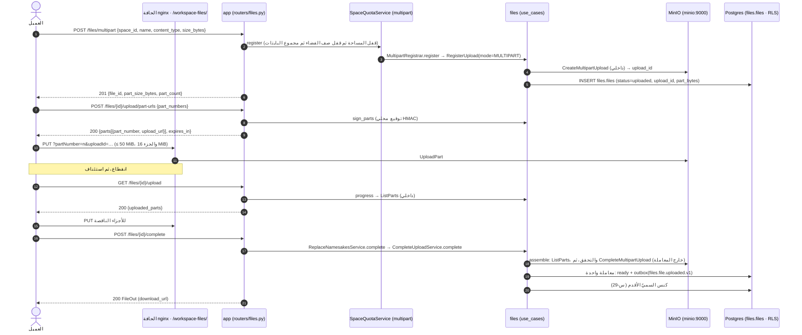

<div dir="rtl">

# التصميم التفصيلي (LLD) للزيادة INC‑0 «تمهيد المنصة»: WireTwin

| البند | القيمة |
|---|---|
| المعرّف | `electrical-drawings` · الزيادة `INC‑0` |
| نوع الوثيقة | تصميم تفصيلي: ملفات، وتواقيع، وDDL، ونص العقود، وخطة اختبار. **لا شيفرة تُكتب في هذه الدورة** |
| الإصدار | 0.2 (مُقَرّ للبناء) |
| التاريخ | 2026-10-30 (0.1 في 2026-10-29) |
| المدخل الملزم | [`hld.md`](hld.md) 0.16 (§5.2، §5.4، §5.6، §5.7، §12.3، §13.8، §16، §18.3، §18.4)، و[`requirements.md`](requirements.md) 0.15 |
| الوثائق الحاكمة | `CLAUDE.md`، و`docs/design/00…12`، و`docs/design/openapi.yaml`، و`docs/architecture.md`، و`.importlinter`، و`.github/workflows/ci.yml` |
| خط الأساس | `master` عند `8236e7b`. كل إحالة `path:line` في هذه الوثيقة إلى ذلك الالتزام |
| النطاق | `PLT‑01`، و`PLT‑13`، و`PLT‑16` (العقود 1..4 وهيكل الوحدة الفارغ)، و`PLT‑19` (SBOM وفحص التراخيص والثغرات دون مسّ نص الترخيص)، وما تستدعيه هذه البنود من `PLT‑23` |
| الحالة | مُقَرّ. حسم المالك القرارات السبعة (§7.1) في 2026-10-30: التوصية في الكل إلا `INC0‑Q‑2` (السقف 100 MiB لا 50 MiB). و`INC0‑Q‑4` سُجّل في SRS 0.16 قرار مالك (SRS D-32). الفرع `feat/electrical-drawings-inc-0` |

## 0. كيفية قراءة الوثيقة

**المعرّفات.** تستعمل SRS المعرّفات `AC-01..AC-10` للقيود المعمارية و`D-xx` لقرارات المالك، وتستعمل `docs/architecture.md` الصيغة `D‑xx` أيضاً. فتأخذ معرّفات هذه الوثيقة بادئة `INC0` لا تتصادم مع أيٍّ منها:

| الصيغة | المعنى | مثال |
|---|---|---|
| `INC0‑AC‑n` | معيار قبول لهذه الزيادة (§5.1) | `INC0‑AC‑7` |
| `INC0‑Q‑n` | قرار ⚠️ يحتاج المالك (§7.1) | `INC0‑Q‑4` |
| `INC0‑D‑n` | قرار تصميم داخل صلاحية المعماري (§7.2) | `INC0‑D‑3` |
| `INC0‑R‑n` | خطر (§7.3) | `INC0‑R‑2` |
| `INC0‑F‑n` | تعارض أو انحراف وُجد في HLD أو SRS أو الوثائق الحاكمة (§7.4) | `INC0‑F‑2` |
| `SRS AC-nn` · `SRS D-nn` | قيد معماري أو قرار مالك من SRS (شَرطة ASCII) | `SRS AC-07` · `SRS D-24` |
| `arch D‑nn` | قرار من `docs/architecture.md` §13 | `arch D‑17` |
| `PLT‑nn` · `DEC‑nn` · `INC‑n` · `RSK‑nn` | معرّفات HLD كما هي | `PLT‑01` |

**الوحدات.** «MiB» و«GiB» قوى العدد 2 (`1 GiB = 1,073,741,824` بايت). وتكتب الشيفرة القائمة «50 MB» وتقصد 50 MiB (`settings.py:992`). FR-ING-02 يطلب «1 GB على الأقل»، و1 GiB تفي به.

## 1. الملخص

INC‑0 زيادة منصة لا تضيف قدرة لـWireTwin، بل تجهّز ما تحتاجه الزيادات بعدها، في أربع طبقات من المعمارية:

- **وحدة `files` وطبقة الإطار (`PLT‑01`).** تُرفع الحدود العامة في `Limits` لكل أغراض الرفع (✅ DEC‑02 (ب)): الملف حتى 1 GiB، وحصة الفضاء 10 GiB (`INC0‑Q‑1`). ويُضاف رفع مجزأ قابل للاستئناف فوق رفع S3 متعدد الأجزاء: يسجّل العميل الرفع، ويطلب روابط موقّعة للأجزاء، ويرفعها مباشرة إلى MinIO، ويسأل عمّا وصل منها، ثم يُتمّ. ويجمّع الخادم الأجزاء ويتحقق منها عند الإتمام، ثم يمرّ في مسار الإتمام القائم نفسه (حدث `files.file.uploaded.v1` واستبدال السميّ بقاعدة س‑29). ويبقى الرفع بطلب PUT واحد كما هو حتى 50 MiB، لأن حدّ الحافة (`client_max_body_size 50m` وحدّ Cloudflare 100 MB) لا يتغيّر. ويأتي الرفع المجزأ بمنفذ إطار شقيق `MultipartStorage` يُحقن في `files` وحدها، ومحوّله `MinioStorage`.
- **وحدة `access` (`PLT‑13`).** أربع صلاحيات `electrical:*` على الأدوار القائمة، بلا دور جديد (✅ DEC‑11، SRS D-25).
- **حدود الاستيراد (`PLT‑16`).** هيكل فارغ للوحدة `app.modules.electrical` (22 ملف `__init__.py`)، والعقود 1..4 في `.importlinter`. فيصير عدد العقود **9** بعد INC‑0، ولا يبلغ 10 إلا في INC‑10.
- **CI (`PLT‑19`).** وظيفة جديدة `supply-chain` في `.github/workflows/ci.yml` تولّد SBOM بصيغة CycloneDX، وتفحص التراخيص بسياسة NFR-LIC-01، وتفحص الثغرات المعروفة، وذلك لاعتماديات وقت التشغيل التي تدخل صورة `app`. ولا يُمسّ نص الترخيص (✅ DEC‑10، SRS D-24)، ولا يدخل تقييم الجودة CI (✅ DEC‑09، SRS D-23).

**ما لا يدخل INC‑0:**
- schema `electrical` وسلسلة هجراتها (`PLT‑14`، في INC‑1).
- مجلد الوكيل والعقدان 5 و6 (INC‑10).
- القراءة المتدفقة من التخزين (`PLT‑03`، في INC‑1).
- وسوم الملف (`PLT‑26`).
- بصمة SHA-256 ومنع التكرار داخل المشروع من FR-ING-02 (STG‑01 في INC‑1، HLD §14.1).
- صورة `ele-parse` وخطوطها OFL-1.1 (INC‑1).
- تغيير `license` في `pyproject.toml`، وملف `LICENSE`، ومسار عرض الشيفرة.

### 1.1 النطاق ومصدره

| البند | SRS وHLD | ما يُبنى في INC‑0 | ما يبقى لغيرها |
|---|---|---|---|
| `PLT‑01` | FR-ING-02 (جانب المنصة)، ✅ DEC‑02 (ب)، صف التعارض 1 في §18.4 | رفع الحدود، وحدّ PUT الواحد، والرفع المجزأ، وتحقّق الأجزاء عند الإتمام، وسقف فهرسة `knowledge` (§1.2)، و`07` §4 و`02` §1.6 و`03` و`openapi.yaml` | بصمة SHA-256 ومنع التكرار في المشروع: STG‑01 (INC‑1) |
| `PLT‑13` | FR-ADM-01، ✅ DEC‑11، SRS D-25، HLD §12.3 | `electrical:read` و`:diagnose` و`:manage` و`:eval` في `Permission` و`RoleCatalog`، وصفوفها في `05` §1.3 | `electrical:review` في R2 مع FR-HIL-06 (`INC0‑D‑9`) |
| `PLT‑16` | SRS AC-07، NFR-MNT-02، ✅ DEC‑01 (ب)، HLD §5.6 (العقود 1..4) | الهيكل الفارغ، والعقود 1..4، واختبارات تثبت أنها تحرس فعلاً | العقدان 5 و6 في INC‑10 |
| `PLT‑19` | NFR-LIC-01، NFR-LIC-02، NFR-LIC-06 (البند 4)، NFR-LIC-07، NFR-SEC-04، ✅ DEC‑09، ✅ DEC‑10، ✅ DEC‑13 (SRS D-26) | وظيفة `supply-chain`: SBOM، وسياسة تراخيص، وفحص ثغرات | صور الإصدار وحزم نظام التشغيل وصورة التضمين (`INC0‑Q‑6`، مع `PLT‑17`) |
| `PLT‑23` | SRS AC-09 | ما تستدعيه البنود أعلاه في الوثائق الحاكمة (§8) | بقية `PLT‑23` في كل زيادة |

### 1.2 أثر الحدّ الأعلى على كل أغراض الرفع (DEC‑02)

يسري الحدّ الأعلى على كل ملف، لا على المخططات وحدها. وطلب HLD (§18.3، DEC‑02) أن يُراجَع في INC‑0 كل مستهلك للملفات: هل يقرأ متدفقاً، أو يرفض ما يفوق طاقته؟ هذا جرد كل من يقرأ بايتات ملف من التخزين اليوم (`grep "storage.get("` في `src/app`):

| المستهلك | الموضع | ما يفعله اليوم | الحكم في INC‑0 |
|---|---|---|---|
| عامل فهرسة `knowledge` | `workers/content_resolver.py:103-107` | يحمّل الملف كاملاً بـ`storage.get`، **بلا أي سقف**، في حاوية ذاكرتها 1–2 GiB (`deploy/sizes/small.env:50`، `large.env:50`) | **يُضاف سقف** `Limits.knowledge_max_index_bytes` = 100 MiB (✅ `INC0‑Q‑2`)، يُفحص على البيانات الوصفية قبل القراءة. الملف الأكبر تصير وثيقته `failed` برمز `knowledge.too_large`، وهو مسار الفشل الصريح نفسه الذي تسلكه `knowledge.parse_timeout` (`content_resolver.py:120-129`) (`INC0‑Q‑2`) |
| قراءة الوكلاء للملفات | `framework/agent_runtime/file_reading.py:117-121` | يرفض ما فوق `max_bytes` على البيانات الوصفية قبل القراءة؛ والوكيلان يمرّران 1 MB (`agents/data_analysis_agent/agent.py:26`، `file_editing_agent/agent.py:24`) | لا تغيير |
| عامل الوسائط | `workers/media_generation.py:134` | يسجّل الملف المولَّد بـ`RegisterUpload` ثم `storage.put` | يبقى بالوضع الأحادي، فسقفه 50 MiB كما كان |
| تثبيت ملف في محادثة، ومجاميع الفضاء | `conversations`، `SummariseSpaces` | بيانات وصفية فقط | لا تغيير |
| الحافة | `deploy/nginx/app-locations.conf:359` | `client_max_body_size 50m` على `/workspace-files/` | لا تغيير في القيمة. حدّ PUT الواحد يساويها، وحجم الجزء (16 MiB) دونها (`INC0‑Q‑3`) |
| WireTwin نفسه | — | لا شيفرة بعد | `PLT‑03` (قراءة متدفقة إلى حجم مؤقت) في INC‑1، قبل أول قراءة لملف مخطط |

## 2. الملفات

القاعدة: **لا يحرّر منفّذان الملف نفسه.** ولذلك تقع ملفات الاختبار والوثائق كل منها كاملاً عند منفّذ واحد، ويحدّد هذا الجدول ما يكتبه كلٌّ فيها. والإنشاء (إ) أو التعديل (ت).

### 2.1 `backend-developer`

| # | المسار | إ/ت | المسؤولية |
|---|---|---|---|
| B1 | `src/app/framework/settings/settings.py` | ت | `Limits` (§3.3.1): `max_upload_bytes` إلى 1 GiB، والحقول الجديدة `max_single_put_bytes` و`multipart_part_bytes` و`knowledge_max_index_bytes`، و`max_space_bytes` (`INC0‑Q‑1`)، ومُدقّق يرفض حجم جزء لا يُوقَّع |
| B2 | `src/app/framework/ports/storage_provider.py` | ت | `StoredPart` و`MultipartStorage` و`ObjectStorage` بجانب `StorageProvider` القائم (`:8-17`) دون تغييره (§3.3.3) |
| B3 | `src/app/framework/ports/__init__.py` | ت | تصدير الأسماء الثلاثة بجانب `StorageProvider` (`:22`) |
| B4 | `src/app/framework/di/storage_handle.py` | ت | تمرير الطرق الخمس الجديدة، و`bind(provider: ObjectStorage)` (`:48`)؛ والمقبض غير المربوط يجيب `common.internal` كما اليوم (`:55-58`) |
| B5 | `src/app/framework/di/space_quota.py` | ت | **الوثيقة فقط** (`:46-58`): القفل يمتد الآن على رحلة واحدة إلى MinIO حين يكون الرفع مجزأً (`INC0‑D‑5`). بلا تغيير في الشيفرة |
| B6 | `src/app/framework/di/composition_root.py` | ت | الربط (§3.3.4): `MultipartUploadService`، و`RegisterUpload(..., multipart=storage)`، و`CompleteUploadService(..., assembler=...)`، و`MultipartRegistrar` ونسخة ثانية من `SpaceQuotaService` في `_build_space_services` (`:1127-1180`)، وحقل `multipart_quota` في `CompositionRoot` (قرب `:1745`) |
| B7 | `src/app/infrastructure/storage/minio_storage.py` | ت | الطرق الخمس فوق minio-py (§3.3.5)، وترجمة `NoSuchUpload` وأخطاء الأجزاء في `_translate` (`:217-225`)، وتصحيح الوثيقة (`:20` «≤25 MB»، و`:195-203`) |
| B8 | `src/app/framework/errors.py` | ت | أربعة رموز في `ERROR_CATALOG` (§3.3.7) |
| B9 | `src/app/modules/files/domain/value_objects.py` | ت | `UploadMode`، و`MultipartUpload`، و`PartsCheck`، و`check_parts`، و`MIN_PART_BYTES`، و`MAX_PARTS` (§3.3.2) |
| B10 | `src/app/modules/files/domain/entities.py` | ت | الحقل `multipart: MultipartUpload \| None = None` آخر حقول `File` (`:34-67`)، والخاصية `is_multipart` |
| B11 | `src/app/modules/files/application/use_cases.py` | ت | `RegisterUpload` بوضع الرفع (`:58-185`)، و`RegisteredMultipartUpload`، و`MultipartRegistrar`، و`MultipartUploadService` ومعه `SignedPart` و`SignedParts` و`UploadedPart` و`UploadProgress`، ومُجمِّع اختياري في `CompleteUploadService` (`:461-501`)، والحقل `multipart` في `FileUseCases` (`:663-690`) |
| B12 | `src/app/api/v1/dto/files.py` | ت | ستة DTO جديدة (§3.3.6)، وتصحيح جملة «1 GiB» (`:28`) |
| B13 | `src/app/api/v1/routers/files.py` | ت | ثلاثة مسارات (§3.1)، ووثيقة الوحدة (`:1-42`)، ووثيقة `complete_file` (`:145-173`) بالتجميع |
| B14 | `src/app/api/v1/dependencies.py` | ت | `ApiServices.multipart_quota: SpaceQuotaService[RegisteredMultipartUpload] \| None = None`، يفشل مغلقاً كما `space_quota` (`:261`) |
| B15 | `src/app/api/main.py` | ت | تمرير `multipart_quota=root.multipart_quota` بجانب `space_quota` (`:738-740`) |
| B16 | `src/app/workers/content_resolver.py` | ت | سقف الفهرسة قبل `storage.get` (`:103-107`)، والمعامل `max_bytes` في المُنشئ (§3.3.4) |
| B17 | `src/app/workers/bootstrap.py` | ت | تمرير `max_bytes=settings.limits.knowledge_max_index_bytes` (`:1636-1642`) |
| B18 | `src/app/ops/mint_load_tokens.py` | ت | `SPACE_BYTE_CEILING` (`:148`) بقيمة `INC0‑Q‑1`؛ واختبار `test_ops_mint_load_tokens.py:532-535` يثبّت تطابقها مع `Limits` |
| B19 | `src/app/modules/access/domain/value_objects.py` | ت | `PLT‑13`: أربع قيم في `Permission` (`:26-62`)، وصفوفها في `RoleCatalog` (`:85-133`) (§3.3.8) |
| B20 | `.importlinter` | ت | العقود 1..4 بنصها في §3.3.9 |
| B21 | `src/app/modules/electrical/**/__init__.py` | إ (22 ملفاً) | الهيكل الفارغ (§3.3.10) |
| B22 | تعليقات «1 GiB» | ت (تعليقات فقط) | تصير «`Limits.max_space_bytes`» بلا رقم: `src/app/api/v1/dto/spaces.py:20,37`، و`src/app/modules/files/ports/repository.py:72`، و`src/app/modules/spaces/ports/repository.py:16`، و`src/app/workers/media_generation.py:142`، و`composition_root.py:1738`، و`routers/files.py:108`، و`main.py:733`، و`dependencies.py:257` |
| BT1 | `tests/unit/test_files_domain.py` | ت | `MultipartUpload` و`check_parts` |
| BT2 | `tests/unit/test_files_use_cases.py` | ت | وضعا التسجيل، و`MultipartUploadService`، والمُجمِّع في `CompleteUploadService` |
| BT3 | `tests/unit/support_files_media.py` | ت | `FileUseCases.multipart` (`:425`) و`FakeMultipartStorage` |
| BT4 | `tests/unit/test_api_files_media_router.py` | ت | المسارات الثلاثة والإتمام المجزأ عبر `file_replacement` |
| BT5 | `tests/unit/test_storage_handle.py` | ت | الطرق الخمس، مربوطة وغير مربوطة |
| BT6 | `tests/unit/test_minio_multipart_api.py` | إ | اختبار إنذار: أن minio-py المثبّتة تملك الطرق الخاصة التي يستعملها المحوّل بتواقيعها (`INC0‑D‑4`) |
| BT7 | `tests/unit/test_foundation.py` | ت | القيم الافتراضية (`:202` اليوم 50 MiB)، والمُدقّق، وتطابق ثابتَي S3 بين الإطار والنطاق |
| BT8 | `tests/unit/test_api_spaces_router.py` | ت | ملء الحصة (`:548-575`): يرفع اليوم ملفات بحجم `max_upload_bytes` بطلب واحد، فيصير الملء عبر `POST /files/multipart` |
| BT9 | `tests/unit/test_api_rbac.py` | ت | ثلاثة صفوف في `EXPECTED` (`:66-135`) |
| BT10 | `tests/unit/test_content_resolver.py` | ت | السقف |
| BT11 | `tests/unit/test_access_domain.py` | ت | صفوف المصفوفة الأربعة لكل دور |
| BT12 | `tests/architecture/test_import_contracts.py` | ت | «9 kept»، ومجموعة العقود، وتثبيت `ignore_imports`، والهيكل، والعدد في الوثائق، وإيجاد `lint-imports` بجانب المفسّر (`INC0‑D‑12`) |
| BT13 | `tests/architecture/test_electrical_contracts.py` | إ | خمسة براهين بأن العقود الجديدة تفشل حين تُخرق |
| BT14 | `tests/integration/test_minio_storage.py` | ت | حالات الرفع المجزأ الحيّة (`live_minio`) |
| BT15 | `tests/integration/test_files_multipart_live.py` | إ | المسار كاملاً مع الاستئناف (`live_db` + `live_minio`) |
| BD1 | `docs/design/openapi.yaml` | ت | ثلاث عمليات، وستة مخططات، ووصف `registerFile` و`completeFile`، وجملتا «1 GiB» (`:335`، `:1158`) |
| BD2 | `docs/design/02-port-contracts.md` | ت | §1.6 (`:127-136`): `MultipartStorage` و`ObjectStorage` |
| BD3 | `docs/design/03-api-spec.md` | ت | §1 صف Files (`:25`)، و§2 DTO (`:130-152`)، و§4 الرموز الأربعة، وتصحيح «(1 GiB)» (`:351`) |
| BD4 | `docs/design/05-rbac-config-secrets.md` | ت | §1.2 و§1.3 (الصفوف الأربعة وعمود `platform_admin`)، وملاحظة `electrical:review`، و§4 (المسارات الثلاثة) |
| BD5 | `docs/design/06-domain-models.md` | ت | §6 (`:121-141`): `MultipartUpload`، و`INV‑F5`، وحالات الاستعمال |
| BD6 | `docs/design/07-nfr-slo.md` | ت | §4 (`:36-42`): الحدود، وملاحظة أن `Limits` ثوابت لا متغيّرات بيئة (`INC0‑F‑11`) |
| BD7 | `docs/design/09-testing-strategy.md` | ت | §4 (العقد 8)، و§7 (الوظيفة `supply-chain`). الملف كله عند `backend-developer` بالنص الذي يحدّده §8 |
| BD8 | `docs/architecture.md` | ت | `:60`، و§06 (الوحدة 13)، و§08 (المنفذ)، و§09 (تسعة عقود)، وD‑11 وD‑17، و`:763`، والملخص (`:794`) |
| BD9 | `docs/architecture.html` | ت | المرآة: `:206`، و`:511`، و`:525`، و`:710`، و`:795`، وما يقابل §06 و§08 |

### 2.2 `data-engineer`

| # | المسار | إ/ت | المسؤولية |
|---|---|---|---|
| E1 | `migrations/versions/files/0005_file_multipart.py` | إ | العمودان والقيد (§4.1). يُطبَّق عبر `python -m app.ops.provision` وحده |
| E2 | `src/app/modules/files/adapters/sql_repository.py` | ت | عمودا `Table` (`:75-105`)، و`add` تكتبهما (`:134-159`)، و`_hydrate` تقرؤهما (`:450-467`)، و`save` لا تمسّهما (`:161-197`)، فهما ثابتان كـ`content_type` |
| E3 | `tests/integration/test_files_repository_rls.py` | ت | ذهاب وإياب العمودين، وثباتهما عند `save`، والعزل بين المستأجرين، والقيد (§5.2) |
| E4 | `docs/design/01-data-model.md` | ت | §2.6 (`:238-275`): العمودان والقيد |

### 2.3 `devops-engineer`

| # | المسار | إ/ت | المسؤولية |
|---|---|---|---|
| O1 | `.github/workflows/ci.yml` | ت | الوظيفة `supply-chain` (§3.3.11)، بجانب `quality` لا داخلها |
| O2 | `deploy/supply-chain/scan.sh` | إ (تنفيذي) | المدخل الوحيد: بيئة وقت التشغيل، وSBOM، والتراخيص، والثغرات. يشغّله CI والمطوّر بالأمر نفسه |
| O3 | `deploy/supply-chain/supply_chain_check.py` | إ | فاحص بالمكتبة القياسية وحدها: يطبّق السياسة على SBOM ونتيجة `pip-audit`، ويكتب التقرير |
| O4 | `deploy/supply-chain/license-policy.toml` | إ | القائمة المسموحة، وجدول المرادفات، وقرارات الحزم، واستثناءات الثغرات المؤرّخة |
| O5 | `deploy/supply-chain/requirements.txt` | إ | أداتا CI بإصدار ثابت `==` |
| O6 | `tests/unit/test_supply_chain_check.py` | إ | الفاحص والسياسة |
| O7 | `tests/unit/test_ci_supply_chain_job.py` | إ | شكل الوظيفة في `ci.yml` |
| O8 | `deploy/nginx/app-locations.conf` | ت (تعليقات فقط) | `:265-273` (رفع الأجزاء يمرّ الآن بروابط يوقّعها التطبيق، والإنشاء والإتمام داخليان)، و`:354-358` (الحدّ يساوي `max_single_put_bytes`). **القيم لا تتغيّر** |
| O9 | `deploy/nginx/nginx.conf` | ت (تعليق فقط) | `:143`: «`max_single_put_bytes`» بدل «`max_upload_bytes`» |
| O10 | `tests/unit/test_public_file_links_edge.py` | ت | الحارس (`:92-121`) يقارن الحافة بـ`max_single_put_bytes`، ويضيف: حجم الجزء دون حدّ الحافة |
| O11 | `tests/unit/test_public_file_links_containers.py` | ت | العُدّة الاختيارية (`RUN_EDGE_FILES_TEST=1`): رفع جزء موقّع عبر الحافة، وبقاء `POST` مرفوضاً (`:747-759`)، والثابت `_MAX_UPLOAD` (`:64`) |
| O12 | `docs/deploy-server.md` | ت | §5.2 (`:359-360`)، وصف `413` (`:417`)، وصف ث‑16 (`:454`). وتبقى عبارتا «50 م.ب» و«100 م.ب» في §5 (`test_public_file_links_docs.py:25-26`) |
| O13 | `docs/quickstart.md` | ت | `:294`: «9 عقود» |
| O14 | `docs/stack-commands.md` | ت | `:69` و`:366` (تسعة عقود)، وصف لـ`deploy/supply-chain/scan.sh` |
| O15 | `README.md` | ت | صف سابع في جدول «Quality gates» (`:67-74`) |
| O16 | `deploy/load/README.md` | ت | `:238`، و`:411`: «1 GiB» تصير حصة `Limits` |
| O17 | `deploy/load/lib/profile.js` | ت (تعليق فقط) | `:231` |

### 2.4 بشري

| المسار | السبب |
|---|---|
| `CLAUDE.md:24` | «(8 contracts)» تصير «(9 contracts)»، وقد يُضاف سطر للوظيفة `supply-chain`. لا يعدّله وكيل (`INC0‑Q‑7`) |

### 2.5 العدد

`backend-developer`: 46 صفاً (B1..B22، وBT1..BT15، وBD1..BD9). وهي 24 ملف مصدر أو إعداد يُعدَّل (B1..B20، وأربعة ملفات تعليقات في B22 لم ترد في غيره)، و22 ملفاً يُنشأ للهيكل (B21)، و15 ملف اختبار منها 3 جديدة، و9 وثائق. `data-engineer`: 4. `devops-engineer`: 17. بشري: 1. **لا `frontend-developer`**: لا واجهة في المستودع.

## 3. العقود

### 3.1 الواجهات البرمجية

كلها تحت `/api/v1`، بوسم `files`، وأخطاؤها RFC 9457 من `AppError` (`api/errors.py:96`). وكل مسار له حارس صلاحية واحد (`test_api_rbac.py:376`).

| الطريقة | المسار | الطلب | الاستجابة | الأخطاء | الصلاحية |
|---|---|---|---|---|---|
| POST | `/files` (`registerFile`، قائم) | `FileRegisterIn` كما هو | `201 FileRegisterOut` كما هو | **جديد:** `413 files.multipart_required` إن زاد `size_bytes` على `max_single_put_bytes` (50 MiB). ويبقى `413 files.too_large` لما فوق `max_upload_bytes` (1 GiB)، و`415 files.unsupported_type`، و`409 files.too_many`، و`409 spaces.quota_exceeded`، و`404 common.not_found` (الفضاء) | `files:write` |
| POST | `/files/multipart` (`registerMultipartFile`، جديد) | `FileRegisterIn` نفسه؛ وترويسة `Idempotency-Key` اختيارية | `201 FileMultipartRegisterOut {file_id, part_size_bytes, part_count}` | `413 files.too_large`، و`415 files.unsupported_type`، و`409 files.too_many`، و`409 spaces.quota_exceeded`، و`404 common.not_found`، و`422 common.validation_error` (`size_bytes` < 1 أو اسم غير صالح)، و`409` لمفتاح تكرار بجسم مختلف (`api/v1/idempotency.py`)، و`500 common.internal` (التخزين) | `files:write` |
| GET | `/files/{id}/upload` (`getFileUpload`، جديد) | — | `200 FileUploadOut {file_id, part_size_bytes, part_count, uploaded_parts[{part_number, size_bytes}]}` | `404 common.not_found` (مجهول، أو لمستأجر آخر، أو محذوف)، و`409 common.conflict` (سُجّل بطلب PUT واحد، أو اكتمل رفعه)، و`409 files.upload_expired` (كنس MinIO الرفع المهجور) | `files:write` (`INC0‑D‑7`) |
| POST | `/files/{id}/upload/part-urls` (`signFileUploadParts`، جديد) | `FilePartUrlsIn {part_numbers: [int]}`، من 1 إلى 100 رقم، كلٌّ في `1..part_count` بلا تكرار | `200 FilePartUrlsOut {parts[{part_number, upload_url}], expires_in}` | `404 common.not_found`، و`409 common.conflict`، و`422 common.validation_error` (رقم خارج المدى أو مكرر أو أكثر من 100) | `files:write` |
| POST | `/files/{id}/complete` (`completeFile`، قائم) | `FileCompleteIn` كما هو | `200 FileOut` كما هو | كما اليوم، و**جديد للملف المجزأ:** `409 files.upload_incomplete` (جزء ناقص أو بحجم غير متوقَّع؛ لا يتغيّر شيء، ويكمل العميل الأجزاء ثم يعيد)، و`409 files.upload_expired` | `files:write` |
| DELETE | `/files/{id}` (قائم) | — | `204` | بلا تغيير. وأجزاء رفع لم يكتمل تبقى حتى كنس MinIO (`INC0‑D‑8`) | `files:delete` |

**بروتوكول العميل** (يُكتب في `03-api-spec.md` §2 ووصف العمليات في `openapi.yaml`):
1. `POST /files/multipart`، فيعود `part_size_bytes` و`part_count`. الجزء `n` يبدأ عند البايت `(n-1)·part_size_bytes`، وكل جزء بحجم `part_size_bytes` إلا الأخير فهو الباقي.
2. `POST /files/{id}/upload/part-urls` لدفعة أرقام، ثم `PUT` كل جزء إلى رابطه **دون ترويسة `Authorization`**. الرابط صالح `expires_in` ثانية (`MINIO_PRESIGN_PUT_TTL_S`، 900 افتراضياً، `settings.py:211`)، فيُطلب قبيل الاستعمال لا كله دفعة واحدة.
3. بعد الانقطاع: `GET /files/{id}/upload`، ثم تُرفع الأجزاء غير المذكورة في `uploaded_parts` أو المذكورة بحجم خاطئ.
4. `POST /files/{id}/complete`. ويعيد العميل المحاولة بأمان: الإتمام المتكرر بعد تجميع نجح لا يُجمّع مرتين (§3.3.4).
5. مدة الاستئناف هي مدة MinIO في كنس الرفع المهجور: 24 ساعة افتراضياً (`MINIO_API_STALE_UPLOADS_EXPIRY`، بفاصل كنس 6 ساعات). يتحقق المنفّذ من القيمة على الصورة المثبّتة (`pgsty/minio:RELEASE.2026-08-04T00-00-00Z`، `docker-compose.yml:1109`) داخل العُدّة المعزولة، لا على المكدّس الحيّ.

### 3.2 تدفق الرفع المجزأ



*الشكل 1. الإنشاء والسرد والإتمام بين `app` وMinIO على شبكة Compose الداخلية. ولا يمرّ عبر الحافة إلا `PUT` الجزء بتوقيع التطبيق.*

### 3.3 التواقيع

#### 3.3.1 الإعداد `Limits`

```python
# src/app/framework/settings/settings.py -- additions/changes only
# S3 protocol limits, restated here because the framework may not import
# `app.modules` (contract framework-kernel); BT7 pins them equal to the
# `files.domain` constants of the same name.
_S3_MIN_PART_BYTES: Final = 5_242_880  # every part but the last is >= 5 MiB
_S3_MAX_PARTS: Final = 10_000


class Limits(BaseModel):
    model_config = _FROZEN

    max_upload_bytes: int = 1_073_741_824  # 1 GiB -- FR-ING-02, DEC-02 (b); was 50 MiB
    # A presigned PUT carries no size of its own, so the edge's body limit is
    # what bounds its bytes (`client_max_body_size 50m`, under Cloudflare's
    # 100 MB). Above it an upload is multipart: `files.multipart_required`.
    max_single_put_bytes: int = 52_428_800  # 50 MiB
    multipart_part_bytes: int = 16_777_216  # 16 MiB -> 64 parts for 1 GiB
    max_space_bytes: int = 10_737_418_240  # 10 GiB -- INC0-Q-1
    # What the knowledge worker may load whole (`storage.get`), checked before
    # it reads a byte. Above it the document fails as `knowledge.too_large`.
    knowledge_max_index_bytes: int = 104_857_600  # 100 MiB -- INC0-Q-2 (owner)

    @model_validator(mode="after")
    def _multipart_is_signable(self) -> Self:
        """Fail at boot rather than at the first upload: a part below S3's
        minimum, above the single-request ceiling, or a ceiling that needs more
        than 10,000 parts cannot be completed."""
        ...
```

المُدقّق يفحص `_S3_MIN_PART_BYTES <= multipart_part_bytes <= max_single_put_bytes`، و`ceil(max_upload_bytes / multipart_part_bytes) <= _S3_MAX_PARTS`. ولا يربط `max_single_put_bytes` بـ`max_upload_bytes` ولا الحصة بحجم الملف، لأن اختبارات قائمة تبني `Limits(max_upload_bytes=4)` و`Limits(max_upload_bytes=50, max_space_bytes=100)` (`test_media_generation.py:298`، `test_space_quota.py:271`). والقيم ثوابت في الشيفرة كما اليوم، فلا اسم جديد في `.env.example` ولا سرّ جديد.

#### 3.3.2 النطاق `files.domain` (المكتبة القياسية وحدها)

```python
# src/app/modules/files/domain/value_objects.py -- additions
MIN_PART_BYTES: Final = 5_242_880
MAX_PARTS: Final = 10_000


class UploadMode(StrEnum):
    """How the bytes of a registered file arrive (FR-ING-02)."""

    SINGLE = "single"  # one presigned PUT, <= Limits.max_single_put_bytes
    MULTIPART = "multipart"  # presigned UploadPart URLs, assembled at completion


@dataclass(frozen=True, slots=True)
class MultipartUpload:
    """The storage-side multipart session of one file. Fixed at registration
    and never re-pointed (INV-F5), like every field that describes the bytes."""

    upload_id: str  # non-empty, <= 1024 chars
    part_bytes: int  # >= MIN_PART_BYTES

    def __post_init__(self) -> None: ...  # raises InvalidFileInput

    def part_count(self, size_bytes: int) -> int:
        """max(1, ceil(size_bytes / part_bytes))."""
        ...

    def expected_size(self, part_number: int, size_bytes: int) -> int:
        """part_bytes for every part but the last; the remainder for the last."""
        ...


@dataclass(frozen=True, slots=True)
class PartsCheck:
    missing: tuple[int, ...]  # sorted part numbers storage does not hold
    wrong_size: tuple[int, ...]  # sorted part numbers of an unexpected size

    @property
    def complete(self) -> bool: ...


def check_parts(
    upload: MultipartUpload, size_bytes: int, uploaded: Mapping[int, int]
) -> PartsCheck:
    """Compare what storage holds ({part_number: size}) with what the declared
    size requires. Parts numbered above part_count are ignored: no URL is ever
    signed for one, and S3 drops unlisted parts at completion."""
    ...
```

```python
# src/app/modules/files/domain/entities.py -- File gains one field, LAST
    version: int
    # FR-ING-02 / PLT-01 -- the multipart session; None for a single-PUT file.
    # Defaulted, unlike `space_id`: every existing construction site means
    # "single PUT", and the default is exactly that statement.
    multipart: MultipartUpload | None = None

    @property
    def is_multipart(self) -> bool: ...
```

**INV‑F5 (جديد في `06` §6).** الملف المجزأ يملك `MultipartUpload` واحداً منذ تسجيله. ولا يصير `ready` إلا بعد أن يجمّع التخزين أجزاءه `1..part_count` بالأحجام المتوقعة، فيساوي الكائن المخزَّن `size_bytes` المعلَن بالضبط.

#### 3.3.3 منفذ الإطار `MultipartStorage`

```python
# src/app/framework/ports/storage_provider.py -- additions; StorageProvider unchanged
@dataclass(frozen=True, slots=True)
class StoredPart:
    """One part storage holds for an in-flight multipart upload."""

    part_number: int
    size_bytes: int
    etag: str


class MultipartStorage(Protocol):
    """Resumable-upload faces of object storage (02 §1.6, PLT-01). Bound into
    `files` ONLY: agents keep `StorageProvider`, which cannot open one."""

    async def start_multipart(self, key: str, content_type: str) -> str:
        """CreateMultipartUpload; returns the storage upload id."""
        ...

    async def presign_upload_part(
        self, key: str, upload_id: str, part_number: int, ttl_s: int
    ) -> str:
        """A presigned UploadPart PUT, signed for the PUBLIC address (7.1)."""
        ...

    async def list_parts(self, key: str, upload_id: str) -> Sequence[StoredPart]:
        """Every part held, all pages. NotFoundError once the upload is gone."""
        ...

    async def complete_multipart(
        self, key: str, upload_id: str, parts: Sequence[StoredPart]
    ) -> None:
        """CompleteMultipartUpload. NotFoundError if the upload is gone;
        ConflictError if storage rejects the parts (InvalidPart, order, size)."""
        ...

    async def object_size(self, key: str) -> int | None:
        """HEAD; None when there is no object under `key`."""
        ...


class ObjectStorage(StorageProvider, MultipartStorage, Protocol):
    """Both faces -- what `MinioStorage` and `StorageHandle` are."""
```

عقد الأخطاء كعقد `StorageProvider` (`minio_storage.py:22-29`): `NotFoundError` حالة يتفرّع عليها المستدعي، وما سواها `common.internal`، ولا يخرج نوع من minio أو urllib3.

#### 3.3.4 التطبيق `files.application`

```python
# src/app/modules/files/application/use_cases.py -- signatures
class RegisterUpload:
    def __init__(
        self,
        files: FileRepository,
        limits: Limits,
        spaces: ActiveSpaces,
        multipart: MultipartStorage | None = None,
    ) -> None: ...

    async def execute(
        self,
        ctx: ExecutionContext,
        *,
        space_id: Uuid | None,
        name: str,
        content_type: str,
        size_bytes: int,
        mode: UploadMode = UploadMode.SINGLE,
    ) -> File: ...


@dataclass(frozen=True, slots=True)
class RegisteredMultipartUpload:
    file: File
    part_bytes: int
    part_count: int


class MultipartRegistrar:
    """`UploadRegistrar[RegisteredMultipartUpload]` (framework/di/space_quota.py:93)
    -- the multipart twin of `FileTransferService.register`."""

    def __init__(self, register: RegisterUpload) -> None: ...

    async def register(
        self,
        ctx: ExecutionContext,
        *,
        space_id: Uuid,
        name: str,
        content_type: str,
        size_bytes: int,
    ) -> RegisteredMultipartUpload: ...


@dataclass(frozen=True, slots=True)
class SignedPart:
    part_number: int
    upload_url: str


@dataclass(frozen=True, slots=True)
class SignedParts:
    parts: tuple[SignedPart, ...]
    expires_in: int


@dataclass(frozen=True, slots=True)
class UploadedPart:
    part_number: int
    size_bytes: int


@dataclass(frozen=True, slots=True)
class UploadProgress:
    file_id: Uuid
    part_bytes: int
    part_count: int
    uploaded: tuple[UploadedPart, ...]


class MultipartUploadService:
    def __init__(
        self, files: FileRepository, storage: MultipartStorage, *, put_ttl_s: int
    ) -> None: ...

    async def sign_parts(
        self, ctx: ExecutionContext, file_id: Uuid, part_numbers: Sequence[int]
    ) -> SignedParts: ...

    async def progress(self, ctx: ExecutionContext, file_id: Uuid) -> UploadProgress: ...

    async def assemble(self, ctx: ExecutionContext, file_id: Uuid) -> None: ...


class CompleteUploadService:
    def __init__(
        self,
        complete_upload: CompleteUpload,
        outbox: EventOutbox,
        uow: UnitOfWork,
        *,
        assembler: MultipartUploadService | None = None,
    ) -> None: ...


@dataclass(frozen=True, slots=True)
class FileUseCases:
    ...  # the six existing fields, unchanged
    multipart: MultipartUploadService
```

```python
# src/app/workers/content_resolver.py
class WorkerDocumentContentResolver:
    def __init__(
        self,
        files: FileRepository,
        storage: StorageProvider,
        extractor: ContentExtractor,
        providers: ProviderResolver,
        *,
        timeout_s: float = Limits().parser_timeout_seconds,
        max_bytes: int = Limits().knowledge_max_index_bytes,
    ) -> None: ...
```

**`RegisterUpload.execute`.** ترتيب الفحوص القائم كما هو (`use_cases.py:140-164`)، وتُضاف ثلاثة أشياء:
- بعد فحص `files.too_large` مباشرة: الوضع `SINGLE` مع `size_bytes > max_single_put_bytes` يرفع `TooLargeError(code="files.multipart_required")`. والوضع `MULTIPART` مع `size_bytes < 1` يرفع `ValidationError`.
- بعد فحص الفضاء والعدد: الوضع `MULTIPART` يستدعي `start_multipart(key, content_type)` ثم يبني `File` ومعه `MultipartUpload(upload_id, limits.multipart_part_bytes)`. وإن غاب `multipart` في المُنشئ رفع `AppError(code="common.internal")`، فيفشل مغلقاً كما يفشل `storage_handle.py:55-58`.
- يجري ذلك داخل وحدة عمل `SpaceQuotaService` وتحت قفليها (`space_quota.py:146-188`)، فتطول نافذة القفل رحلةً واحدة إلى MinIO (`INC0‑D‑5`). وإن فشل الإدراج بعد الإنشاء بقي رفع يتيم في MinIO يكنسه بعد مدته.

**`MultipartUploadService`.** الطرق الثلاث تبدأ بالحارس نفسه:
- الملف مجهول، أو لمستأجر آخر، أو محذوف: `NotFoundError`.
- `multipart is None`: `ConflictError` («سُجّل الملف بطلب PUT واحد»).
- الحالة غير `uploaded`: `ConflictError` («اكتمل رفع الملف»).

ثم:
- `sign_parts`: يرفض الأرقام المكررة أو الخارجة عن `1..part_count` بـ`ValidationError`، ويوقّع الباقي بـ`presign_upload_part` (عمل HMAC محلي، كـ`presign_put` في `minio_storage.py:194-214`).
- `progress`: يسرد الأجزاء، ويحوّل `NotFoundError` إلى `ConflictError(code="files.upload_expired")`.
- `assemble`، **خارج أي معاملة** (قاعدة R2 في `space_deletion.py`: لا I/O شبكي تحت معاملة مفتوحة):
  1. يعود فوراً إن كان الملف بطلب PUT واحد أو ليس `uploaded`، ويترك الحكم لـ`CompleteUpload`.
  2. يسرد الأجزاء. فإن كان الرفع قد زال: يسأل `object_size(key)`، فإن ساوى `size_bytes` عُدّ التجميع منجزاً من محاولة سابقة (إعادة آمنة)، وإلا رفع `files.upload_expired`.
  3. يطبّق `check_parts`، فإن نقص شيء رفع `ConflictError(code="files.upload_incomplete")`، والتفصيل يذكر عدد الناقص وأول أرقامه.
  4. يستدعي `complete_multipart` بالأجزاء `1..part_count` مرتّبة. فإن ردّ `NotFoundError` (إتمامان متزامنان) طبّق الحكم في الخطوة 2 نفسها.

**`CompleteUploadService.complete`.** يستدعي `assembler.assemble(ctx, file_id)` **قبل** `uow.begin(ctx)`، ثم يجري ما يجريه اليوم (`use_cases.py:490-501`). فلا يتغيّر `ReplaceNamesakesService` ولا مسار `POST /files/{id}/complete`: يجمّع الإتمام ثم يكنس السميّ (`file_replacement.py:176-179`). وكلفة الملف الأحادي قراءة واحدة بالمفتاح الأساسي قبل المعاملة.

**الربط في `composition_root.py` (`_build_file_services`، `:1095-1124`):**

```python
multipart = MultipartUploadService(
    files, storage, put_ttl_s=settings.minio.presign_put_ttl_s
)
complete = CompleteUploadService(
    CompleteUpload(files), outbox, tenant_session, assembler=multipart
)
register = RegisterUpload(files, settings.limits, spaces, multipart=storage)
bundle = FileUseCases(
    transfers=FileTransferService(register, files, storage, ...),
    ...,
    multipart=multipart,
)
# _build_space_services: a second quota over the SAME registrar instance
multipart_quota = SpaceQuotaService(
    MultipartRegistrar(register), spaces, files, tenant_session, limits,
    AdvisoryQuotaLock(tenant_session),
)
```

`storage` هنا هو `StorageHandle` نفسه (`:1066`)، وهو يحقق `ObjectStorage` بعد B4. ولا تتغيّر `space_quota.py` ولا `file_replacement.py` في الشيفرة.

#### 3.3.5 المحوّل `MinioStorage`

`MinioStorage` يحقق `ObjectStorage` بنيوياً، وتوقيعات الطرق كما في §3.3.3. ومسار البيانات على `self._client` ومسار التوقيع على `self._signing_client` (`minio_storage.py:133-145`):

| الطريقة | minio-py 7.2.20 | ملاحظة |
|---|---|---|
| `start_multipart` | `client._create_multipart_upload(bucket, key, {"Content-Type": ct})` (`minio/api.py:1761`) | خاصة |
| `presign_upload_part` | `signing_client.get_presigned_url("PUT", bucket, key, expires=timedelta(seconds=ttl), extra_query_params={"uploadId": id, "partNumber": str(n)})` (`api.py:2431`) | عامة |
| `list_parts` | `client._list_parts(bucket, key, id, max_parts=1000, part_number_marker=…)` حتى `is_truncated` خاطئ (`api.py:3402`، و`ListPartsResult` في `datatypes.py:291-305`) | خاصة |
| `complete_multipart` | `client._complete_multipart_upload(bucket, key, id, [Part(n, etag)])` (`api.py:1730`، `datatypes.py:266`) | خاصة |
| `object_size` | `client.stat_object(bucket, key).size`، و`NoSuchKey` تصير `None` | عامة |

كل نداء عبر `asyncio.to_thread` كبقية المحوّل (`:16-20`). وفي `_translate` يُضاف: `NoSuchUpload` تصير `NotFoundError`، و`InvalidPart` و`InvalidPartOrder` و`EntityTooSmall` تصير `ConflictError` (`common.conflict`). وتُبنى القيم المرتجعة بأنواع صريحة (`int(...)` و`str(...)`)، لأن minio خارج فحص mypy (`pyproject.toml:227`) و`warn_return_any` مفعّل في الوضع الصارم.

#### 3.3.6 DTO والمسارات

```python
# src/app/api/v1/dto/files.py -- additions (FileRegisterIn reused by /files/multipart)
class FileMultipartRegisterOut(BaseModel):
    file_id: str
    part_size_bytes: int
    part_count: int


class FilePartUrlsIn(BaseModel):
    part_numbers: list[Annotated[int, Field(ge=1, le=10_000)]] = Field(
        min_length=1, max_length=100
    )


class FilePartUrlOut(BaseModel):
    part_number: int
    upload_url: str


class FilePartUrlsOut(BaseModel):
    parts: list[FilePartUrlOut]
    expires_in: int


class FileUploadedPartOut(BaseModel):
    part_number: int
    size_bytes: int


class FileUploadOut(BaseModel):
    file_id: str
    part_size_bytes: int
    part_count: int
    uploaded_parts: list[FileUploadedPartOut]
```

```python
# src/app/api/v1/routers/files.py -- additions
@router.post(
    "/multipart", status_code=201, dependencies=[Depends(require(Permission.FILES_WRITE))]
)
async def register_multipart_file(
    body: FileRegisterIn,
    services: Services,
    ctx: Context,
    idempotency_key: IdempotencyKey = None,
) -> FileMultipartRegisterOut: ...  # services.multipart_quota; None -> common.internal
                                    # idempotent(..., endpoint="POST /files/multipart")


@router.get("/{file_id}/upload", dependencies=[Depends(require(Permission.FILES_WRITE))])
async def get_file_upload(file_id: str, services: Services, ctx: Context) -> FileUploadOut: ...


@router.post(
    "/{file_id}/upload/part-urls", dependencies=[Depends(require(Permission.FILES_WRITE))]
)
async def sign_file_upload_parts(
    file_id: str, body: FilePartUrlsIn, services: Services, ctx: Context
) -> FilePartUrlsOut: ...
```

```yaml
# docs/design/openapi.yaml -- paths (compact style of the file)
  /files/multipart:
    post:
      tags: [files]
      operationId: registerMultipartFile
      parameters: [ { $ref: "#/components/parameters/IdempotencyKey" } ]
      requestBody: { required: true, content: { application/json: { schema: { $ref: "#/components/schemas/FileRegisterIn" } } } }
      responses:
        "201": { description: Created, content: { application/json: { schema: { $ref: "#/components/schemas/FileMultipartRegisterOut" } } } }
        default: { $ref: "#/components/responses/Problem" }
  /files/{id}/upload:
    get:
      tags: [files]
      operationId: getFileUpload
      parameters: [ { $ref: "#/components/parameters/Id" } ]
      responses:
        "200": { description: OK, content: { application/json: { schema: { $ref: "#/components/schemas/FileUploadOut" } } } }
        default: { $ref: "#/components/responses/Problem" }
  /files/{id}/upload/part-urls:
    post:
      tags: [files]
      operationId: signFileUploadParts
      parameters: [ { $ref: "#/components/parameters/Id" } ]
      requestBody: { required: true, content: { application/json: { schema: { $ref: "#/components/schemas/FilePartUrlsIn" } } } }
      responses:
        "200": { description: OK, content: { application/json: { schema: { $ref: "#/components/schemas/FilePartUrlsOut" } } } }
        default: { $ref: "#/components/responses/Problem" }
```

وتُضاف المخططات الستة إلى `components.schemas` بأسماء الـDTO، وكل خصائصها snake_case، ولا تعيد أي عملية مصفوفة مجرّدة (`test_api_conventions.py:304`، `:404`). ويتّسع وصف `registerFile` بحدّ 50 MiB وبالإحالة إلى `registerMultipartFile`، ووصف `completeFile` بالتجميع ورمزيه.

#### 3.3.7 رموز الأخطاء

| الرمز | الحالة | العنوان (`title`) | موضع الإصدار |
|---|---|---|---|
| `files.multipart_required` | 413 | `File needs a multipart upload` | `RegisterUpload.execute`، الوضع `SINGLE` |
| `files.upload_incomplete` | 409 | `Multipart upload is incomplete` | `MultipartUploadService.assemble` |
| `files.upload_expired` | 409 | `Multipart upload no longer exists` | `MultipartUploadService.progress` و`assemble` |
| `knowledge.too_large` | 422 | `Document exceeds the indexing size limit` | `WorkerDocumentContentResolver.resolve` |

يحرسها `tests/unit/test_error_catalog.py` في الاتجاهين: كل رمز في الكتالوج له موضع إصدار، وكل `code=` في المصدر له صفّ. وتُضاف إلى `03-api-spec.md` §4.

#### 3.3.8 الصلاحيات (`PLT‑13`)

```python
# src/app/modules/access/domain/value_objects.py -- additions
class Permission(StrEnum):
    ...
    # WireTwin (SRS D-25, DEC-11): on the EXISTING roles, no new RoleName.
    # `electrical:review` (FR-HIL-06, R2) is deliberately absent until R2.
    ELECTRICAL_READ = "electrical:read"
    ELECTRICAL_DIAGNOSE = "electrical:diagnose"
    ELECTRICAL_MANAGE = "electrical:manage"
    ELECTRICAL_EVAL = "electrical:eval"
```

| الصلاحية | owner | admin | member | viewer | platform_admin |
|---|:--:|:--:|:--:|:--:|:--:|
| `electrical:read` | ✓ | ✓ | ✓ | ✓ | — |
| `electrical:diagnose` | ✓ | ✓ | ✓ | — | — |
| `electrical:manage` | ✓ | ✓ | — | — | — |
| `electrical:eval` | ✓ | ✓ | — | — | — |

- **owner وadmin** يأخذانها تلقائياً من `_ALL_TENANT_PERMISSIONS` (`value_objects.py:66`، `:86-89`).
- **member** يُضاف إليه `READ` و`DIAGNOSE` (`:90-108`)، و**viewer** يُضاف إليه `READ` (`:109-122`).
- **platform_admin** لا شيء: الدعم عابر للمستأجرين ولا يرى محتواهم (`:123-132`، `05` §1.3). وهذا العمود غائب في HLD §12.3 (`INC0‑F‑4`).
- لا جدول ولا هجرة: الكتالوج ثابت في الشيفرة، والقاعدة لا تخزّن إلا إسناد الأدوار.
- يتّسع ما يعيده `GET /me` (`routers/me.py:32-41`) بالسلاسل الجديدة، ومخططه لا يعدّد الصلاحيات (`openapi.yaml:838`).
- لماذا في INC‑0 وما الذي أُجّل: `INC0‑D‑9`.

#### 3.3.9 نص `.importlinter` (`PLT‑16`)

العقود الثمانية اليوم (`lint-imports`: «Contracts: 8 kept, 0 broken.»): `layers`، و`domain-purity`، و`application-boundaries`، و`modules-independent`، و`agents-independent`، و`agents-no-api-no-infra`، و`infra-only-via-composition-root`، و`framework-kernel`. والتغيير ثلاث إضافات إلى عقود قائمة وعقد واحد جديد، ولا `ignore_imports` في أيٍّ منها:

```ini
# (2) domain-purity -- .importlinter:35-54; source_modules becomes:
source_modules =
    app.modules.*.domain
    app.modules.electrical.*.domain
    app.modules.electrical.shared
# WireTwin (HLD §5.6 contract 2): `*` matches ONE name component in
# import-linter 2.13 (ModuleExpression), so `app.modules.*.domain` never
# reaches `app.modules.electrical.drawings.domain`. The two sources above
# WIDEN what this contract forbids; nothing is ignored.

# (3) application-boundaries -- .importlinter:60-72; source_modules becomes:
source_modules =
    app.modules.*.application
    app.modules.electrical.*.application
# WireTwin (HLD §5.6 contract 3): the same one-component `*`, the same remedy.

# (4) modules-independent -- .importlinter:84-95; one entry appended:
    app.modules.spaces
    app.modules.electrical
# WireTwin (HLD §5.6 contract 1, INC-0): ONE entry for the whole module, as the
# header above requires of every new package. Its four sections are kept
# apart by `electrical-contexts` below, not here.

# ---------------------------------------------------------------------------
# 8) WireTwin's sections (HLD §5.6 contract 4, DEC-01 (b)). Four independent
#    sections over one pure floor: no section imports another, directly or
#    through a chain; `shared` imports no section; any section may import
#    `shared`. `exhaustive` fails the contract the day a fifth child appears
#    under the container without being declared here.
# ---------------------------------------------------------------------------
[importlinter:contract:electrical-contexts]
name = WireTwin sections are independent and shared is the floor
type = layers
containers =
    app.modules.electrical
layers =
    drawings | circuits | search | diagnostics
    shared
exhaustive = true
```

تُوضع التعليقات بعد القيم كما في `:96-102`. ويُسقط configparser سطر التعليق داخل القيمة متعددة الأسطر أيضاً (جُرّب)، لكن الأسلوب القائم أوضح.

**ما تحقّق منه هذا التصميم في import-linter 2.13 المثبّتة:**
- `*` تطابق مكوّناً واحداً (`importlinter/domain/imports.py:85-97`).
- الفاصل `|` يجعل أشقاء الطبقة مستقلين (`contracts/layers.py:20`، `:61-62`).
- `exhaustive` يشترط `containers` (`layers.py:134-140`)، ويعدّ كل ابن مباشر للحاوية (`:248-264`).
- طبقة غائبة في الحاوية ترفع «Missing layer in container» (`:236-246`)، ومصدر صريح غائب في `forbidden` يرفع «Module … does not exist» (`forbidden.py:213-218`)، وكذلك `independence` (`independence.py:91-94`). أما المصدر بنجمة فلا يطابق شيئاً بصمت (`domain/helpers.py:106-109`)، ولذلك يثبت BT12 أن الهيكل يجعل النجمتين تطابقان أربعة أقسام فعلاً.

**العدّ:** 8 اليوم، و**9** بعد INC‑0 (`electrical-contexts` وحده عقد جديد، والثلاثة الأخرى إضافات)، و10 بعد INC‑10 (`wiretwin-agent-via-ports`؛ والعقد 5 إضافة إلى `agents-independent`). وعبارة «8 ← 10» في HLD لا تصحّ على INC‑0 (`INC0‑F‑2`).

#### 3.3.10 هيكل الوحدة `electrical`

22 ملفاً، في كلٍّ منها سطر توثيق واحد بأسلوب `modules/admin/__init__.py`، ولا استيراد:

```
src/app/modules/electrical/__init__.py            """WireTwin -- the electrical module (HLD §5.2). Empty since INC-0."""
src/app/modules/electrical/shared/__init__.py     """CMP-06: pure shared kernel (stdlib only, no I/O)."""
src/app/modules/electrical/<section>/__init__.py  × 4  (drawings · circuits · search · diagnostics)
src/app/modules/electrical/<section>/{domain,application,ports,adapters}/__init__.py  × 16
```

**القواعد:**
- `electrical/__init__.py` لا يستورد شيئاً ولا يعيد تصدير شيء. فالحاوية ليست طبقة في العقد 8، وما يُستورد منها لا يفحصه العقد.
- لا ملف غير الحزم الخمس مباشرة تحت `electrical/`، وإلا فشل `exhaustive`.
- لا مجلد وكيل، لأن `PluginLoader` يمسح `app/agents/*` (HLD §5.6).
- لا جدول ولا سلسلة هجرات ولا ربط في جذر التركيب حتى INC‑1.

#### 3.3.11 سلسلة التوريد (`PLT‑19`)

**ما يُفحص: اعتماديات وقت التشغيل التي تعمل داخل المنصة (NFR-LIC-07)، لا أدوات التطوير.** فتُبنى بيئة كما يبنيها `Dockerfile`: `pip install '.[parsers]'` ثم إزالة `aizzak-platform` (`Dockerfile:42-44`). أما `[dev]` (ruff وmypy وpytest وimport-linter) فلا تدخل الصورة ولا تُفحص. ونطاق الصور الأخرى قرار `INC0‑Q‑6`.

```yaml
# .github/workflows/ci.yml -- a fourth top-level job; `quality` and
# `integration` untouched (release.yml mirrors `quality` step for step and
# `tests/unit/test_release_workflow.py:120-121` pins that, so this is NOT a
# step inside `quality`).
  # PLT-19 (INC-0) -- NFR-LIC-02 · NFR-LIC-07 · NFR-SEC-04, DEC-09: SBOM,
  # licence policy and known vulnerabilities of the RUNTIME closure the image
  # installs. Quality evaluation stays OUT of CI (SRS D-23).
  supply-chain:
    runs-on: ubuntu-latest
    timeout-minutes: 15
    permissions:
      contents: read
    steps:
      - uses: actions/checkout@v4

      - uses: actions/setup-python@v5
        with:
          python-version: "3.12"
          cache: pip

      - name: SBOM, licence policy and known vulnerabilities (runtime closure)
        run: deploy/supply-chain/scan.sh

      - name: Report
        if: always()
        run: cat build/supply-chain/report.md >> "$GITHUB_STEP_SUMMARY"

      - name: Upload the SBOM and the reports
        if: always()
        uses: actions/upload-artifact@v4
        with:
          name: supply-chain-${{ github.sha }}
          path: |
            build/supply-chain/sbom.cdx.json
            build/supply-chain/audit.json
            build/supply-chain/runtime-freeze.txt
            build/supply-chain/report.md
          retention-days: 90
```

`deploy/supply-chain/scan.sh` (`set -euo pipefail`، على سابقة `deploy/prometheus/test-rules.sh`). يكتب في `build/supply-chain/`، وهو مُتجاهَل (`.gitignore:31`):
1. ينشئ بيئة `runtime` ويثبّت فيها `'.[parsers]'` ثم يزيل `aizzak-platform`، كما يفعل `Dockerfile`، ثم `pip freeze --all > runtime-freeze.txt`.
2. ينشئ بيئة `tools` من `deploy/supply-chain/requirements.txt`: `cyclonedx-bom==7.6.0` و`pip-audit==2.10.1`، وكلاهما Apache-2.0. وهما أداتا CI لا تعملان داخل المنصة، فلا تدخلان قائمة SRS D-26.
3. يولّد SBOM: `cyclonedx-py environment runtime/bin/python --pyproject pyproject.toml --mc-type application --sv 1.6 --of JSON --output-reproducible -o sbom.cdx.json`.
4. يفحص الثغرات: `pip-audit -r runtime-freeze.txt --no-deps --disable-pip --strict --progress-spinner off -f json -o audit.json`، ويحفظ رمز خروجه ولا يتوقف عنده.
5. يشغّل `python3 deploy/supply-chain/supply_chain_check.py --sbom … --audit … --freeze … --policy deploy/supply-chain/license-policy.toml --report report.md`. ورمز خروج هذه الخطوة هو رمز خروج الوظيفة: 0 نجاح، و1 مخالفة، و2 مدخل ناقص.

```python
# deploy/supply-chain/supply_chain_check.py -- stdlib only (tomllib, json), Python >= 3.11
@dataclass(frozen=True)
class Policy:
    allowed: frozenset[str]  # NFR-LIC-01 SPDX ids (SRS D-01, D-26)
    approved: frozenset[str]  # extra ids the owner approved (INC0-Q-4)
    exceptions: frozenset[str]  # SPDX `WITH` exceptions; empty
    agpl: frozenset[str]  # flagged, not refused (NFR-LIC-06 item 4)
    font_licences: frozenset[str]  # {"OFL-1.1"} -- font FILES only (SRS D-26)
    font_extensions: tuple[str, ...]  # .ttf .otf .ttc .woff .woff2
    aliases: Mapping[str, str]  # metadata text -> SPDX expression
    packages: Mapping[str, PackageDecision]  # name -> (expression, reason, decision)
    vulnerabilities: tuple[VulnException, ...]  # (id, package, reason, decision, expires)


def load_policy(path: Path) -> Policy: ...
def parse_expression(text: str) -> Expr: ...  # AND / OR / WITH / parentheses
def component_expression(component: Mapping[str, Any], policy: Policy) -> Expr | None: ...
def check_licences(sbom: Mapping[str, Any], policy: Policy) -> LicenceReport: ...
def check_vulnerabilities(
    audit: Mapping[str, Any], frozen: Sequence[str], policy: Policy, today: date
) -> VulnReport: ...
def render(licences: LicenceReport, vulns: VulnReport) -> str: ...
def main(argv: Sequence[str] | None = None) -> int: ...  # 0 pass · 1 violation · 2 bad input
```

**قواعد التقييم (تفشل مغلقة):**
1. ترخيص المكوّن من `expression` إن وُجد، وإلا من معرّفات SPDX في `licenses[].license.id`، وإلا من النص بعد المرادفات. وإن تعدّدت المداخل بلا تعبير فهي **AND**، ولا يصير الاختيار OR إلا بقرار في `[[package]]`.
2. في `OR` يكفي فرع مسموح، وفي `AND` تلزم الفروع كلها، و`X WITH Y` يلزم فيه `X` مسموحاً و`Y` في `exceptions`. والنص الذي لا مرادف له مخالفة.
3. `OFL-1.1` مقبول لمكوّن ملف خط وحده (`type` = `file` بامتداد خط)، ومخالفة لأي مكتبة. ولا خطوط في الصورة اليوم، فيُختبر القانون بوحدات اختبار، ويُستعمل أول مرة مع صورة `ele-parse` في INC‑1.
4. مكوّنات AGPL تُعلَّم في التقرير ولا تُرفض (NFR-LIC-06 البند 4)، وأولها PyMuPDF.
5. المكوّن الجذر (`metadata.component`، أي `aizzak-platform`) يُذكر ترخيصه في التقرير، `Proprietary` مع تذكير ⏰ DEC‑10 وSRS D-24، ولا يُقيَّم.
6. الثغرات: أي ثغرة في `audit.json` لا يغطيها استثناء صالح في `[[vulnerability]]` مخالفة. والاستثناء بلا `decision`، أو الذي فات تاريخ `expires`، أو الذي يزيد عمره على 90 يوماً، غير صالح. وإن غاب `audit.json` أو قلّت حزمه عن `runtime-freeze.txt` خرج الفاحص بـ2 («الفحص لم يجرِ»)، فلا يمرّ فحص فارغ.

**`license-policy.toml`، القسم الثابت** (لا يتّسع إلا بقرار مالك، ويثبّته O6):

```toml
version = 1

[allow]
# NFR-LIC-01: MIT, BSD, Apache-2.0, MPL-2.0, PSF, ISC, AGPL-3.0 (SRS D-01).
spdx = ["MIT", "BSD-2-Clause", "BSD-3-Clause", "LicenseRef-BSD", "Apache-2.0", "MPL-2.0",
        "PSF-2.0", "Python-2.0", "ISC", "AGPL-3.0-only", "AGPL-3.0-or-later"]
approved = []      # SRS D-32 (INC0-Q-4) fills this, with the decision id in a comment
exceptions = []

[flag]
agpl = ["AGPL-3.0-only", "AGPL-3.0-or-later"]

[fonts]            # SRS D-26: OFL-1.1 for font files only, never for code
spdx = ["OFL-1.1"]
extensions = [".ttf", ".otf", ".ttc", ".woff", ".woff2"]

[aliases]          # maps text to SPDX; never widens [allow]
"MIT License" = "MIT"
"BSD License" = "LicenseRef-BSD"
"Apache Software License" = "Apache-2.0"
"Apache License 2.0" = "Apache-2.0"
"Apache 2.0" = "Apache-2.0"
"3-Clause BSD License" = "BSD-3-Clause"
"BSD 3-Clause License" = "BSD-3-Clause"
"Mozilla Public License 2.0 (MPL 2.0)" = "MPL-2.0"
"Dual Licensed - GNU AFFERO GPL 3.0 or Artifex Commercial License" = "AGPL-3.0-only OR LicenseRef-Artifex-Commercial"
```

**أول تشغيل لن يمرّ دون `INC0‑Q‑4`.** قرأتُ البيانات الوصفية لاعتماديات وقت التشغيل المثبّتة محلياً (`.venv`، قراءة فقط)، فوجدتُ تراخيص خارج القائمة الحرفية في NFR-LIC-01:

| الحزمة (الإصدار المحلي) | ما تعلنه | الطريق |
|---|---|---|
| `numpy` 2.5.1 | `BSD-3-Clause AND 0BSD AND MIT AND Zlib AND CC0-1.0` | `0BSD` و`Zlib` و`CC0-1.0` في `approved` |
| `cffi` 2.1.0 | `MIT-0` | `MIT-0` في `approved` |
| `pillow` 12.3.0 | `MIT-CMU` | `MIT-CMU` في `approved` |
| `pycryptodome` 3.23.0 (عبر `minio`) | `BSD, Public Domain` | قرار حزمة: `BSD-2-Clause AND LicenseRef-Public-Domain` |
| `pyphen` 0.17.2 (عبر `weasyprint`، في الصورة الأساسية) | ثلاثي: GPLv2+ أو LGPLv2.1+ أو MPL 1.1 | قرار حزمة: اختيار `LGPL-2.1-or-later` (متوافق مع AGPL-3.0 بعبارة «أو لاحق») |
| `pypdfium2` 5.13.0 (عبر `camelot-py`) | `BSD-3-Clause, Apache-2.0, dependency licenses` | قرار حزمة بعد مراجعة إشعارات PDFium المضمَّنة |
| `pymupdf` 1.28.0 | AGPL-3.0 أو تجاري | مرادف ثم اختيار AGPL (SRS D-01)، ويُعلَّم |

والقائمة النهائية يُخرجها أول تشغيل لـ`scan.sh` على الفرع، لأن ما يولّده cyclonedx-py قد يختلف قليلاً عن قراءتي للبيانات الوصفية. وكل مدخل في `approved` أو `[[package]]` يحمل `decision = "SRS D-32"` (✅ `INC0‑Q‑4`). وإن أخرج أول تشغيل ترخيصاً لا يغطيه القرار، أو وُجد في إشعارات PDFium المضمَّنة في `pypdfium2` ترخيص خارج القائمة، عاد إلى المالك ولا يُضاف إلى السياسة دون قراره.

### 3.4 العميل والأنواع

لا واجهة أمامية في المستودع (`CLAUDE.md`، HLD §12.5). و`docs/design/openapi.yaml` هو العقد، ويطابقه `tests/unit/test_api_conventions.py:288` بالمخطط الذي يولّده FastAPI في الاتجاهين. والواجهة المنفصلة تولّد عميلها من `openapi.yaml` في كل إصدار. والتغيير إضافي: عمليات ومخططات جديدة، وحالة `413` برمز جديد على `registerFile` لما بين 50 MiB و1 GiB، وكان هذا المدى `413 files.too_large` من قبل. فالعميل الذي لا يعرف الرفع المجزأ يرى الحالة نفسها ويقرأ رمزاً أوضح.

## 4. البيانات

### 4.1 الترحيل `files/0005_file_multipart`

```python
# migrations/versions/files/0005_file_multipart.py
revision = "0005_file_multipart"  # 19 chars <= 32 (test_migration_revision_ids.py)
down_revision = "0004_space_quota_covering"
branch_labels = None
depends_on = None


def upgrade() -> None:
    op.execute(
        """
        ALTER TABLE files.files
          ADD COLUMN upload_id  text    NULL,
          ADD COLUMN part_bytes integer NULL;
        """
    )
    # NOT VALID, then VALIDATE (see the note below: inside one transaction the
    # split buys no lock benefit). `part_bytes IS NOT NULL` is required: a CHECK
    # passes on NULL, so without it `upload_id='x', part_bytes=NULL` is accepted.
    op.execute(
        """
        ALTER TABLE files.files ADD CONSTRAINT ck_files_multipart_shape CHECK (
          (upload_id IS NULL AND part_bytes IS NULL)
          OR (upload_id IS NOT NULL
              AND char_length(upload_id) BETWEEN 1 AND 1024
              AND part_bytes IS NOT NULL
              AND part_bytes >= 5242880)
        ) NOT VALID;
        """
    )
    op.execute("ALTER TABLE files.files VALIDATE CONSTRAINT ck_files_multipart_shape;")


def downgrade() -> None:
    op.execute("ALTER TABLE files.files DROP CONSTRAINT IF EXISTS ck_files_multipart_shape;")
    op.execute(
        "ALTER TABLE files.files DROP COLUMN IF EXISTS part_bytes, "
        "DROP COLUMN IF EXISTS upload_id;"
    )
```

- **تصحيح في البناء (0.2، data-engineer، `3dff3ce`):** نص القيد في الإصدار 0.1 كان يقبل `upload_id` بلا `part_bytes`، لأن CHECK ينجح حين تكون قيمته `NULL`. كشفه اختبار E3 على قاعدة مؤقتة، فأُضيف `part_bytes IS NOT NULL`. والفصل بين `NOT VALID` و`VALIDATE` لا يخفّف القفل هنا، لأن Alembic ينفّذهما في معاملة واحدة، فيبقى قفل `ACCESS EXCLUSIVE` حتى الالتزام. والفحص رخيص، فكل الصفوف `NULL`، ومهلة القفل 3000 ms.
- **لا فهرس:** لا استعلام يبحث بـ`upload_id`، فالقراءة دائماً بالمفتاح الأساسي. ولا قفل حاجز إذن (`test_zero_downtime_migrations.py:48`).
- **العمودان قابلان لـ`NULL` بلا قيمة افتراضية**، فالإضافة تغيير في البيانات الوصفية في PostgreSQL 16، ويرضى بها `test_zero_downtime_migrations.py:65`.
- **التطبيق** عبر `python -m app.ops.provision` (خدمة `migrate`) وحده، لا `alembic upgrade head` (`CLAUDE.md`، `docs/stack-commands.md`). والسلسلة `files` قائمة في `MIGRATION_CHAINS` و`alembic.ini`، فلا تسجيل جديد.

### 4.2 التوافق والتراجع

- **متوافق مع الخلف (توسيع لا تقليص).** الشيفرة القديمة على schema الجديد تعمل: `select(files)` يقرأ الأعمدة المعلنة في `Table` وحدها (`sql_repository.py:75-105`)، و`add` القديمة تترك العمودين `NULL`، وهو ما يقبله القيد. فالنشر بالاستبدال المتدرّج آمن (`deploy/rolling-deploy.sh`).
- **التراجع:** تُعاد الشيفرة أولاً، ثم يُشغَّل `downgrade` إن لزم، لأن الشيفرة الجديدة تقرأ `upload_id`. والأولى ترك العمودين، فهما بلا أثر على الشيفرة القديمة. والأثر الوحيد للتراجع: الرفوع المجزأة الجارية تفقد معرّفها فلا تكتمل، وتبقى صفوفها `uploaded` حتى يحذفها صاحبها، ويكنس MinIO أجزاءها بعد مدته.

### 4.3 المستأجرون وRLS والمنح

- **RLS:** `files.files` تحت `FORCE ROW LEVEL SECURITY` وسياسة `tenant_isolation` على `workspace_id` منذ `0001_files.py:67-76`، والسياسة تغطي الصف بكل أعمدته. فلا سياسة جديدة. ويضبط `SET LOCAL app.workspace_id` كل معاملة كما اليوم (`framework/repository.py`، DD‑04).
- **المنح:** `app_rw` يُمنح `SELECT, INSERT, UPDATE, DELETE` على الجدول كله من `_TENANT_TABLES` (`app/ops/provision.py:254-256`)، فيشمل العمودين. و`workspace_purger` و`backup_operator` بلا تغيير، ولا دور جديد في `10-roles.sh`.
- **لا مستودع جديد**، فلا ملف RLS جديد. ويتّسع `tests/integration/test_files_repository_rls.py` بالحالات في §5.2 (E3).

### 4.4 التخزين وQdrant

- **MinIO:** لا دلو جديد ولا سياسة دلو. والكائن النهائي بالمفتاح نفسه `<workspace_id>/<file_id>` (`value_objects.py:108-111`). والأجزاء قبل الإتمام داخل MinIO، يكنسها MinIO بعد مدة الرفع المهجور (§3.1). و`delete_prefix` في `app.ops.purge` يسرد الكائنات لا الرفوع الجارية، فلا يحذف أجزاء رفع لم يكتمل (`INC0‑R‑6`).
- **Qdrant:** لا تغيير.
- **الأحداث:** `files.file.uploaded.v1` بلا تغيير، ويُصدَر للملف المجزأ عند `ready` كما للأحادي. ولا مخطط جديد في `docs/design/events/schemas/`.

## 5. خطة الاختبار

### 5.1 معايير القبول

| المعرّف | المعيار | المصدر |
|---|---|---|
| INC0‑AC‑1 | `Limits` الافتراضية: `max_upload_bytes` = 1 GiB، و`max_single_put_bytes` = 50 MiB، و`multipart_part_bytes` = 16 MiB، و`max_space_bytes` و`knowledge_max_index_bytes` بقيمتي `INC0‑Q‑1` و`INC0‑Q‑2`. والتسجيل الأحادي حتى 50 MiB يجيب كما يجيب اليوم بايتاً ببايت. وما فوقه حتى 1 GiB يجيب `413 files.multipart_required`، وما فوق 1 GiB يجيب `413 files.too_large` في الوضعين. وحجم جزء لا يوقَّع يوقف الإقلاع | FR-ING-02، DEC‑02 (ب)، `PLT‑01` |
| INC0‑AC‑2 | الرفع المجزأ القابل للاستئناف: يمرّ التسجيل بحصة الفضاء وسقف ملفات المساحة ومفتاح التكرار. وتُوقَّع روابط للأرقام المطلوبة وحدها (`1..part_count`، حتى 100، بلا تكرار). ويُذكر ما وصل. وبعد الانقطاع تكفي إعادة رفع الناقص. والإتمام مع جزء ناقص أو بحجم خاطئ يجيب `409 files.upload_incomplete` ولا يتغيّر شيء. والإتمام الكامل يُنتج كائناً بحجم `size_bytes` بالضبط، وحالة `ready`، وحدثاً واحداً `files.file.uploaded.v1`، وكنس السميّ. وإعادة الإتمام بعد تجميع لم يُسجَّل تنجح. والرفع الذي كُنس يجيب `409 files.upload_expired` | FR-ING-02، س‑29، `PLT‑01` |
| INC0‑AC‑3 | العزل والحافة: عمودا الرفع المجزأ تحت RLS القائمة، ورفع مساحة أخرى لا يُقرأ ولا يُوقَّع ولا يُتمّ (404). ويمرّ `PUT` الجزء الموقّع عبر `/workspace-files/`، ويبقى `POST ?uploads` و`POST ?uploadId` و`DELETE` مرفوضة من الخارج، وكذلك ترويسة `x-amz-copy-source` (نسخ جزء) | arch D‑23، ق‑2 (ب) في public-file-links، `INC0‑Q‑3` |
| INC0‑AC‑4 | الحدّ الأعلى على كل الأغراض: عامل `knowledge` لا يحمّل ملفاً أكبر من `knowledge_max_index_bytes`، فتصير وثيقته `failed` برمز `knowledge.too_large`، ولا يُستدعى `storage.get`. وقراءة الوكلاء وعامل الوسائط كما كانا | DEC‑02 («ويُراجع في INC‑0…»)، `INC0‑Q‑2` |
| INC0‑AC‑5 | العقود والوثائق لـ`PLT‑01`: `openapi.yaml` يعلن العمليات الثلاث ومخططاتها ووصفي `registerFile` و`completeFile`، ويطابق التطبيق في الاتجاهين. وخريطة الصلاحية لكل مسار كاملة. والرموز الأربعة في الكتالوج ولكلٍّ موضع إصدار. و`02` §1.6 و`03` و`06` §6 و`07` §4 محدّثة | SRS AC-09، HLD §12.5 |
| INC0‑AC‑6 | `PLT‑13`: في `Permission` أربع قيم `electrical:*`، و`RoleCatalog` يطابق جدول §3.3.8، ولا `RoleName` جديد، و`electrical:review` غائب. وصفوف `05` §1.2 و§1.3 تطابق الشيفرة | FR-ADM-01، SRS D-25، DEC‑11 |
| INC0‑AC‑7 | `PLT‑16`: في `.importlinter` تسعة عقود بالضبط، و`lint-imports` يقول «Contracts: 9 kept, 0 broken.». والعقود 1..4 بنص §3.3.9، ولا `ignore_imports` جديد. وكل عقد جديد أو موسَّع يفشل فعلاً حين يُخرق | SRS AC-07، NFR-MNT-02، HLD §5.6 |
| INC0‑AC‑8 | كل وثيقة حيّة تذكر العدد تقول 9 (§8). والسجلات التاريخية في `docs/delivery/*` لا تُمسّ. و`CLAUDE.md` يعدّله إنسان | `PLT‑23` |
| INC0‑AC‑9 | كل تشغيل لـCI (دفع إلى `master` وكل PR) يُخرج SBOM بصيغة CycloneDX 1.6 JSON لاعتماديات وقت التشغيل، مرفقاً بالتشغيل. ويعلّم التقرير مكوّنات AGPL ويذكر ترخيص الجذر `Proprietary` | NFR-LIC-02، NFR-LIC-06 البند 4 |
| INC0‑AC‑10 | يفشل CI على أي مكوّن ترخيصه خارج السياسة بعد التطبيع (OR فيكفي بديل، AND فيلزم الكل). ويُقبل OFL-1.1 لملف خط وحده ويُرفض لأي مكتبة. وكل قرار حزمة أو اعتماد يحمل مرجع قراره. ولا تُفحص أدوات التطوير | NFR-LIC-01، NFR-LIC-07، SRS D-26 |
| INC0‑AC‑11 | يفشل CI على أي ثغرة معروفة في اعتماديات وقت التشغيل لا يغطيها استثناء مؤرّخ مرجعه قرار (`INC0‑Q‑5`)، وعلى فحص فارغ أو ناقص. ولا يدخل CI تقييم الجودة | NFR-SEC-04، DEC‑09، SRS D-23 |
| INC0‑AC‑12 | يبقى `license = { text = "Proprietary" }` (`pyproject.toml:11`)، ولا ملف `LICENSE`، ولا مسار لعرض الشيفرة | DEC‑10، SRS D-24 |
| INC0‑AC‑13 | لا تراجع: البوابات الست خضراء، ومسار PUT الواحد حتى 50 MiB كما هو، وملف الحمل (`deploy/load/lib/profile.js:239-290`) لا يتغيّر سلوكه، ولا سلسلة هجرات جديدة | `CLAUDE.md` «Quality gates» |

### 5.2 الاختبارات لكل معيار

يتبع الهرم `docs/design/09-testing-strategy.md`: نطاق نقي باختبار وحدة، ومحوّل باختبار تكامل حيّ، وحدود باختبار معماري، والـOpenAPI والأحداث والكتالوجات باختبار عقد.

| المعيار | المستوى | الموضع | ما يثبته |
|---|---|---|---|
| INC0‑AC‑1 | وحدة | `tests/unit/test_foundation.py` (BT7) | القيم الافتراضية، ورفض المُدقّق لجزء دون 5 MiB أو فوق 50 MiB أو حدّ يحتاج أكثر من 10,000 جزء، و`_S3_MIN_PART_BYTES == MIN_PART_BYTES` |
| | وحدة | `tests/unit/test_files_use_cases.py` (BT2) | 50 MiB أحادي ينجح، و50 MiB + 1 يجيب `files.multipart_required`، و1 GiB + 1 يجيب `files.too_large` في الوضعين، والمجزأ بصفر بايت يجيب 422 |
| | وحدة (موجّه) | `tests/unit/test_api_files_media_router.py` (BT4)، `tests/unit/test_api_spaces_router.py` (BT8) | الحالة والرمز على السلك، وسقف الفضاء الجديد يُفرض عبر `POST /files/multipart` |
| | وحدة (حافة) | `tests/unit/test_public_file_links_edge.py` (O10) | `client_max_body_size` يساوي `max_single_put_bytes`، والجزء دونه، والحدّ دون 100 MB، والحارس يفشل إن تحرّك رقم وحده (`:112-121`) |
| INC0‑AC‑2 | وحدة | `tests/unit/test_files_domain.py` (BT1) | `MultipartUpload` (معرّف فارغ أو جزء صغير مرفوضان)، و`part_count` و`expected_size` عند المضاعف التام وعند بايت واحد وعند جزء واحد، و`check_parts` (ناقص، وحجم خاطئ، وزائد مُتجاهَل) |
| | وحدة | `tests/unit/test_files_use_cases.py` (BT2) | `sign_parts` (المدى والتكرار والحالة)، و`progress`، و`assemble` بكل فروعه: الناقص لا يستدعي `complete_multipart`، والإتمام بالأجزاء مرتّبة، والإعادة بعد تجميع، والمكنوس. و`CompleteUploadService` يجمّع قبل وحدة العمل، والملف الأحادي لا يلمس المُجمِّع |
| | وحدة (موجّه) | `tests/unit/test_api_files_media_router.py` (BT4) | المسارات الثلاثة، وإعادة `registerMultipartFile` بمفتاح التكرار نفسه تعيد الجواب نفسه ولا تفتح رفعاً ثانياً، والإتمام المجزأ يمرّ بـ`file_replacement` |
| | وحدة | `tests/unit/test_storage_handle.py` (BT5) | الطرق الخمس: غير مربوطة تجيب `common.internal`، ومربوطة تمرّر كما هي (`:50`، `:70`) |
| | وحدة | `tests/unit/test_minio_multipart_api.py` (BT6) | الطرق الخاصة في minio-py موجودة بتواقيعها المتوقعة (`inspect.signature`) |
| | تكامل (`live_minio`) | `tests/integration/test_minio_storage.py` (BT14) | إنشاء، ثم رابط جزء، ثم `PUT` حقيقي بـhttpx لجزأين (5 MiB والباقي)، ثم سرد، ثم إتمام، ثم `object_size`؛ و`NoSuchUpload` تصير `NotFoundError`؛ وETag خاطئ يصير `ConflictError` |
| | تكامل (`live_db` + `live_minio`) | `tests/integration/test_files_multipart_live.py` (BT15) | المسار كاملاً بالمستودع الحقيقي وMinIO: تسجيل عبر `SpaceQuotaService`، ورفع جزء، و«انقطاع»، ثم تقدّم يذكر جزءاً واحداً، ثم إكمال، ثم إتمام: `ready`، وصف واحد في `platform.outbox`، والسميّ الأقدم محذوف. ثم إتمام ثانٍ يجيب 409 حالة |
| INC0‑AC‑3 | تكامل (`live_db`) | `tests/integration/test_files_repository_rls.py` (E3) | ذهاب وإياب `upload_id` و`part_bytes`؛ و`save` لا يغيّرهما (على نمط `:414`)؛ ومستأجر آخر يقرأ `None` (`:359`)؛ والقيد يرفض زوجاً نصفه فارغ (كتابة بدور المالك، على نمط `_force_name`، `:113-136`) |
| | وحدة | `tests/unit/test_files_use_cases.py` (BT2) | معرّف ملف أجنبي يجيب 404 للتوقيع والتقدّم والإتمام |
| | حاويات (اختياري، `RUN_EDGE_FILES_TEST=1`) | `tests/unit/test_public_file_links_containers.py` (O11) | `PUT` جزء موقّع عبر الحافة يجيب 200 ويصل MinIO؛ و`POST ?uploads` و`POST ?uploadId=` يجيبان 403 أو 405 ولا يصلان المسجِّل (`:747-759`)؛ و`x-amz-copy-source` مع `partNumber` يجيب 403 |
| INC0‑AC‑4 | وحدة | `tests/unit/test_content_resolver.py` (BT10) | `size_bytes` فوق السقف يرفع `ValidationError(code="knowledge.too_large")` و`storage.get` لم يُستدعَ؛ ويساوي السقف ينجح |
| | وحدة (عقد) | `tests/unit/test_error_catalog.py` | آلي: الرمز في الكتالوج وله موضع |
| | وحدة | `tests/unit/test_media_generation.py`، `test_content_agents.py` | بلا تغيير، وتبقى خضراء |
| INC0‑AC‑5 | عقد | `tests/unit/test_api_conventions.py` | آلي: العمليات في الاتجاهين، وsnake_case، وترويسة التكرار على `registerMultipartFile` وحدها من الجديدة، ولا مصفوفة مجرّدة |
| | عقد | `tests/unit/test_api_rbac.py` (BT9) | الصفوف الثلاثة في `EXPECTED` بـ`files:write`، وحارس واحد لكل مسار |
| INC0‑AC‑6 | وحدة | `tests/unit/test_access_domain.py` (BT11) | 20 حالة (أربع صلاحيات × خمسة أدوار) في `test_permission_matrix`، و`RoleName` بأعضائه الخمسة، و`"electrical:review" not in {p.value for p in Permission}` |
| | وحدة | `tests/unit/test_api_rbac.py:532` | آلي: كل دور يبلغ شيئاً ولا دور يبلغ كل شيء |
| INC0‑AC‑7 | معماري | `tests/architecture/test_import_contracts.py` (BT12) | رمز خروج 0 و«Contracts: 9 kept, 0 broken.»؛ ومجموعة معرّفات العقود التسعة؛ وشكل `electrical-contexts` (الحاوية والطبقتان و`exhaustive`)؛ و`ignore_imports` في الملف كله يساوي الأسطر الستة القائمة (`:27-29`، `:140-143`، `:169-171`)؛ والملفات الـ22 موجودة، ولكل قسم `domain` و`application` |
| | معماري | `tests/architecture/test_electrical_contracts.py` (BT13) | يقرأ نص العقود من `.importlinter` الحقيقي، ويشغّل `lint-imports --no-cache --config <tmp>` على شجرة `app` مؤقتة في `tmp_path` (`PYTHONPATH=tmp_path`، وفيها `framework` و`infrastructure` و`api` و`agents` بذورٌ فارغة). خمس حالات: قسم يستورد قسماً يكسر `electrical-contexts`؛ و`shared` يستورد قسماً يكسره؛ وابن غير معلن يكسره (`exhaustive`)؛ ونطاق قسم يستورد `pydantic` يكسر `domain-purity`؛ و`electrical` يستورد `app.modules.files` يكسر `modules-independent`. على سابقة `test_the_contract_ddl_guard_can_actually_fail` |
| INC0‑AC‑8 | معماري | `tests/architecture/test_import_contracts.py` (BT12) | في `docs/architecture.md` و`docs/architecture.html` و`docs/quickstart.md` و`docs/stack-commands.md` و`docs/design/09-testing-strategy.md` تظهر صيغ العدد 9 في §8، ولا يبقى «8 عقود» ولا «ثمانية عقود» ولا «ثمانيةُ عقود» ولا «ثمانيةُ عقودٍ» ولا «العقودُ الثمانية». و`CLAUDE.md` خارج الاختبار لأنه بيد إنسان، وكذلك السجلات المؤرّخة |
| INC0‑AC‑9 | وحدة | `tests/unit/test_ci_supply_chain_job.py` (O7) | الوظيفة `supply-chain` موجودة، و`permissions == {"contents": "read"}`، و`timeout-minutes <= 30`، وخطوة تشغّل `deploy/supply-chain/scan.sh`، ورفع المرفق بـ`if: always()`، والسير على `push: [master]` و`pull_request`، وكل `run` يمرّ بـ`bash -n`، و`scan.sh` قابل للتنفيذ |
| | وحدة | `tests/unit/test_supply_chain_check.py` (O6) | التقرير يذكر مكوّنات AGPL وترخيص الجذر |
| | قبول | تشغيل CI على الـPR | المرفق موجود وفيه `sbom.cdx.json` |
| INC0‑AC‑10 | وحدة | `tests/unit/test_supply_chain_check.py` (O6) | المسموح يمرّ؛ وOR وAND وWITH؛ والنص المجهول يفشل؛ والمرادف؛ وOFL على مكتبة يفشل وعلى ملف خط يمرّ؛ وقرار الحزمة بلا `decision` غير صالح؛ و`[allow].spdx` يساوي قائمة NFR-LIC-01 المثبّتة في الاختبار |
| | تشغيل | `deploy/supply-chain/scan.sh` محلياً (يحتاج الشبكة) وفي CI | لا مخالفة بعد `INC0‑Q‑4` |
| INC0‑AC‑11 | وحدة | `tests/unit/test_supply_chain_check.py` (O6) | ثغرة تفشل؛ واستثناء مؤرّخ يمرّ؛ ومنتهٍ يفشل؛ وبلا قرار غير صالح؛ و`audit.json` غائب أو أقلّ من التجميد يخرج بـ2 |
| | وحدة | `tests/unit/test_ci_supply_chain_job.py` (O7) | لا خطوة في الوظيفة تشغّل التقييم (`tests/eval` أو المجموعة الذهبية) |
| INC0‑AC‑12 | مراجعة | فرق الـPR | `pyproject.toml:11` كما هو، ولا `LICENSE`، ولا عملية `about/source` في `openapi.yaml` (يحرسها `test_api_conventions.py:288` في الاتجاهين) |
| INC0‑AC‑13 | كل البوابات | §6 | الاختبارات القائمة للرفع الأحادي والاستبدال والحصة (`test_files_use_cases.py`، `test_file_replacement.py`، `test_space_quota.py`) بلا تعديل وخضراء، و`deploy/prometheus/test-rules.sh` أخضر |

### 5.3 ما لا يُشغَّل محلياً دون موافقة

المكدّس الحيّ على هذا المضيف مستعمل (`CLAUDE.md`). فالمنفّذون يشغّلون محلياً `pytest tests/unit tests/architecture tests/eval` وحدها، وهي تشمل BT1..BT13 وO6 وO7 وO10. أما BT14 وBT15 وE3 (`live_*`) فتجري في وظيفة CI `integration` (`docker-compose.test.yml`، `REQUIRE_LIVE=1`)، أو محلياً بموافقة بشرية. والعُدّة O11 اختيارية، ولها حاويات وشبكة معزولة لا تمسّ المكدّس الحيّ (`test_public_file_links_containers.py:1-26`)، وتُشغَّل بموافقة. و`scan.sh` لا يمسّ أي خدمة، لكنه يحتاج الشبكة إلى PyPI وقاعدة الثغرات.

## 6. ترتيب التنفيذ والتوازي

0. **(بشري ومنسّق)** ✅ حُسمت `INC0‑Q‑1..Q‑7` في 2026-10-30، والفرع `feat/electrical-drawings-inc-0` من `master` (عرف `feat/<slug>`). `INC0‑Q‑7` يعدّله المالك عند الدمج.
1. **`backend-developer`: `PLT‑16`** (B20، B21، BT12 دون جزء الوثائق، BT13). أولاً لأنه أصغر البنود، ولأنه يحرس كل ما يأتي بعده.
2. **`backend-developer`: `PLT‑13`** (B19، BT11، BD4 §1). يوازي الخطوتين 3 و6.
3. **`backend-developer`: `PLT‑01` (أ)، النطاق والإطار** (B1..B5، B7، B9، B10، BT1، BT5، BT6، BT7). تُفتح بها الخطوتان 4 و5.
4. **`data-engineer`** (E1..E4) بعد دمج B9 وB10، ويوازي الخطوة 5. وE3 يجري في CI.
5. **`backend-developer`: `PLT‑01` (ب)، التطبيق والواجهة** (B6، B8، B11..B18، B22، BT2..BT4، BT8..BT10، BT14، BT15، BD1..BD3، BD5، BD6). وفي آخرها يُجمع مع E2.
6. **`devops-engineer`: `PLT‑19`** (O1..O7). يبدأ مع الخطوة 1، ولا يكتمل `license-policy.toml` إلا بعد `INC0‑Q‑4` و`INC0‑Q‑5`.
7. **`devops-engineer`: الحافة والوثائق** (O8..O17). بعد B1 من الخطوة 3، لأن O10 يقرأ `max_single_put_bytes`.
8. **`backend-developer`: بقية `PLT‑23`** (BD7..BD9، وجزء الوثائق في BT12). بعد O13 وO14 لأن الاختبار يقرؤهما.
9. **بشري:** `CLAUDE.md:24` (`INC0‑Q‑7`).

**التوازي:** الخطوات 1 و2 و6 معاً، ثم 4 بالتوازي مع 5 بعد 3، و7 بعد 3، و8 بعد 1 و7. ولا يحرّر منفّذان ملفاً واحداً (§2).

**البوابات في كل خطوة** (`CLAUDE.md` «Quality gates»، بالترتيب):

| البوابة | الأمر | ما يُنتظر بعد INC‑0 |
|---|---|---|
| 1 | `.venv/bin/ruff format --check .` | يشمل `deploy/supply-chain/supply_chain_check.py` (ruff على `.`) |
| 2 | `.venv/bin/ruff check .` | كذلك |
| 3 | `.venv/bin/mypy src` | صارم؛ و`deploy/` خارج `src` كما `deploy/auto_size.py` |
| 4 | `.venv/bin/lint-imports` | «Contracts: 9 kept, 0 broken.» |
| 5 | `.venv/bin/pytest -rs` (محلياً: `tests/unit tests/architecture tests/eval`) | أخضر؛ والحيّة في وظيفة `integration` |
| 6 | `deploy/prometheus/test-rules.sh` | أخضر؛ لا قاعدة تنبيه جديدة ولا معدّلة في INC‑0 |
| + | `deploy/supply-chain/scan.sh` | أخضر بعد `INC0‑Q‑4` و`INC0‑Q‑5`؛ ويُضاف إلى `README.md` و`docs/stack-commands.md` |

## 7. المخاطر والقرارات

### 7.1 قرارات ⚠️ تحتاج المالك

**الحسم (المالك، 2026-10-30):** «نفّذ التوصية على جميع القرارات باستثناء Q‑2: حد حجم الملف الذي تفهرسه وحدة المعرفة 100 MB».

| القرار | الحسم |
|---|---|
| `INC0‑Q‑1` | ✅ (ب): `max_space_bytes` = 10 GiB = 10,737,418,240 |
| `INC0‑Q‑2` | ✅ بقيمة المالك: `knowledge_max_index_bytes` = 100 MiB = 104,857,600 (على عرف الشيفرة: «50 MB» فيها تعني 50 MiB). لم يُقَس استهلاك الذاكرة عند هذا الحجم، فيُقاس مع `PLT‑03` (`INC0‑R‑10`) |
| `INC0‑Q‑3` | ✅ (أ): روابط `UploadPart` عبر المسار القائم، وتُعدَّل نصوص تعليق الحافة وث‑16 |
| `INC0‑Q‑4` | ✅ (أ): سُجّل قرار مالك في SRS 0.16، **SRS D-32**، وعُدّل NFR-LIC-01 |
| `INC0‑Q‑5` | ✅ (أ): الفشل على كل ثغرة معروفة، واستثناءات مؤرّخة لا تتجاوز 90 يوماً بموافقة المالك |
| `INC0‑Q‑6` | ✅ (أ): `ci.yml` وحده في INC‑0، والصور مع `PLT‑17` في INC‑1، وتحديث `torch` بند منفصل للمالك (`INC0‑F‑16`) |
| `INC0‑Q‑7` | ✅ التوصية: يعدّل المالك `CLAUDE.md:24` بنفسه عند الدمج |
| `INC0‑Q‑8` | ✅ (2026-10-30، أثناء البناء): كشف أول تشغيل لـ`scan.sh` في إشعارات PDFium المضمَّنة في `pypdfium2` سبعة تراخيص متساهلة خارج D-32. أقرّها المالك لهذه الحزمة وحدها: **SRS D-33** (SRS 0.17) |
| `INC0‑Q‑9` | ✅ (2026-10-30، أثناء البناء): التثبيت الجديد يحلّ `pymupdf` 2.0 (`pyproject.toml:122` بلا حدّ أعلى)، وهو يطلب `onnxruntime` و`networkx` وحزمتين بلا ترخيص معلن (`pymupdf4llm` و`pymupdf_layout`)، بينما الاختبارات على 1.28. قرار المالك: `pymupdf>=1.24,<2`، والترقية إلى 2.x قرار منفصل لاحقاً |
| `INC0‑Q‑10` | ✅ (2026-10-30، بعد مراجعة الشيفرة #2): أخرج التنفيذ `pip` من التدقيق (`pip freeze` بلا `--all`) وأبقاه في الـSBOM، وعلى `pip` 24.0 تنبيهات لها إصلاح. قرار المالك: يعود `pip freeze --all` كما في §3.3.11، وتُسجَّل تنبيهات `pip` وحده استثناءات `[[vulnerability]]` بـ`added = 2026-10-30` و`decision = "INC0-Q-10"` تنتهي بعد 90 يوماً (2027-01-28)، ويُرقّى `pip` في صورة `app` مع `PLT‑17` قبل انتهائها. ويذكر `report.md` كل مكوّن في الـSBOM لم يُدقَّق وسببه |

**⚠️ INC0‑Q‑1: قيمة `max_space_bytes` (الأداء والسعة والكلفة).** تقول HLD إن القيمة تُحدَّد في INC‑0 «بحسب سعة MinIO» (DEC‑02).
- **الواقع:** MinIO لا سعة له من ذاته، والذي يحدّه قرص المضيف. والقرص الافتراضي `/dev/sdd` يعلن 790 GB حرّة، لكن ملفه يقع على قرص Windows `C:` وفيه 44 GB حرّة فقط (89٪ مستعمل). وتنبيه `AizzakHostDiskHigh` لا يراقب `C:` (`deploy/prometheus/alerts.yml:1080-1104`).
- **ما تحتاجه الحصة:** ملفاً واحداً بـ1 GiB، ومعه نسخته الجديدة أثناء الاستبدال (كلاهما يُعدّ، `use_cases.py:112-123`)، فالحدّ الأدنى 2 GiB. ومشروع NFR-SCAL-01 (5,000 صفحة) نحو 0.5–2.5 GB من الـPDF المتجهي، ومعه أدلّة المنطقة في `knowledge` (SRS D-29: الفضاء منطقة).
- **الخيارات:** (أ) 5 GiB، وهو ضيّق مع هامش الاستبدال؛ (ب) **10 GiB = 10,737,418,240**؛ (ج) 20 GiB؛ (د) قيمة لكل مضيف بمتغيّر `LIMITS_MAX_SPACE_BYTES`، وهو غير موجود اليوم (`INC0‑F‑11`)، فيوسّع النطاق.
- **التوصية:** (ب). وتُسجَّل الملاحظة للمالك: الحصة لا تحمي القرص، لأن عدد الفضاءات بلا سقف. فعلى هذا المضيف تملأ أربعة فضاءات ممتلئة القرص `C:`، ومراقبة `C:` قرار منفصل (Q‑2 في monitoring-profile).

**⚠️ INC0‑Q‑2: سقف فهرسة `knowledge` (الأداء والأمن).** بعد DEC‑02 يقبل الرفع إلى فضاء معرفة ملفاً بـ1 GiB، وعامل الفهرسة يحمّله كاملاً بلا سقف (§1.2) في حاوية ذاكرتها 1–2 GiB. فقتلُه لنفاد الذاكرة يُسقط عمل مستأجرين آخرين على النسخة نفسها، ثم تُعاد الرسالة خمس مرات حتى DLQ.
- **الخيارات:** (أ) **سقف 50 MiB**، وهو الغلاف الذي يعمل فيه العامل اليوم، والأكبر يُعلَن `failed` برمز `knowledge.too_large` ولا يُتخطّى بصمت (قرار س‑13)؛ (ب) سقف أكبر يُقاس (مثلاً 200 MiB)، وقياسه على المكدّس الحيّ يحتاج موافقة؛ (ج) بلا سقف.
- **التوصية:** (أ) الآن، ويُعاد النظر بالقياس مع `PLT‑03`. والأثر الظاهر: دليلٌ بـ300 MB يُرفع إلى فضاء معرفة فيُخزَّن ولا يُفهرس، وحالته تقول ذلك.

**⚠️ INC0‑Q‑3: رفع الأجزاء عبر الحافة (الأمن).** قرار المالك Q‑2 (ب) في public-file-links: `GET` و`HEAD` و`PUT` وحدها. ويقول تعليق الحافة (`app-locations.conf:270-273`) وصف ث‑16 (`docs/deploy-server.md:454`) «ولا رفع مجزّأ».
- **التصميم لا يغيّر إعداد nginx:** `PUT` الجزء طريقة مسموحة أصلاً. وإنشاء الرفع وإتمامه (`POST`) وإلغاؤه (`DELETE`) وسرده تجري من `app` إلى `minio:9000` على الشبكة الداخلية، فتبقى ممنوعة من الخارج. ونسخ جزء (`x-amz-copy-source`) يبقى مرفوضاً (`:318-329`).
- **لكنه يغيّر ما يوقّعه التطبيق:** صنف رابط جديد، `UploadPart`، يكتب جزءاً في رفع واحد لمفتاح واحد. ولا يظهر كائن إلا بعد إتمام الخادم وتحقّقه من الأحجام، وهذا أضيق من `PUT` الواحد الذي يكتب الكائن مباشرة بلا فحص حجم.
- **ما يبقى:** جزء بحجم زائد يُخزَّن مؤقتاً حتى يُرفض عند الإتمام، وسقفه على الخادم 50 MiB × عدد الأجزاء. وأجزاء رفع لم يكتمل تبقى حتى كنس MinIO (24 ساعة افتراضياً) بعد حذف الملف أو تطهير مساحة العمل (`INC0‑R‑6`).
- **الخيارات:** (أ) **روابط `UploadPart` عبر المسار القائم**، وتُعدَّل نصوص التعليق وث‑16؛ (ب) تمرير الأجزاء عبر التطبيق، فيحمل `app` بايتات الرفع ويُرفع حدّ جسمه؛ (ج) لا رفع مجزأ عبر الحافة، فلا يعمل على الخادم.
- **التوصية:** (أ).

**⚠️ INC0‑Q‑4: تراخيص خارج القائمة في اعتماديات اليوم.** NFR-LIC-01 يشترط قراراً موثقاً لكل ترخيص خارج القائمة، وفحص CI يرفض آلياً (NFR-LIC-07). وفي اعتماديات وقت التشغيل اليوم ستّ حزم خارج القائمة الحرفية (الجدول في §3.3.11)، وكلها متساهلة أو متوافقة مع AGPL-3.0.
- **الخيارات:** (أ) **إقرار المعرّفات المتساهلة** `MIT-0` و`MIT-CMU` و`0BSD` و`Zlib` و`CC0-1.0` و`LicenseRef-Public-Domain` (المكافئ `Unlicense`)، مع ثلاثة قرارات حزم: `pyphen` باختيار `LGPL-2.1-or-later`، و`pycryptodome`، و`pypdfium2` بعد مراجعة إشعارات PDFium المضمَّنة؛ (ب) قائمة حرفية واستبدال الحزم، وهذا متعذّر: `pyphen` تحتاجها WeasyPrint في الصورة الأساسية، و`numpy` يحتاجها pandas وcamelot وopencv، و`cffi` تحتاجها cryptography، و`pycryptodome` يحتاجها minio؛ (ج) فحص ينبّه ولا يُفشل، وهذا يخالف NFR-LIC-07.
- **التوصية:** (أ)، ويُسجَّل قرار مالك في SRS (يوسّع NFR-LIC-01 كما فعل SRS D-26).

**⚠️ INC0‑Q‑5: صرامة بوابة الثغرات (الأمن والتشغيل).** لا ملف قفل في المستودع (`pyproject.toml:15-23`)، فكل تشغيل لـCI يحلّ أحدث الإصدارات.
- **ما وجدتُه** باستعلام قراءة من OSV: في `.venv` المحلية (إصدارات حُلّت قبل أسابيع) ثغرات معروفة في تسع حزم، منها `pillow` 12.3.0 و`pyjwt` 2.13.0 و`urllib3` 2.7.0 و`cryptography` 49.0.0 و`weasyprint` 69.0. وأحدث إصداراتها اليوم بلا ثغرة معروفة. فالبوابة خضراء على CI اليوم، وتصير حمراء لكل PR يوم تُنشر ثغرة بلا إصدار مُصلَح.
- **الخيارات:** (أ) **الفشل على كل ثغرة معروفة**، والاستثناء مدخلٌ مؤرّخ في السياسة (المعرّف، والحزمة، والسبب، ومرجع القرار، وانتهاء لا يتجاوز 90 يوماً) بموافقة المالك، على سابقة `ignore_imports`؛ (ب) الفشل حين يوجد إصلاح وحده، والتنبيه دونه؛ (ج) تقرير بلا فشل.
- **التوصية:** (أ).

**⚠️ INC0‑Q‑6: نطاق «كل بناء» وتغيير إعداد CI.** NFR-LIC-02 يطلب SBOM «في كل بناء»، وNFR-SEC-04 فحص الاعتماديات «في كل بناء». والوظيفة المقترحة تفحص ما يحلّه CI لصورة `app`، لا الصورة المنشورة نفسها، لغياب ملف القفل (`INC0‑R‑2`). ولا تفحص حزم نظام التشغيل في الصورة. ولا صورة التضمين، ونسختها المثبّتة `torch==2.5.1` عليها 22 تنبيهاً في OSV، و`sentence-transformers==3.3.1` عليها اثنان (`services/embedding/requirements*.txt`).
- **والتغيير نفسه تغيير إعداد CI:** وظيفة جديدة، وإجراء `actions/upload-artifact@v4` جديد، وصلاحيات قراءة على مستوى الوظيفة. وهو مطلوب بنص NFR-LIC-02 تحت DEC‑09.
- **الخيارات:** (أ) **`ci.yml` وحده في INC‑0** لاعتماديات بايثون في صورة `app`، ويُنقل الفحص نفسه إلى `release.yml` مع فحص الصور (حزم النظام وصورة التضمين) في `PLT‑17` (INC‑1)، لأنه يعدّل `release.yml` و`build-push.sh` أصلاً؛ (ب) `ci.yml` و`release.yml` معاً الآن، ومعهما متطلبات صورة التضمين، فيصير الفحص أحمر من يومه الأول بسبب `torch`؛ (ج) (ب) ومعه فاحص صور (Trivy أو Grype)، وهو أداة جديدة تحتاج المالك.
- **التوصية:** (أ). ويُرفع تحديث `torch` في صورة التضمين إلى المالك بنداً منفصلاً (`INC0‑F‑16`).

**⚠️ INC0‑Q‑7: `CLAUDE.md` (موافقة بشرية).** `CLAUDE.md:24` يقول «(8 contracts)»، ويصير «(9 contracts)» بعد INC‑0. ولا يعدّل وكيل `CLAUDE.md`. فإما أن يعدّله المالك عند الدمج، وإما أن يأذن صراحة. ويقرّر معه: هل يُضاف إلى قائمة البوابات سطر للوظيفة `supply-chain`؟ (الأمر يحتاج الشبكة، وهو خارج وظيفة `quality`).

### 7.2 قرارات التصميم (داخل النطاق المقرّ، بلا ⚠️)

- **INC0‑D‑1: حدّ PUT الواحد منفصل عن حدّ الملف.** رفع `max_upload_bytes` إلى 1 GiB دون فصل يكسر الحارس `test_public_file_links_edge.py:92-109`، الذي يشترط أن يساوي `client_max_body_size` هذا الحدّ، ويخالف حدّ Cloudflare 100 MB. فيبقى الطلب الواحد 50 MiB بحقل جديد، ولا يتغيّر إعداد nginx.
- **INC0‑D‑2: منفذ شقيق `MultipartStorage` بدل توسيع `StorageProvider`.** HLD تقول «`StorageProvider` (توقيع الرفع متعدد الأجزاء)» (`INC0‑F‑6`). لكن `StorageProvider` يُحقن في الوكلاء (`AgentDependencies.storage`)، والقاعدة القائمة أن القدرة الأوسع لا تُحقن حيث لا تلزم (`PurgeSpaceFiles` في `use_cases.py:411-415`، و`delete_prefix` في `minio_storage.py:232-237`). ثم إن توسيعه يُلزم ثمانية أشباه اختبار تحقق `StorageProvider` بخمس طرق لا تستعملها. الملف واحد، والمحوّل واحد، والوثيقة `02` §1.6 واحدة.
- **INC0‑D‑3: مسار تسجيل مستقل بدل حقل وضع في `POST /files`.** حقل وضع يجعل `upload_url` في `FileRegisterOut` قابلاً لـ`null`، وهذا تغيير في نوع استجابة قائمة لكل عميل مولَّد. والمسار المستقل يعيد استعمال `SpaceQuotaService` كما هو بنسخة ثانية، لأنه عام في نتيجته (`space_quota.py:93-110`)، ولا يغيّر `space_quota.py`. والإتمام يبقى `completeFile` نفسه، فلا مسار إتمام ثانياً يفوت قاعدة س‑29.
- **INC0‑D‑4: طرق minio-py الخاصة مع اختبار إنذار، لا `boto3`.** minio-py 7.2.20 لا تكشف إنشاء الرفع المجزأ وسرده وإتمامه إلا بطرق خاصة (`_create_multipart_upload` و`_list_parts` و`_complete_multipart_upload`). و`boto3` اعتمادية جديدة خارج قائمة SRS D-26، فتعود إلى المالك. فيُستعمل الخاص خلف المحوّل وحده، ويثبّته BT6 فيفشل CI لا الإنتاج إن تغيّر في إصدار لاحق. وإن رفض المراجع ذلك صار `boto3` قراراً ⚠️.
- **INC0‑D‑5: إنشاء الرفع داخل قفل الحصة.** معرّف الرفع يلزم صفّ الملف، وصفّ الملف يُدرج تحت القفل. فتطول النافذة رحلةً إلى MinIO لتسجيلات المساحة الواحدة وحدها، لأن القفل على مستوى المساحة (`space_quota.py:53-58`). والبديل، إنشاء كسول عند أول طلب روابط، يحتاج كتابة ثانية للصف وسباقاً بين طلبين أولين.
- **INC0‑D‑6: عمودان في `files.files` لا جدول جديد.** الجلسة 1:1 مع الملف، ولا تتغيّر بعد التسجيل، والحقيقة عن الأجزاء في MinIO لا في القاعدة. فيكفي RLS القائم ومستودعه واختباره، ولا يُنشأ مستودع جديد.
- **INC0‑D‑7: `GET /files/{id}/upload` بصلاحية `files:write`.** هو خطوة في بروتوكول الكتابة (الاستئناف) لا قراءة لمحتوى ملف، ولا حاجة للمشاهد إليه. وكل مسار له حارس واحد (`test_api_rbac.py:376`).
- **INC0‑D‑8: لا إلغاء صريح للرفع المجزأ عند الحذف.** الحذف ليّن يترك البايتات أصلاً (`routers/files.py:259-262`)، وMinIO يكنس الأجزاء المهجورة بعد مدته. والإلغاء الصريح يغيّر تسلسل الحذف العابر للوحدات (`file_deletion.py`) ويضيف طريقة لا يستهلكها غيره. ويبقى أثر ذلك في `INC0‑R‑6`.
- **INC0‑D‑9: `PLT‑13` في INC‑0، لا في INC‑1، و`electrical:review` في R2.** HLD §16 تضع `PLT‑13` في INC‑0، وجدول §5.7 يضعه في INC‑1 (`INC0‑F‑1`). والحسم لـ§16، ولا يحتاج المالك:
  - §16 خارطة التسليم، وبها حدّد المنسّق نطاق INC‑0.
  - DEC‑11 كان يحجب INC‑0 بالذات (status.md: «INC‑0 يحجبه … DEC‑11»)، فالبند كان في INC‑0 منذ البداية، وخلية §5.7 بقيت كما كانت.
  - المصفوفة الموقّعة وثيقة أمنية، والأفضل تعديلها مرة واحدة مع مرآتها في الشيفرة واختبارها.
  - الصلاحية لا تمنح شيئاً قبل أن يطلبها حارس مسار.

  أما `electrical:review` فلا مستهلك له قبل FR-HIL-06 (S، R2)، فلا يُضاف الآن (`INC0‑F‑5`). وصفوف أدوار المساعد الذكي لا شيء فيها الآن، لأن تلك الأدوار لم تُقرّ (`INC0‑F‑15`).
- **INC0‑D‑10: لا تحقّق من حجم الكائن في الإتمام الأحادي.** الرفع الأحادي محدود بالحافة كما اليوم، وث‑17 قائم (`docs/deploy-server.md:455`). وإضافة `HEAD` لكل إتمام أحادي تقوية خارج `PLT‑01`، وتغيّر زمن مسار يقيسه ملف الحمل. أما المجزأ فتحقّقه من الحجم جزء من تصميمه.
- **INC0‑D‑11: أدوات سلسلة التوريد.** `cyclonedx-bom` لـSBOM، و`pip-audit` للثغرات، وفاحص صغير بالمكتبة القياسية للسياسة. ورُفض `pip-licenses`، لأن `--allow-only` مع `--partial-match` يطابق نصاً جزئياً («MIT» تطابق «MIT-CMU»)، ولا يعبّر عن AND وOR ولا عن «OFL للخطوط وحدها».
- **INC0‑D‑12: `test_import_contracts.py` يجد `lint-imports` بجانب المفسّر.** اليوم يتخطّى الاختبار نفسه إن لم يكن `lint-imports` في `PATH` (`:19-21`)، وهذا يحدث مع `.venv/bin/pytest` دون تفعيل البيئة. فيبحث أولاً في `Path(sys.executable).parent`، ثم يفشل ولا يتخطّى. لأن INC0‑AC‑7 يعتمد عليه.

### 7.3 المخاطر

| المعرّف | الخطر | الأثر | المعالجة |
|---|---|---|---|
| INC0‑R‑1 | تغيّر طرق minio-py الخاصة عند ترقية، والإصدارات غير مقفلة | الرفع المجزأ يتعطّل | BT6 يفشل في CI قبل النشر؛ والبديل `boto3` بقرار (`INC0‑D‑4`) |
| INC0‑R‑2 | SBOM يصف ما حلّه CI، لا ما في الصورة المنشورة (لا ملف قفل) | تقرير لا يطابق ما يعمل | `INC0‑Q‑6`؛ وملف قفل قرار منفصل للمالك |
| INC0‑R‑3 | الفحص بالبيانات الوصفية لا يرى المكتبات الأصلية المضمَّنة في العجلات: FFmpeg بـLGPL في `opencv-python-headless`، ومكتبات `pillow` و`numpy` و`pypdfium2`، وMuPDF في `pymupdf` | ترخيص غير معلن يمرّ | يُوثَّق حدّاً معروفاً في التقرير، مع قائمة الحزم التي تضمّن مكتبات أصلية للمراجعة اليدوية |
| INC0‑R‑4 | قرص `C:` على المضيف المحلي عند 89٪، ولا يراقبه `AizzakHostDiskHigh`، والرفع صار حتى 1 GiB | يمتلئ القرص فتتوقف Postgres وغيرها | `INC0‑Q‑1`؛ وفحص المشغّل لـ`C:` قبل تجارب الحجم الكبير |
| INC0‑R‑5 | الرفع المهجور يبقى `uploaded` ويُعدّ في الحصة حتى يحذفه صاحبه (`sql_repository.py:245-268` تعدّ كل صف غير محذوف)، والأثر صار حتى 1 GiB لا 50 MiB | حصة تمتلئ بلا ملفات جاهزة | لا كنس آلي لبيانات المستخدم (SRS D-28). وكنس تقني للصفوف `uploaded` القديمة قرار لاحق مع `PLT‑22` |
| INC0‑R‑6 | أجزاء رفع لم يكتمل تبقى حتى كنس MinIO بعد حذف الملف أو تطهير مساحة العمل | بيانات تبقى نحو 24–30 ساعة | `INC0‑Q‑3`؛ وإلغاء صريح في `app.ops.purge` إن طلبه المالك |
| INC0‑R‑7 | نافذة قفل الحصة أطول برحلة إلى MinIO للتسجيل المجزأ | تزاحم تسجيلات المساحة الواحدة | محصور في المساحة؛ ويقيسه BT15 زمناً لا سعة |
| INC0‑R‑8 | مهلتا Cloudflare (125 و30 ثانية، `docs/deploy-server.md:360`) على جزء بـ16 MiB في اتصال بطيء | فشل جزء | الاستئناف يعيد الجزء وحده؛ والحجم ثابت في `Limits` يُصغَّر إن أظهر القياس في 7.3 حاجة |
| INC0‑R‑9 | ملف مخطط كبير في فضاء مشروع قبل `PLT‑06` (INC‑8) يمرّ إلى فهرسة `knowledge` فتفشل وثيقته | وثيقة `failed` ظاهرة | متوقَّع ومعلن (`INC0‑Q‑2`)؛ و`PLT‑06` يمنع ازدواج الفهرسة |
| INC0‑R‑10 | سقف الفهرسة 100 MiB (قرار المالك) ضعف الغلاف الذي يعمل فيه العامل اليوم (50 MiB)، ولم يُقَس. فملف قريب من السقف يُحمَّل كاملاً ثم يُحلَّل في حاوية ذاكرتها 1–2 GiB | نفاد ذاكرة العامل، وإعادة الرسالة حتى DLQ، وتأخّر مستأجرين آخرين على النسخة نفسها | السقف إعداد في `Limits` يُغيَّر بسطر واحد؛ وقياس ذروة الذاكرة عند السقف مع `PLT‑03` (INC‑1)، وعلى المكدّس الحيّ بموافقة بشرية |

### 7.4 تعارضات وجدتُها في HLD وSRS والوثائق الحاكمة

لم أعدّل أيّاً من هذه الملفات. والتصحيح للمنسّق أو المالك:

| المعرّف | الموضع | التعارض | ما فعلته هذه الوثيقة |
|---|---|---|---|
| INC0‑F‑1 | HLD §16 صف INC‑0، مقابل §5.7 صف `PLT‑13` («INC‑1») | زيادتان لبند واحد | INC‑0 (`INC0‑D‑9`)؛ يُصحَّح عمود §5.7 |
| INC0‑F‑2 | HLD §5.6 («يصير عدد العقود عشرة بدل ثمانية»)، وصف `PLT‑16` في §5.7 («8 ← 10»)، و`status.md` («سيصبح العدد 10 عند البناء») | INC‑0 يضيف عقداً واحداً | 8 ← 9 في INC‑0، ثم 9 ← 10 في INC‑10 |
| INC0‑F‑3 | HLD §16 صف INC‑0: «SBOM وفحص التراخيص»، و«يغطي NFR-LIC-02 وNFR-LIC-07» | يغيب فحص الثغرات الذي يذكره `PLT‑19` وDEC‑09 (NFR-SEC-04)، وتغيب NFR-LIC-01 | الثغرات داخلة (INC0‑AC‑11)، والقائمة المسموحة (INC0‑AC‑10) |
| INC0‑F‑4 | HLD §12.3 | المصفوفة بلا عمود `platform_admin`، وهو في المصفوفة الموقّعة (`05` §1.3) | «—» في كل صلاحيات `electrical:*` (§3.3.8) |
| INC0‑F‑5 | HLD §12.3 | `electrical:review` (R2) ضمن مصفوفة يسلّمها INC‑0 | مؤجَّل إلى R2 (`INC0‑D‑9`) |
| INC0‑F‑6 | HLD §5.7 `PLT‑01` | «`StorageProvider` (توقيع الرفع متعدد الأجزاء)» | منفذ شقيق في الملف نفسه (`INC0‑D‑2`) |
| INC0‑F‑7 | HLD §18.3 DEC‑02 | «تُحدَّد القيمة … بحسب سعة MinIO» | الحدّ قرص المضيف لا MinIO (`INC0‑Q‑1`) |
| INC0‑F‑8 | HLD §5.6، فقرة الحرّاس | تعدّ `tests/architecture/test_import_contracts.py` بين ما يتأثر بالعدد، وهو لا يعدّ العقود اليوم | يصير يعدّها (BT12) |
| INC0‑F‑9 | SRS NFR-LIC-01 وHLD §13.8 | القائمة المسموحة لا تغطي اعتماديات المنصة اليوم (§3.3.11) | `INC0‑Q‑4` |
| INC0‑F‑10 | SRS FR-ING-02 | البصمة ومنع التكرار ليسا من شأن `files` | INC‑0 يغطي الحجم والاستئناف، والباقي في STG‑01 (INC‑1)، كما يقول HLD §16 «جانب المنصة» |
| INC0‑F‑11 | `docs/design/07-nfr-slo.md` §4 (`:36`، `:42`) | يذكر `LIMITS_*` و`LIMITS_MAX_SPACE_BYTES` كأنها متغيّرات بيئة، و`infrastructure/config/env_settings.py` لا يقرأ أي حدّ من `Limits` | ملاحظة تحت الجدول بأنها ثوابت (BD6) |
| INC0‑F‑12 | `docs/design/09-testing-strategy.md` §4 | يعدّد سبعة عقود ويقول «الوحدات العشر» | يُحدَّث (BD7، §8) |
| INC0‑F‑13 | `.importlinter:84-95` | `app.modules.admin` (الوحدة الثانية عشرة) خارج `modules-independent`، وقد سجّله المنسّق في status.md | خارج نطاق INC‑0، وإضافته قرار مستقل لا يمسّ WireTwin |
| INC0‑F‑14 | `docs/deploy-server.md:454` (ث‑16)، و`app-locations.conf:270-273` | «ولا رفع مجزّأ» | يتغيّر بـ`INC0‑Q‑3` |
| INC0‑F‑15 | HLD §12.3، البند الثاني | أدوار المساعد الذكي «تُحسم في … تصميم INC‑0 التفصيلي» | لا شيء يُحسم: الأدوار غير مقرّة (`INC0‑D‑9`) |
| INC0‑F‑16 | `services/embedding/requirements.txt` و`requirements-cuda.txt` | `torch==2.5.1` (22 تنبيهاً في OSV) و`sentence-transformers==3.3.1` (2) مثبّتتان | خارج نطاق الفحص في INC‑0 (`INC0‑Q‑6`)؛ بند للمالك |

## 8. تحديثات الوثائق الحاكمة (`PLT‑23`)

**العدد.** كل نص حيّ يقول 8 يصير 9، وبالصيغ التي يقرؤها BT12:

| الموضع | اليوم | بعد INC‑0 | المنفّذ |
|---|---|---|---|
| `docs/architecture.md:60` | «ثمانيةُ عقودٍ في `.importlinter`» | «تسعةُ عقودٍ في `.importlinter`» | backend |
| `docs/architecture.md:461` | «**ثمانيةُ عقود**» | «**تسعةُ عقود**» | backend |
| `docs/architecture.md:472-474` | «**العقودُ الثمانية بالاسم:** … الكِرنلُ لا يستورد الخارج.» | «**العقودُ التسعة بالاسم:** … الكِرنلُ لا يستورد الخارج · أقسامُ `electrical` مستقلّةٌ و`shared` في القاع.» | backend |
| `docs/architecture.md:694` | «import‑linter في CI (8 عقود)» | «import‑linter في CI (9 عقود)» | backend |
| `docs/architecture.md:763` | «والعقودُ الثمانية تحرسه» | «والعقودُ التسعة تحرسه» | backend |
| `docs/architecture.md:794` | «12 وحدة · 24 منفذاً · 8 عقود» | «13 وحدة · 24 منفذاً · 9 عقود» | backend |
| `docs/architecture.html:206`، `:511`، `:525`، `:710`، `:795` | المرآة | المرآة | backend |
| `docs/quickstart.md:294` | «— 8 عقود، الصفر خرقاً» | «— 9 عقود، الصفر خرقاً» | devops |
| `docs/stack-commands.md:69` | «ثمانية عقود طبقاتٍ» | «تسعة عقود طبقاتٍ» | devops |
| `docs/stack-commands.md:366` | «ينفّذ ثمانية عقودٍ … ✅ **8/0**» | «ينفّذ تسعة عقودٍ … ✅ **9/0**» | devops |
| `docs/design/09-testing-strategy.md` §4 | سبعة بنود | بند ثامن: «**استقلال أقسام `electrical`**: الأقسام الأربعة لا تستورد بعضها، و`shared` في القاع ولا يستورد قسماً (`exhaustive`)»، ويُصحَّح «العشر» | backend |
| `CLAUDE.md:24` | «(8 contracts)» | «(9 contracts)» | بشري (`INC0‑Q‑7`) |

السجلات المؤرّخة لا تُمسّ: `docs/delivery/baseline.md:11`، و«8 kept» في `docs/delivery/*/test-plan.md` و`acceptance.md` و`review.md`، و«8/0» في بند مرحلة مغلقة في `docs/ROADMAP.md:213` وفي سجلّ مؤرّخ في `docs/capacity-status.md:2794`.

**وغير العدد:**
- `docs/architecture.md`:
  - §06: صفّ 13 للوحدة `electrical` («✗ ✗ 0 — هيكل فارغ منذ INC‑0: أربعة أقسام و`shared`؛ schema وسلسلة في INC‑1»)، ونقطة في الشكل 4، و«12» تصير «13» في `:246` و`:263` وفي D‑11 (`:688`، `:714`).
  - §08 (`:407`، `:421`): «25 بروتوكولاً» تصير «27»، وصفّ `StorageProvider` يصير `StorageProvider` / `MultipartStorage`.
  - «اثنتا عشرةَ سلسلةَ هجراتٍ» تبقى كما هي، لأن INC‑0 لا تضيف سلسلة.
- `docs/design/09-testing-strategy.md` §7: جملة عن الوظيفة الثالثة `supply-chain` (SBOM وتراخيص وثغرات لاعتماديات وقت التشغيل)، وأن تقييم الجودة خارج CI (SRS D-23).
- `docs/design/02` و`03` و`05` و`06` و`07` و`01` و`openapi.yaml`: كما في §2.
- `docs/deploy-server.md`:
  - §5.2: حجم الرفع بطلب واحد 50 م.ب = `max_single_put_bytes` = `client_max_body_size 50m`، وفوقه رفع مجزأ بأجزاء 16 MiB حتى 1 GiB.
  - صف `413`: يساوي `max_single_put_bytes`.
  - ث‑16: «ولا إنشاء رفع مجزّأ ولا إتمامه من الخارج؛ ورفع الأجزاء بروابط يوقّعها التطبيق يمرّ بـ`PUT`».
  - تبقى عبارتا «50 م.ب» و«100 م.ب» في §5.
- `README.md`: صفّ 7 «Supply chain (SBOM, licences, vulnerabilities; needs network) · `deploy/supply-chain/scan.sh`».

## 9. ملخص التسليم للمنسّق

- **الملفات لكل منفّذ:** `backend-developer` 46 صفاً في §2.1: 24 ملف مصدر أو إعداد يُعدَّل، و22 ملف هيكل يُنشأ، و15 ملف اختبار (منها 3 جديدة)، و9 وثائق. `data-engineer` 4 (§2.2). `devops-engineer` 17 (§2.3). بشري 1 (`CLAUDE.md`).
- **الترحيل: نعم، واحد.** `migrations/versions/files/0005_file_multipart.py` في سلسلة `files` القائمة: عمودان قابلان لـ`NULL` وقيد، ومتوافق مع الخلف، ويُطبَّق بـ`python -m app.ops.provision` وحده. ولا schema `electrical` في INC‑0.
- **المراحل التي تُتخطّى:** UX والواجهة الأمامية (لا واجهة في المستودع). ومرحلة `data-engineer` **لا تُتخطّى**.
- **الحاجب:** سبعة قرارات ⚠️ (§7.1). `INC0‑Q‑1` و`Q‑2` و`Q‑3` تحجب بناء `PLT‑01`، و`Q‑4` و`Q‑5` و`Q‑6` تحجب اكتمال `PLT‑19`، و`Q‑7` عند الدمج. أما `PLT‑16` و`PLT‑13` فيُبنيان دون انتظار.

</div>
