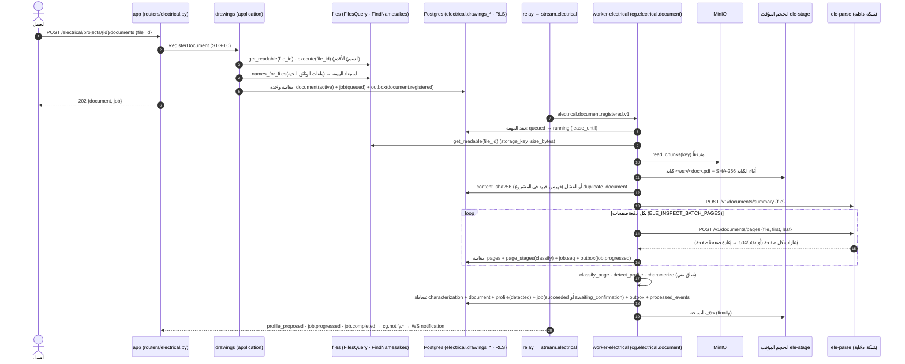
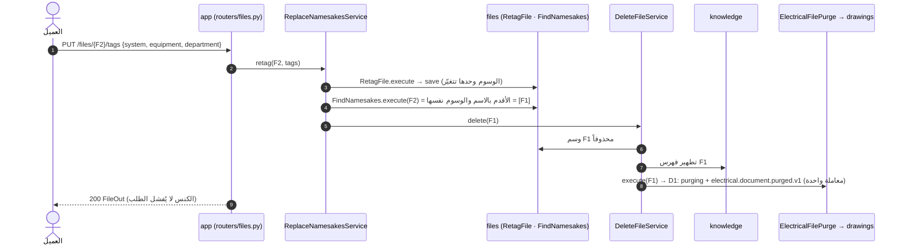

<div dir="rtl">

# التصميم التفصيلي (LLD) للزيادة INC‑1 «النواة والتسجيل والفحص والتوصيف»: WireTwin

| البند | القيمة |
|---|---|
| المعرّف | `electrical-drawings` · الزيادة `INC‑1` |
| نوع الوثيقة | تصميم تفصيلي: ملفات، وتواقيع، وDDL، ونص العقود، وخطة اختبار. **لا شيفرة تُكتب في هذه الدورة** |
| الإصدار | 0.2 (مُقَرّ للبناء) |
| التاريخ | 2026-10-31 (0.1 في اليوم نفسه) |
| المدخل الملزم | [`hld.md`](hld.md) 0.16 (§4، §5.2، §5.4، §5.6، §5.7، §6، §7، §8.1–8.3، §8.7، §8.8، §8.11، §12، §13، §14.1، §14.4، §16، §18)، و[`requirements.md`](requirements.md) 0.17، و[`lld-inc-0.md`](lld-inc-0.md) 0.2 (مبنيّ ومدموج في PR #26) |
| المدخل المساند | `docs/delivery/smart-assistant/requirements.md` (FR‑18..FR‑32، م‑2، م‑3) و`study.md` §5.2 و§5.6، و`inc-0/security-review.md`، و`inc-0/review.md`، و`status.md` |
| الوثائق الحاكمة | `CLAUDE.md`، و`docs/design/00…12`، و`docs/design/openapi.yaml`، و`docs/design/events/schemas/`، و`docs/architecture.md`، و`.importlinter`، و`.github/workflows/ci.yml` |
| خط الأساس | `master` = `origin/master` عند `9438cee`، والفرع `docs/electrical-drawings-inc-1-lld`. **كل إحالة `path:line` في هذه الوثيقة إلى ذلك الالتزام.** وعليه `lint-imports` يقول «Contracts: 9 kept, 0 broken.» (شغّلتُه قراءةً) |
| النطاق | صف INC‑1 في HLD §16، ومعه `PLT‑26` بقرار البشري (2026-10-31): وسوم الملف في `files` ونطاق الاستبدال بالاسم، يُبنى أولاً ويخدم المساعد الذكي أيضاً. و`PLT‑13` أُنجز في INC‑0 فلا يُعاد |
| الحالة | مُقَرّ. حسم المالك القرارات الأربعة (§7.1) في 2026-10-31: التوصية في `INC1‑Q‑1` و`Q‑2` و`Q‑3`، **وخلاف التوصية في `INC1‑Q‑4`**: الخيار (ج)، فيُؤجَّل التوصيف على عيّنات المالك إلى ما بعد دمج INC‑1. و`INC1‑Q‑3` يغيّر توقيت `INC0‑Q‑6` (أ). ولا قرار يحجب البناء، فيبدأ من S1 |

## 0. كيفية قراءة الوثيقة

**المعرّفات.** على اصطلاح `lld-inc-0.md` §0، تأخذ معرّفات هذه الوثيقة بادئة `INC1` فلا تتصادم مع معرّفات SRS (`AC-nn`، `D-nn`) ولا مع `docs/architecture.md` (`D‑nn`) ولا مع معرّفات INC‑0:

| الصيغة | المعنى | مثال |
|---|---|---|
| `INC1‑AC‑n` | معيار قبول لهذه الزيادة، قابل للاختبار (§5.1) | `INC1‑AC‑7` |
| `INC1‑Q‑n` | قرار ⚠️ يحتاج المالك، بخيارات وتوصية وما يحجبه (§7.1) | `INC1‑Q‑1` |
| `INC1‑D‑n` | قرار تصميم داخل صلاحية المعماري (§7.2) | `INC1‑D‑4` |
| `INC1‑R‑n` | خطر (§7.3) | `INC1‑R‑2` |
| `INC1‑F‑n` | تعارض أو انحراف وُجد في HLD أو SRS أو الوثائق الحاكمة، مُبلَّغ عنه لا مُعدَّل (§7.4) | `INC1‑F‑3` |
| `B` · `E` · `O` + رقم | صف ملف لمنفّذه في §2: `backend-developer` · `data-engineer` · `devops-engineer` | `B12` · `E7` · `O1` |
| `S` + رقم | خطوة في ترتيب البناء (§6) | `S3` |
| `PR‑A..PR‑D` | طلبات الدمج الأربعة المقرّة (✅ `INC1‑Q‑2`) | `PR‑C` |
| `SRS AC-nn` · `SRS D-nn` · `FR-…` · `M-nn` | معرّفات SRS كما كُتبت فيها (شَرطة ASCII) | `SRS D-29` |
| `PLT‑nn` · `DEC‑nn` · `STG‑nn` · `CMP‑nn` · `RSK‑nn` | معرّفات HLD كما هي | `STG‑01` |
| `INC0‑…` | معرّفات `lld-inc-0.md` | `INC0‑D‑2` |

**«القسم» كلمة لمعنيين، فتُفصل هنا.** «قسم الوحدة» (section) هو `drawings` أو `circuits` أو `search` أو `diagnostics` داخل `app.modules.electrical` (HLD §0). و«وسم القسم» (department: كهرباء، ميكانيك، تحكّم) أحد وسوم الملف الثلاثة في SRS FR-ING-13 وفي FR‑19 من المساعد الذكي. واسمه في الشيفرة `department` لا `section`، لئلا يلتبس بأقسام الوحدة (`INC1‑D‑2`).

**الوحدات.** «MiB» و«GiB» قوى العدد 2، كما في `lld-inc-0.md` §0.

**المصطلحات.** «الوسم» قيمة من الثلاث على صف الملف (النظام، والمعدّة، والقسم). و«السميّ» ملف آخر في الفضاء نفسه بالاسم نفسه. و«التسلسل» (cascade) خدمة تنسيق في `framework/di/` تعبر الوحدات. و«الحجم المؤقت» (stage volume) مجلد على قرص المضيف يكتب فيه العامل نسخة الـPDF ويقرؤها `ele-parse` قراءة فقط.

## 1. الملخص

INC‑1 أول زيادة تحمل قدرة لـWireTwin. تبدأ بتغيير منصة واحد، ثم تبني النواة، ثم مسار التسجيل والفحص حتى STG‑01، وتنتهي بتقرير التوصيف. وتقع في المعمارية هكذا:

- **وحدة `files` (`PLT‑26`، أولاً).** ثلاثة وسوم اختيارية على صف الملف: `system` و`equipment` و`department`. تُحدَّد عند التسجيل (`registerFile` و`registerMultipartFile`)، وتُغيَّر بمسار جديد `PUT /files/{id}/tags`، ويحملها `files.file.uploaded.v1` حقلاً اختيارياً، وتُعرض في `FileOut`. وصار الاستبدال بالاسم (س‑29) يشترط تطابق الاسم والوسوم معاً: الوسم الغائب لا يطابق إلا غائباً، فالملفات بلا وسوم تتبع القاعدة كما كانت، ونوع الملف لا يدخل في التطابق. وإعادة الوسم تكنس كما تكنس إعادة التسمية. والتغيير لا يعرف WireTwin، فهو يخدم المساعد الذكي (FR‑31، FR‑32) بالبناء نفسه.
- **النواة `app.modules.electrical.shared` (CMP‑06).** محلّل المعرّفات الموحّد (FR-ID-01، 03..10، 12، 13): IEC 81346 وGB/T 5094 بجوانبها، وأكواد الحروف الصينية وNFPA/JIC، والأطراف والجسور، وأرقام الأسلاك، وعناوين Siemens S7 بكل صيغها، والمراجع المتقاطعة، ونقاط الاتصال، والجهود، وأشكال التطبيع. مكتبة قياسية فقط وبلا I/O، وقواعدها ملفات بيانات بإصدار تقرؤها محوّلات الأقسام.
- **قسم الوحدة `drawings` (CMP‑01).** المشاريع (مشروع واحد لكل فضاء، SRS D-29)، وملفات الإعداد بإصدارات، والوثائق (ملف واحد لكل وثيقة، SRS D-22)، ومهام الاستيعاب، وحالة كل (صفحة، مرحلة)، وتقرير التوصيف. وفيه STG‑00 (التسجيل وحارسه) وSTG‑01 (الفحص والتصنيف واقتراح ملف الإعداد)، ومعاينة الاستبدال، والوثيقة المستبعدة، ومنفذ تطهير القسم بمرحلتيه.
- **الخدمة المعزولة `ele-parse` (CMP‑07، DEC‑04).** PyMuPDF خلف HTTP على شبكة Docker داخلية، بلا أسرار ولا قاعدة بيانات ولا إنترنت، تقرأ الحجم المؤقت قراءة فقط، وتعمل كل طلب في عملية فرعية بحدود ذاكرة وزمن.
- **العامل `worker-electrical` بدور `document` (CMP‑09).** يستهلك `stream.electrical` بالمجموعة `cg.electrical.document`، ويقرأ الملف من MinIO متدفقاً إلى الحجم المؤقت (`PLT‑03`)، ويحسب SHA-256 أثناء ذلك.
- **المنصة.** الطوبولوجيا والإشعارات (`PLT‑11`)، والـschema `electrical` وسلسلة هجراته ومنحه (`PLT‑14`)، ورموز الأخطاء (`PLT‑15`)، وملف التشغيل `electrical` في Compose (`PLT‑17`)، وقسم الإعداد (`PLT‑21`)، والمشارك المركّب `electrical` في تسلسلَي الحذف (`PLT‑04`)، وربط فحص السميّ (`PLT‑24`)، وتنبيهاته (`PLT‑18`)، ووثائقه (`PLT‑23`).
- **التقييم.** هيكل إطار التقييم في `tests/eval/electrical/` (FR-EVAL-01)، ومقياس M-04 (على مجموعة حالات النواة)، وحساب M-32، وتقرير التوصيف (FR-EVAL-14) من المسار نفسه ومن أداة خارج المكدّس. كلها تُبنى وتُختبر على ملفات PDF اصطناعية وملفات فحص مثبّتة. **أما تشغيلها على عيّنات المالك فبعد دمج INC‑1** (✅ `INC1‑Q‑4` (ج))، ومعه التقرير المجمّع على العيّنات، وقياس M-32 عليها، وضبط العتبات بها. فهذه خارج تعريف «منجز» لـINC‑1 (§1.4).

**شكل التسليم (✅ `INC1‑Q‑2`):** وثيقة واحدة وأربعة PRs متتالية: `PR‑A` لـ`PLT‑26`، و`PR‑B` للنواة، و`PR‑C` لقلب WireTwin، و`PR‑D` لسلسلة التوريد (`pip` واعتماديات `ele-parse`، ✅ `INC1‑Q‑3`).

### 1.1 النطاق ومصدره

| البند | SRS وHLD | ما يُبنى في INC‑1 | ما يبقى لغيرها |
|---|---|---|---|
| `PLT‑26` | SRS FR-ING-13، FR-ING-03، SRS D-29 (DEC‑17)؛ المساعد الذكي FR‑31 وFR‑32 | الأعمدة الثلاثة، والتحقق، والتسجيل بالوسوم، و`PUT /files/{id}/tags`، والحدث، و`live_namesakes` بالوسوم، والكنس عند إعادة الوسم، ووصف `completeFile` و`renameFile`، و`01` §2.6 | كتالوج الوسوم المُدار وتحقّقه (م‑2 في المساعد الذكي)، وكتابة الوسوم في نقاط Qdrant (FR‑32 في م‑3، وفي WireTwin مع INC‑8)، وحدث إعادة الوسم (`INC1‑D‑5`) |
| CMP‑06 `shared` | FR-ID-01، 03..10، 12، 13؛ HLD §5.4 البنود 1، 2، 4 | المحلّل وقواعده بإصدار ومجموعة حالات تغطي ملحق أ | الكميات (DATA-05) والمعرّفات الحتمية uuid5 في INC‑2؛ الفئات الدلالية (FR-SYM-13) في INC‑4؛ رموز الأعطال (R2) وصيغ مورّدين آخرين (R3)؛ FR-ID-02 (المعرّف الكامل الموروث) في INC‑2 |
| `drawings`: المشاريع وملفات الإعداد | FR-ING-01، FR-ADM-04 (الإصدارات) | الإنشاء والقراءة والسرد والتعديل، وملف المشروع وتجاوزه للوثيقة بإصدارات وبصمة | حذف المشروع والتصدير (NFR-PRIV-03) في INC‑11 |
| الوثائق والتسجيل (STG‑00) | FR-ING-02 (التكرار)، FR-ING-03، HLD §8.11، §14.4 | الحارس، والتسجيل الذرّي (وثيقة ومهمة وحدث)، والوثيقة المستبعدة عند التسجيل | الكشف الدوري للمستبعدة (`PLT‑22`، INC‑5) |
| الفحص والتصنيف (STG‑01) | FR-ING-02 (SHA-256)، FR-ING-06، FR-ING-08، FR-ING-12 | البصمة ومنع التكرار في المشروع، وتصنيف كل صفحة، واقتراح ملف الإعداد بثقة وعلامة الاختلاط، وبيانات التوصيف | التصيير (INC‑2)، وOCR (INC‑3) |
| المهام وحالة الصفحة | FR-ING-04، FR-ING-05، FR-ING-10، NFR-SCAL-05، DEC‑15 (د) | الإلغاء والاستئناف وإعادة معالجة صفحات، والتقدّم بالإشعار، والموضع في الطابور، والحتمية | سجل أحداث المهمة بعد `seq` عبر REST (FR-API-03، INC‑10) |
| الاستبدال بالاسم | FR-ING-03، FR-INT-13، HLD §8.8، §8.11، `PLT‑04`، `PLT‑24` | المشارك المركّب `electrical` ومنفذ `drawings` فيه بمرحلتيه، والمعاينة، وحارس التسجيل | منفذا `circuits` (INC‑6) و`search` (INC‑8) في المشارك نفسه |
| `ele-parse` والعامل | DEC‑04، NFR-SEC-02، `PLT‑17` (ملف `electrical`) | الخدمة، والشبكة الداخلية، والحجم المؤقت، وصورة تُبنى محلياً، والعامل بدور `document` | الأدوار `pages`/`ocr`/`model`/`index`؛ صورة الإصدار وفحص الصور المبنية في خطوة «جاهزية الخادم» (✅ `INC1‑Q‑3`) |
| المنصة | `PLT‑03`، `PLT‑11`، `PLT‑14`، `PLT‑15`، `PLT‑18`، `PLT‑21`، `PLT‑23` | كما في §3 و§4 و§8 | — |
| التقييم | FR-EVAL-01 (هيكل)، FR-EVAL-14، M-04، M-32 | الهيكل، وM-04، وحساب M-32، والتقرير لكل وثيقة ولكل مشروع، وأداة التوصيف خارج المكدّس، مختبرة على مدخلات اصطناعية | التشغيل على عيّنات المالك وقياس M-32 عليها وضبط العتبات (بعد الدمج، ✅ `INC1‑Q‑4` (ج))؛ المجموعة الذهبية وطبقتها (FR-EVAL-02، INC‑2)؛ والتقييم المستقل الكامل (INC‑11) |

### 1.2 ما لا يدخل INC‑1

- استخراج البدائيات والنص الكامل والتصيير (STG‑02، INC‑2)، وخطوط CJK في صورة `ele-parse` (تأتي مع التصيير). فأول استعمال لقاعدة OFL-1.1 في فحص التراخيص ينتقل إلى INC‑2.
- مجموعات الاستهلاك `cg.electrical.pages` و`.ocr` و`.model` و`.index` (HLD §7.8: كل رابطة تدخل مع مستهلكها).
- صندوق Qdrant `ele-<ws>`، و`pg_trgm` (INC‑8).
- `PLT‑22` (المهام الدورية)، وحذف المشروع وتصديره (INC‑11).
- المجلد `app/agents/wiretwin_agent/` والعقدان 5 و6. فعدد العقود يبقى **9**.
- أي تغيير في `knowledge` أو `rag_agent` (قيد المساعد الذكي ق‑1 وNFR‑1 هناك).
- صورة إصدار `ele-parse`، وفحص الصور المبنية في `release.yml`، وصورة التضمين، وأداة حزم النظام: إلى خطوة «جاهزية الخادم» (✅ `INC1‑Q‑3` (أ)).
- كل ما يحتاج عيّنات المالك (§1.4).

### 1.3 متابعات INC‑0 التي تقع في منطقة INC‑1

| البند | المصدر | الحكم في INC‑1 | السبب |
|---|---|---|---|
| ترقية `pip` في صورة `app` قبل 2027-01-28 | قرار المالك `INC0‑Q‑10`؛ SR‑16 | **يُؤخذ** (`PR‑D`، `O15`..`O17`) | الموعد يُحمّر وظيفة `supply-chain` في كل PR بعد 2027-01-28. والتغيير سطر في `Dockerfile` و`scan.sh` وحذف الاستثناءات الستة |
| SR‑11 (`.venv` المحلية و`pyjwt`، وصورة `app` المبنية قديماً) | `security-review.md` | **يُؤخذ نصفه:** فحص اعتماديات `ele-parse` في `scan.sh`. **ويُترك نصفه:** فحص الصور المبنية في `release.yml` إلى خطوة «جاهزية الخادم» (✅ `INC1‑Q‑3` (أ))، وتحديث `.venv` المحلية بند للمالك | `.venv` بيئة المالك على مضيف مستعمل، لا ملف في المستودع. وفحص الصور المبنية تغيير في `release.yml` يتشابك مع صورة التضمين (`torch`) |
| `INC0‑Q‑6` (أ): فحص الصور (حزم النظام وصورة التضمين) «مع `PLT‑17` في INC‑1» | قرار المالك 2026-10-30 | **تغيّر توقيته** بقرار المالك `INC1‑Q‑3` (أ) في 2026-10-31: إلى خطوة «جاهزية الخادم» قبل أول نشر لـWireTwin على خادم | لا نشر مخطط، وملف `electrical` معطّل افتراضياً، وفحص صورة التضمين يحمرّ بـ`torch` |
| SR‑3 (إلغاء الرفع المجزأ عند الحذف، وضبط `MINIO_API_STALE_UPLOADS_EXPIRY` صراحةً) | `security-review.md` | **يُترك** | يخصّ `PLT‑01` لا WireTwin. وضبط مدة الكنس إعداد مكدّس قال المراجع إنه قرار بشري، والإلغاء يغيّر `INC0‑D‑8` |
| SR‑7 (تثبيت الإجراءات ببصمة الالتزام، وبصمات متطلبات الأدوات) | `security-review.md` | **يُترك** | سياسة على كل سير عمل في المستودع، وINC‑1 لا يضيف إجراءً جديداً ولا يغيّر `ci.yml` (`INC1‑D‑28`) |
| `INC0‑F‑16` (`torch==2.5.1` و`sentence-transformers==3.3.1` في صورة التضمين) | `lld-inc-0.md` §7.4 | **يُترك** للمالك | خارج WireTwin، وترقية `torch` تمسّ تضمين المنصة كلها. وصورة التضمين في خطوة «جاهزية الخادم» (✅ `INC1‑Q‑3` (أ)) |
| `INC0‑R‑10` (ذروة ذاكرة عامل `knowledge` عند سقف 100 MiB) | `lld-inc-0.md` §7.3 | **يُترك** | INC‑1 لا يغيّر `knowledge`: محلّلاته تحتاج البايتات في الذاكرة أصلاً، والقراءة المتدفقة هنا لـWireTwin. والقياس على المكدّس الحيّ يحتاج موافقة بشرية (`INC1‑R‑10`) |
| SR‑14 (إتمام ملف PUT الواحد لأي عضو) | `security-review.md` | **يُترك** | قائم قبل INC‑0، والقرار للمالك |

### 1.4 ما خرج من تعريف «منجز» بقرار المالك (✅ `INC1‑Q‑4` (ج))

قرّر المالك في 2026-10-31 تأجيل التوصيف على عيّناته إلى ما بعد دمج INC‑1، خلافاً للتوصية (أ). فـINC‑1 **يسلّم** أداة التوصيف وهيكل إطار التقييم وحساب M-32، مختبرة على ملفات PDF تولّدها الاختبارات وعلى ملفات فحص مثبّتة. و**يخرج** من تعريف «منجز» لـINC‑1 أربعة أشياء تُنجز بعد الدمج (البند P1 في §6):
1. تشغيل `ele-parse inspect` و`app.ops.electrical_characterize` على عيّنات المالك.
2. التقرير المجمّع على العيّنات وما يُلتزم منه في المستودع.
3. قياس M-32 على عيّنات موسومة، وتسميات المالك لها.
4. ضبط عتبات التصنيف وثقة الاقتراح (`ClassificationThresholds` و`auto_accept_confidence`) على العيّنات.

والأثر: تبقى العتبات افتراضات لم يتحقق منها قياس (`INC1‑R‑3`)، وتتأخر «أول نتيجة عملية» التي يضعها HLD §16 في نهاية INC‑1 (`INC1‑F‑21`). والعيّنة الوحيدة التي وجدتُها خارج المستودع مذكورة في §7.1 كما كانت.

## 2. الملفات

القاعدة كما في INC‑0: **لا يحرّر منفّذان الملف نفسه.** وكل ملف اختبار أو وثيقة يقع كاملاً عند منفّذ واحد. والإنشاء (إ) أو التعديل (ت). والعمود الأخير هو الـPR (✅ `INC1‑Q‑2`) والخطوة (§6).

### 2.1 `backend-developer`

**`PR‑A`: وسوم الملف (`PLT‑26`)**

| # | المسار | إ/ت | المسؤولية | الخطوة |
|---|---|---|---|---|
| B1 | `src/app/modules/files/domain/value_objects.py` | ت | `TagKind` و`FileTags` و`MAX_TAG_CHARS` (§3.3.1) | S1 |
| B2 | `src/app/modules/files/domain/entities.py` | ت | الحقل `tags: FileTags = FileTags()` آخر حقول `File` (بعد `multipart`، `:72`)، و`retag()`، ووثيقة INV‑F4 وINV‑F6 (`:1-15`) | S1 |
| B3 | `src/app/modules/files/domain/events.py` | ت | `FileUploaded.tags` (`:30-40`)، ووثيقة الوحدة | S1 |
| B4 | `src/app/modules/files/ports/repository.py` | ت | وثيقة `live_namesakes` بالوسوم (`:149-205`)، والطريقة الجديدة `live_name_conflicts` | S3 |
| B5 | `src/app/modules/files/ports/inbound.py` | ت | `FileView.tags` (`:32-46`) | S3 |
| B6 | `src/app/modules/files/application/use_cases.py` | ت | `RegisterUpload` بالوسوم (`:142-219`)، والحدث بالوسوم (`:254-268`)، و`RetagFile`، و`FindNamesakes.preview` و`NamesakePreview` (`:271-301`)، و`FilesQueryService` (`:462-492`)، و`MultipartRegistrar` و`FileTransferService.register` بالوسوم، و`FileUseCases.retag` (`:930-965`) | S3 |
| B7 | `src/app/modules/files/application/event_mapping.py` | ت | `tags` في `data` حين يوجد وسم، ولا `null` أبداً (`:73-83`) | S3 |
| B8 | `src/app/framework/di/space_quota.py` | ت | `tags` في `UploadRegistrar.register` (`:98-116`) و`SpaceQuotaService.register` (`:142-200`)، يُمرَّر كما هو | S3 |
| B9 | `src/app/framework/di/file_replacement.py` | ت | البروتوكول `FileRetagger` والمدخل الثالث `retag` بالكنس نفسه (`:116-184`) | S3 |
| B10 | `src/app/api/v1/dto/files.py` | ت | `FileTagsIn` و`FileTagsOut`، و`FileRegisterIn.tags`، و`FileOut.tags` | S3 |
| B11 | `src/app/api/v1/routers/files.py` | ت | الوسوم في مساري التسجيل و`_to_file_out` (`:87-97`)، والمسار `PUT /files/{file_id}/tags` عبر `file_replacement`، ووثيقة الوحدة (`:1-24`) | S3 |
| B12 | `src/app/framework/di/composition_root.py` | ت | `PR‑A`: `RetagFile` في `_build_file_services` و`ReplaceNamesakesService(..., retag=...)` (`:1064-1136`). `PR‑C`: `_build_electrical`، و`_NOTIFY_STREAMS` (`:486-495`)، والمشارك `electrical` في التسلسلين (`:1131`، `:1197-1202`)، والحقل في `CompositionRoot` | S3، S7، S8 |
| B13 | `docs/design/events/schemas/files.file.uploaded.v1.json` | ت | خاصية `tags` اختيارية (§3.3.4) | S3 |
| B14 | `docs/design/openapi.yaml` | ت | `PR‑A`: `retagFile` و`FileTagsIn`/`FileTagsOut` وحقلا `tags` ووصف `completeFile` و`renameFile` (`:412-438`). `PR‑C`: الوسم `electrical` ومساراته العشرون ومخططاتها | S3، S8 |
| BT1 | `tests/unit/test_files_domain.py` | ت | `FileTags` و`File.retag` | S1 |
| BT2 | `tests/unit/test_files_use_cases.py` | ت | التسجيل بالوسوم، و`RetagFile`، و`FindNamesakes.preview`، والحدث | S3 |
| BT3 | `tests/unit/support_files_media.py` | ت | المستودع المزيّف يطابق الوسوم ويجيب `live_name_conflicts` | S3 |
| BT4 | `tests/unit/test_api_files_media_router.py` | ت | الوسوم على السلك، والمسار الجديد عبر `file_replacement` | S3 |
| BT5 | `tests/unit/test_file_replacement.py` | ت | `retag` يكنس، والإعادة بلا تغيير تكنس أيضاً | S3 |
| BT6 | `tests/unit/test_files_event_mapping.py` | ت | `tags` يُصادَق بالمخطط، ويغيب حين لا وسم | S3 |
| BT7 | `tests/unit/test_space_quota.py` | ت | تمرير الوسوم | S3 |
| BT8 | `tests/unit/test_api_rbac.py` | ت | `EXPECTED` (`:66-135`): صف `PR‑A`، وعشرون صفاً في `PR‑C` (§3.3.16) | S3، S8 |
| BT9 | `tests/unit/test_composition_root.py` | ت | هويات الربط: `retag` في `PR‑A`، والمشارك `electrical` والحزمة في `PR‑C` (على سابقة مراجعة INC‑0، الملاحظة 1) | S3، S8 |

**`PR‑B`: النواة `shared` (CMP‑06)**

| # | المسار | إ/ت | المسؤولية | الخطوة |
|---|---|---|---|---|
| B15 | `src/app/modules/electrical/shared/{version,kinds,rules,normalization,reference_designation,letter_codes,terminals,wire_numbers,plc_siemens,cross_references,connection_points,voltages,parser}.py` | إ (13) | المحلّل الموحّد (§3.3.5). المكتبة القياسية وحدها، بلا I/O | S4 |
| B16 | `src/app/modules/electrical/shared/rules/__init__.py`، `…/rules/identifiers.toml` | إ (2) | ملف القواعد بإصداره، بيانات لا شيفرة (`INC1‑D‑19`) | S4 |
| BT10 | `tests/unit/test_electrical_shared_{normalization,reference_designation,letter_codes,terminals_wires,plc_siemens,cross_references,rules,parser}.py` | إ (8) | كل صيغة في ملحق أ من SRS (FR-ID-12)، والصالح وغير الصالح | S4 |
| BT11 | `tests/eval/electrical/{__init__.py,README.md,framework.py,m04_identifiers.py}`، `…/cases/identifiers.toml` | إ (5) | هيكل إطار التقييم (FR-EVAL-01) ومقياس M-04 ومجموعة حالاته (§3.3.17) | S4 |
| BT12 | `tests/unit/test_electrical_eval_framework.py` | إ | شكل التقرير، والمقارنة بين تشغيلين، وحساب M-04 | S4 |
| BT13 | `tests/architecture/test_import_contracts.py` | ت | `test_the_skeleton_is_22_empty_packages` (`:131-143`) يصير ثوابت الهيكل: الأبناء الخمسة المباشرون، والطبقات الأربع لكل قسم، وملفات `__init__.py` الأصلية بسطر توثيق واحد. لأن `shared` صار فيه شيفرة وحزمة `rules` | S4 |

**`PR‑C`: قلب WireTwin**

| # | المسار | إ/ت | المسؤولية | الخطوة |
|---|---|---|---|---|
| B17 | `src/app/framework/ports/storage_provider.py` | ت | المنفذ الشقيق `StreamingStorage`، و`ObjectStorage` يجمعه (`:62-63`) | S5 |
| B18 | `src/app/framework/ports/__init__.py` | ت | تصدير `StreamingStorage` | S5 |
| B19 | `src/app/framework/di/storage_handle.py` | ت | `read_chunks` تمريراً، وغير المربوط يجيب `common.internal` | S5 |
| B20 | `src/app/infrastructure/storage/minio_storage.py` | ت | `read_chunks` فوق `get_object` بالأجزاء (§3.3.9) | S5 |
| B21 | `src/app/framework/settings/settings.py` | ت | `ElectricalSettings` والحقل `Settings.electrical` (§3.3.12) | S5 |
| B22 | `src/app/infrastructure/config/env_settings.py` | ت | المفاتيح العشرة (§3.3.12) | S5 |
| B23 | `src/app/framework/errors.py` | ت | الرموز في §3.3.13، كلٌّ في الخطوة التي تُصدره (`test_error_catalog.py` يشترط موضع إصدار) | S7، S8 |
| B24 | `src/app/framework/events/topology.py` | ت | `cg.electrical.document` و`stream.electrical` (§3.3.11) | S7 |
| B25 | `src/app/framework/di/electrical_purge.py` | إ | المشارك المركّب `electrical`: `ElectricalFilePurge` و`ElectricalSpacePurge` (§3.3.3) | S5 |
| B26 | `src/app/framework/di/file_deletion.py` | ت | معامل ثانٍ `electrical` و`FileDeletion.drawings` (`:113-155`)، مع ربطه في B12 في الخطوة نفسها | S7 |
| B27 | `src/app/framework/di/space_deletion.py` | ت | معامل `electrical` قبل `files` و`SpaceDeletion.drawings` (`:83-142`) | S7 |
| B28 | `src/app/framework/observability/heartbeat.py` | ت | `"electrical"` في `HEARTBEAT_PROCESS_NAMES` (`:77-84`) | S7 |
| B29 | `src/app/framework/observability/metrics.py` | ت | العدّاد `aizzak_ele_documents_excluded_total{reason}` | S8 |
| B30 | `src/app/modules/electrical/drawings/domain/{project,profile,document,job,pages,classification,profile_detection,characterization,pipeline,events,errors}.py` | إ (11) | النطاق النقي (§3.3.6) | S5 |
| B31 | `src/app/modules/electrical/drawings/ports/{repository,files,namesakes,spaces,pdf,source,rules,liveness,inbound}.py` | إ (9) | المنافذ (§3.3.7) | S5 |
| B32 | `src/app/modules/electrical/drawings/application/{projects,documents,jobs,inspection,purge,replacement,characterization,event_mapping,use_cases}.py` | إ (9) | حالات الاستعمال (§3.3.8) | S7 |
| B33 | `src/app/modules/electrical/drawings/adapters/{ele_parse_client,source_stager,rule_files}.py`، `…/adapters/data/__init__.py`، `…/adapters/data/producers.toml` | إ (5) | محوّلات غير SQL (§3.3.7) | S7 |
| B34 | `services/ele_parse/{__init__,contract,inspect,sandbox,child,app,__main__}.py` | إ (7) | خدمة `ele-parse`: عقد JSON، والفحص فوق PyMuPDF، والعملية الفرعية بحدودها، وخادم HTTP، ووضع CLI (§3.3.10) | S7 |
| B35 | `src/app/api/v1/dto/electrical.py` | إ | DTO (§3.3.14) | S8 |
| B36 | `src/app/api/v1/routers/electrical.py` | إ | المسارات العشرون، وحارس `electrical_enabled` | S8 |
| B37 | `src/app/api/v1/dependencies.py` | ت | `ApiServices.electrical: DrawingsUseCases \| None = None` (قرب `:258`)، والتبعية `electrical_enabled` | S8 |
| B38 | `src/app/api/main.py` | ت | تضمين الموجّه، وتمرير `electrical=root.electrical` | S8 |
| B39 | `src/app/workers/electrical_bootstrap.py` | إ | جذر تركيب العامل (§3.3.15)، ملف مستقل لا إضافة إلى `bootstrap.py` (2,167 سطراً) | S7 |
| B40 | `src/app/workers/electrical_worker.py` | إ | نقطة الدخول الرقيقة على نمط `memory_worker.py` | S7 |
| B41 | `src/app/workers/main.py` | ت | `"electrical"` في `_RUNNERS` (`:26-31`) | S7 |
| B42 | `src/app/ops/electrical_characterize.py` | إ | أداة التوصيف خارج المكدّس من ملفات فحص JSON (§3.3.17) | S8 |
| B43 | `docs/design/events/schemas/electrical.{document.registered,job.requested,document.profile_proposed,job.progressed,job.completed,document.purged}.v1.json` | إ (6) | مخطط لكل نوع (§3.3.11) | S7 |
| BT14 | `tests/unit/support_electrical.py` | إ | مستودعات مزيّفة في الذاكرة، و`FakePdfInspection` من ملفات JSON، و`FakeDrawingFiles`، و`FakeStager` | S5 |
| BT15 | `tests/unit/test_electrical_drawings_domain.py` | إ | المجاميع وآلات الحالة والبصمة | S5 |
| BT16 | `tests/unit/test_electrical_classification.py` | إ | تصنيف الصفحة واللغة والحاجة إلى OCR | S5 |
| BT17 | `tests/unit/test_electrical_profile_detection.py` | إ | الاقتراح والثقة والاختلاط والحتمية | S5 |
| BT18 | `tests/unit/test_electrical_registration.py` | إ | حارس STG‑00 بكل فروعه والذرّية والاستبعاد عند التسجيل، ومعاينة الاستبدال | S7 |
| BT19 | `tests/unit/test_electrical_inspection.py` | إ | STG‑01: البصمة، والتكرار، ورفض الملف، وفشل صفحة لا يُفشل الملف، والعتبة، والإلغاء أثناء العمل، والعقد | S7 |
| BT20 | `tests/unit/test_electrical_jobs.py` | إ | الإلغاء، والاستئناف، وإعادة المعالجة، والمهمة المفتوحة الواحدة، والموضع والتقدير | S7 |
| BT21 | `tests/unit/test_electrical_purge.py` | إ | المرحلتان، والفضاء، والمثالية | S7 |
| BT22 | `tests/unit/test_electrical_characterization.py` | إ | سجل الوثيقة وتجميع المشروع وحقول FR-EVAL-14 | S7 |
| BT23 | `tests/unit/test_api_electrical_router.py` | إ | المسارات والرموز والعلم والتكرار و`heavy_job` | S8 |
| BT24 | `tests/unit/test_electrical_event_mapping.py` | إ | كل حدث يُصادَق بمخططه، ولا `null` | S7 |
| BT25 | `tests/unit/test_electrical_worker.py` | إ | المعالجات الثلاثة، والمطالبة في معاملة الأثر، والعقد | S7 |
| BT26 | `tests/unit/test_ele_parse_service.py` | إ | الفحص على PDFs تُولَّد بـPyMuPDF في `tmp_path`، ورفض المسار، والمهلة، وحدّ الذاكرة، والحتمية، ووضع CLI | S7 |
| BT27 | `tests/unit/test_electrical_settings.py` | إ | القيم الافتراضية والمُدقّقات والقراءة من البيئة | S5 |
| BT28 | `tests/unit/test_ops_electrical_characterize.py` | إ | الأداة على ملفات فحص مثبّتة | S8 |
| BT29 | `tests/unit/test_minio_streaming_adapter.py` | إ | `read_chunks` على عميل مزيّف: الأجزاء، والإغلاق، والترجمة | S5 |
| BT30 | `tests/unit/test_storage_handle.py` | ت | `read_chunks` مربوطاً وغير مربوط | S5 |
| BT31 | `tests/unit/test_stream_topology.py` | ت | أربع روابط، وخمسة مجارٍ، ومطابقة معالجات العامل الجديد (`:125-249`) | S7 |
| BT32 | `tests/unit/test_file_deletion.py` | ت | المشارك الثاني وترتيبه | S7 |
| BT33 | `tests/unit/test_space_deletion.py` | ت | `electrical` قبل `files` | S7 |
| BT34 | `tests/unit/test_api_app_shell.py` | ت | `services.electrical is not None` في ربط الإنتاج | S8 |
| BT35 | `tests/unit/test_heartbeat.py`، `tests/unit/test_healthcheck_coverage.py` | ت (2) | الاسم `electrical` | S7 |
| BT36 | `tests/architecture/test_electrical_tables.py` | إ | كل `Table` في محوّلات قسم تحمل بادئة قسمها وschema `electrical` (`INC1‑D‑23`) | S7 |
| BT37 | `tests/integration/test_minio_storage.py` | ت | `read_chunks` حيّاً (`live_minio`) | S7 |
| BT38 | `tests/integration/test_electrical_ingestion_live.py` | إ | STG‑00 ثم STG‑01 بالمستودع الحقيقي وMinIO وRedis، وفاحص في العملية نفسها (`live_db` + `live_minio` + `live_redis`) | S8 |
| BT39 | `tests/eval/electrical/m32_profile_detection.py`، `tests/unit/test_electrical_m32.py` | إ (2) | حساب M-32 من مجلد ملفات فحص وملف تسميات يُمرَّران وسيطين؛ ويختبره الثاني على ملفات فحص اصطناعية وتسميات مثبّتة في `tests/unit/fixtures/electrical/` (ومنها حالات خاطئة عمداً، فتكون النسبة المتوقعة أقل من 1). وتشغيله على عيّنات المالك بعد الدمج (§1.4) | S8 |

**الوثائق (`PR‑A` ثم `PR‑C`، والملف كله عند `backend-developer`)**

| # | المسار | إ/ت | المسؤولية |
|---|---|---|---|
| BD1 | `docs/design/02-port-contracts.md` | ت | §1.6: `StreamingStorage`. و§2: `FileView.tags`، و`live_name_conflicts`، و`FindNamesakes.preview` |
| BD2 | `docs/design/03-api-spec.md` | ت | §1 (صف Files وصف Electrical)، و§2 (DTO)، و§3.2 (أنواع الإشعار الثلاثة)، و§4 (الرموز) |
| BD3 | `docs/design/04-event-catalog.md` | ت | §2 (`stream.electrical`، والمجموعة، والطابور الميت)، و§4 (الأنواع الستة، و`tags` في `files.file.uploaded.v1`) |
| BD4 | `docs/design/05-rbac-config-secrets.md` | ت | §2 (المفاتيح العشرة، غير سرّية)، و§4 (21 صفاً) |
| BD5 | `docs/design/06-domain-models.md` | ت | §6 (INV‑F6)، وقسم جديد لمجاميع `drawings` ولازماتها |
| BD6 | `docs/design/07-nfr-slo.md` | ت | §4: `ELE_MAX_PAGES` و`ELE_QUEUE_PROTECTION_LIMIT` وحدّا `ele-parse` |
| BD7 | `docs/design/09-testing-strategy.md` | ت | اختبارات WireTwin وأماكنها، و`tests/eval/electrical/` خارج CI (SRS D-23) |
| BD8 | `docs/architecture.md` | ت | §8 |
| BD9 | `docs/architecture.html` | ت | المرآة |

### 2.2 `data-engineer`

| # | المسار | إ/ت | المسؤولية | الخطوة |
|---|---|---|---|---|
| E1 | `migrations/versions/files/0006_file_tags.py` | إ | ثلاثة أعمدة وقيد (§4.1) | S2 |
| E2 | `src/app/modules/files/adapters/sql_repository.py` | ت | أعمدة `Table` (`:77-113`)، و`add` و`save` و`_hydrate` بالوسوم (`:141-207`، `:460-481`)، وشرط الوسوم في `live_namesakes` (`:340-401`)، والطريقة `live_name_conflicts` | S2 |
| E3 | `tests/integration/test_files_repository_rls.py` | ت | ذهاب وإياب الوسوم، و`save` يكتبها، والقيد، والعزل | S2 |
| E4 | `tests/integration/test_file_namesakes_live.py` | ت | المطابقة بالوسوم، والتعارضات، وبقاء `name_key` شرط فهرس (`test_the_name_key_is_an_index_condition_and_not_a_filter`) | S2 |
| E5 | `docs/design/01-data-model.md` | ت | §2.6 (`PR‑A`)، و§2.12 جديد للـschema `electrical` (`PR‑C`)، و§6 (ثلاث عشرة سلسلة) | S2، S6 |
| E6 | `migrations/versions/platform/0006_electrical_schema.py` | إ | `CREATE SCHEMA electrical` (§4.2) | S6 |
| E7 | `migrations/versions/electrical/0001_electrical_drawings.py` | إ | الجداول السبعة وفهارسها وRLS (§4.3) | S6 |
| E8 | `alembic.ini` | ت | سطر `migrations/versions/electrical` في `version_locations` (`:16-28`) | S6 |
| E9 | `src/app/ops/provision.py` | ت | `MIGRATION_CHAINS` (`:130-153`)، و`_TENANT_TABLES` (`:160-198`)، و`_MODULE_SCHEMAS` (`:200-212`)، و`PURGE_GRANTS` (`:365-409`)، و«twelve» في `run_migrations` (`:413`) | S6 |
| E10 | `src/app/ops/purge.py` | ت | `_SchemaSpec("electrical", …)` قبل `files` في `_SCHEMA_ORDER` (`:352-425`)، ووثيقة الوحدة | S6 |
| E11 | `src/app/modules/electrical/drawings/adapters/sql_repository.py` | إ | محوّل المستودعات الستة فوق جداول `drawings_*` (§3.3.7) | S6 |
| E12 | `tests/integration/test_electrical_drawings_repository_rls.py` | إ | اختبار RLS للمستودعات، والقيود، والفهارس الفريدة (§5.2) | S6 |
| E13 | `tests/unit/test_ops_provision.py` | ت | الجداول السبعة ممنوحة، والسلسلة في الترتيب (`:71-351`) | S6 |
| E14 | `tests/unit/test_ops_purge.py` | ت | ترتيب `electrical` قبل `files` | S6 |

### 2.3 `devops-engineer`

| # | المسار | إ/ت | المسؤولية | الخطوة |
|---|---|---|---|---|
| O1 | `docker-compose.yml` | ت | الخدمتان `ele-parse` و`worker-electrical` خلف الملف `electrical`، والشبكة الداخلية `ele-parse`، والحجم `ele-stage`، و`ELECTRICAL_ENABLED` في بيئة `app` (§3.3.10، §4.6) | S9 |
| O2 | `docker-compose.build.yml` | ت | `worker-electrical: *app-build`، و`ele-parse` من `services/ele_parse/Dockerfile` | S9 |
| O3 | `services/ele_parse/Dockerfile` | إ | `python:3.12-slim`، ومستخدم غير جذري، وبلا أدوات بناء في الطبقة النهائية | S9 |
| O4 | `services/ele_parse/requirements.txt` | إ | `pymupdf==<الإصدار الذي يحلّه CI اليوم ضمن <2>`، وحده | S9 |
| O5 | `deploy/sizes/{small,medium,large}.env` | ت (3) | `ELE_PARSE_CPUS/MEM` و`WORKER_ELECTRICAL_CPUS/MEM` | S9 |
| O6 | `docs/design/08-local-runbook.md` | ت | §2‑ج (الدفتر) وقسم لملف `electrical` | S9 |
| O7 | `tests/unit/test_resource_budget.py` | ت | المعلّقة بملفات التشغيل 6 ← 8 (`:424`) | S9 |
| O8 | `tests/unit/test_compose_build_overlay.py` | ت | مدخلا البناء الجديدان | S9 |
| O9 | `tests/unit/test_compose_electrical_profile.py` | إ | فحص ثابت لـ`docker-compose.yml` (§5.2، INC1‑AC‑9) | S9 |
| O10 | `tests/unit/test_ele_parse_containers.py` | إ | عُدّة حاويات اختيارية (`RUN_ELE_PARSE_CONTAINER_TEST=1`) على نمط `test_public_file_links_containers.py` | S9 |
| O11 | `.env.example` | ت | أسماء المفاتيح العشرة ومفاتيح `ele-parse` الخمسة ومفاتيح الأحجام، بلا قيم سرّية | S9 |
| O12 | `deploy/prometheus/alerts.yml` | ت | استثناء `stream.electrical` من `AizzakStreamQueueWaitHigh` (`:929-950`)، و`AizzakElectricalQueueWaitHigh`، و`AizzakElectricalDocumentsExcluded` | S9 |
| O13 | `deploy/prometheus/alerts.test.yml` | ت | حالتا إشعال وإصمات لكل قاعدة جديدة، وحالة تثبت أن القاعدة القديمة صمتت عن `stream.electrical` | S9 |
| O14 | `docs/runbooks/alerts.md` | ت | قسمان جديدان، وتعديل قسم `AizzakStreamQueueWaitHigh` | S9 |
| O15 | `Dockerfile` | ت | ترقية `pip` في `/opt/venv` إلى إصدار مثبّت يصلح التنبيهات الستة (`INC0‑Q‑10`) | S11 |
| O16 | `deploy/supply-chain/scan.sh` | ت | ترقية `pip` نفسها في بيئة `runtime`، وبيئة ثانية من `services/ele_parse/requirements.txt` تدخل الـSBOM والتدقيق | S11 |
| O17 | `deploy/supply-chain/license-policy.toml` | ت | حذف الاستثناءات الستة لـ`pip` (`INC0‑Q‑10`) | S11 |
| O18 | `tests/unit/test_supply_chain_check.py` | ت | ما يثبّت الاستثناءات أو البيئة الواحدة، إن وُجد | S11 |
| O19 | `docs/stack-commands.md` | ت | تشغيل ملف `electrical`، وأمر `ele-parse inspect` المعزول، وأداة التوصيف، وبيئة `scan.sh` الثانية | S9، S11 |
| O20 | `docs/deploy-server.md` | ت | ملف `electrical` معطّل افتراضياً، والشبكة الداخلية، وبند `ث‑N` إن ظهر | S9 |
| O21 | `tests/unit/test_compose_sizes.py` | ت | مفاتيح الأحجام الجديدة مسمّاة (`:80`) | S9 |
| O22 | `tests/unit/test_prometheus_alert_rules.py` | ت | `EXPECTED_ALERTS` (`:90`) بالقاعدتين، وما يقرأ تعبير `AizzakStreamQueueWaitHigh` (`:664`)، وقسم الدليل لكل قاعدة (`:584`) والإشعال والإصمات (`:601`) آليان | S9 |

### 2.4 بشري

لا ملف إلزامي. القرارات `INC1‑Q‑1..Q‑4` حُسمت في 2026-10-31. ويبقى للمالك خارج البناء: تطبيق الهجرات على المكدّس الحيّ عبر `migrate`، وتفعيل ملف `electrical`، وبعد دمج INC‑1 تسليم العيّنات وتسمياتها (§1.4). وفي `CLAUDE.md` جملة قديمة (`INC1‑F‑17`) تصحيحها للمالك إن شاء.

### 2.5 العدد

- **`backend-developer`:** 91 صفاً (B1..B43، وBT1..BT39، وBD1..BD9)، وهي نحو 158 ملفاً: 27 ملف مصدر أو إعداد يُعدَّل، و62 ملف مصدر يُنشأ (منها 7 لـ`ele-parse`)، و7 مخططات أحداث (6 جديدة)، و`openapi.yaml`، و52 ملف اختبار (34 جديداً)، و9 وثائق. ومعها مجلد ملفات فحص وتسميات مثبّتة `tests/unit/fixtures/electrical/` (BT28، BT39).
- **`data-engineer`:** 14 ملفاً (5 جديدة، منها ثلاث هجرات).
- **`devops-engineer`:** 22 صفاً، وهي 24 ملفاً (3 جديدة).
- **بشري:** لا ملف.
- **لا `frontend-developer`:** لا واجهة في المستودع.

## 3. العقود

### 3.1 الواجهات البرمجية

كلها تحت `/api/v1`، وأخطاؤها RFC 9457 من `AppError` (`src/app/api/errors.py:64-112`)، ولكل مسار حارس صلاحية واحد (`test_api_rbac.py:383`). والقوائم `Page[T]` بترقيم keyset.

**(أ) `files` (`PLT‑26`)**

| الطريقة | المسار | الطلب | الاستجابة | الأخطاء | الصلاحية |
|---|---|---|---|---|---|
| POST | `/files` (`registerFile`، قائم) | `FileRegisterIn` + **`tags?: FileTagsIn`** | `201 FileRegisterOut` كما هو | كما اليوم، و`422 common.validation_error` لوسم فارغ أو أطول من 128 أو فيه محرف تحكّم أو مفتاح مجهول | `files:write` |
| POST | `/files/multipart` (`registerMultipartFile`، قائم) | كذلك | `201 FileMultipartRegisterOut` كما هو | كذلك | `files:write` |
| PUT | `/files/{id}/tags` (**`retagFile`، جديد**) | `FileTagsIn {system?, equipment?, department?}`، استبدال كامل: المفتاح الغائب أو `null` يزيل الوسم | `200 FileOut` | `404 common.not_found` (مجهول أو لمستأجر آخر)، و`409 common.conflict` (محذوف)، و`422 common.validation_error` | `files:write` |
| POST | `/files/{id}/complete`، PATCH `/files/{id}` (قائمان) | كما هما | كما هما | كما هما. **والاستبدال صار بالاسم والوسوم معاً** | `files:write` |
| GET | `/files`، `/files/{id}` (قائمان) | كما هما | `FileOut` + **`tags: FileTagsOut`** | كما هما | `files:read` |

**(ب) `electrical` (عشرون عملية، الوسم `electrical`).** كل مسار يجيب `503 electrical.disabled` حين `ELECTRICAL_ENABLED=false` (`INC1‑D‑12`)، قبل حارس الصلاحية لا بعده، لأن السؤال عن صلاحية ميزة غير موجودة لا معنى له. والعمليات الثلاث التي تجيب 202 عليها `heavy_job` (`test_heavy_job_limit.py:368`) و`Idempotency-Key`.

| الطريقة | المسار (`operationId`) | الطلب | الاستجابة | الأخطاء | الصلاحية |
|---|---|---|---|---|---|
| POST | `/electrical/projects` (`createElectricalProject`) | `ElectricalProjectIn {space_id, name, description?, profile?}` | `201 ElectricalProjectOut` | `404 common.not_found` (الفضاء)، و`409 electrical.project_exists`، و`422 electrical.invalid_profile`، و`422 common.validation_error` | `electrical:manage` |
| GET | `/electrical/projects` (`listElectricalProjects`) | `space_id` إلزامي، و`limit`، و`cursor` | `200 ElectricalProjectPage` (صفر أو واحد) | `422` | `electrical:read` |
| GET | `/electrical/projects/{id}` (`getElectricalProject`) | — | `200 ElectricalProjectOut` | `404` | `electrical:read` |
| PATCH | `/electrical/projects/{id}` (`updateElectricalProject`) | `ElectricalProjectPatchIn {name?, description?}` | `200 ElectricalProjectOut` | `404`، `409 common.conflict` (نسخة قديمة)، `422` | `electrical:manage` |
| GET | `/electrical/projects/{id}/profile` (`getProjectProfile`) | — | `200 DrawingProfileOut` | `404` | `electrical:read` |
| PUT | `/electrical/projects/{id}/profile` (`replaceProjectProfile`) | `DrawingProfileIn {body}` | `200 DrawingProfileOut` (إصدار جديد) | `404`، `422 electrical.invalid_profile` | `electrical:manage` |
| POST | `/electrical/projects/{id}/documents` (`registerElectricalDocument`) | `DocumentRegisterIn {file_id, checksum?}`؛ `Idempotency-Key` | `202 DocumentRegisteredOut {document, job}` | `404` (المشروع، أو ملف مجهول أو غير `ready` أو محذوف أو لمستأجر آخر)، و`415 electrical.not_a_pdf`، و`422 electrical.file_not_in_project_space`، و`409 electrical.document_exists`، و`409 electrical.namesake_not_replaced`، و`409 electrical.duplicate_document` (إن أُرسلت البصمة)، و`429 electrical.ingestion_queue_full` (مع `Retry-After`)، و`429 common.rate_limited` (`heavy_job`) | `electrical:manage` |
| GET | `/electrical/projects/{id}/documents` (`listElectricalDocuments`) | `limit`، `cursor`، `status?` | `200 ElectricalDocumentPage` (الأحدث أولاً، والاسم من `files`) | `404` | `electrical:read` |
| GET | `/electrical/projects/{id}/characterization` (`getProjectCharacterization`) | — | `200 CharacterizationReportOut` | `404` | `electrical:read` |
| GET | `/electrical/documents/{id}` (`getElectricalDocument`) | — | `200 ElectricalDocumentOut` (ومعه الوسوم من `files` وآخر مهمة) | `404` | `electrical:read` |
| GET | `/electrical/documents/{id}/profile` (`getDocumentProfile`) | — | `200 EffectiveProfileOut` | `404` | `electrical:read` |
| PUT | `/electrical/documents/{id}/profile` (`replaceDocumentProfile`) | `DrawingProfileIn` | `200 EffectiveProfileOut` | `404`، `422 electrical.invalid_profile`، `409 electrical.job_conflict` (مهمة جارية) | `electrical:manage` |
| POST | `/electrical/documents/{id}/profile-confirmation` (`confirmDocumentProfile`) | `ProfileConfirmIn {body?}` (فارغ = قبول الاقتراح كما هو)؛ `Idempotency-Key` | `202 IngestionJobOut` | `404`، `409 electrical.job_conflict` (لا مهمة بانتظار التأكيد)، `422 electrical.invalid_profile` | `electrical:manage` |
| POST | `/electrical/documents/{id}/reprocessing` (`reprocessDocument`) | `ReprocessIn {pages?: [int]}` (1..1000 رقم بلا تكرار)؛ `Idempotency-Key` | `202 IngestionJobOut` | `404`، `409 electrical.job_conflict` (مهمة مفتوحة)، `409 electrical.profile_unconfirmed`، `422` (صفحة خارج `1..page_count`) | `electrical:manage` |
| GET | `/electrical/documents/{id}/pages` (`listDocumentPages`) | `limit` (≤ 200)، `cursor` (على `page_no` تصاعدياً) | `200 DocumentPagePage` | `404` | `electrical:read` |
| GET | `/electrical/documents/{id}/characterization` (`getDocumentCharacterization`) | — | `200 CharacterizationOut` | `404` (أو لم يجرِ STG‑01 بعد) | `electrical:read` |
| GET | `/electrical/ingestion-jobs/{id}` (`getIngestionJob`) | — | `200 IngestionJobOut` | `404` | `electrical:read` |
| POST | `/electrical/ingestion-jobs/{id}/cancel` (`cancelIngestionJob`) | — | `200 IngestionJobOut` | `404`، `409 electrical.job_conflict` (منتهية) | `electrical:manage` |
| POST | `/electrical/ingestion-jobs/{id}/resume` (`resumeIngestionJob`) | `Idempotency-Key` | `202 IngestionJobOut` | `404`، `409 electrical.job_conflict` (ليست `failed` أو `cancelled` أو `running` بعقد منتهٍ)، `409 electrical.profile_unconfirmed` | `electrical:manage` |
| GET | `/electrical/files/{id}/replacement-preview` (`previewFileReplacement`) | `checksum?` في الاستعلام (64 hex) | `200 ReplacementPreviewOut` | `404` (ملف مجهول أو لمستأجر آخر أو محذوف)، `422` (البصمة) | `electrical:read` |

ملاحظات:
- **`DocumentRegisterIn.checksum`** إنذار مبكر لا ضمان: البصمة يرسلها العميل ولا يتحقق منها الخادم هنا، فيعيد STG‑01 حسابها من البايتات، وهو الحَكَم (`INC1‑AC‑7`).
- **الصفحة الواحدة لا تفشل المهمة** (NFR-REL-01)، فحالة الصفحة في `listDocumentPages` لا في رمز HTTP.
- **الاستئناف من `running`** مسموح حين انتهى عقد المهمة (`lease_until < now()`)، لأن العامل مات أو أقرّ رسالته دون أن يُنهيها (`INC1‑D‑9`). ولا مهمة دورية تكشف العالقة قبل `PLT‑22`، فيظهر ذلك في `getIngestionJob` بالحقل `stale: true`.

### 3.2 التدفقان



*الشكل 1. STG‑00 وSTG‑01. كل سهم إلى `DB` معه outbox معاملة واحدة.*



*الشكل 2. إعادة الوسم تكنس كما تكنس إعادة التسمية (HLD §8.11 الخطوة 3). والإتمام والتسمية يمرّان بالخطوات 3..8 نفسها.*

### 3.3 التواقيع

#### 3.3.1 نطاق `files` (المكتبة القياسية وحدها)

```python
# src/app/modules/files/domain/value_objects.py -- additions
MAX_TAG_CHARS: Final = 128


class TagKind(StrEnum):
    """The three classification tags a file may carry (SRS FR-ING-13, D-29;
    smart-assistant FR-31). `department` is SRS's «القسم» (INC1-D-2)."""

    SYSTEM = "system"
    EQUIPMENT = "equipment"
    DEPARTMENT = "department"


@dataclass(frozen=True, slots=True)
class FileTags:
    """Opaque classification references (INC1-Q-1 (b)). A present value is
    NFC-normalised and stripped, then must be 1..MAX_TAG_CHARS long with no
    control character. It is compared EXACTLY -- no case fold: `files` never
    interprets it. `None` is ABSENT, and absent matches only absent."""

    system: str | None = None
    equipment: str | None = None
    department: str | None = None

    def __post_init__(self) -> None: ...  # normalise each; InvalidFileInput

    @classmethod
    def from_mapping(cls, raw: Mapping[str, str | None]) -> FileTags:
        """Unknown key -> InvalidFileInput; "" or whitespace -> InvalidFileInput
        (an absent tag is omitted or null, never empty)."""
        ...

    def as_mapping(self) -> dict[str, str]:
        """Present tags only, keyed by `TagKind` values -- the event's and the
        `FileView`'s shape."""
        ...

    @property
    def is_empty(self) -> bool: ...
```

```python
# src/app/modules/files/domain/entities.py -- File gains one field, LAST
    multipart: MultipartUpload | None = None
    # PLT-26 -- the classification tags (INV-F6). Defaulted for `multipart`'s
    # reason: every existing construction site means "untagged".
    tags: FileTags = FileTags()

    def retag(self, tags: FileTags, now: datetime) -> bool:
        """Replace all three tags. False -- and nothing written -- when they are
        already these (`rename`'s no-op rule). Any status; a deleted file is
        refused with FileStateError."""
        ...
```

```python
# src/app/modules/files/domain/events.py -- FileUploaded gains one field, LAST
    occurred_at: datetime
    tags: FileTags = FileTags()  # PLT-26: carried for the consumer, like space_id
```

**INV‑F6 (جديد في `06` §6).** الوسوم تصف الملف لا بايتاته، فتتغيّر بـ`retag` وحده، كما يتغيّر الاسم بـ`rename` وحده (INV‑F4). والوسم الغائب `None`، ولا يُخزَّن ولا يُنشر فارغاً. والاستبدال بالاسم (س‑29 القاعدة 1) يقع بين ملفين في الفضاء نفسه إذا تطابق الاسم (`lower(normalize(name, NFC))`) **وتطابق كل وسم من الثلاثة حرفياً**، والغائب يطابق الغائب وحده. ونوع الملف لا يدخل في التطابق.

#### 3.3.2 منافذ `files` وتطبيقها

```python
# src/app/modules/files/ports/repository.py
class FileRepository(Protocol):
    async def live_namesakes(self, ctx: ExecutionContext, file: File) -> Sequence[Uuid]:
        """... same space, same name, the SAME TAGS (each of the three equal,
        an absent tag matching only an absent one), registered before it ..."""
        ...

    async def live_name_conflicts(self, ctx: ExecutionContext, file: File) -> Sequence[Uuid]:
        """The ACTIVE files in the same space with the same name whose tags
        DIFFER from `file`'s, of any age, `file` itself excluded -- the files a
        replacement will NOT touch (RSK-20). A read for a preview: nothing in
        `files` acts on it."""
        ...
```

```python
# src/app/modules/files/ports/inbound.py -- FileView gains one field, LAST
    status: str
    # PLT-26 -- present tags only ({"system": "...", ...}); {} when untagged.
    # Plain types: every consumer is another module and may not name FileTags.
    tags: Mapping[str, str] = field(default_factory=dict)
```

```python
# src/app/modules/files/application/use_cases.py -- signatures
class RegisterUpload:
    async def execute(
        self,
        ctx: ExecutionContext,
        *,
        space_id: Uuid | None,
        name: str,
        content_type: str,
        size_bytes: int,
        mode: UploadMode = UploadMode.SINGLE,
        tags: Mapping[str, str | None] | None = None,  # PLT-26
    ) -> File: ...
    # Tags are parsed in the FIRST block, beside FileName/ContentType, so a bad
    # tag is a 422 before any limit is spent and before `start_multipart`.


class RetagFile:
    """Re-tag a file (PLT-26). `RenameFile`'s twin: no event (nothing consumes
    one yet, INC1-D-5), a no-op writes nothing, and the replacement that a new
    tag set can cause is `framework/di/file_replacement.py`'s."""

    def __init__(self, files: FileRepository) -> None: ...

    async def execute(
        self, ctx: ExecutionContext, file_id: Uuid, *, tags: Mapping[str, str | None]
    ) -> File: ...  # NotFoundError · ValidationError · ConflictError (deleted)


@dataclass(frozen=True, slots=True)
class NamesakePreview:
    replaced: tuple[Uuid, ...]  # what completing / renaming / re-tagging NOW deletes
    kept: tuple[Uuid, ...]  # same name, different tags: they stay (RSK-20)


class FindNamesakes:
    async def execute(self, ctx: ExecutionContext, file_id: Uuid) -> tuple[Uuid, ...]: ...
    async def preview(self, ctx: ExecutionContext, file_id: Uuid) -> NamesakePreview: ...


class MultipartRegistrar:  # and FileTransferService.register: the same new keyword
    async def register(
        self, ctx: ExecutionContext, *, space_id: Uuid, name: str, content_type: str,
        size_bytes: int, tags: Mapping[str, str | None] | None = None,
    ) -> RegisteredMultipartUpload: ...


@dataclass(frozen=True, slots=True)
class FileUseCases:
    ...  # the nine existing fields, unchanged
    retag: RetagFile  # the bare use-case, for `rename`'s reason
```

`CompleteUpload` ينشر الوسوم مقروءة من الصف كما ينشر `space_id` (`use_cases.py:254-268`)، و`FilesQueryService.get_readable` يملأ `FileView.tags` بـ`file.tags.as_mapping()`. و`names_for_files` لا يتغيّر: يعيد الاسم وحده لقائمة (`INC1‑D‑26`).

#### 3.3.3 تسلسلات الإطار

```python
# src/app/framework/di/space_quota.py
class UploadRegistrar[R](Protocol):
    async def register(
        self, ctx: ExecutionContext, *, space_id: Uuid, name: str, content_type: str,
        size_bytes: int, tags: Mapping[str, str | None] | None = None,
    ) -> R: ...
# SpaceQuotaService.register gains the same keyword and passes it DOWN unread:
# the quota is about bytes, never about tags.
```

```python
# src/app/framework/di/file_replacement.py
class FileRetagger[R](Protocol):
    """`RetagFile.execute` -- the bare use-case, for `FileRenamer`'s reason."""

    async def execute(
        self, ctx: ExecutionContext, file_id: Uuid, *, tags: Mapping[str, str | None]
    ) -> R: ...


class ReplaceNamesakesService[R]:
    """Complete, rename or RE-TAG a file, then destroy the files it replaced.
    Three entry points, one sweep (HLD §8.11 step 3, D-29)."""

    def __init__(
        self,
        complete: FileCompleter[R],
        rename: FileRenamer[R],
        *,
        retag: FileRetagger[R],
        namesakes: NamesakeFinder,
        erase: FileEraser,
    ) -> None: ...

    async def retag(
        self, ctx: ExecutionContext, file_id: Uuid, *, tags: Mapping[str, str | None]
    ) -> R:
        retagged = await self._retag.execute(ctx, file_id, tags=tags)
        await self._sweep(ctx, file_id)  # a no-op re-tag still sweeps, like rename
        return retagged
```

```python
# src/app/framework/di/electrical_purge.py -- NEW; imports no module (file_deletion.py's rule)
class SectionFilePurge(Protocol):
    async def execute(self, ctx: ExecutionContext, file_id: Uuid) -> int: ...


class SectionSpacePurge(Protocol):
    async def execute(self, ctx: ExecutionContext, space_id: Uuid) -> int: ...


class ElectricalFilePurge:
    """The ONE `electrical` participant in DeleteFileService (HLD §8.8, PLT-04).
    PHASE 1 only: each section takes the file's documents out of every read,
    synchronously, in a fixed order (drawings, then search in INC-8, then
    circuits in INC-6). Phase 2 is each section's consumer of
    `electrical.document.purged.v1`. Returns the documents drawings marked."""

    def __init__(self, *, drawings: SectionFilePurge) -> None: ...

    async def execute(self, ctx: ExecutionContext, file_id: Uuid) -> int: ...


class ElectricalSpacePurge:
    def __init__(self, *, drawings: SectionSpacePurge) -> None: ...

    async def execute(self, ctx: ExecutionContext, space_id: Uuid) -> int: ...
```

```python
# src/app/framework/di/file_deletion.py
@dataclass(frozen=True, slots=True)
class FileDeletion:
    file_id: Uuid
    documents: int  # knowledge's, unchanged
    drawings: int  # electrical's: documents marked `purging`


class DeleteFileService:
    def __init__(
        self, mark: FileMarker, *, knowledge: FileContentPurge, electrical: FileContentPurge
    ) -> None: ...
    # mark -> knowledge -> electrical. Each idempotent; a re-run of
    # DELETE /files/{id} completes an interrupted cascade, as today.
```

```python
# src/app/framework/di/space_deletion.py
class DeleteSpaceService:
    def __init__(
        self,
        mark: SpaceMarker,
        *,
        knowledge: SpaceContentPurge,
        electrical: SpaceContentPurge,  # NEW -- before files (HLD §8.8)
        files: SpaceContentPurge,
        conversations: SpaceContentPurge,
    ) -> None: ...
# SpaceDeletion gains `drawings: int`.
```

`electrical` معامل إلزامي بلا قيمة افتراضية، على قاعدة `File.space_id` في الشيفرة: مشارك نُسي يجب أن يظهر في موضع البناء، لا أن يغيب صامتاً. وكل موضع بناء لـ`DeleteFileService` و`DeleteSpaceService` اليوم في جذر التركيب والاختبارات (BT32، BT33).

#### 3.3.4 `files` على السلك

```python
# src/app/api/v1/dto/files.py -- additions
class FileTagsIn(BaseModel):
    """Absent or null = no such tag. Unknown keys are REFUSED: a misspelt tag
    ("section") would otherwise be dropped in silence and the file stay
    untagged, which under D-29 means "replaces untagged namesakes" (INC1-D-1).
    The sanitation (NFC, strip, 1..128) is the domain's, like `name`'s."""

    model_config = ConfigDict(extra="forbid")

    system: str | None = None
    equipment: str | None = None
    department: str | None = None


class FileTagsOut(BaseModel):
    system: str | None
    equipment: str | None
    department: str | None


class FileRegisterIn(BaseModel):
    ...  # unchanged fields
    tags: FileTagsIn | None = None


class FileOut(BaseModel):
    ...  # unchanged fields
    tags: FileTagsOut
```

```python
# src/app/api/v1/routers/files.py -- addition
@router.put("/{file_id}/tags", dependencies=[Depends(require(Permission.FILES_WRITE))])
async def retag_file(file_id: str, body: FileTagsIn, services: Services, ctx: Context) -> FileOut:
    """Through `services.file_replacement`, never `services.files.retag`: a new
    tag set can create the collision an upload can (`rename_file`'s reason)."""
    ...  # None -> AppError(_UNREPLACED, code="common.internal")
```

```yaml
# docs/design/openapi.yaml -- paths (compact style of the file)
  /files/{id}/tags:
    put:
      tags: [files]
      operationId: retagFile
      description: "Replace the file's three classification tags (`system`, `equipment`, `department`) ... An absent tag matches only an absent one, so an untagged file keeps today's rule; the file type plays no part. A tag set that makes an OLDER live file in the same space a namesake (same name, same tags) REPLACES it, exactly as `renameFile` ... Permission `files:write`."
      parameters: [ { $ref: "#/components/parameters/Id" } ]
      requestBody: { required: true, content: { application/json: { schema: { $ref: "#/components/schemas/FileTagsIn" } } } }
      responses:
        "200": { description: Re-tagged, content: { application/json: { schema: { $ref: "#/components/schemas/FileOut" } } } }
        default: { $ref: "#/components/responses/Problem" }
# components.schemas: FileTagsIn (additionalProperties: false; each {type: string, maxLength: 128, nullable: true}),
# FileTagsOut; `tags` added to FileRegisterIn (optional) and FileOut.
```

ويتّسع وصف `completeFile` و`renameFile` (`openapi.yaml:416`، `:432`) بعبارة «الاسم **والوسوم**»، وتسقط من `renameFile` عبارة «the ONLY mutable field it has».

```jsonc
// docs/design/events/schemas/files.file.uploaded.v1.json -- one property added
"tags": {
  "type": "object",
  "minProperties": 1,
  "additionalProperties": false,
  "properties": {
    "system":     { "type": "string", "minLength": 1, "maxLength": 128 },
    "equipment":  { "type": "string", "minLength": 1, "maxLength": 128 },
    "department": { "type": "string", "minLength": 1, "maxLength": 128 }
  },
  "description": "the file's classification tags (PLT-26); ABSENT when it has none, and an absent tag is absent from the object -- never null (smart-assistant FR-32). An added optional field, so the type stays v1"
}
```

#### 3.3.5 النواة `shared` (CMP‑06)

```python
# src/app/modules/electrical/shared/version.py
SHARED_VERSION: Final = "1.0.0"  # enters every fingerprint (NFR-REP-01)

# src/app/modules/electrical/shared/kinds.py
class IdentifierKind(StrEnum):
    REFERENCE_DESIGNATION = "reference_designation"  # IEC 81346 / GB/T 5094 (FR-ID-01)
    LETTER_CODE = "letter_code"  # KM1, 1KM, CR1 (FR-ID-13)
    TERMINAL = "terminal"  # -X1:14, X1.14, XT1:5, 1XT-5 (FR-ID-03)
    BRIDGE = "bridge"  # FR-ID-03
    WIRE_NUMBER = "wire_number"  # FR-ID-04
    PLC_ADDRESS = "plc_address"  # FR-ID-05
    CROSS_REFERENCE = "cross_reference"  # FR-ID-06
    CONNECTION_POINT = "connection_point"  # A1, 13, 95 (FR-ID-07)
    VOLTAGE = "voltage"  # L1, PE, +24V (FR-ID-08)


class Convention(StrEnum):  # FR-ID-13
    IEC_81346 = "iec_81346"
    GBT_5094 = "gbt_5094"
    CN_LETTER_CODES = "cn_letter_codes"
    NFPA_JIC = "nfpa_jic"


class PlcFamily(StrEnum):  # FR-ID-05, every form at once (D-15)
    S7_EN = "s7_en"  # I0.0 Q0.0 M10.1 IW64 PIW256
    S7_DE = "s7_de"  # E0.0 A0.0 EW64 PEW256
    TIA = "tia"  # %I0.0 %IW64
    S7_DB = "s7_db"  # DB10.DBX2.3 DB10.DBW4
    S7_200 = "s7_200"  # V100.0 VW100 AIW16 AQW16


@dataclass(frozen=True, slots=True)
class Aspect:
    prefix: str  # "=" "+" "-" and the configured extras "==" "++" "&" "#"
    code: str  # "A1"


@dataclass(frozen=True, slots=True)
class PlcAddress:
    family: PlcFamily
    area: str  # canonical English: I Q M PI PQ V AI AQ DB
    width: str  # bit | byte | word | dword
    byte: int
    bit: int | None
    db_number: int | None


@dataclass(frozen=True, slots=True)
class NormalizedForms:  # FR-ID-09
    original: str  # exactly as it appeared (DATA-06)
    canonical: str  # full-width folded, upper-cased, unified separators
    search_keys: tuple[str, ...]  # without leading zeros, without the leading "-", ...


@dataclass(frozen=True, slots=True)
class ParsedIdentifier:
    kind: IdentifierKind
    convention: Convention | None
    forms: NormalizedForms
    aspects: tuple[Aspect, ...] = ()
    connection_point: str | None = None
    device_class: str | None = None  # suggested from the letter code (FR-ID-13)
    pole_role: str | None = None  # FR-ID-07
    plc: PlcAddress | None = None
    valid: bool = True  # FR-ID-10: flagged, never dropped
    issues: tuple[str, ...] = ()


@dataclass(frozen=True, slots=True)
class ConventionTally:
    """What a bag of tokens says about the drawing's conventions (FR-ING-12)."""

    conventions: Mapping[Convention, int]
    plc_families: Mapping[PlcFamily, int]
    cross_reference_formats: Mapping[str, int]
    identifiers: int  # tokens that parsed as anything
    tokens: int  # tokens seen
```

```python
# src/app/modules/electrical/shared/rules.py
@dataclass(frozen=True, slots=True)
class RuleSelection:
    """What a document's profile chooses, by NAME only (drawings builds it)."""

    conventions: frozenset[Convention]
    plc_families: frozenset[PlcFamily]
    extra_aspects: tuple[str, ...]
    wire_number_patterns: tuple[str, ...]
    cross_reference_format: str | None  # None = detect the dominant one
    extra_voltage_labels: tuple[str, ...]


@dataclass(frozen=True, slots=True)
class IdentifierRules:
    """Rules as VALUES (HLD §5.4): built from a mapping a section adapter read
    from `shared/rules/identifiers.toml`; `shared` itself never opens a file."""

    version: str
    aspects: tuple[str, ...]
    extra_aspects: tuple[str, ...]
    cn_letter_codes: Mapping[str, str]
    nfpa_codes: Mapping[str, str]
    terminal_prefixes: tuple[str, ...]
    wire_number_patterns: Mapping[str, str]  # name -> regex
    cross_reference_formats: Mapping[str, str]  # name -> regex
    connection_point_roles: Mapping[str, str]
    voltage_labels: tuple[str, ...]

    @classmethod
    def from_mapping(cls, data: Mapping[str, object]) -> IdentifierRules:
        """Validates shape and compiles every regex once; RuleError otherwise."""
        ...

    def narrowed(self, profile: RuleSelection) -> IdentifierRules:
        """The subset a document's profile selects (conventions, PLC families,
        patterns by NAME, extra voltage labels). A profile never carries a regex."""
        ...


# src/app/modules/electrical/shared/parser.py -- the ONE parser (FR-ID-12)
class IdentifierParser:
    def __init__(self, rules: IdentifierRules) -> None: ...

    def parse(self, text: str, *, hint: IdentifierKind | None = None) -> ParsedIdentifier | None:
        """None when the text is no identifier at all; a ParsedIdentifier with
        valid=False when it is one, malformed (FR-ID-10)."""
        ...

    def tally(self, tokens: Iterable[str]) -> ConventionTally: ...


# src/app/modules/electrical/shared/normalization.py
def normalize(text: str) -> NormalizedForms: ...  # FR-ID-09, pure and deterministic
```

وتقسيم الملفات: `reference_designation.py` (FR-ID-01)، و`letter_codes.py` (FR-ID-13)، و`terminals.py` (FR-ID-03)، و`wire_numbers.py` (FR-ID-04)، و`plc_siemens.py` (FR-ID-05، والنحو ثابت في الشيفرة لأن صيغ S7 ثابتة)، و`cross_references.py` (FR-ID-06، ومعه `dominant_format(tally)`)، و`connection_points.py` (FR-ID-07)، و`voltages.py` (FR-ID-08). وكلٌّ دالة نقية تعيد `ParsedIdentifier | None`، و`parser.py` يجرّبها بترتيب ثابت فيبقى الناتج حتمياً. وربط العنوان بالحامل والفتحة والقناة، واستخراج الاسم الرمزي والتعليق من صفحة البطاقة (بقية FR-ID-05)، يحتاجان تخطيط الصفحة، فيأتيان مع STG‑04/05 في INC‑2.

```toml
# src/app/modules/electrical/shared/rules/identifiers.toml -- shape (values abridged)
version = "1.0.0"   # bumps with any rule change

[reference_designation]
aspects = ["=", "+", "-"]
extra_aspects = ["==", "++", "&", "#"]
connection_point_separator = ":"

[cn_letter_codes]       # code -> suggested device class (FR-ID-13)
KM = "contactor"
KA = "relay"
QF = "circuit_breaker"
FU = "fuse"
SB = "pushbutton"
HL = "indicator_lamp"
XT = "terminal_strip"

[nfpa_codes]
CR = "control_relay"
M  = "motor_starter"
PB = "pushbutton"
LT = "indicator_lamp"
TB = "terminal_block"

[terminals]
prefixes = ["X", "XT", "TB"]

[wire_numbers]          # selected by NAME in the profile
sequential    = '^W?\d{1,5}$'
page_column   = '^\d{1,4}\.\d{1,2}(-\d{1,3})?$'
voltage_based = '^(L[1-3]|[UVW])\d{1,3}(-\d{1,3})?$'

[cross_references]
slash_page_dot_column = '^/(\d{1,4})\.(\d{1,2})$'          # /12.3
page_dot_column       = '^(\d{1,4})\.(\d{1,2})$'           # 12.3
prefixed_slash        = '^(=[A-Z0-9]+)/(\d{1,4})\.(\d{1,2})$'  # =A1/12.3
page_slash_column     = '^(\d{1,4})/(\d{1,2})$'            # 12/3

[connection_points]     # label -> pole role (FR-ID-07)
A1 = "coil"
A2 = "coil"
13 = "aux_no"
14 = "aux_no"
21 = "aux_nc"
22 = "aux_nc"
95 = "overload_nc"
96 = "overload_nc"

[voltages]
labels = ["L1", "L2", "L3", "N", "PE", "L+", "L-", "M", "+24V", "0V", "24VDC"]
```

التعبيرات النمطية في ملف القواعد يكتبها المستودع ويراجعها الاستعراض، ولا يحملها ملف إعداد المستخدم أبداً: ملف الإعداد يختار نمطاً **باسمه** (`INC1‑D‑19`). فلا ReDoS من مدخل مستخدم.

#### 3.3.6 نطاق `drawings` (المكتبة القياسية و`shared` وحدهما)

```python
# drawings/domain/pipeline.py
PIPELINE_VERSION: Final = "1.0.0"  # bumps whenever a stage's output can change


class Stage(StrEnum):
    """Per-page stages. INC-1 has one; each later increment APPENDS its own
    (and widens ck_drawings_page_stages_stage, §4.3)."""

    CLASSIFY = "classify"  # STG-01, FR-ING-08


# drawings/domain/pages.py
class PageKind(StrEnum):  # FR-ING-08, plus EMPTY (INC1-D-18)
    VECTOR_TEXT = "vector_text"
    VECTOR_OUTLINED = "vector_outlined"  # text drawn as curves / SHX strokes
    VECTOR_GARBLED = "vector_garbled"  # CID text without a sane Unicode mapping
    RASTER = "raster"
    MIXED = "mixed"
    EMPTY = "empty"


class PageLanguage(StrEnum):
    EN = "en"
    ZH = "zh"
    MIXED = "mixed"
    NONE = "none"


class StageStatus(StrEnum):  # FR-ING-10
    PENDING = "pending"
    RUNNING = "running"
    SUCCEEDED = "succeeded"
    FAILED = "failed"
    NEEDS_REVIEW = "needs_review"


class StageReason(StrEnum):
    PARSE_TIMEOUT = "parse_timeout"
    MEMORY_LIMIT = "memory_limit"
    PARSE_ERROR = "parse_error"
    AMBIGUOUS_CLASSIFICATION = "ambiguous_classification"


@dataclass(frozen=True, slots=True)
class PdfSummary:
    page_count: int
    pdf_version: str
    encrypted: bool
    creator: str | None
    producer: str | None
    outline_count: int


@dataclass(frozen=True, slots=True)
class FontSignal:
    name: str
    font_type: str
    cid: bool
    embedded: bool
    has_tounicode: bool


@dataclass(frozen=True, slots=True)
class PageSignals:
    """One page as ele-parse saw it (contract schema 1, §3.3.10)."""

    page_no: int
    width_pt: float
    height_pt: float
    rotation: int
    char_count: int
    unmapped_char_count: int  # no Unicode, or U+FFFD
    pua_char_count: int  # Private Use Area
    cjk_char_count: int
    latin_char_count: int
    word_count: int
    vector_path_count: int
    short_curve_path_count: int  # stroke-sized curves: the SHX / outlined-text signal
    image_count: int
    image_area_ratio: float
    link_count: int
    fonts: tuple[FontSignal, ...]  # <= 32
    tokens: tuple[str, ...]  # <= ELE_PARSE_TOKEN_SAMPLE, each <= 32 chars


@dataclass(frozen=True, slots=True)
class ClassificationThresholds:  # part of the profile (NFR-CFG-01); defaults below
    min_text_chars: int = 20
    garbled_ratio: float = 0.20
    raster_area_ratio: float = 0.60
    outlined_curves_min: int = 400
    ambiguity_margin: float = 0.10
    cjk_share: float = 0.30
    script_mix_share: float = 0.15


@dataclass(frozen=True, slots=True)
class PageClassification:
    page_no: int
    kind: PageKind
    language: PageLanguage
    needs_ocr: bool  # RASTER, VECTOR_OUTLINED, VECTOR_GARBLED, or MIXED with either
    status: StageStatus  # SUCCEEDED, or NEEDS_REVIEW when two kinds sit within the margin
    reason: StageReason | None


# drawings/domain/classification.py -- pure, deterministic
def classify_page(signals: PageSignals, t: ClassificationThresholds) -> PageClassification: ...
```

قواعد `classify_page` بالترتيب، وأول قاعدة تصدق تحكم: `EMPTY` (لا نص ولا مسارات ولا صور تُذكر)؛ ثم `RASTER` (نص أقل من `min_text_chars` وصور تغطي `raster_area_ratio` فأكثر)؛ ثم `VECTOR_GARBLED` (`(unmapped + pua) / char_count ≥ garbled_ratio`)؛ ثم `VECTOR_OUTLINED` (نص قليل و`short_curve_path_count ≥ outlined_curves_min`)؛ ثم `MIXED` (نص سليم ومعه إحدى إشارتَي الصورة أو المنحنيات فوق نصف عتبتها)؛ وإلا `VECTOR_TEXT`. وإن وقعت نسبة على بُعد `ambiguity_margin` من عتبتها صارت الحالة `NEEDS_REVIEW` بسبب `ambiguous_classification`، والنوع يبقى نوع القاعدة الحاكمة. واللغة من نسبتي الحروف الصينية واللاتينية (ADR‑19). والعتبات افتراضات أولية تُضبط بتقرير التوصيف وM-32، لا أرقام مقيسة (`INC1‑R‑3`).

```python
# drawings/domain/profile.py
class SymbolStandard(StrEnum):
    IEC_60617 = "iec_60617"
    GBT_4728 = "gbt_4728"
    NFPA_JIC = "nfpa_jic"
    VENDOR = "vendor"


class CrossReferenceFormat(StrEnum):
    AUTO = "auto"
    SLASH_PAGE_DOT_COLUMN = "slash_page_dot_column"  # /12.3
    PAGE_DOT_COLUMN = "page_dot_column"  # 12.3
    PREFIXED_SLASH = "prefixed_slash"  # =A1/12.3
    PAGE_SLASH_COLUMN = "page_slash_column"  # 12/3


class JunctionConvention(StrEnum):
    AUTO = "auto"
    DOT_MARKS_JUNCTION = "dot_marks_junction"
    NO_DOT = "no_dot"


class ProfileSource(StrEnum):
    DEFAULT = "default"
    USER = "user"
    DETECTED = "detected"
    CONFIRMED = "confirmed"


@dataclass(frozen=True, slots=True)
class DrawingProfile:
    """FR-ING-01: one shape for the project profile and a document's override."""

    symbol_standard: SymbolStandard
    vendor_library: str | None  # only with VENDOR
    identifier_convention: Convention
    extra_aspects: tuple[str, ...]
    cross_reference_format: CrossReferenceFormat
    junction_convention: JunctionConvention
    plc_vendor: str  # "siemens" in R1 (FR-ID-14 is C)
    plc_families: frozenset[PlcFamily]
    languages: frozenset[str]  # subset of {"en", "zh"}, 1..2
    wire_number_patterns: tuple[str, ...]  # names from identifiers.toml
    voltage_labels: tuple[str, ...]  # extra labels, <= 64, each <= 16 chars
    auto_accept_confidence: float  # 0.5..1.0; default 0.90, M-32's R1 target
    classification: ClassificationThresholds

    @classmethod
    def default(cls) -> DrawingProfile: ...

    @classmethod
    def from_body(
        cls, body: Mapping[str, object], *, known_patterns: frozenset[str]
    ) -> DrawingProfile:
        """`schema` must be 1; unknown keys, bad enum values and out-of-range
        numbers raise InvalidProfile naming the field path (NFR-CFG-02)."""
        ...

    def to_body(self) -> dict[str, object]: ...  # canonical, with "schema": 1
    def fingerprint(self) -> str: ...  # sha256 of canonical JSON (sorted keys)
    def rule_selection(self) -> RuleSelection: ...


@dataclass(frozen=True, slots=True)
class ProfileVersion:
    id: str
    workspace_id: str
    project_id: str
    document_id: str | None  # None = the project's own profile
    version: int  # 1, 2, ... per owner; append-only (FR-ADM-04)
    source: ProfileSource
    profile: DrawingProfile
    fingerprint: str
    confidence: float | None  # DETECTED only
    mixed_standards: bool
    created_by: str | None
    created_at: datetime


# drawings/domain/profile_detection.py
@dataclass(frozen=True, slots=True)
class ProducerSignature:  # data: drawings/adapters/data/producers.toml
    pattern: str  # case-insensitive substring of Creator/Producer
    family: str  # "eplan", "autocad_electrical", "see_electrical", ...
    symbol_hint: SymbolStandard | None
    weight: float


@dataclass(frozen=True, slots=True)
class ProfileProposal:
    profile: DrawingProfile
    confidence: float  # min of the field confidences
    field_confidence: Mapping[str, float]
    mixed_standards: bool  # FR-ING-12
    basis: Mapping[str, tuple[str, ...]]  # why: "tokens", "producer", "language"


def detect_profile(
    *,
    base: DrawingProfile,
    summary: PdfSummary,
    pages: Sequence[PageClassification],
    tally: ConventionTally,
    producers: Sequence[ProducerSignature],
) -> ProfileProposal: ...
```

**`detect_profile`:** الاصطلاح = أكثر الاصطلاحات حصّةً في `tally.conventions`، وثقته هامش الأول على الثاني مضروباً في معامل حجم العيّنة (صفر عند أقل من 20 معرّفاً). والمعيار الرمزي في INC‑1 **مستنتج** لا مرئي، لأن الرموز تأتي في INC‑4: IEC 81346 ← IEC 60617، وGB/T 5094 أو الحروف الصينية ← GB/T 4728، وNFPA/JIC ← NFPA/JIC، ويعدّله تلميح البرنامج المنتج ولغة الصفحات، وثقته أدنى من ثقة الاصطلاح بالبناء (`INC1‑R‑3`). وصيغة المرجع المتقاطع = السائدة في العيّنة، وعائلات PLC = ما ظهر منها، واللغات = ما تجاوز 5٪ من الصفحات. و`mixed_standards` حين يبلغ الاصطلاح الثاني ربع المعرّفات وعشرين معرّفاً على الأقل. والتعادل يُحسم بترتيب قيم الـenum، فالناتج حتمي.

```python
# drawings/domain/characterization.py -- FR-EVAL-14
@dataclass(frozen=True, slots=True)
class Characterization:
    document_id: str
    content_sha256: str
    producer_family: str | None
    creator: str | None
    producer: str | None
    page_count: int
    text_kinds: Mapping[PageKind, int]
    page_languages: Mapping[PageLanguage, int]
    document_language: str  # en | zh | bilingual | none
    conventions: Mapping[Convention, int]
    symbol_standard_guess: SymbolStandard
    symbol_standard_basis: tuple[str, ...]
    plc_families: Mapping[PlcFamily, int]
    cross_reference_formats: Mapping[str, int]
    ocr_needed_pages: int
    cid_fonts_without_tounicode: int
    pipeline_version: str
    shared_version: str
    rules_version: str


@dataclass(frozen=True, slots=True)
class CharacterizationReport:  # a project's, or the offline tool's
    documents: int
    pages: int
    producers: Mapping[str, int]  # documents per producer family
    text_kinds: Mapping[PageKind, int]  # pages
    document_languages: Mapping[str, int]
    conventions: Mapping[Convention, int]  # documents by proposed convention
    symbol_standards: Mapping[SymbolStandard, int]
    plc_families: Mapping[PlcFamily, int]
    ocr_needed_ratio: float
    mixed_standard_documents: int
    versions: Mapping[str, tuple[str, ...]]  # every version seen, so a mixed set says so


def characterize(
    document_id: str, content_sha256: str, summary: PdfSummary,
    pages: Sequence[PageClassification], signals: Sequence[PageSignals],
    tally: ConventionTally, proposal: ProfileProposal, producers: Sequence[ProducerSignature],
) -> Characterization: ...


def aggregate(items: Sequence[Characterization]) -> CharacterizationReport: ...
```

```python
# drawings/domain/document.py
class DocumentStatus(StrEnum):
    ACTIVE = "active"  # read everywhere
    EXCLUDED = "excluded"  # out of every read, row kept (HLD §8.11)
    PURGING = "purging"  # out of every read, being swept (HLD §8.8)


class ExclusionReason(StrEnum):
    FILE_UNREADABLE = "file_unreadable"  # an orphan: its file is gone
    DUPLICATE_CONTENT = "duplicate_content"  # FR-ING-02, found at STG-01


class ProfileState(StrEnum):
    NONE = "none"  # no proposal yet
    PROPOSED = "proposed"  # detected below the threshold: awaiting confirmation
    ACCEPTED = "accepted"  # detected at or above the threshold
    CONFIRMED = "confirmed"  # confirmed (as is, or edited) by a person


@dataclass(slots=True)
class Document:
    id: str
    workspace_id: str
    space_id: str
    project_id: str
    file_id: str
    status: DocumentStatus
    exclusion_reason: ExclusionReason | None
    content_sha256: str | None
    page_count: int | None
    pdf_creator: str | None
    pdf_producer: str | None
    profile_state: ProfileState
    pipeline_version: str | None
    created_by: str | None
    created_at: datetime
    updated_at: datetime
    purging_at: datetime | None
    version: int

    @property
    def is_live(self) -> bool: ...  # ACTIVE only
    def exclude(self, reason: ExclusionReason, now: datetime) -> None: ...  # ACTIVE -> EXCLUDED
    def mark_purging(self, now: datetime) -> bool: ...  # any -> PURGING; False if already
    def record_inspection(
        self, *, sha256: str, page_count: int, creator: str | None, producer: str | None,
        pipeline_version: str, now: datetime,
    ) -> None: ...
    def set_profile_state(self, state: ProfileState, now: datetime) -> None: ...


# drawings/domain/project.py
@dataclass(slots=True)
class Project:
    id: str
    workspace_id: str
    space_id: str  # one project per space (SRS D-29); never moves
    name: str  # 1..200, sanitised like FileName
    description: str | None  # <= 2,000
    created_by: str | None
    created_at: datetime
    updated_at: datetime
    version: int

    def rename(self, name: str, now: datetime) -> None: ...
    def describe(self, description: str | None, now: datetime) -> None: ...
```

```python
# drawings/domain/job.py
class JobKind(StrEnum):
    INGEST = "ingest"
    REPROCESS = "reprocess"


class JobStatus(StrEnum):
    QUEUED = "queued"
    RUNNING = "running"
    AWAITING_CONFIRMATION = "awaiting_confirmation"
    SUCCEEDED = "succeeded"
    FAILED = "failed"
    CANCELLED = "cancelled"


@dataclass(slots=True)
class IngestionJob:
    id: str
    workspace_id: str
    document_id: str
    kind: JobKind
    pages: tuple[int, ...] | None  # REPROCESS subset; None = every page
    status: JobStatus
    stage: Stage | None
    failure_code: str | None  # an ERROR_CATALOG code (INC1-D-29)
    failure_detail: str | None  # <= 2,000
    attempt: int
    lease_until: datetime | None
    seq: int  # progress sequence, +1 per published progress event (FR-ING-04)
    cancel_requested_at: datetime | None
    pipeline_version: str
    created_by: str | None
    created_at: datetime
    updated_at: datetime
    started_at: datetime | None
    finished_at: datetime | None
    version: int

    @property
    def is_open(self) -> bool: ...  # QUEUED | RUNNING | AWAITING_CONFIRMATION
    def is_stale(self, now: datetime) -> bool: ...  # RUNNING and lease_until < now
    def take_lease(self, now: datetime, lease_s: int) -> bool: ...
    def extend_lease(self, now: datetime, lease_s: int) -> None: ...
    def next_seq(self) -> int: ...
    def await_confirmation(self, now: datetime) -> None: ...
    def requeue(self, now: datetime) -> None: ...  # confirmation or resume; attempt += 1
    def succeed(self, now: datetime) -> None: ...
    def fail(self, code: str, detail: str, now: datetime) -> None: ...
    def request_cancel(self, now: datetime) -> None: ...  # RUNNING: cooperative
    def cancel(self, now: datetime) -> None: ...
```

| من | الفعل | إلى | من يفعله |
|---|---|---|---|
| `queued` | أخذ العقد | `running` | العامل |
| `running` | انتهت المراحل والثقة ≥ العتبة، أو الملف مؤكَّد | `succeeded` | العامل |
| `running` | ثقة دون العتبة | `awaiting_confirmation` | العامل |
| `running` | خطأ دائم (رفض الملف، تكرار المحتوى، صفحات أكثر من الحدّ، الملف لم يعد مقروءاً) | `failed` | العامل |
| `awaiting_confirmation` | تأكيد ملف الإعداد | `queued` ثم يتابعه العامل | الواجهة |
| `queued` · `awaiting_confirmation` | إلغاء | `cancelled` فوراً | الواجهة |
| `running` | إلغاء | `cancel_requested_at`، ثم `cancelled` عند حدّ الدفعة التالية | الواجهة ثم العامل |
| `failed` · `cancelled` · `running` بعقد منتهٍ | استئناف | `queued` (`attempt + 1`) | الواجهة |
| أي حالة مفتوحة | تطهير الوثيقة | `cancelled` بالرمز `electrical.document_not_live` | المشارك أو العامل |

«الخطأ العابر» (`ele-parse` لا يجيب، أو MinIO) لا يغيّر الحالة: يُرفع الاستثناء فيعيد المحرّك تسليم الرسالة حتى الحدّ ثم DLQ (arch D‑19)، والمهمة تبقى `running` حتى ينتهي عقدها فتُستأنف.

#### 3.3.7 منافذ `drawings` ومحوّلاتها

```python
# drawings/ports/files.py -- bound to files' FilesQuery (knowledge/ports/files.py pattern)
class DrawingFile(Protocol):
    @property
    def file_id(self) -> str: ...
    @property
    def space_id(self) -> str | None: ...
    @property
    def name(self) -> str: ...
    @property
    def content_type(self) -> str: ...
    @property
    def size_bytes(self) -> int: ...
    @property
    def storage_key(self) -> str: ...
    @property
    def tags(self) -> Mapping[str, str]: ...


class DrawingFiles(Protocol):
    async def get_readable(self, ctx: ExecutionContext, file_id: Uuid) -> DrawingFile | None: ...
    async def names_for_files(
        self, ctx: ExecutionContext, file_ids: Sequence[Uuid]
    ) -> Mapping[Uuid, str]: ...


# drawings/ports/namesakes.py -- bound to files' FindNamesakes (PLT-24)
class NamesakeView(Protocol):
    @property
    def replaced(self) -> Sequence[str]: ...
    @property
    def kept(self) -> Sequence[str]: ...


class OlderNamesakes(Protocol):
    async def execute(self, ctx: ExecutionContext, file_id: Uuid) -> Sequence[Uuid]: ...
    async def preview(self, ctx: ExecutionContext, file_id: Uuid) -> NamesakeView: ...


# drawings/ports/spaces.py -- bound to spaces' SpacesQuery (files/ports/spaces.py pattern)
class ActiveSpaces(Protocol):
    async def get_active(self, ctx: ExecutionContext, space_id: Uuid) -> ActiveSpace | None: ...


# drawings/ports/source.py
@dataclass(frozen=True, slots=True)
class StagedSource:
    name: str  # "<workspace_id>/<document_id>.pdf", relative to the stage root
    sha256: str
    size_bytes: int


class SourceStager(Protocol):
    async def stage(
        self, ctx: ExecutionContext, *, document_id: Uuid, storage_key: str, expected_size: int
    ) -> StagedSource: ...  # ValidationError(code="electrical.source_unreadable") on size mismatch

    async def discard(self, source: StagedSource) -> None: ...  # idempotent


# drawings/ports/pdf.py -- bound to the ele-parse client
class PdfInspection(Protocol):
    async def summary(self, source: StagedSource) -> PdfSummary: ...
    async def pages(self, source: StagedSource, first: int, last: int) -> Sequence[PageSignals]: ...
# Errors are drawings.domain.errors: PdfRejected(code, detail) for a file
# ele-parse refuses (corrupt, encrypted, not a PDF); PageRangeFailed(reason)
# for a range that timed out or hit the memory limit; InspectionUnavailable
# for a transport fault (transient: raised so the engine redelivers).


# drawings/ports/rules.py
class RuleSource(Protocol):
    def identifier_rules(self) -> IdentifierRules: ...
    def producer_signatures(self) -> Sequence[ProducerSignature]: ...


# drawings/ports/liveness.py
class Liveness(Protocol):
    def beat(self) -> None: ...  # the worker heartbeat, between page ranges


# drawings/ports/inbound.py -- what the framework cascades bind to
class DrawingsFilePurge(Protocol):
    async def execute(self, ctx: ExecutionContext, file_id: Uuid) -> int: ...


class DrawingsSpacePurge(Protocol):
    async def execute(self, ctx: ExecutionContext, space_id: Uuid) -> int: ...
```

```python
# drawings/ports/repository.py -- every method takes ctx first (RLS, DD-04)
class ProjectRepository(Protocol):
    async def get(self, ctx: ExecutionContext, project_id: Uuid) -> Project | None: ...
    async def get_by_space(self, ctx: ExecutionContext, space_id: Uuid) -> Project | None: ...
    async def add(self, ctx: ExecutionContext, project: Project) -> None: ...  # project_exists
    async def save(self, ctx: ExecutionContext, project: Project) -> None: ...  # optimistic
    async def list_by_space(
        self, ctx: ExecutionContext, space_id: Uuid, *, limit: int, cursor: str | None
    ) -> Page[Project]: ...
    async def delete_in_space(self, ctx: ExecutionContext, space_id: Uuid) -> int: ...


class ProfileRepository(Protocol):
    async def latest(
        self, ctx: ExecutionContext, *, project_id: Uuid, document_id: Uuid | None
    ) -> ProfileVersion | None: ...
    async def append(self, ctx: ExecutionContext, version: ProfileVersion) -> ProfileVersion: ...
    # `append` assigns version = max + 1 under the owner's unique index; a lost
    # race is ConflictError and the caller retries once.


class DocumentRepository(Protocol):
    async def get(self, ctx: ExecutionContext, document_id: Uuid) -> Document | None: ...
    async def lock_live(self, ctx: ExecutionContext, document_id: Uuid) -> Document | None: ...
    # SELECT ... FOR SHARE inside the caller's unit of work; None unless ACTIVE.
    async def not_purging_for_file(
        self, ctx: ExecutionContext, file_id: Uuid
    ) -> Sequence[Document]: ...
    async def live_in_space(self, ctx: ExecutionContext, space_id: Uuid) -> Sequence[Document]: ...
    async def active_files(
        self, ctx: ExecutionContext, project_id: Uuid
    ) -> Mapping[Uuid, Uuid]: ...  # document_id -> file_id
    async def active_with_content(
        self, ctx: ExecutionContext, project_id: Uuid, sha256: str
    ) -> Document | None: ...
    async def add(self, ctx: ExecutionContext, document: Document) -> None: ...  # document_exists
    async def save(self, ctx: ExecutionContext, document: Document) -> None: ...
    # duplicate_document when content_sha256 collides among ACTIVE ones
    async def list_by_project(
        self, ctx: ExecutionContext, project_id: Uuid, *, status: DocumentStatus | None,
        limit: int, cursor: str | None,
    ) -> Page[Document]: ...


class JobRepository(Protocol):
    async def get(self, ctx: ExecutionContext, job_id: Uuid) -> IngestionJob | None: ...
    async def add(self, ctx: ExecutionContext, job: IngestionJob) -> None: ...  # job_conflict
    async def save(self, ctx: ExecutionContext, job: IngestionJob) -> None: ...
    async def open_for_document(
        self, ctx: ExecutionContext, document_id: Uuid
    ) -> IngestionJob | None: ...
    async def latest_for_document(
        self, ctx: ExecutionContext, document_id: Uuid
    ) -> IngestionJob | None: ...
    async def open_count(self, ctx: ExecutionContext) -> int: ...  # the workspace's
    async def queue_position(self, ctx: ExecutionContext, job: IngestionJob) -> int: ...
    async def recent_run_seconds(self, ctx: ExecutionContext, *, limit: int) -> Sequence[float]: ...


class PageRepository(Protocol):
    async def seed(
        self, ctx: ExecutionContext, document_id: Uuid, pages: Sequence[int], stage: Stage,
        pipeline_version: str,
    ) -> None: ...  # pending rows; ON CONFLICT DO NOTHING (a resume re-seeds harmlessly)
    async def record(
        self, ctx: ExecutionContext, document_id: Uuid, results: Sequence[PageResult]
    ) -> None: ...  # upsert pages + their stage rows, keyed (document, page, stage)
    async def unfinished(
        self, ctx: ExecutionContext, document_id: Uuid, stage: Stage
    ) -> Sequence[int]: ...
    async def stage_counts(
        self, ctx: ExecutionContext, document_id: Uuid, stage: Stage
    ) -> Mapping[StageStatus, int]: ...
    async def classifications(
        self, ctx: ExecutionContext, document_id: Uuid
    ) -> Sequence[PageClassification]: ...
    async def list(
        self, ctx: ExecutionContext, document_id: Uuid, *, limit: int, cursor: str | None
    ) -> Page[PageRow]: ...


class CharacterizationRepository(Protocol):
    async def put(self, ctx: ExecutionContext, item: Characterization, *, project_id: Uuid) -> None: ...
    async def get(self, ctx: ExecutionContext, document_id: Uuid) -> Characterization | None: ...
    async def for_project(
        self, ctx: ExecutionContext, project_id: Uuid
    ) -> Sequence[Characterization]: ...  # ACTIVE documents only


class DrawingsSweep(Protocol):
    async def sweep_document(self, ctx: ExecutionContext, document_id: Uuid) -> int: ...
    # stages -> pages -> characterization -> jobs -> document profiles -> document,
    # one transaction, only while the document is PURGING; 0 when already gone.
```

`PageResult` = (`PageClassification`، و`PageSignals` مختصرة في jsonb، و`attempts`)، و`PageRow` = الصف مع حالات مراحله. والمحوّل `drawings/adapters/sql_repository.py` (`E11`) جداوله الخاصة على `MetaData` محلية (R9)، ويترجم `23505` باسم القيد إلى الرمز: `ux_drawings_projects_space` ← `electrical.project_exists`، و`ux_drawings_documents_file` ← `electrical.document_exists`، و`ux_drawings_documents_content` ← `electrical.duplicate_document`، و`ux_drawings_jobs_open` ← `electrical.job_conflict`، وما سواه `common.conflict`.

**المحوّلات غير SQL (`B33`):**
- `ele_parse_client.py`: `EleParseClient(http: httpx.AsyncClient, *, timeout_s)` يحقق `PdfInspection`. يترجم 422 إلى `PdfRejected`، و504/507 إلى `PageRangeFailed`، و503 وأخطاء النقل إلى `InspectionUnavailable`. ولا يخرج نوع من httpx.
- `source_stager.py`: `StreamingSourceStager(storage: StreamingStorage, root: Path, *, chunk_bytes)` يكتب `root/<ws>/<doc>.pdf.part` بأذونات `0640`، ويحسب SHA-256 بـ`hashlib` أثناء الكتابة، ويتحقق من الحجم، ثم `os.replace` إلى الاسم النهائي. و`discard` يحذف الاسمين.
- `rule_files.py`: `PackagedRuleSource` يقرأ `shared/rules/identifiers.toml` و`drawings/adapters/data/producers.toml` بـ`importlib.resources` و`tomllib` مرة واحدة عند البناء، ويفشل الإقلاع إن لم يصح ملف (`RuleError`).

#### 3.3.8 تطبيق `drawings`

```python
# drawings/application/use_cases.py -- the bundle the API consumes
@dataclass(frozen=True, slots=True)
class DrawingsUseCases:
    projects: ProjectService  # create, get, list, update; profile get / replace
    documents: DocumentService  # register (STG-00), get, list, profile, confirm, reprocess, pages
    jobs: JobService  # get (counts, position, estimate, stale), cancel, resume
    replacement: ReplacementPreviewService
    characterization: CharacterizationService
# Worker-side, NOT in the bundle: InspectDocument (STG-01), SweepPurgedDocument.
# Cascade-side, NOT in the bundle: PurgeFileDocuments, PurgeSpaceDrawings
# (no route may purge -- PurgeSpaceFiles' rule, files/application/use_cases.py:428-459).


@dataclass(frozen=True, slots=True)
class RegisteredDocument:
    document: Document
    job: IngestionJob
    excluded: tuple[tuple[str, ExclusionReason], ...]  # orphans this call excluded


class DocumentService:
    async def register(
        self, ctx: ExecutionContext, project_id: Uuid, *, file_id: Uuid, checksum: str | None
    ) -> RegisteredDocument: ...
    async def confirm_profile(
        self, ctx: ExecutionContext, document_id: Uuid, *, body: Mapping[str, object] | None
    ) -> IngestionJob: ...
    async def reprocess(
        self, ctx: ExecutionContext, document_id: Uuid, *, pages: Sequence[int] | None
    ) -> IngestionJob: ...
    ...  # get, list, get_profile, replace_profile, list_pages


class InspectDocument:
    async def run(self, ctx: ExecutionContext, *, job_id: Uuid, event_id: str) -> None: ...


class SweepPurgedDocument:
    async def execute(self, ctx: ExecutionContext, document_id: Uuid, *, event_id: str) -> int: ...
```

**`DocumentService.register` (STG‑00، HLD §8.11 «حارس التسجيل»).** الفحوص بالترتيب، وأول ما يفشل يُجاب:
1. المشروع مجهول أو لمستأجر آخر: `404`.
2. `DrawingFiles.get_readable(file_id)` يعيد `None` (مجهول، أو لم يكتمل، أو معزول، أو محذوف): `404`، بلا تمييز، على سابقة `indexFile` (`openapi.yaml:469`).
3. `content_type` ليس `application/pdf`: `415 electrical.not_a_pdf`.
4. فضاء الملف غير فضاء المشروع: `422 electrical.file_not_in_project_space`.
5. للملف وثيقة غير `purging`: `409 electrical.document_exists`.
6. `OlderNamesakes.execute(file_id)` غير فارغ (كنسٌ فشل): `409 electrical.namesake_not_replaced`، و`detail` يسمّي معرّفات الأقدم (`INC1‑D‑14`). والعلاج `DELETE /files/{older}` ثم إعادة التسجيل.
7. أُرسلت البصمة ولوثيقة نشطة في المشروع البصمة نفسها: `409 electrical.duplicate_document`.
8. المهام المفتوحة في مساحة العمل بلغت `ELE_QUEUE_PROTECTION_LIMIT`: `429 electrical.ingestion_queue_full` مع `Retry-After: 60` (`INC1‑D‑21`).
9. **وحدة عمل واحدة:** تُستبعد الوثائق النشطة في المشروع التي لم يعد ملفها مقروءاً (قراءة واحدة بـ`names_for_files`، `ExclusionReason.FILE_UNREADABLE`)، ثم تُدرج الوثيقة `active` والمهمة `queued`، ويُلحق `electrical.document.registered.v1`. والفهارس الفريدة حَكَم السباق: تسجيلان متزامنان للملف نفسه يجيب ثانيهما `409 electrical.document_exists`.

**`InspectDocument.run` (STG‑01).** كل I/O شبكي خارج المعاملات (قاعدة R2 في `space_deletion.py`)، وكل معاملة قصيرة:
1. **العقد.** معاملة: المهمة مجهولة أو منتهية ← مطالبة `processed_events` والخروج. `take_lease` يفشل لأن عقداً حيّاً قائماً ← خروج بلا مطالبة، فالتشغيل الآخر يكمل. `lock_live(document)` يعيد `None` ← `cancel` بالرمز `electrical.document_not_live` و`job.completed`.
2. **لا عمل باقياً؟** إن لم يبقَ صفحات غير منتهية وللوثيقة توصيف (متابعة بعد التأكيد)، انتقل إلى الخطوة 6 دون تنزيل.
3. **التنزيل.** `get_readable(file_id)` ثم `stager.stage(...)` متدفقاً، والبصمة أثناء الكتابة. ملف غائب أو حجم مختلف: `fail("electrical.source_unreadable")`.
4. **البصمة والتكرار (FR-ING-02).** معاملة: `record_inspection(sha256=…)` ثم `save`. فإن ردّ الفهرس الفريد `electrical.duplicate_document`: `exclude(DUPLICATE_CONTENT)` و`fail(...)` ومعرّف الوثيقة الأخرى في `failure_detail`. وفي إعادة المعالجة يجب أن تساوي البصمة المخزّنة، وإلا `source_unreadable`.
5. **الصفحات.** `summary()`: `PdfRejected` ← `fail("electrical.pdf_rejected", detail)` برسالة واضحة (FR-ING-06). و`page_count > ELE_MAX_PAGES` ← `fail("electrical.too_many_pages")`. ثم `seed` للصفحات المطلوبة (كلها، أو مجموعة إعادة المعالجة، وتعود حالتها `pending`)، ثم لكل دفعة من `ELE_INSPECT_BATCH_PAGES` من الصفحات غير المنتهية:
   - يُقرأ `cancel_requested_at` وحالة الوثيقة. إلغاء ← `cancel` و`job.completed` والخروج، والصفحات الباقية `pending`.
   - `pdf.pages(first, last)`. فإن ردّ `PageRangeFailed` أُعيدت الدفعة صفحةً صفحة، وما فشل وحده يُسجَّل `failed` بسببه (`parse_timeout` أو `memory_limit` أو `parse_error`). **فشل صفحة لا يُفشل الملف** (NFR-REL-01).
   - `classify_page` لكل صفحة، و`parser.tally(tokens)` لكل صفحة. ثم معاملة: `lock_live(document)` (لا شيء ← توقف، فقد طُهّرت)، و`pages.record(...)` (والعدّ لكل صفحة في jsonb، فيُجمع عند الاستئناف دون إعادة قراءة)، و`extend_lease`، و`job.progressed` إن مضى `ELE_PROGRESS_MIN_INTERVAL_S` أو كانت الدفعة الأخيرة.
   - `liveness.beat()`.
   - `InspectionUnavailable` يُرفع كما هو، فيعيد المحرّك التسليم والعقد يحمي من التشغيل المزدوج.
6. **الاقتراح والتوصيف.** في الذاكرة من صفوف القاعدة: `detect_profile(base=ملف المشروع)` و`characterize(...)`. ثم معاملة أخيرة **تبدأ بمطالبة `processed_events`** (المطالبة المكرّرة ترجع دون كتابة): التوصيف، والوثيقة، ونسخة ملف إعداد `detected` بثقتها إلا إن كانت الوثيقة `confirmed`، ثم `succeed` (ثقة ≥ `auto_accept_confidence`، أو مؤكَّد) أو `await_confirmation`، و`profile_proposed`، و`job.completed` عند النجاح.
7. **`finally`:** `stager.discard(source)`.

**الحتمية (FR-ING-05، NFR-REP-02).** مخرج STG‑01 دالة في (بايتات الملف، وملف الإعداد، و`PIPELINE_VERSION`، و`SHARED_VERSION`، وإصدار القواعد، وإصدار PyMuPDF في `ele-parse`). والصفوف مفتاحها (الوثيقة، الصفحة، المرحلة)، وكل إعادة تكتب الصفوف نفسها. ولا ترتيب يعتمد على الزمن أو على ترتيب وصول الدفعات.

**المهام (`JobService`).** `get` يشتق العدّ لكل حالة من `page_stages` ولا يخزّن عدّاداً (HLD §7.3 البند 4)، والموضع في الطابور داخل مساحة العمل، و`estimated_wait_s` = الموضع × وسيط زمن آخر عشرين مهمة ناجحة، أو `null` إن لم يكن تاريخ (`INC1‑D‑21`). و`cancel` على `queued`/`awaiting_confirmation` فوري ومعه `job.completed`، وعلى `running` طلب يُنفَّذ عند حدّ الدفعة، وتكراره 200 بلا كتابة. و`resume` يعيد المهمة نفسها إلى `queued` ويلحق `electrical.job.requested.v1` (`reason=resume`)، فتُعالَج الصفحات غير المنتهية وحدها (FR-ING-04).

**ملف الإعداد.** المشروع يُنشأ ومعه الإصدار 1 (`default` أو `user`). والفعّال للوثيقة: آخر إصدار للوثيقة إن كانت حالتها `accepted` أو `confirmed`، وإلا آخر إصدار للمشروع. و`confirm_profile` يلحق إصداراً `confirmed` (الاقتراح كما هو أو المعدَّل)، ويعيد المهمة إلى `queued`، ويلحق `job.requested` (`reason=confirmation`)، كله في معاملة. و`replace_document_profile` مرفوض بـ`409 electrical.job_conflict` حين تنتظر مهمة التأكيد، لأن طريقه التأكيد. وتغيير ملف الإعداد لا يعيد المعالجة آلياً: إعادة المعالجة نداء صريح (HLD §7.5، والخريطة «حقل ← أول مرحلة تقرؤه» في INC‑1 تقول: كل حقل يقرؤه STG‑01 وحده، فلا يتغيّر ناتج إلا الاقتراح).

**المعاينة (`ReplacementPreviewService.preview`).** `OlderNamesakes.preview(file_id)` (ويجيب 404 لملف مجهول أو أجنبي)، ثم أسماء `replaced` و`kept` بقراءة جمع واحدة، ووسوم `kept` بقراءة لكلٍّ (عددها صغير)، ثم وثائق `replaced` غير `purging` ومعها المشروع والبصمة. و`content_identical` = بصمة الطلب تساوي `content_sha256` للوثيقة، أو `null` إن غابت إحداهما. ولا عدّ للتصحيحات والتسميات الذهبية قبل أن تكون لها جداول (`INC1‑D‑25`).

**التطهير (`PLT‑04`، HLD §8.8).**
- `PurgeFileDocuments.execute(file_id)`، المرحلة 1، معاملة واحدة: كل وثيقة غير `purging` للملف تصير `purging`، ومهمتها المفتوحة `cancelled`، ويُلحق `electrical.document.purged.v1` (و`job.completed`). وتكرار النداء يعيد 0. صف واحد لكل وثيقة، فلا يطول `completeFile` ولا `renameFile` ولا `retagFile` بحجم المخطط (RSK‑17).
- `PurgeSpaceDrawings.execute(space_id)`: كذلك لكل وثيقة في الفضاء، ثم يُحذف المشروع وإصدارات ملفه في المعاملة نفسها (`INC1‑D‑16`).
- `SweepPurgedDocument.execute(document_id)`، المرحلة 2، في العامل: معاملة تبدأ بالمطالبة ثم `sweep_document` بترتيب المفاتيح الأجنبية. ولا مشتقات في MinIO في INC‑1، فلا حذف بادئة بعد.

**التزامن بين الفحص والتطهير.** الفحص يقفل صف الوثيقة `FOR SHARE` في كل معاملة كتابة، والتطهير يحدّثه (`FOR UPDATE` ضمناً)، فلا تُكتب صفحات لوثيقة صارت `purging`، ولا تبقى صفوف يتيمة بعد الكنس.

#### 3.3.9 المنفذ `StreamingStorage` (`PLT‑03`)

```python
# src/app/framework/ports/storage_provider.py -- addition; StorageProvider unchanged
class StreamingStorage(Protocol):
    """A bounded-memory read of one object (02 §1.6, PLT-03): consecutive
    chunks of at most `chunk_bytes`, in order. NotFoundError when there is no
    object; anything else common.internal. The caller consumes the iterator
    fully or closes it (`aclose`): the adapter releases the connection then.
    Bound into `drawings` ONLY; agents keep `StorageProvider`."""

    def read_chunks(self, key: str, *, chunk_bytes: int) -> AsyncIterator[bytes]: ...


class ObjectStorage(StorageProvider, MultipartStorage, StreamingStorage, Protocol):
    """Every face -- what `MinioStorage` and `StorageHandle` are."""
```

و`MinioStorage.read_chunks` مولّد غير متزامن: `get_object` في `asyncio.to_thread`، ثم `response.read(chunk_bytes)` في خيط حتى تعود بايتات فارغة، و`close()` و`release_conn()` في `finally`. والترجمة كبقية المحوّل (`minio_storage.py:324-341`): `NoSuchKey` ← `NotFoundError`. والذاكرة جزء واحد (8 MiB افتراضياً) مهما كبر الملف. و`StorageHandle.read_chunks` يمرّر، وغير المربوط يجيب `common.internal` (`storage_handle.py:58`).

#### 3.3.10 خدمة `ele-parse` (CMP‑07، DEC‑04)

**العقد (JSON، `"schema": 1`).** كل الحقول محدودة الحجم، والترتيب ثابت، ولا زمن في الناتج:

| العملية | الطلب | الجواب 200 | الأخطاء |
|---|---|---|---|
| `GET /health` | — | `{status, service_version, pymupdf_version, schema: 1}` | — |
| `POST /v1/documents/summary` | `{file: "<ws>/<doc>.pdf"}` | `PdfSummary`: `{page_count, pdf_version, encrypted, creator, producer, outline_count}` | `400 bad_path`، `404 not_found`، `422 {code: not_pdf \| corrupt \| encrypted, detail}`، `503 busy` (مع `Retry-After`)، `504 timeout`، `507 memory_limit` |
| `POST /v1/documents/pages` | `{file, first_page, last_page}`، والمدى ≤ 1000 صفحة | `{pages: [PageSignals…]}` بحقول §3.3.6 | كذلك، و`422 bad_range` |

**الحدود.**
- `file` يطابق `^[0-9a-f]{8}-…-[0-9a-f]{12}/[0-9a-f]{8}-…-[0-9a-f]{12}\.pdf$`، و`Path.resolve()` داخل `ELE_PARSE_STAGE_ROOT`، وليس رابطاً رمزياً، وملف عادي. وإلا `400`.
- كل طلب في **عملية فرعية جديدة** (`subprocess`، `python -m services.ele_parse.child`) تُضبط قبل `exec` بـ`resource.setrlimit`: `RLIMIT_AS` = `ELE_PARSE_MEMORY_MB`، و`RLIMIT_CPU`، و`RLIMIT_FSIZE = 0` (لا كتابة)، و`RLIMIT_NOFILE`. والمهلة: `communicate(timeout)` بـ`ELE_PARSE_PAGE_TIMEOUT_S × عدد الصفحات` بسقف `ELE_PARSE_RANGE_TIMEOUT_S`، ثم `kill`. وتجاوز الذاكرة (`MemoryError` أو قتل الإشارة) ← `507`.
- `BoundedSemaphore(ELE_PARSE_MAX_CHILDREN)`، وما زاد ← `503 busy`.
- الخادم `http.server.ThreadingHTTPServer` من المكتبة القياسية، وجسم الطلب ≤ 4 KiB. ولا اعتمادية غير PyMuPDF (`INC1‑D‑8`).
- **وضع CLI للعمل خارج المكدّس:** `python -m services.ele_parse inspect <file.pdf>` يكتب على `stdout` الكائن `{schema, summary, pages[]}` بالعملية الفرعية والحدود نفسها. عليه تقوم أداة التوصيف (§3.3.17) وملفات الاختبار المثبّتة.

**Compose (`O1`، `O2`، `O3`).**

```yaml
# docker-compose.yml -- additions (devops-engineer)
  ele-parse:
    profiles: ["electrical"]
    image: ${ELE_PARSE_IMAGE_REPO:-aizzak/ele-parse}:${ELE_PARSE_IMAGE_TAG:-dev}
    user: "10001:10001"              # the app image's uid, so the stage files (0640) are readable
    read_only: true
    cap_drop: ["ALL"]
    security_opt: ["no-new-privileges:true"]
    tmpfs: ["/tmp:size=64m"]
    pids_limit: 64
    networks: [ele-parse]            # ONLY the internal network: no default, no egress
    volumes:
      - ele-stage:/var/lib/aizzak/ele-stage:ro
    environment:                     # no secret, no DSN, no Vault (DEC-04)
      ELE_PARSE_STAGE_ROOT: /var/lib/aizzak/ele-stage
      ELE_PARSE_PORT: "8090"
      ELE_PARSE_PAGE_TIMEOUT_S: ${ELE_PARSE_PAGE_TIMEOUT_S:-10}
      ELE_PARSE_RANGE_TIMEOUT_S: ${ELE_PARSE_RANGE_TIMEOUT_S:-300}
      ELE_PARSE_MEMORY_MB: ${ELE_PARSE_MEMORY_MB:-1024}
      ELE_PARSE_MAX_CHILDREN: ${ELE_PARSE_MAX_CHILDREN:-2}
      ELE_PARSE_TOKEN_SAMPLE: ${ELE_PARSE_TOKEN_SAMPLE:-200}
    deploy:
      resources:
        limits:
          cpus: "${ELE_PARSE_CPUS:-1.0}"
          memory: ${ELE_PARSE_MEM:-2560m}   # MAX_CHILDREN x MEMORY_MB + the server; an estimate
    healthcheck:
      test: ["CMD", "python", "-c", "import urllib.request,sys; sys.exit(urllib.request.urlopen('http://127.0.0.1:8090/health', timeout=2).status != 200)"]

  worker-electrical:
    <<: [*app-image, *app-logging, *host-gateway, *worker-service]
    profiles: ["electrical"]
    networks: [default, ele-parse]   # `default` listed: a list replaces the implicit one
    volumes:
      - ele-stage:/var/lib/aizzak/ele-stage
    environment:
      <<: [*app-env, *worker-env]
      WORKER: electrical
      ELECTRICAL_WORKER_ROLES: document
      ELE_PARSE_URL: http://ele-parse:8090
      ELE_STAGE_DIR: /var/lib/aizzak/ele-stage
      WORKER_CONCURRENCY: ${WORKER_CONCURRENCY_ELECTRICAL:-1}
      HEARTBEAT_MAX_AGE_S: ${HEARTBEAT_MAX_AGE_S_ELECTRICAL:-600}
    deploy:
      resources:
        limits:
          cpus: "${WORKER_ELECTRICAL_CPUS:-1.0}"
          memory: ${WORKER_ELECTRICAL_MEM:-1g}
    healthcheck:
      <<: *heartbeat-healthcheck
      test: ["CMD", "python", "-m", "app.ops.healthcheck", "electrical"]

networks:
  ele-parse:
    internal: true                   # the gpu-metrics precedent (docker-compose.gpu.yml:165-169)

volumes:
  ele-stage:
```

و`app` يأخذ `ELECTRICAL_ENABLED: ${ELECTRICAL_ENABLED:-false}`، ولا يدخل الشبكة `ele-parse`: الواجهة لا تكلّم المحلّل. وحاجة العامل إلى Vault هي حاجة `worker-knowledge` نفسها، لقراءة اعتماد MinIO عبر `bind_minio` (`framework/di/storage_binding.py:63`)، فلا سرّ جديد. والأرقام في `deploy/sizes/*.env` تقديرات تُقاس قبل أي حملة (`INC1‑R‑5`).

#### 3.3.11 الأحداث والطوبولوجيا (`PLT‑11`)

`source` = `electrical`، والمجرى `stream.electrical`، والطابور الميت `stream.electrical.dlq`. والحمولات مراجع لا بيانات (HLD §7.8)، والوسم الاختياري الغائب لا يُرسل `null`:

| النوع | المنتِج ← المستهلك | المجموعة | `subject` | `data` |
|---|---|---|---|---|
| `electrical.document.registered.v1` | `drawings` (الواجهة) ← `drawings` (`document`) | `cg.electrical.document` | `document_id` | `document_id`، `project_id`، `file_id`، `job_id` |
| `electrical.job.requested.v1` (**جديد**، `INC1‑F‑3`) | `drawings` (الواجهة) ← `drawings` (`document`) | `cg.electrical.document` | `job_id` | `job_id`، `document_id`، `reason` ∈ {`resume`، `reprocess`، `confirmation`} |
| `electrical.document.profile_proposed.v1` | `drawings` (العامل) ← الإشعار | `cg.notify.*` | `document_id` | `document_id`، `job_id`، `confidence`، `needs_confirmation`، `mixed_standards` |
| `electrical.job.progressed.v1` | `drawings` (العامل) ← الإشعار | `cg.notify.*` | `job_id` | `job_id`، `document_id`، `seq`، `stage`، `done`، `total`، `failed`، `needs_review` |
| `electrical.job.completed.v1` | `drawings` ← الإشعار | `cg.notify.*` | `job_id` | `job_id`، `document_id`، `status` ∈ {`succeeded`، `failed`، `cancelled`}، `failure_code?` |
| `electrical.document.purged.v1` | `drawings` (مشارك الحذف) ← `drawings` (`document`) | `cg.electrical.document` | `document_id` | `document_id`، `project_id`، `file_id` (و`generation_id?` يضيفه INC‑6) |

```python
# src/app/framework/events/topology.py -- additions
STATIC_CONSUMER_TOPOLOGY = (
    ...,  # the three existing bindings, unchanged
    ConsumerBinding(
        stream="stream.electrical",
        group="cg.electrical.document",
        # INC-1's role. pages/ocr/model/index join with their consumers
        # (HLD §7.8): a group without a reader pins the trim (RSK-14).
        event_types=frozenset(
            {
                "electrical.document.registered.v1",
                "electrical.job.requested.v1",
                "electrical.document.purged.v1",
            }
        ),
    ),
)
PUBLISHED_STREAMS = (..., "stream.electrical")

# src/app/framework/di/composition_root.py -- _NOTIFY_STREAMS gains one key
    "stream.electrical": (
        "electrical.document.profile_proposed.v1",
        "electrical.job.progressed.v1",
        "electrical.job.completed.v1",
    ),
```

`drawings/application/event_mapping.py` على سابقة `files/application/event_mapping.py:56-112`: `match` شامل مع `assert_never`، ومعرّف حدث لكل سجل، و`correlationid` من السياق، و`STREAM = "stream.electrical"` يقارنه `test_stream_topology.py` بالجدول. والإشعار على WS نوع `notification` القائم (`framework/streaming/notifications.py:81-106`)، موجَّه بمساحة العمل، فلا نوع رسالة جديد قبل INC‑10.

**الحجم.** وثيقة 5,000 صفحة بدفعات 200 تعطي 25 معاملة صفحات، وحدث تقدّم لكل منها على الأكثر، وحدثين أو ثلاثة للبداية والنهاية. وكل عملية API تقرأ المجرى من أجل الإشعار (HLD §7.8 «الحجم»)، والحجم صغير.

#### 3.3.12 الإعداد (`PLT‑21`)

```python
# src/app/framework/settings/settings.py -- addition
class ElectricalSettings(BaseModel):
    """WireTwin's platform configuration (HLD §13.5, NFR-CFG-01). Structure,
    not domain: thresholds and conventions live in the profile (§3.3.6)."""

    model_config = _FROZEN

    enabled: bool = False  # ELECTRICAL_ENABLED -- INC1-D-12
    ele_parse_url: str = "http://ele-parse:8090"  # ELE_PARSE_URL
    ele_parse_timeout_s: float = Field(default=330.0, gt=0)  # ELE_PARSE_TIMEOUT_S (> the range ceiling)
    stage_dir: str = "/var/lib/aizzak/ele-stage"  # ELE_STAGE_DIR
    stage_chunk_bytes: int = Field(default=8_388_608, ge=65_536, le=67_108_864)  # ELE_STAGE_CHUNK_BYTES
    inspect_batch_pages: int = Field(default=200, ge=1, le=1_000)  # ELE_INSPECT_BATCH_PAGES
    max_pages: int = Field(default=5_000, ge=1)  # ELE_MAX_PAGES -- FR-ING-02 "at least 5,000"
    queue_protection_limit: int = Field(default=1_000, ge=1)  # ELE_QUEUE_PROTECTION_LIMIT
    progress_min_interval_s: float = Field(default=2.0, ge=0)  # ELE_PROGRESS_MIN_INTERVAL_S
    job_lease_s: int = Field(default=600, ge=60)  # ELE_JOB_LEASE_S
    worker_roles: tuple[str, ...] = ("document",)  # ELECTRICAL_WORKER_ROLES; INC-1 knows one


class Settings(BaseModel):
    ...
    electrical: ElectricalSettings = Field(default_factory=ElectricalSettings)
```

المفاتيح العشرة يقرؤها `infrastructure/config/env_settings.py` وحده (DD‑11)، وكلها **غير سرّية**، وتُضاف أسماؤها إلى `.env.example` (`O11`) و`05` §2 (`BD4`). ومفاتيح `ele-parse` الخمسة تخصّ تلك الحاوية وحدها، فلا يقرؤها `Settings`. ولا سرّ جديد في INC‑1: `ele-parse` بلا أسرار، والعامل يقرأ اعتماد MinIO الموجود في Vault كما يفعل `worker-knowledge`.

#### 3.3.13 رموز الأخطاء (`PLT‑15`)

| الرمز | الحالة | العنوان (`title`) | موضع الإصدار |
|---|---|---|---|
| `electrical.disabled` | 503 | `WireTwin is not enabled on this deployment` | التبعية `electrical_enabled` |
| `electrical.project_exists` | 409 | `The space already has a WireTwin project` | محوّل SQL (القيد) |
| `electrical.invalid_profile` | 422 | `Drawing profile is invalid` | `ProjectService`، `DocumentService` |
| `electrical.not_a_pdf` | 415 | `Only PDF files can be registered as drawings` | `DocumentService.register` |
| `electrical.file_not_in_project_space` | 422 | `File belongs to another space` | `DocumentService.register` |
| `electrical.document_exists` | 409 | `File is already a drawing document` | `register`، ومحوّل SQL |
| `electrical.namesake_not_replaced` | 409 | `An older file with this name and tags is still live` | `register` |
| `electrical.duplicate_document` | 409 | `The same content is already a document of this project` | `register`، و`InspectDocument` (رمز فشل المهمة) |
| `electrical.ingestion_queue_full` | 429 | `Ingestion queue protection limit reached` | `register` |
| `electrical.job_conflict` | 409 | `Ingestion job is not in a state that allows this` | `JobService`، `DocumentService`، محوّل SQL |
| `electrical.profile_unconfirmed` | 409 | `The document profile awaits confirmation` | `reprocess`، `resume` |
| `electrical.pdf_rejected` | 422 | `PDF could not be opened` | `InspectDocument` (رمز فشل المهمة) |
| `electrical.too_many_pages` | 422 | `PDF exceeds the page limit` | `InspectDocument` |
| `electrical.source_unreadable` | 422 | `The file's bytes could not be read` | `SourceStager`، `InspectDocument` |
| `electrical.document_not_live` | 409 | `The document is no longer live` | `InspectDocument`، `PurgeFileDocuments` (رمز إلغاء المهمة) |

كل رمز يُرفع `AppError` بالرمز صريحاً (`ConflictError(code=…)` إلخ)، فيجد `tests/unit/test_error_catalog.py` موضع إصداره في الاتجاهين. ورموز فشل المهمة رموز الكتالوج نفسها (`INC1‑D‑29`)، يحفظها العامل في `failure_code`. و`detail` بالإنجليزية في INC‑1؛ وتوطينه بـ`Accept-Language` (SRS D-30 (أ)) خارج INC‑1، لأن المنصة لا تملك آلية توطين بعد.

#### 3.3.14 DTO والمسارات

```python
# src/app/api/v1/dto/electrical.py -- the shapes (snake_case; no bare arrays)
class ElectricalProjectIn(BaseModel):
    space_id: str
    name: str
    description: str | None = None
    profile: dict[str, object] | None = None  # a DrawingProfile body; default profile if absent


class ElectricalProjectPatchIn(BaseModel):
    name: str | None = None
    description: str | None = None


class ElectricalProjectOut(BaseModel):
    id: str
    space_id: str
    name: str
    description: str | None
    created_at: datetime
    updated_at: datetime


class DrawingProfileIn(BaseModel):
    body: dict[str, object]


class DrawingProfileOut(BaseModel):
    version: int
    source: str
    fingerprint: str
    body: dict[str, object]
    created_at: datetime


class EffectiveProfileOut(BaseModel):
    state: str  # none | proposed | accepted | confirmed
    effective: DrawingProfileOut
    project_version: int
    proposal: ProfileProposalOut | None  # the latest detected one, while it matters


class ProfileProposalOut(BaseModel):
    confidence: float
    field_confidence: dict[str, float]
    mixed_standards: bool
    basis: dict[str, list[str]]
    body: dict[str, object]


class DocumentRegisterIn(BaseModel):
    file_id: str
    checksum: str | None = None


class IngestionJobOut(BaseModel):
    id: str
    document_id: str
    kind: str
    status: str
    stage: str | None
    pages: list[int] | None
    counts: dict[str, int]  # per StageStatus, derived
    seq: int
    attempt: int
    failure_code: str | None
    failure_detail: str | None
    queue_position: int | None
    estimated_wait_s: float | None
    stale: bool
    created_at: datetime
    started_at: datetime | None
    finished_at: datetime | None


class ElectricalDocumentOut(BaseModel):
    id: str
    project_id: str
    file_id: str
    file_name: str | None  # from files; null once the file is unreadable
    tags: FileTagsOut | None  # from files on the single read (INC1-D-26)
    status: str
    exclusion_reason: str | None
    page_count: int | None
    content_sha256: str | None
    profile_state: str
    latest_job: IngestionJobOut | None
    created_at: datetime


class DocumentRegisteredOut(BaseModel):
    document: ElectricalDocumentOut
    job: IngestionJobOut


class ProfileConfirmIn(BaseModel):
    body: dict[str, object] | None = None


class ReprocessIn(BaseModel):
    pages: list[Annotated[int, Field(ge=1)]] | None = Field(default=None, min_length=1, max_length=1_000)


class PageStageOut(BaseModel):
    stage: str
    status: str
    reason: str | None
    attempts: int


class DocumentPageOut(BaseModel):
    page_no: int
    kind: str | None
    language: str | None
    needs_ocr: bool | None
    stages: list[PageStageOut]


class CharacterizationOut(BaseModel): ...  # the Characterization fields, enums as strings
class CharacterizationReportOut(BaseModel): ...  # the CharacterizationReport fields


class ReplacedFileOut(BaseModel):
    file_id: str
    name: str | None
    documents: list[AffectedDocumentOut]


class AffectedDocumentOut(BaseModel):
    document_id: str
    project_id: str
    status: str
    content_identical: bool | None


class KeptNamesakeOut(BaseModel):
    file_id: str
    name: str | None
    tags: FileTagsOut


class ReplacementPreviewOut(BaseModel):
    file_id: str
    replaced: list[ReplacedFileOut]
    kept: list[KeptNamesakeOut]
```

والصفحات `Page[T]` القائمة: `ElectricalProjectPage` و`ElectricalDocumentPage` و`DocumentPagePage`. وفي `routers/electrical.py` موجّه واحد `APIRouter(prefix="/electrical", tags=["electrical"], dependencies=[Depends(current_principal), Depends(electrical_enabled)])`. ومسارات 202 الثلاثة بـ`Depends(require(...))` ثم `Depends(heavy_job)` بهذا الترتيب (`api/middleware/heavy_jobs.py`)، وجسمها داخل `idempotent(services.idempotency, ctx, endpoint=…)` كما في `register_file` (`routers/files.py:146-154`). و`services.electrical is None` ← `common.internal`، يفشل مغلقاً كما `space_quota`.

#### 3.3.15 العامل `worker-electrical` (CMP‑09)

```python
# src/app/workers/electrical_bootstrap.py
def build_electrical_worker(
    *,
    redis_client: Redis,
    roles: frozenset[str],
    inspect: InspectDocument,
    sweep: SweepPurgedDocument,
    consumer_name: str,
    block_ms: int,
    batch_count: int,
    max_deliveries: int,
    heartbeat: Heartbeat | None = None,
    sweep_interval_s: float = 0.0,
    stale_idle_ms: int = 0,
    dlq_watch_interval_s: float = 0.0,
    dlq_watch_ledger: TaskLedger | None = None,
    dlq_watch_max_runtime_s: float = 0.0,
    concurrency: int = 1,
    drain_timeout_s: float = 0.0,
) -> tuple[StreamConsumer, list[Subscription]]:
    """`build_memory_worker`'s shape (workers/bootstrap.py:2024-2088). Role
    `document` subscribes `cg.electrical.document` with three handlers:
    registered and job.requested -> inspect.run; document.purged -> sweep."""
    ...


async def build_electrical_worker_from_env() -> tuple[
    StreamConsumer, list[Subscription], list[Disposable]
]: ...
```

- **من البيئة:** المحرّك والجلسات (`TenantSessionFactory`)، و`SqlProcessedEventLedger`، و`StorageHandle` مربوطاً بـ`bind_minio` (Vault)، و`httpx.AsyncClient` لـ`ele-parse`، و`PackagedRuleSource`، و`StreamingSourceStager`، و`FilesQueryService` و`FindNamesakes` فوق `SqlFileRepository` (الربط البنيوي نفسه الذي يفعله جذر تركيب الواجهة). فالعامل جذر تركيب لعمليته، يستورد `app.infrastructure` كما يجيز العقد 6.
- **الاسم في `HEARTBEAT_PROCESS_NAMES`:** `electrical`، ويدقّ القلب بين الدفعات عبر `Liveness`.
- **مهلة المطالبة بالمعلّق:** `stale_idle_ms = max(consumer_stale_idle_s, 2 × job_lease_s) × 1000`، فلا يطالب مستهلك آخر برسالة فحص حيّ. وإن طالب، ردّه العقد (`INC1‑D‑9`).
- **مراقبة DLQ** في هذا الدور، وهو الوحيد في INC‑1.
- **`WORKER_CONCURRENCY_ELECTRICAL`** افتراضياً 1، لأن كل فحص ينتظر `ele-parse` ويشغل الحجم المؤقت بحجم ملفه.
- **عند الإقلاع:** يُحذف من الحجم المؤقت كل ملف أقدم من `2 × job_lease_s` (`INC1‑D‑20`).

#### 3.3.16 الصلاحيات (صفوف `EXPECTED` في `test_api_rbac.py`، و`05` §4)

| المسار | الطريقة | الصلاحية |
|---|---|---|
| `/api/v1/files/{}/tags` | put | `files:write` |
| `/api/v1/electrical/projects` | get · post | `electrical:read` · `electrical:manage` |
| `/api/v1/electrical/projects/{}` | get · patch | `electrical:read` · `electrical:manage` |
| `/api/v1/electrical/projects/{}/profile` | get · put | `electrical:read` · `electrical:manage` |
| `/api/v1/electrical/projects/{}/documents` | get · post | `electrical:read` · `electrical:manage` |
| `/api/v1/electrical/projects/{}/characterization` | get | `electrical:read` |
| `/api/v1/electrical/documents/{}` | get | `electrical:read` |
| `/api/v1/electrical/documents/{}/profile` | get · put | `electrical:read` · `electrical:manage` |
| `/api/v1/electrical/documents/{}/profile-confirmation` | post | `electrical:manage` |
| `/api/v1/electrical/documents/{}/reprocessing` | post | `electrical:manage` |
| `/api/v1/electrical/documents/{}/pages` | get | `electrical:read` |
| `/api/v1/electrical/documents/{}/characterization` | get | `electrical:read` |
| `/api/v1/electrical/ingestion-jobs/{}` | get | `electrical:read` |
| `/api/v1/electrical/ingestion-jobs/{}/cancel` · `/resume` | post · post | `electrical:manage` |
| `/api/v1/electrical/files/{}/replacement-preview` | get | `electrical:read` |

فالعضو (`member`) يقرأ ويرى المعاينة ولا يسجّل ولا يغيّر ملف إعداد، والمشاهد (`viewer`) يقرأ، كما في `RoleCatalog` منذ INC‑0 (`access/domain/value_objects.py:91-130`). ولا صلاحية جديدة.

#### 3.3.17 التقييم والتوصيف (FR-EVAL-01، FR-EVAL-14، M-04، M-32)

```python
# tests/eval/electrical/framework.py -- not collected by pytest (no test_ prefix)
@dataclass(frozen=True)
class MetricResult:
    metric_id: str  # "M-04", "M-32"
    value: float
    target_r1: float
    passed: bool
    n: int
    breakdown: Mapping[str, Mapping[str, float]]  # FR-EVAL-13: by standard, language, text kind, vendor
    dataset_fingerprint: str  # sha256 over the inputs' own hashes, sorted


@dataclass(frozen=True)
class EvalReport:
    run_id: str
    commit: str  # `git rev-parse HEAD`, FR-EVAL-08
    versions: Mapping[str, str]  # pipeline, shared, rules, pymupdf
    metrics: tuple[MetricResult, ...]
    created_at: str


def write_report(report: EvalReport, out: Path) -> None: ...  # JSON, sorted keys
def compare(previous: EvalReport, current: EvalReport) -> Mapping[str, float]: ...  # deltas
```

- **`m04_identifiers.py`:** يقرأ `cases/identifiers.toml` (كل صيغة في ملحق أ، ومعها شكلها المتوقع: النوع والاصطلاح والجوانب والأشكال الثلاثة والصلاحية)، ويحسب نسبة التطابق التام. وفي INC‑1 هو M-04 «اختبارات النواة» (HLD §16)، لأن النص المتجهي نفسه يأتي في INC‑2. والحالات نفسها يقرؤها `BT10`، فكل حالة تفشل تُفشل CI، والنسبة في التقرير 1.0 بالبناء.
- **`m32_profile_detection.py`:** المدخلات مجلد ملفات فحص JSON (من وضع CLI في `ele-parse`) وملف تسميات خارج المستودع، لكل وثيقة `{sha256: {symbol_standard, identifier_convention}}`. يشغّل `detect_profile` ويقيس الدقة لكل حقل وللاثنين معاً، ويفصّل بحسب المورّد واللغة. والمساران وسيطان، فلا مسار مثبّت في الشيفرة. وفي INC‑1 يُختبر الحساب على ملفات فحص اصطناعية وتسميات مثبّتة (BT39)، وقياسه على عيّنات المالك وتسمياته بعد الدمج (§1.4).
- **`app/ops/electrical_characterize.py`:** `python -m app.ops.electrical_characterize --inspections <dir> --out <file.json> [--markdown <file.md>]`. يقرأ ملفات الفحص، ويشغّل `classify_page` و`IdentifierParser.tally` و`detect_profile` و`characterize` و`aggregate`، وهي الدوال نفسها التي يشغّلها العامل، فلا مسار ثانٍ ينحرف. ولا يمسّ قاعدة بيانات ولا شبكة. والتقرير يذكر البصمات لا الأسماء إلا إن طلب `--with-names`. وفي INC‑1 تُختبر على ملفات فحص مثبّتة (BT28)، وأول تشغيل لها على عيّنات المالك بعد الدمج (§1.4)، ومعه قرار ما يُلتزم من تقريرها.
- **على المكدّس** يصدر التوصيف لكل وثيقة مع STG‑01، ويُقرأ مجمّعاً بـ`GET /electrical/projects/{id}/characterization`.

### 3.4 العميل والأنواع

لا واجهة أمامية في المستودع (`CLAUDE.md`، HLD §12.5). و`docs/design/openapi.yaml` هو العقد، ويطابقه `tests/unit/test_api_conventions.py` بالمخطط الذي يولّده FastAPI في الاتجاهين. والواجهة المنفصلة تعيد توليد عميلها وأنواعها من `openapi.yaml` في كل إصدار. والتغيير **إضافي كله**: عمليات ومخططات جديدة، وحقل `tags` اختياري في الطلب، وحقل `tags` جديد في `FileOut`. والعميل الذي لا يعرف الوسوم يرى سلوك اليوم بالضبط، لأن ملفاته بلا وسوم. والفرق السلوكي الوحيد المرئي لعميل قديم: ملف بلا وسوم لم يعد يستبدل سميّاً **موسوماً** (والعكس)، وهذا ما قرّره المالك في SRS D-29.

## 4. البيانات

ثلاث هجرات في ثلاث سلاسل، تُطبَّق كلها عبر `python -m app.ops.provision` (خدمة `migrate`) وحده، لا `alembic upgrade head` (`CLAUDE.md`، `docs/stack-commands.md`). ويتحقق منها `data-engineer` على حاوية `postgres:16` مؤقتة كما في INC‑0 (§5.3)، لا على المكدّس الحيّ.

### 4.1 الهجرة `files/0006_file_tags` (`PR‑A`)

```python
# migrations/versions/files/0006_file_tags.py
revision = "0006_file_tags"  # 14 chars <= 32 (test_migration_revision_ids.py)
down_revision = "0005_file_multipart"
branch_labels = None
depends_on = None


def upgrade() -> None:
    op.execute(
        """
        ALTER TABLE files.files
          ADD COLUMN tag_system     text NULL,
          ADD COLUMN tag_equipment  text NULL,
          ADD COLUMN tag_department text NULL;
        """
    )
    # Absent is NULL, never '' (INV-F6): the domain refuses an empty tag, and
    # this is the database's guarantee for a writer that bypasses it.
    op.execute(
        """
        ALTER TABLE files.files ADD CONSTRAINT ck_files_tags_shape CHECK (
              (tag_system     IS NULL OR char_length(tag_system)     BETWEEN 1 AND 128)
          AND (tag_equipment  IS NULL OR char_length(tag_equipment)  BETWEEN 1 AND 128)
          AND (tag_department IS NULL OR char_length(tag_department) BETWEEN 1 AND 128)
        ) NOT VALID;
        """
    )
    op.execute("ALTER TABLE files.files VALIDATE CONSTRAINT ck_files_tags_shape;")


def downgrade() -> None:
    op.execute("ALTER TABLE files.files DROP CONSTRAINT IF EXISTS ck_files_tags_shape;")
    op.execute(
        "ALTER TABLE files.files DROP COLUMN IF EXISTS tag_department, "
        "DROP COLUMN IF EXISTS tag_equipment, DROP COLUMN IF EXISTS tag_system;"
    )
```

- **الأعمدة قابلة لـ`NULL` بلا قيمة افتراضية:** تغيير بيانات وصفية في PostgreSQL 16، وكل الصفوف القائمة بلا وسوم، وهو بالضبط «القاعدة كما كانت». ويرضى بها `test_zero_downtime_migrations.py:364`.
- **لا فهرس (`INC1‑D‑4`).** شرط الوسوم يُطبَّق مرشِّحاً بعد البحث بـ`ix_files_space_name (workspace_id, space_id, name_key)` (`files/0004_space_quota_covering.py:121-126`)، وهو يضيّق إلى صف أو صفين. وفهرس رابع يتشارك البادئة قد يسرق خطة بحث الأسماء، وهو الخطأ الذي وثّقه `0004` (`:45-70`). والحارس الحيّ `test_the_name_key_is_an_index_condition_and_not_a_filter` يبقى أخضر ويُضاف إليه ملف موسوم (`E4`).
- **الشرط في `live_namesakes` (`E2`):** لكل وسم `files.c.tag_x.is_not_distinct_from(file.tags.x)`. وفي `live_name_conflicts` النفي `or_(files.c.tag_x.is_distinct_from(file.tags.x) for x)`، **لا** `not_(… = …)`: مع `NULL` يصير نفي المساواة `NULL` فيُسقط الصف الذي تختلف وسومه، وهذا خطأ صامت. وكلاهما يُبنى من دالة واحدة في المحوّل، فللقاعدة موضع واحد. و`IS [NOT] DISTINCT FROM` ليس عامل بحث في btree، وهذا مقبول هنا لأنه مرشِّح لا مفتاح.
- **`save` يكتب الوسوم** بجانب `name`، لأنها صارت قابلة للتغيير (`sql_repository.py:170-207`). ولكل مستدعٍ آخر هو إعادة كتابة لما قُرئ، فلا أثر، وهي حجة `name` نفسها في تعليق `save`.
- **التطبيق** عبر `provision`. والسلسلة `files` قائمة في `MIGRATION_CHAINS` و`alembic.ini`.

### 4.2 الهجرة `platform/0006_electrical_schema` (`PR‑C`)

```python
# migrations/versions/platform/0006_electrical_schema.py
revision = "0006_electrical_schema"  # 22 chars
down_revision = "0005_ledger_autovacuum"
branch_labels = None
depends_on = None


def upgrade() -> None:
    # The chain cannot create the schema its own alembic_version lives in
    # (platform/0004_spaces_schema.py's docstring, which this mirrors).
    op.execute('CREATE SCHEMA IF NOT EXISTS "electrical"')


def downgrade() -> None:
    op.execute('DROP SCHEMA IF EXISTS "electrical" CASCADE')
```

### 4.3 الهجرة `electrical/0001_electrical_drawings` (`PR‑C`)

سبعة جداول، كلها ببادئة `drawings_` (HLD §8.2)، ولكلٍّ `workspace_id` و`ENABLE`/`FORCE ROW LEVEL SECURITY` وسياسة `tenant_isolation` بصيغة `NULLIF` (`spaces/0001_spaces.py`)، ومشغّل `trg_touch` حيث يوجد `updated_at`. والفهارس كلها على جداول تولد في الهجرة نفسها، فلا قفل حاجز (`test_zero_downtime_migrations.py:347`).

```sql
-- revision = "0001_electrical_drawings"; down_revision = None; branch_labels = ("electrical",)

CREATE TABLE electrical.drawings_projects (
  id            uuid PRIMARY KEY,
  workspace_id  uuid NOT NULL,
  space_id      uuid NOT NULL,                   -- logical ref spaces.spaces.id
  name          text NOT NULL CHECK (char_length(name) BETWEEN 1 AND 200),
  description   text NULL CHECK (description IS NULL OR char_length(description) <= 2000),
  created_by    uuid NULL,
  created_at    timestamptz NOT NULL DEFAULT now(),
  updated_at    timestamptz NOT NULL DEFAULT now(),
  version       integer NOT NULL DEFAULT 1
);
-- One project per space (SRS D-29). Plain, not partial: a project is only ever
-- hard-deleted (INC1-D-15). 23505 here -> electrical.project_exists.
CREATE UNIQUE INDEX ux_drawings_projects_space
  ON electrical.drawings_projects(workspace_id, space_id);

CREATE TABLE electrical.drawings_documents (
  id               uuid PRIMARY KEY,
  workspace_id     uuid NOT NULL,
  space_id         uuid NOT NULL,
  project_id       uuid NOT NULL,                -- logical: the space purge drops the project first
  file_id          uuid NOT NULL,                -- logical ref files.files.id (01 §0)
  status           text NOT NULL DEFAULT 'active'
                     CHECK (status IN ('active','excluded','purging')),
  exclusion_reason text NULL
                     CHECK (exclusion_reason IS NULL
                            OR exclusion_reason IN ('file_unreadable','duplicate_content')),
  content_sha256   text NULL CHECK (content_sha256 IS NULL OR content_sha256 ~ '^[0-9a-f]{64}$'),
  page_count       integer NULL CHECK (page_count IS NULL OR page_count >= 0),
  pdf_creator      text NULL CHECK (pdf_creator IS NULL OR char_length(pdf_creator) <= 512),
  pdf_producer     text NULL CHECK (pdf_producer IS NULL OR char_length(pdf_producer) <= 512),
  profile_state    text NOT NULL DEFAULT 'none'
                     CHECK (profile_state IN ('none','proposed','accepted','confirmed')),
  pipeline_version text NULL,
  created_by       uuid NULL,
  created_at       timestamptz NOT NULL DEFAULT now(),
  updated_at       timestamptz NOT NULL DEFAULT now(),
  purging_at       timestamptz NULL,
  version          integer NOT NULL DEFAULT 1,
  CONSTRAINT ck_drawings_documents_exclusion
    CHECK ((status = 'excluded') = (exclusion_reason IS NOT NULL))
);
-- One live document per file (HLD §8.7).   23505 -> electrical.document_exists
CREATE UNIQUE INDEX ux_drawings_documents_file
  ON electrical.drawings_documents(workspace_id, file_id) WHERE status <> 'purging';
-- FR-ING-02: the same bytes once per project.   23505 -> electrical.duplicate_document
CREATE UNIQUE INDEX ux_drawings_documents_content
  ON electrical.drawings_documents(workspace_id, project_id, content_sha256)
  WHERE status = 'active' AND content_sha256 IS NOT NULL;
CREATE INDEX ix_drawings_documents_project
  ON electrical.drawings_documents(workspace_id, project_id, id DESC);   -- newest first
CREATE INDEX ix_drawings_documents_space
  ON electrical.drawings_documents(workspace_id, space_id);              -- the space purge

CREATE TABLE electrical.drawings_jobs (
  id                  uuid PRIMARY KEY,
  workspace_id        uuid NOT NULL,
  document_id         uuid NOT NULL REFERENCES electrical.drawings_documents(id),
  kind                text NOT NULL CHECK (kind IN ('ingest','reprocess')),
  pages               integer[] NULL CHECK (pages IS NULL OR cardinality(pages) BETWEEN 1 AND 1000),
  status              text NOT NULL DEFAULT 'queued'
                        CHECK (status IN ('queued','running','awaiting_confirmation',
                                          'succeeded','failed','cancelled')),
  stage               text NULL,
  failure_code        text NULL CHECK (failure_code IS NULL OR char_length(failure_code) <= 64),
  failure_detail      text NULL CHECK (failure_detail IS NULL OR char_length(failure_detail) <= 2000),
  attempt             integer NOT NULL DEFAULT 0 CHECK (attempt >= 0),
  lease_until         timestamptz NULL,
  seq                 bigint NOT NULL DEFAULT 0 CHECK (seq >= 0),
  cancel_requested_at timestamptz NULL,
  pipeline_version    text NOT NULL,
  created_by          uuid NULL,
  created_at          timestamptz NOT NULL DEFAULT now(),
  updated_at          timestamptz NOT NULL DEFAULT now(),
  started_at          timestamptz NULL,
  finished_at         timestamptz NULL,
  version             integer NOT NULL DEFAULT 1
);
-- One open job per document.   23505 -> electrical.job_conflict
CREATE UNIQUE INDEX ux_drawings_jobs_open
  ON electrical.drawings_jobs(workspace_id, document_id)
  WHERE status IN ('queued','running','awaiting_confirmation');
CREATE INDEX ix_drawings_jobs_queue
  ON electrical.drawings_jobs(workspace_id, created_at) WHERE status = 'queued';   -- position
CREATE INDEX ix_drawings_jobs_document
  ON electrical.drawings_jobs(workspace_id, document_id, created_at DESC);

CREATE TABLE electrical.drawings_pages (
  workspace_id uuid NOT NULL,
  document_id  uuid NOT NULL REFERENCES electrical.drawings_documents(id),
  page_no      integer NOT NULL CHECK (page_no >= 1),
  kind         text NULL CHECK (kind IS NULL OR kind IN
                 ('vector_text','vector_outlined','vector_garbled','raster','mixed','empty')),
  language     text NULL CHECK (language IS NULL OR language IN ('en','zh','mixed','none')),
  needs_ocr    boolean NULL,
  signals      jsonb NULL CHECK (signals IS NULL OR octet_length(signals::text) <= 16384),
  updated_at   timestamptz NOT NULL DEFAULT now(),
  PRIMARY KEY (workspace_id, document_id, page_no)
);

CREATE TABLE electrical.drawings_page_stages (
  workspace_id     uuid NOT NULL,
  document_id      uuid NOT NULL,
  page_no          integer NOT NULL,
  stage            text NOT NULL,
  status           text NOT NULL
                     CHECK (status IN ('pending','running','succeeded','failed','needs_review')),
  reason           text NULL CHECK (reason IS NULL OR char_length(reason) BETWEEN 1 AND 64),
  attempts         integer NOT NULL DEFAULT 0 CHECK (attempts >= 0),
  pipeline_version text NOT NULL,
  updated_at       timestamptz NOT NULL DEFAULT now(),
  PRIMARY KEY (workspace_id, document_id, page_no, stage),
  FOREIGN KEY (workspace_id, document_id, page_no)
    REFERENCES electrical.drawings_pages(workspace_id, document_id, page_no),
  -- Widened by each increment that adds a stage (drop, then ADD ... NOT VALID + VALIDATE).
  CONSTRAINT ck_drawings_page_stages_stage CHECK (stage IN ('classify')),
  CONSTRAINT ck_drawings_page_stages_reason
    CHECK ((status IN ('failed','needs_review')) = (reason IS NOT NULL))
);
CREATE INDEX ix_drawings_page_stages_status
  ON electrical.drawings_page_stages(workspace_id, document_id, stage, status);   -- counts, resume

CREATE TABLE electrical.drawings_profile_versions (
  id              uuid PRIMARY KEY,
  workspace_id    uuid NOT NULL,
  project_id      uuid NOT NULL,
  document_id     uuid NULL REFERENCES electrical.drawings_documents(id),  -- NULL = the project's
  version         integer NOT NULL CHECK (version >= 1),
  source          text NOT NULL CHECK (source IN ('default','user','detected','confirmed')),
  body            jsonb NOT NULL CHECK (octet_length(body::text) <= 65536),
  fingerprint     text NOT NULL CHECK (fingerprint ~ '^[0-9a-f]{64}$'),
  confidence      real NULL CHECK (confidence IS NULL OR (confidence >= 0 AND confidence <= 1)),
  mixed_standards boolean NOT NULL DEFAULT false,
  created_by      uuid NULL,
  created_at      timestamptz NOT NULL DEFAULT now()
);
CREATE UNIQUE INDEX ux_drawings_profiles_project
  ON electrical.drawings_profile_versions(workspace_id, project_id, version)
  WHERE document_id IS NULL;
CREATE UNIQUE INDEX ux_drawings_profiles_document
  ON electrical.drawings_profile_versions(workspace_id, document_id, version)
  WHERE document_id IS NOT NULL;

CREATE TABLE electrical.drawings_characterizations (
  workspace_id     uuid NOT NULL,
  document_id      uuid NOT NULL REFERENCES electrical.drawings_documents(id),
  project_id       uuid NOT NULL,
  report           jsonb NOT NULL CHECK (octet_length(report::text) <= 262144),
  pipeline_version text NOT NULL,
  shared_version   text NOT NULL,
  rules_version    text NOT NULL,
  created_at       timestamptz NOT NULL DEFAULT now(),
  PRIMARY KEY (workspace_id, document_id)
);
CREATE INDEX ix_drawings_characterizations_project
  ON electrical.drawings_characterizations(workspace_id, project_id);

-- For each of the seven tables:
--   ALTER TABLE electrical.<t> ENABLE ROW LEVEL SECURITY;
--   ALTER TABLE electrical.<t> FORCE ROW LEVEL SECURITY;
--   CREATE POLICY tenant_isolation ON electrical.<t>
--     USING      (workspace_id = NULLIF(current_setting('app.workspace_id', true), '')::uuid)
--     WITH CHECK (workspace_id = NULLIF(current_setting('app.workspace_id', true), '')::uuid);
-- And trg_touch (platform.touch_updated_at()) on projects, documents, jobs, pages, page_stages.
```

- **المفاتيح الأجنبية داخل القسم وحده** (HLD §5.2: لا FK بين قسمين). و`project_id` في الوثائق منطقي، لأن تطهير الفضاء يحذف المشروع قبل أن يكنس العامل وثائقه (`INC1‑D‑17`). وبلا `ON DELETE CASCADE`، على قاعدة `app.ops.purge`: كل جدول يُفرَّغ بعبارة صريحة تُعدّ.
- **`downgrade`** يُسقط السياسات والمشغّلات ثم الجداول بعكس ترتيب المفاتيح، وتراجع `platform/0006` يُسقط الـschema بـ`CASCADE`.
- **التسجيل:** سطر `%(here)s/migrations/versions/electrical` في `alembic.ini`، و`("electrical@head", "electrical")` آخر `MIGRATION_CHAINS`، لأن الهجرة لا تقرأ جدول سلسلة أخرى (`test_a_chain_that_reads_another_chains_table_is_ordered_after_it`). فيصير العدد **ثلاث عشرة سلسلة**.

### 4.4 التوافق والتراجع

- **متوافق مع الخلف (توسيع لا تقليص)** في الثلاث. الشيفرة القديمة على `files.files` الجديد تعمل: `select(files)` يقرأ الأعمدة المعلنة في `Table` وحدها، و`add` القديمة تترك الوسوم `NULL`، وهو ما يقبله القيد. والـschema `electrical` لا يقرؤه أحد قبل `PR‑C`. فالاستبدال المتدرّج آمن (`deploy/rolling-deploy.sh`).
- **ترتيب النشر:** الهجرة قبل الشيفرة الجديدة، كما في INC‑0.
- **التراجع:** الشيفرة أولاً ثم `downgrade` إن لزم. وأثر تراجع `files/0006`: تضيع الوسوم، فيعود كل ملف «بلا وسوم» ويعود الاستبدال بالاسم وحده، وقد يحذف رفعٌ لاحق ملفاً كان الوسم يحميه. **فالأولى ترك الأعمدة** (لا أثر لها على الشيفرة القديمة). وأثر تراجع `electrical/0001`: تضيع المشاريع والوثائق والمهام، وملفات `files` باقية فيُعاد التسجيل. والأولى كذلك تركها مع تعطيل `ELECTRICAL_ENABLED`.

### 4.5 المستأجرون وRLS والمنح

- **RLS** على الجداول السبعة بـ`workspace_id` وحده، والفضاء والمشروع مرشِّحان في `WHERE` كل مستودع (`docs/design/01-data-model.md` §3، HLD §8.2). و`SET LOCAL app.workspace_id` لكل معاملة كما اليوم.
- **`app_rw`:** الجداول السبعة في `_TENANT_TABLES` (`provision.py:160-198`) و`electrical` في `_MODULE_SCHEMAS` (`:200-212`)، فيأخذ USAGE وCRUD منهما (`:215-258`).
- **`workspace_purger`:** `USAGE ON SCHEMA electrical`، و`SELECT, DELETE` على الجداول السبعة في `PURGE_GRANTS` (`:365-409`). و`_SchemaSpec("electrical", …)` قبل `files` في `_SCHEMA_ORDER` (`purge.py:352-425`) بترتيب: `page_stages` ثم `pages` ثم `characterizations` ثم `jobs` ثم `profile_versions` ثم `documents` ثم `projects`، لأن الوثائق تشير إلى `file_id` منطقياً.
- **`retention_sweeper`:** لا منح في INC‑1. والكنس التقني (DEC‑16) في INC‑11.
- **`backup_operator`:** لا منح، فهو يملك `pg_read_all_data` و`BYPASSRLS` (HLD §8.2).
- **`metrics_reader`:** لا منح. والعدّاد في عمليات `app` (`INC1‑D‑22`).
- **لا دور جديد** في `deploy/postgres/initdb/10-roles.sh`.
- **اختبار RLS لكل مستودع جديد:** `tests/integration/test_electrical_drawings_repository_rls.py` (`E12`) يغطي المستودعات الستة. و`test_files_repository_rls.py` يتّسع بالوسوم (`E3`).

### 4.6 التخزين وQdrant والحجم المؤقت

- **MinIO:** لا دلو ولا بادئة جديدة في INC‑1، والعامل يقرأ مفتاح الملف القائم (`<ws>/<file_id>`) متدفقاً. والمشتقات تحت `<ws>/ele/<document_id>/` تبدأ في INC‑2، و`app.ops.purge` يمحو بادئة مساحة العمل كلها أصلاً (HLD §8.3).
- **Qdrant:** لا تغيير. صندوق `ele-<ws>` في INC‑8.
- **الحجم المؤقت `ele-stage`:** حجم Docker مسمّى، يكتب فيه العامل ويقرؤه `ele-parse` قراءة فقط. الملف `<ws>/<document_id>.pdf` بأذونات `0640` لمالك `10001`، يُحذف في `finally` بعد STG‑01، ويكنس العامل عند إقلاعه ما تركه موتٌ مفاجئ (`INC1‑D‑20`). وليس نسخة دائمة من الملف (FR-INT-07، HLD §8.3). وحذف الحجم يحجبه الخطاف (`CLAUDE.md`).
- **Redis:** المجرى `stream.electrical` وطابوره الميت، ويقصّه `stream_trim` القائم لأنه في `PUBLISHED_STREAMS`.

## 5. خطة الاختبار

### 5.1 معايير القبول

| المعرّف | المعيار | المصدر |
|---|---|---|
| INC1‑AC‑1 | **الوسوم على الملف:** يقبل التسجيل (بطلب PUT واحد ومجزأً) وسوماً اختيارية ثلاثة، ويُطبّعها (NFC، وقص المسافات) ويرفض الفارغ والأطول من 128 ومحرف التحكّم والمفتاح المجهول بـ422 قبل إنفاق أي حدّ وقبل فتح رفع مجزأ. وتُحفظ وتُعاد في `FileOut`، والغائب `null` في الجواب ولا يُخزَّن فارغاً. و`PUT /files/{id}/tags` يستبدلها كاملة، والإعادة بالوسوم نفسها لا تكتب ولا تغيّر `updated_at`، والملف المحذوف 409 | SRS FR-ING-13، `PLT‑26` |
| INC1‑AC‑2 | **الاستبدال بالاسم والوسوم:** عند الإتمام وإعادة التسمية وإعادة الوسم، يُحذف الأقدم الحيّ في الفضاء نفسه بالاسم نفسه **والوسوم نفسها** وحده. والغائب يطابق الغائب وحده، فالملفات بلا وسوم تتبع القاعدة كما كانت، واختبارات الاستبدال القائمة لا تتغيّر وتبقى خضراء. ونوع الملف لا يدخل. وإعادة الوسم بلا تغيير تكنس أيضاً. ويبقى `name_key` شرط فهرس في خطة الاستعلام | SRS FR-ING-03، SRS D-29، س‑29، FR‑31 (المساعد الذكي) |
| INC1‑AC‑3 | **العقود لـ`PLT‑26`:** يحمل `files.file.uploaded.v1` الحقل `tags` حين يوجد وسم وحده، ويغيب المفتاح الغائب ولا `null`، ويُصادَق بالمخطط. و`openapi.yaml` يعلن `retagFile` وحقلي `tags`، ويطابق التطبيق في الاتجاهين. و`01` §2.6 و`02` و`03` و`04` و`05` §4 و`06` §6 محدّثة | SRS FR-ING-13، FR‑32 (المساعد الذكي)، SRS AC-09 |
| INC1‑AC‑4 | **النواة:** يحلّل المحلّل كل مثال في ملحق أ من SRS إلى نوعه واصطلاحه وجوانبه ونقطة اتصاله وأشكاله الثلاثة (الأصلي، والمطبّع، ومفاتيح البحث)، ومنها الحروف كاملة العرض وكل صيغ S7. وغير الصالح يُعلَّم ولا يُسقط. والقواعد من ملف بإصدار، و`shared` بالمكتبة القياسية وبلا I/O (العقدان `domain-purity` و`electrical-contexts` يبقيان محفوظين). وM-04 على مجموعة الحالات = 1.0 (والهدف ≥ 0.995) | FR-ID-01، 03..10، 12، 13؛ M-04 |
| INC1‑AC‑5 | **المشاريع وملفات الإعداد:** مشروع واحد لكل فضاء (الثاني `409 electrical.project_exists`، والفضاء المجهول 404). والقراءة والسرد والتعديل. وملف المشروع وتجاوزه للوثيقة بإصدارات متتالية لا تُعدَّل، ولكلٍّ بصمة، والملف غير الصالح يُرفض بـ`422 electrical.invalid_profile` يسمّي الحقل. والصلاحيات كما في §3.3.16 | FR-ING-01، FR-ADM-04، NFR-CFG-02، SRS D-29 |
| INC1‑AC‑6 | **التسجيل (STG‑00):** وثيقة من ملف `ready` في فضاء المشروع تُنشأ ومعها مهمة وحدث في معاملة واحدة، و202. وكل فرع رفض في §3.3.8 يجيب رمزه، ولا يكتب شيئاً. ومفتاح التكرار يعيد الجواب نفسه ولا ينشئ وثيقة ثانية. و`heavy_job` يحرس المسار. والوثيقة النشطة التي صار ملفها غير مقروء تُستبعد عند التسجيل التالي في المشروع، ويُعدّ ذلك في العدّاد | FR-ING-03، HLD §8.11، DEC‑15 (د) |
| INC1‑AC‑7 | **الفحص (STG‑01):** يُقرأ الملف متدفقاً بذاكرة جزء واحد، وتُحسب SHA-256 من البايتات، والمحتوى المكرّر في المشروع يُستبعد وتفشل مهمته بـ`electrical.duplicate_document`. والملف التالف أو المشفّر يُفشل المهمة بـ`electrical.pdf_rejected` ورسالة واضحة، ولا يمسّ غيرها. وكل صفحة تُصنَّف إلى أحد الأنواع ولغتها وحاجتها إلى OCR. والصفحة التي تنتهي مهلتها أو تبلغ حدّ الذاكرة `failed` بسببها، وبقية الصفحات تكمل. والاقتراح بثقة ≥ العتبة يُنهي المهمة `succeeded`، ودونها `awaiting_confirmation` ومعه `profile_proposed`، والاختلاط يُعلَّم. والملف نفسه بالإعداد والإصدارات نفسها يعطي الصفوف نفسها بايتاً ببايت | FR-ING-02، 06، 08، 10، 12؛ FR-ING-05؛ NFR-REL-01؛ NFR-REP-02 |
| INC1‑AC‑8 | **المهام:** آلة الحالة كما في §3.3.6، ومهمة مفتوحة واحدة لكل وثيقة. والإلغاء فوري للمنتظرة وعند حدّ الدفعة للجارية. والاستئناف يعالج غير المنتهي وحده، ومسموح للعقد المنتهي. وإعادة معالجة صفحات محددة تعيد تصنيفها وحدها. والتقدّم يصل إشعاراً على WS بـ`seq` متزايد ومقيّد المعدّل. و`getIngestionJob` يذكر العدّ المشتق والموضع والتقدير. ولا تشغيلان متزامنان لمهمة واحدة | FR-ING-04، FR-ING-05، NFR-SCAL-05، SRS D-30 (د) |
| INC1‑AC‑9 | **عزل `ele-parse`:** خلف الملف `electrical`، على شبكة `internal: true` وحدها بلا وصول خارجي، بلا أسرار ولا متغيّر DSN ولا Vault، ونظام ملفات للقراءة فقط، ومستخدم غير جذري، و`cap_drop: [ALL]`، و`no-new-privileges`، وحجم مؤقت للقراءة فقط، وحدود موارد. وكل طلب في عملية فرعية بحدّ ذاكرة ومهلة، والمسار خارج الجذر أو الرابط الرمزي مرفوض. و`app` ليس على شبكته | FR-ING-06، NFR-SEC-02، DEC‑04 |
| INC1‑AC‑10 | **مشارك الحذف (`PLT‑04`):** حذف الملف واستبداله بالاسم وإعادة تسميته وإعادة وسمه تجعل وثيقته `purging` وتلحق `electrical.document.purged.v1` وتلغي مهمتها، كله في معاملة واحدة داخل الطلب، فتخرج من كل قراءة في `drawings` فوراً. ثم يكنس العامل صفوفها. والتكرار مثاليّ في المرحلتين. وحذف الفضاء يطهّر وثائقه ومشروعه. وتطهير مساحة العمل يشمل الـschema `electrical` | FR-ING-03، FR-INT-13، HLD §8.8، NFR-PRIV-01 |
| INC1‑AC‑11 | **المعاينة (`PLT‑24`):** تذكر الملفات التي سيحذفها الإتمام ووثائقها ومشاريعها، والسميّين بوسوم مختلفة الباقين ووسومهم، و`content_identical` حين تُرسل البصمة. و404 لملف مجهول أو أجنبي. ولا تكتب شيئاً | FR-ING-03، R-21، RSK‑20 |
| INC1‑AC‑12 | **ربط المنصة:** `stream.electrical` في `PUBLISHED_STREAMS`، و`cg.electrical.document` بأنواعه الثلاثة، وأنواع الإشعار الثلاثة. والـschema والسلسلة الثالثة عشرة عبر `provision`، والمنح، وRLS على الجداول السبعة. والرموز الخمسة عشر في الكتالوج ولكلٍّ موضع إصدار. والمفاتيح العشرة في الإعداد و`.env.example` بلا سرّ. والعلم `ELECTRICAL_ENABLED=false` يجعل كل مسار `/electrical` 503. والعقود تسعة، ولا `ignore_imports` جديد. وكل جدول في محوّلات قسم يحمل بادئته | `PLT‑11`، `PLT‑14`، `PLT‑15`، `PLT‑21`، SRS AC-07 |
| INC1‑AC‑13 | **التوصيف والتقييم، بلا عيّنات:** (1) بعد STG‑01 لكل وثيقة سجل توصيف فيه كل حقل يعدّده FR-EVAL-14 (البرامج المنتجة، وأنواع النص، ولغات الصفحات والوثيقة، والاصطلاحات، والمعيار المستنتج وأساسه، وعائلات PLC، ونسبة الحاجة إلى OCR) وإصداراته الثلاثة، وللمشروع تقرير مجمّع مشتق يطابق مجموع سجلات وثائقه النشطة. (2) أداة `app.ops.electrical_characterize` تُخرج من ملفات الفحص المثبّتة التقرير نفسه بايتاً ببايت الذي يحسبه العامل من المدخلات نفسها، دون قاعدة ولا شبكة. (3) هيكل الإطار يكتب تقريراً JSON فيه الالتزام والإصدارات وبصمة المدخلات، ويقارن تشغيلين. (4) حساب M-32 على ملفات فحص اصطناعية وتسميات مثبّتة يعطي القيمة المحسوبة يدوياً لها، لكل حقل وللاثنين معاً. **وخارج هذا المعيار** (✅ `INC1‑Q‑4` (ج)): التشغيل على عيّنات المالك، والتقرير المجمّع عليها، وقياس M-32 عليها، وضبط العتبات (§1.4) | FR-EVAL-01، FR-EVAL-14، M-32، SRS D-23 |
| INC1‑AC‑14 | **المراقبة (`PLT‑18`):** `stream.electrical.dlq` يغطيه `AizzakDlqNotEmpty` القائم. و`AizzakStreamQueueWaitHigh` لم يعد يشتعل لـ`stream.electrical`، ويشتعل بدله `AizzakElectricalQueueWaitHigh` بعتبته. و`AizzakElectricalDocumentsExcluded` يشتعل على أي استبعاد في ساعة. ولكلٍّ قسم في `docs/runbooks/alerts.md` وحالتا `promtool`. والسجلات تحمل `job_id` و`document_id` و`page` حيث تنطبق | NFR-OBS-01، HLD §13.2 |
| INC1‑AC‑15 | **سلسلة التوريد (`PR‑D`):** `pip` في صورة `app` وبيئة الفحص بالإصدار المثبّت نفسه، والاستثناءات الستة محذوفة، و`scan.sh` يفحص اعتماديات `ele-parse` أيضاً ويعلّم PyMuPDF (AGPL)، وينجح | `INC0‑Q‑10`، SR‑11، NFR-LIC-02، NFR-SEC-04 |
| INC1‑AC‑16 | **لا تراجع:** البوابات الست خضراء، و`deploy/supply-chain/scan.sh` أخضر. واختبارات الرفع والاستبدال والحصة القائمة خضراء بلا تعديل إلا اتساع التواقيع. ولا سطر يتغيّر في `src/app/agents/rag_agent/` ولا في `knowledge` (NFR‑1 في المساعد الذكي) | `CLAUDE.md` «Quality gates» |

### 5.2 الاختبارات لكل معيار

يتبع الهرم `docs/design/09-testing-strategy.md`: نطاق نقي باختبار وحدة، ومحوّل باختبار تكامل حيّ، وحدود باختبار معماري، والـOpenAPI والأحداث والكتالوجات باختبار عقد.

| المعيار | المستوى | الموضع | ما يثبته |
|---|---|---|---|
| INC1‑AC‑1 | وحدة | `test_files_domain.py` (BT1) | `FileTags`: التطبيع (ألف بهمزة مركّبة وغير مركّبة)، والرفض بأنواعه، و`from_mapping` والمفتاح المجهول، و`retag` بلا تغيير يعيد `False` ولا يغيّر `updated_at`، والمحذوف `FileStateError` |
| | وحدة | `test_files_use_cases.py` (BT2) | الوسم الخاطئ 422 قبل `files.too_many` وقبل `start_multipart` (`storage.uploads == {}`)؛ و`RetagFile` |
| | وحدة (موجّه) | `test_api_files_media_router.py` (BT4) | الوسوم على السلك في المسارين و`FileOut`، و`PUT /files/{id}/tags`، و`extra=forbid` |
| | تكامل (`live_db`) | `test_files_repository_rls.py` (E3) | ذهاب وإياب الوسوم الثلاث، و`save` يكتبها، والقيد يرفض `''` (كتابة بدور المالك، على نمط `_force_name`)، ومستأجر آخر لا يرى |
| INC1‑AC‑2 | وحدة | `test_file_replacement.py` (BT5) | `retag` يكنس، والإعادة بلا تغيير تكنس، وفشل الكنس لا يُفشل الطلب |
| | وحدة | `support_files_media.py` (BT3) و`test_files_use_cases.py` (BT2) | المزيّف يطبّق القاعدة نفسها، و`FindNamesakes.preview` يقسم السميّين إلى `replaced` و`kept` |
| | تكامل (`live_db`) | `test_file_namesakes_live.py` (E4) | ملفان بلا وسوم يستبدل الأحدث الأقدم (كما اليوم)؛ موسوم وغير موسوم لا يتبادلان؛ وسمٌ واحد مختلف يبقي الاثنين؛ كتيّب ومخطط بالاسم والوسوم نفسها ملف واحد؛ `live_name_conflicts` يجد المختلف ولو كان أحد طرفيه `NULL`؛ وخطة الاستعلام تبقي `name_key` في `Index Cond` مع ملفات موسومة |
| INC1‑AC‑3 | عقد | `test_files_event_mapping.py` (BT6) | `tags` يُصادَق بالمخطط المنشور، ويغيب بلا وسوم، ولا `null` |
| | عقد | `test_api_conventions.py` | آلي: `retagFile` في الاتجاهين، وsnake_case |
| | عقد | `test_api_rbac.py` (BT8) | صف `PUT /files/{}/tags` بـ`files:write` |
| INC1‑AC‑4 | وحدة | `test_electrical_shared_*.py` (BT10) | كل صف في ملحق أ (أمثلة كل نوع)، وغير الصالح مُعلَّم، وتطبيع كامل العرض (`ＫＭ１`، `XT1：5`)، وكل عائلات S7، والمرجع السائد، والقواعد من الملف وإصدارها، و`RuleSelection` يضيّق |
| | تقييم | `tests/eval/electrical/m04_identifiers.py` (BT11) و`test_electrical_eval_framework.py` (BT12) | M-04 = 1.0 على الحالات، والتقرير بالإصدارات |
| | معماري | `test_import_contracts.py` (BT13) | «9 kept»، وثوابت الهيكل، و`shared` لا يستورد إلا المكتبة القياسية |
| INC1‑AC‑5 | وحدة | `test_electrical_drawings_domain.py` (BT15) | `DrawingProfile.from_body` يرفض بمسار الحقل، و`fingerprint` ثابت لترتيب مفاتيح مختلف، والإصدارات متتالية |
| | وحدة (موجّه) | `test_api_electrical_router.py` (BT23) | الإنشاء والثاني 409، والقراءة والسرد بـ`space_id`، و`PUT …/profile` |
| | تكامل (`live_db`) | `test_electrical_drawings_repository_rls.py` (E12) | الفهرس الفريد للفضاء، وإصدارات ملف الإعداد وفهرساها الجزئيان |
| INC1‑AC‑6 | وحدة | `test_electrical_registration.py` (BT18) | كل فرع رفض بالترتيب ولا كتابة؛ الوثيقة والمهمة والحدث في وحدة عمل واحدة (المزيّف يسجّل ترتيب `begin`)؛ الاستبعاد عند التسجيل وقيمته في `RegisteredDocument.excluded` |
| | وحدة (موجّه) | `test_api_electrical_router.py` (BT23) | الرموز على السلك، و`Idempotency-Key`، و`Retry-After`، وزيادة العدّاد |
| | عقد | `test_heavy_job_limit.py` | آلي: المسارات الثلاثة ذات 202 محروسة |
| | تكامل (`live_db`) | `test_electrical_drawings_repository_rls.py` (E12) | تسجيلان متزامنان للملف نفسه: واحد ينجح والثاني `electrical.document_exists` |
| INC1‑AC‑7 | وحدة | `test_electrical_classification.py` (BT16) | قاعدة لكل نوع وحدودها، و`needs_review` عند الهامش، واللغة |
| | وحدة | `test_electrical_profile_detection.py` (BT17) | IEC وGB/T والحروف الصينية وNFPA، والاختلاط، والعيّنة الصغيرة بثقة صفر، والحتمية (التشغيل مرتين يعطي البايتات نفسها) |
| | وحدة | `test_electrical_inspection.py` (BT19) | البصمة صحيحة على جسم معروف، والحجم المختلف `source_unreadable`، والتكرار يستبعد ويُفشل، و`PdfRejected` يُفشل برسالته، و`PageRangeFailed` يعيد صفحةً صفحة ويُفشل الصفحة وحدها، والعتبة في الاتجاهين، والإلغاء عند حدّ الدفعة، والتطهير أثناء الفحص يوقفه ولا يكتب صفحات، و`InspectionUnavailable` يُرفع |
| | وحدة | `test_ele_parse_service.py` (BT26) | على PDFs تُولَّد بـPyMuPDF في `tmp_path`: نص متجهي، وصفحة صورة، وصفحة فارغة، وPDF مشفّر، وبايتات تالفة؛ وحدّ الذاكرة والمهلة بقيم صغيرة؛ والمسار المرفوض؛ والناتج متطابق بين تشغيلين |
| | وحدة | `test_minio_streaming_adapter.py` (BT29)، `test_storage_handle.py` (BT30) | الأجزاء بالحجم، والإغلاق في `finally`، و`NoSuchKey` |
| | تكامل (`live_minio`) | `test_minio_storage.py` (BT37) | `read_chunks` على كائن 20 MiB بأجزاء 8 MiB يعيد البايتات نفسها |
| | تكامل (`live_db` + `live_minio` + `live_redis`) | `test_electrical_ingestion_live.py` (BT38) | من التسجيل إلى `succeeded` بالمستودع الحقيقي وMinIO، والعامل مبنيّاً بـ`build_electrical_worker`، و`PdfInspection` في العملية نفسها فوق `services.ele_parse.inspect` (العزل نفسه في `O10`)؛ وصف واحد في `platform.processed_events` بعد تسليمين |
| INC1‑AC‑8 | وحدة | `test_electrical_jobs.py` (BT20) | كل انتقال في الجدول، والعقد الحيّ يردّ تشغيلاً ثانياً، والعقد المنتهي يُستأنف، والاستئناف يعيد غير المنتهي وحده، والعدّ المشتق، والموضع والتقدير و`null` بلا تاريخ |
| | وحدة | `test_electrical_worker.py` (BT25) | المعالجات الثلاثة، والمطالبة أول المعاملة الأخيرة، و`stale_idle_ms` |
| | وحدة | `test_electrical_event_mapping.py` (BT24) | `job.progressed` بـ`seq` متزايد، ومقيّد المعدّل |
| | تكامل (`live_db`) | `test_electrical_drawings_repository_rls.py` (E12) | `ux_drawings_jobs_open` يرفض مهمة مفتوحة ثانية |
| INC1‑AC‑9 | وحدة (ملف) | `test_compose_electrical_profile.py` (O9) | `ele-parse` خلف `electrical`، و`networks == ["ele-parse"]`، والشبكة `internal: true`، ولا متغيّر يطابق `SECRET\|PASSWORD\|TOKEN\|VAULT\|DATABASE\|REDIS\|MINIO`، و`read_only`، و`user`، و`cap_drop`، و`no-new-privileges`، والحجم `:ro`، والحدود؛ و`app` ليس على الشبكة |
| | حاويات (اختياري، `RUN_ELE_PARSE_CONTAINER_TEST=1`) | `test_ele_parse_containers.py` (O10) | داخل الحاوية: لا اتصال خارج الشبكة (`1.1.1.1:53` يفشل)، ولا كتابة على `/`، و`id -u` ≠ 0، وPDF ثقيل يُقتل بالمهلة، والمسار `../` يُرفض. على شبكة معزولة وحاويات مؤقتة |
| | وحدة | `test_ele_parse_service.py` (BT26) | `setrlimit` يُضبط قبل `exec`، و`BoundedSemaphore` يجيب 503 |
| INC1‑AC‑10 | وحدة | `test_electrical_purge.py` (BT21) | المرحلة 1 لكل مسار (حذف، واستبدال، وتسمية، ووسم) معاملةٌ واحدة، والقراءات تستثني `purging`، والكنس بترتيب المفاتيح، والتكرار 0 |
| | وحدة | `test_file_deletion.py` (BT32)، `test_space_deletion.py` (BT33) | `electrical` بعد `knowledge`، وقبل `files` في الفضاء |
| | تكامل (`live_db`) | `test_electrical_drawings_repository_rls.py` (E12) | `sweep_document` يحذف الجداول بترتيبها ويحترم RLS |
| | وحدة | `test_ops_purge.py` (E14)، `test_ops_provision.py` (E13) | `electrical` قبل `files`، والمنح |
| INC1‑AC‑11 | وحدة | `test_electrical_registration.py` (BT18، قسم المعاينة) | `replaced` و`kept` و`content_identical` في حالاته الثلاث (مطابق، ومختلف، و`null`)، ولا كتابة |
| | وحدة (موجّه) | `test_api_electrical_router.py` (BT23) | الشكل على السلك، و404 لملف أجنبي، و422 لبصمة خاطئة |
| INC1‑AC‑12 | عقد | `test_stream_topology.py` (BT31) | الروابط الأربع، والمجاري الخمسة، ومطابقة معالجات العامل |
| | عقد | `test_error_catalog.py` | آلي في الاتجاهين |
| | عقد | `test_api_conventions.py`، `test_api_rbac.py` (BT8) | آلي، والصفوف العشرون |
| | وحدة | `test_electrical_settings.py` (BT27)، `test_composition_root.py` (BT9)، `test_api_app_shell.py` (BT34) | القيم والمُدقّقات والبيئة؛ هويات الربط؛ والعلم يجعل كل مسار 503 |
| | معماري | `test_electrical_tables.py` (BT36)، `test_import_contracts.py` | البادئة وschema `electrical`؛ و«9 kept» |
| | تكامل | `test_electrical_drawings_repository_rls.py` (E12) | RLS لكل جدول: مستأجر آخر يرى صفراً ولا يكتب (`42501`) |
| INC1‑AC‑13 | وحدة | `test_electrical_characterization.py` (BT22)، `test_ops_electrical_characterize.py` (BT28) | حقول FR-EVAL-14 كلها، والتجميع، والأداة على ملفات فحص مثبّتة تطابق ما يحسبه العامل |
| | وحدة | `test_electrical_m32.py` (BT39) | الدقة على ملفات فحص اصطناعية وتسميات مثبّتة، ومنها حالات خاطئة عمداً، تساوي القيمة المحسوبة يدوياً، والتفصيل بحسب المورّد واللغة |
| | وحدة | `test_electrical_characterization.py` (BT22) | تقرير المشروع = تجميع سجلات وثائقه النشطة، والوثيقة المستبعدة خارجه |
| | — (بعد الدمج) | `m32_profile_detection.py` و`app.ops.electrical_characterize` على عيّنات المالك | خارج INC‑1 (§1.4) |
| INC1‑AC‑14 | قواعد | `deploy/prometheus/test-rules.sh` (O13) | حالتا كل قاعدة جديدة، وصمت القاعدة القديمة عن `stream.electrical` وبقاؤها لـ`stream.knowledge` |
| | وحدة | `test_prometheus_alert_rules.py` (O22) | القائمة المتوقعة، ولكل قاعدة قسم في الدليل وحالتا `promtool` (`:584`، `:601`) |
| | وحدة | `test_electrical_inspection.py` (BT19) | السجل يحمل `job_id` و`document_id` و`page` (`caplog`) |
| INC1‑AC‑15 | تشغيل | `deploy/supply-chain/scan.sh` (O16) | PASS، ولا استثناء لـ`pip`، و`pymupdf` معلَّمة AGPL |
| | وحدة | `test_supply_chain_check.py` (O18) | ما تغيّر في السياسة |
| INC1‑AC‑16 | كل البوابات | §6 | `git diff master --stat -- src/app/agents/rag_agent src/app/modules/knowledge` فارغ |

### 5.3 ما لا يُشغَّل محلياً دون موافقة

المكدّس الحيّ على هذا المضيف مستعمل (`CLAUDE.md`). فالمنفّذون يشغّلون محلياً `pytest tests/unit tests/architecture tests/eval` وحدها، وهي تشمل كل اختبارات الوحدة والمعمار أعلاه (و`tests/eval/electrical/` لا يجمعه pytest). أما E3 وE4 وE12 وBT37 وBT38 (`live_*`) فتجري:
- **في وظيفة CI `integration`** (`docker-compose.test.yml`، `REQUIRE_LIVE=1`). و`tests/integration/conftest.py` يشغّل `run_migrations` بكل السلاسل، فيدخلها `electrical` تلقائياً. ولا يحتاج أيٌّ منها `ele-parse` حاويةً، فلا تغيير في `ci.yml`.
- **أو محلياً على حاويات مؤقتة** بموافقة المنسّق، كما في INC‑0: `postgres:16` على `127.0.0.1:25432` و`minio` و`redis` على منافذ loopback غير المكدّس الحيّ، كلها `--rm` وبلا حجم، ثم `provision` عليها، ثم إزالتها والتحقق من ذلك.

والعُدّة O10 اختيارية، تبني الصورة وتشغّلها على شبكة معزولة، فلا تمسّ المكدّس الحيّ، وتُشغَّل بموافقة. و`scan.sh` لا يمسّ خدمة، لكنه يحتاج الشبكة إلى PyPI وقاعدة الثغرات. وتطبيق الهجرات على المكدّس الحيّ وتفعيل ملف `electrical` فيه قراران بشريان خارج هذا البناء.

## 6. ترتيب التنفيذ

**بالتتابع لا بالتوازي:** كل الكتّاب في مستودع واحد وفرع واحد (قاعدة التشغيل التي طبّقها المنسّق في INC‑0، `status.md`). وكل خطوة تُغلق والبوابات خضراء، ويلتزم المنفّذ بها قبل أن تبدأ التالية. والترتيب يجعل كل منفذ يسبق محوّله، وكل محوّل يسبق من يربطه، فلا تحمرّ `mypy` عند جذر التركيب بين خطوتين.

| الخطوة | المنفّذ | الـPR | المحتوى | تُغلق بـ |
|---|---|---|---|---|
| S0 | منسّق | — | ✅ حُسمت `INC1‑Q‑1..Q‑4` في 2026-10-31. يبقى الفرع `feat/electrical-drawings-inc-1` من `master` | — |
| S1 | `backend-developer` | `PR‑A` | نطاق `files`: B1، B2، B3، BT1 | البوابات 1..5 |
| S2 | `data-engineer` | `PR‑A` | E1..E4، و`01` §2.6 من E5. والتحقق على `postgres:16` مؤقتة | البوابات 1..5، وE3 وE4 على القاعدة المؤقتة |
| S3 | `backend-developer` | `PR‑A` | B4..B14 وBT2..BT9 بجزئها لـ`PLT‑26`، وBD1..BD5 بجزئها | البوابات 1..5. ثم دورة `PR‑A`: الجودة، والمراجعة، والأمن، والقبول، ودمج المالك |
| S4 | `backend-developer` | `PR‑B` | النواة: B15، B16، BT10..BT13 | البوابات 1..5، و«9 kept». ثم دورة `PR‑B` |
| S5 | `backend-developer` | `PR‑C` | الإطار والنطاق والمنافذ: B17..B22، B25، B30، B31، BT14..BT17، BT27، BT29، BT30 | البوابات 1..5 |
| S6 | `data-engineer` | `PR‑C` | E5 (§2.12)، E6..E14. والتحقق على قاعدة مؤقتة: `provision` ثم التراجع ثم الإعادة للسلاسل الثلاث | البوابات 1..5، وE12 على القاعدة المؤقتة |
| S7 | `backend-developer` | `PR‑C` | التطبيق والمحوّلات والعامل والخدمة: B23 (رموز العامل)، B24، B26، B27، B28، B32، B33، B34، B39..B41، B43، وجزء التسلسلات والعامل من B12، وBT18..BT22، BT24..BT26، BT31..BT33، BT35..BT37 | البوابات 1..5 |
| S8 | `backend-developer` | `PR‑C` | الواجهة والأداة والتقييم: B14 (المسارات العشرون)، B23 (رموز الواجهة)، B29، B35..B38، B42، وجزء الواجهة من B12، وBT8، BT9، BT23، BT28، BT34، BT38، BT39، وBD1..BD7 بجزئها لـWireTwin | البوابات 1..5؛ وBT38 حيّاً على حاويات مؤقتة أو في CI |
| S9 | `devops-engineer` | `PR‑C` | Compose والصورة والأحجام والتنبيهات والدليل: O1..O14، O19 (ملف `electrical`)، O20..O22 | البوابات 1..6 (و`test-rules.sh` يحمل القواعد الجديدة) |
| S10 | `backend-developer` | `PR‑C` | BD8، BD9 (`docs/architecture.md` و`.html`) بعد S9 لأنهما يصفان الخدمتين | البوابات 1..5. ثم دورة `PR‑C` |
| S11 | `devops-engineer` | `PR‑D` | O15..O18، وO19 (جزء `scan.sh`) | البوابات 1..6 و`scan.sh` PASS. ثم دورة `PR‑D` |


**بعد الدمج، خارج INC‑1 (✅ `INC1‑Q‑4` (ج)):**
- **P1** (المالك أو مشغّل بطلبه): البنود الأربعة في §1.4. تسليم العيّنات وتسمياتها، ثم `ele-parse inspect` على حاوية مؤقتة `--network none` والمجلد قراءة فقط، ثم `app.ops.electrical_characterize` و`m32_profile_detection.py`، ثم ضبط العتبات بقرار، وقرار ما يُلتزم من التقرير. ولا يحجب دمج أي PR من INC‑1، ويُفضَّل أن يسبق INC‑2 لأن تقرير التوصيف يحدّد توزيع المجموعة الذهبية (HLD §16، FR-EVAL-14).

**ما يجوز تقديمه بقرار المنسّق:** `PR‑B` لا يعتمد على `PR‑A`، فيُبنى قبله أو بعده. و`PR‑D` لا يعتمد على `PR‑B` ولا على `PR‑C` إلا في جزء اعتماديات `ele-parse` من `scan.sh` (يحتاج `O4` من S9).

**البوابات في كل خطوة** (`CLAUDE.md` «Quality gates»، بالترتيب):

| البوابة | الأمر | ما يُنتظر بعد INC‑1 |
|---|---|---|
| 1 | `.venv/bin/ruff format --check .` | يشمل `services/ele_parse/` و`tests/eval/electrical/` |
| 2 | `.venv/bin/ruff check .` | كذلك |
| 3 | `.venv/bin/mypy src` | صارم؛ و`services/` خارج `src` كما `services/embedding/` |
| 4 | `.venv/bin/lint-imports` | «Contracts: 9 kept, 0 broken.» بلا `ignore_imports` جديد |
| 5 | `.venv/bin/pytest -rs` (محلياً: `tests/unit tests/architecture tests/eval`) | أخضر؛ والحيّة في `integration` |
| 6 | `deploy/prometheus/test-rules.sh` | أخضر بالقواعد الثلاث (S9) |
| + | `deploy/supply-chain/scan.sh` | PASS بلا استثناء `pip` (S11) |

## 7. المخاطر والقرارات

### 7.1 قرارات ⚠️ احتاجت المالك (حُسمت)

**الحسم (المالك، 2026-10-31):** التوصية في `INC1‑Q‑1` و`INC1‑Q‑2` و`INC1‑Q‑3`، والخيار (ج) في `INC1‑Q‑4` خلافاً للتوصية (أ). ولا قرار يحجب البناء بعد الحسم.

| القرار | الموضوع | التوصية | الحسم | أثره |
|---|---|---|---|---|
| `INC1‑Q‑1` | شكل قيمة الوسم (يمسّ المساعد الذكي) | (ب) رمز مرجعي معتم يُقارن حرفياً | ✅ (ب) | كما في §3.3.1 و§4.1 و`INC1‑D‑1` |
| `INC1‑Q‑2` | شكل التسليم | (ب) وثيقة واحدة وأربعة PRs | ✅ (ب) | `PR‑A..PR‑D` كما في §6 |
| `INC1‑Q‑3` | نطاق `PLT‑17` في الإصدار وسلسلة التوريد | (أ) ترقية `pip` وفحص اعتماديات `ele-parse` الآن، وصورة الإصدار وفحص الصور المبنية في خطوة «جاهزية الخادم» | ✅ (أ) | `PR‑D` = O15..O18. **ويتغيّر توقيت `INC0‑Q‑6` (أ):** فحص الصور (حزم النظام وصورة التضمين) لم يعد «مع `PLT‑17` في INC‑1»، بل في خطوة «جاهزية الخادم» قبل أول نشر لـWireTwin على خادم، ومعه صورة إصدار `ele-parse` وأداة حزم النظام |
| `INC1‑Q‑4` | العيّنات والتسميات وما يُلتزم من التقرير | (أ) خارج المكدّس على حاوية `ele-parse` معزولة، والتقرير المجمّع وحده في المستودع | ✅ **(ج)، خلاف التوصية** | التوصيف على العيّنات بعد دمج INC‑1 (§1.4، P1 في §6). INC‑1 يسلّم الأداة والهيكل وحساب M-32 مختبرة على مدخلات اصطناعية (INC1‑AC‑13)، ويُضاف `INC1‑R‑15` و`INC1‑F‑21` |

النص أدناه سجلّ كما عُرض على المالك، والحسم في رأس كل قرار.

**✅ INC1‑Q‑1: شكل قيمة الوسم (`PLT‑26`، يمسّ عقد `files` والمساعد الذكي). الحسم: (ب)، التوصية (المالك، 2026-10-31).**
- **المشكلة.** يُبنى `PLT‑26` مرة واحدة ليخدم WireTwin والمساعد الذكي (FR‑31، FR‑32). وتصميم المساعد الذكي لم يُكتب، لكن متطلباته ودراسته تقول ثلاثة أشياء تحكم شكل القيمة:
  - النظام والمعدّة والقسم **كيانات مُدارة** في وحدة مقترحة اسمها `assets` (`study.md` §5.2 البند 2؛ FR‑19، FR‑20، FR‑22 هناك).
  - «إعادة التسمية لا تحتاج إعادة فهرسة: وسوم المقاطع معرّفات لا أسماء، والأسماء تُقرأ وقت الإجابة» (FR‑25 هناك). والدراسة تسمّي الحقلين `system_id` و`equipment_id` (`study.md` §5.6).
  - الدمج ينقل الملفات إلى الهدف ويحدّث وسوم مقاطعها (FR‑27 هناك).
  
  فإن صارت القيمة اسماً حرّاً، صار تغيير اسم النظام إعادة وسم لكل ملفاته وكنساً، واحتاج المساعد ترحيلاً من الأسماء إلى المعرّفات. وهذا هو التراجع الذي طلب البشري التنبيه إليه.
- **الخيارات:**
  - (أ) **نص حرّ** هو الاسم المعروض، يُطابَق بـ`lower(normalize(NFC))` كالاسم. أبسط شيء لـWireTwin اليوم، لكن المساعد الذكي سيتراجع عنه: FR‑25 يناقضه، والترحيل يحتاج ربط كل اسم بكيان، ولا يُعرف الكيان من الاسم حين يتكرّر.
  - (ب) **رمز مرجعي معتم:** نص من 1 إلى 128 محرفاً، يُطبَّع (NFC وقص) ويُقارن حرفياً بلا طيّ حالة، ولا تعرف `files` معناه ولا تعرضه اسماً. قبل كتالوج المساعد يختار العميل رمزاً ثابتاً (رمز المعدّة أو KKS، أو معرّفاً يحتفظ به). وحين يأتي المساعد الذكي يكتب فيه UUID كيانه نصاً، ويضيف إلى `files` منفذ تحقق اختيارياً (`TagCatalog`، على نمط `files/ports/spaces.py`) يثبت أن الرمز يسمّي كياناً في الفضاء، وهذه إضافة لا تغيير. فلا يتغيّر عمود ولا قاعدة مطابقة ولا حدث. **الكلفة:** قبل الكتالوج لا شيء يثبت أن الرمز يسمّي شيئاً، ولا اسم معروض في `files`، ورمزان يكتبهما شخصان بحالتين مختلفتين وسمان مختلفان (`INC1‑R‑1`).
  - (ج) **أعمدة `uuid` وكتالوج مُدار يُبنى الآن** (الأنظمة والمعدّات والأقسام). يسحب م‑2 من المساعد الذكي إلى INC‑1 قبل تصميمه وقبل الإجابة عن أسئلته المفتوحة (Q‑4 وQ‑5 وQ‑15 هناك)، ويضيف وحدة جديدة وعقداً في `modules-independent`.
  - (د) **أعمدة `uuid` بلا كتالوج:** يُلزم كل عميل بتوليد UUIDs لا اسم لها في أي مكان، ويمنع رموزاً كـKKS.
- **التوصية:** (ب). لا تُغلق أي طريق على المساعد الذكي، ولا تبني له شيئاً قبل تصميمه. والخطر الباقي: إن اختار المساعد لاحقاً عمود `uuid` بالنوع، فتحويل `text` إلى `uuid` يصح فقط إن كانت كل القيم UUIDs، وهذا قرار يُتّخذ يومها (`INC1‑R‑11`).
- **كان يحجب:** S1 وما بعده. **ولا يحجب شيئاً بعد الحسم.**

**✅ INC1‑Q‑2: شكل التسليم (حجم INC‑1). الحسم: (ب)، التوصية (المالك، 2026-10-31).**
- **المشكلة.** INC‑1 نحو 195 ملفاً (§2.5) في أربعة أجزاء مستقلة الغرض: تغيير منصة يخدم ميزة أخرى، ونواة نقية، وقلب WireTwin، وصيانة سلسلة التوريد. وPR واحد بهذا الحجم يصعّب المراجعة والأمن والقبول، ويحبس `PLT‑26` الذي يحتاجه المساعد الذكي خلف WireTwin كله.
- **الخيارات:**
  - (أ) PR واحد للزيادة كلها.
  - (ب) **وثيقة واحدة (هذه)، وأربعة PRs متتالية على فرع واحد أو أفرع متتابعة**، كلٌّ أخضر وحده ويُدمج قبل التالي: `PR‑A` (`PLT‑26`)، و`PR‑B` (`shared`)، و`PR‑C` (قلب WireTwin)، و`PR‑D` (`pip` و`scan.sh`). ولكلٍّ دورة جودة ومراجعة وأمن وقبول، ويجوز جمع `PR‑B` مع `PR‑C` في دورة واحدة إن رأى المنسّق.
  - (ج) وثيقتان: `PLT‑26` ميزة منصة مستقلة، وINC‑1 بدونه. يكرّر تصميماً كُتب هنا، ويخالف قرار البشري في 2026-10-31 بتصميم `PLT‑26` داخل هذه الوثيقة.
- **التوصية:** (ب).
- **كان يحجب:** بدء البناء. **ولا يحجب شيئاً بعد الحسم.**

**✅ INC1‑Q‑3: نطاق `PLT‑17` في الإصدار وسلسلة التوريد (إعداد CI والنشر). الحسم: (أ)، التوصية (المالك، 2026-10-31). ويغيّر توقيت `INC0‑Q‑6` (أ).**
- **المشكلة.** صف INC‑1 في HLD §16 يقول «`PLT‑17` (ملف `electrical`)»، أي ملف التشغيل في Compose. لكن جدول §5.7 يضع في `PLT‑17` صورة إصدار لـ`ele-parse` في `deploy/release/build-push.sh` و`release.yml` و`bundle.sh`، و`bundle.sh` يقبل اليوم ثلاث صور بالضبط (`deploy/release/bundle.sh:48`، `:170`). وقرار المالك `INC0‑Q‑6` (أ) نقل «فحص الصور (حزم النظام وصورة التضمين)» إلى `PLT‑17` في INC‑1. وفحص صورة التضمين يحمرّ من يومه الأول (`torch==2.5.1` عليه 22 تنبيهاً، `INC0‑F‑16`)، وفحص حزم النظام يحتاج أداة غير مقرّة (Trivy أو Grype). ولا نشر على خادم مخطط له، وملف `electrical` معطّل افتراضياً، فصورة `ele-parse` لا يسحبها أحد قبل قرار نشر.
- **الخيارات:**
  - (أ) **في INC‑1:** ملف `electrical` وصورة `ele-parse` تُبنى محلياً (`docker-compose.build.yml`)، وترقية `pip` في صورة `app` وبيئة الفحص مع حذف الاستثناءات الستة (موعد 2027-01-28)، وإدخال `services/ele_parse/requirements.txt` في `scan.sh` بلا تغيير `ci.yml`. **ويُؤجَّل** إلى خطوة «جاهزية الخادم» يقرّرها المالك قبل أول نشر لـWireTwin على خادم: صورة الإصدار في `build-push.sh` و`bundle.sh` (صيغة `VERSION` من ثلاث بصمات إلى أربع) و`release.yml`، وفحص الصور المبنية، وصورة التضمين، وأداة حزم النظام.
  - (ب) **كل `PLT‑17` الآن كما في `INC0‑Q‑6` (أ):** صورة الإصدار وفحص الصور الأربع. يحمرّ الفحص بـ`torch` حتى يقرّر المالك ترقيته أو استثناءات مؤرّخة، ويحتاج أداة جديدة لحزم النظام.
  - (ج) (أ) ومعه فحص اعتماديات بايثون **داخل** صورتي `app` و`ele-parse` المبنيتين في `release.yml` (`docker run … pip freeze --all` ثم `pip-audit`، بلا أداة جديدة)، دون صورة التضمين وحزم النظام.
- **التوصية:** (أ). لأنه يحقق كل ما له موعد أو أثر الآن، ولا يغيّر عقد الإصدار قبل قرار نشر. وهو يعدّل `INC0‑Q‑6` (أ) في التوقيت، ولذلك يعود إلى المالك.
- **كان يحجب:** S11 (`PR‑D`) وحده. **ولا يحجب شيئاً بعد الحسم.**
- **ما ترتّب عليه:** `INC0‑Q‑6` (أ) قال إن فحص الصور (حزم النظام وصورة التضمين) يأتي مع `PLT‑17` في INC‑1؛ وصار في خطوة «جاهزية الخادم»، ومعه صورة إصدار `ele-parse` (وصيغة `VERSION` بأربع بصمات) وفحص الصور المبنية في `release.yml` وأداة حزم النظام وصورة التضمين. وتبقى ترقية `torch` بند المالك (`INC0‑F‑16`).

**✅ INC1‑Q‑4: العيّنات والتسميات وما يُلتزم من تقرير التوصيف (بيانات المالك). الحسم: (ج)، خلاف التوصية (أ) (المالك، 2026-10-31).**
- **الواقع.** لا عيّنة في المستودع ولا في مجلد التسليم. ووجدتُ خارجهما ملفاً واحداً: `/home/anas/aizzak-golden/electrical/UNIT 11KV incomer.pdf` (656,874 بايتاً)، ومعه `m0-out/` فيه مخرجات تجربة سابقة (`p2_ids.json` وصور)، ولا يذكره شيء في المستودع. لم أفتح أياً منهما. وSRS §8.3 يطلب أربع مجموعات على الأقل من موردين مختلفين.
- **ما يُبنى بلا عيّنات:** كل INC‑1، وتُختبر بملفات PDF تولّدها الاختبارات بـPyMuPDF، وبملفات فحص JSON مثبّتة. وما لا يُنجز إلا بها: تقرير التوصيف على العيّنات «أولاً» (FR-EVAL-14) وقياس M-32، ومعهما ضبط العتبات (`INC1‑R‑3`).
- **الخيارات:**
  - (أ) **خارج المكدّس:** يسمّي المالك مجلد عيّنات أو أكثر خارج المستودع، ويعطي لكل وثيقة تسميتها (معيار الرموز واصطلاح المعرّفات) في ملف خارجه. فيُشغَّل `ele-parse` حاوية مؤقتة `--network none` والمجلد مركّب قراءة فقط، ثم `app.ops.electrical_characterize` وM-32. ولا يدخل المستودع إلا تقرير مجمّع بالأعداد والبصمات بلا أسماء ولا محتوى (`docs/delivery/electrical-drawings/inc-1/characterization.md`)، والأسماء بقرار المالك (`--with-names`).
  - (ب) **على المكدّس الحيّ:** تطبيق الهجرات بـ`migrate`، وتفعيل الملف `electrical` (ذاكرة إضافية على مضيف 13 GB)، ورفع العيّنات إلى مساحة عمل وفضاء للتقييم. ثلاثة قرارات بشرية، ويجعل أول نتيجة عملية تنتظر النشر.
  - (ج) تأجيل التوصيف إلى ما بعد دمج INC‑1.
- **التوصية:** (أ). يعطي أول نتيجة عملية (HLD §16) دون مسّ المكدّس الحيّ، ولا تغادر العيّنات المضيف (FR-EVAL-08).
- **كان يحجب:** S12 وجزء العيّنات من INC1‑AC‑13. **ولا يحجب شيئاً بعد الحسم.**
- **ما ترتّب عليه:** INC‑1 يسلّم أداة التوصيف وهيكل الإطار وحساب M-32، مختبرة على ملفات PDF اصطناعية وملفات فحص مثبّتة. ويخرج من تعريف «منجز» لـINC‑1: التشغيل على العيّنات، والتقرير المجمّع عليها، وقياس M-32 عليها، وضبط العتبات (§1.4). وأُعيدت صياغة INC1‑AC‑13 ليُختبر بلا عيّنات، وحُذفت S12 من خطوات البناء وصارت البند P1 بعد الدمج (§6). وأُضيف `INC1‑R‑15` (العتبات بلا تحقق) و`INC1‑F‑21` (تأخر «أول نتيجة عملية» عن نهاية INC‑1). وتبقى ملاحظة العيّنة الموجودة خارج المستودع أعلاه كما هي، ولا يُفتح الملف قبل P1.

### 7.2 قرارات التصميم (داخل النطاق المقرّ، بلا ⚠️)

- **INC1‑D‑1: قيمة الوسم (✅ `INC1‑Q‑1` (ب)).** ثلاثة أعمدة مسمّاة لا `jsonb` ولا مصفوفة، لأن القاعدة تقارن ثلاثة حقول معروفة، ولأن فهرساً لاحقاً على أحدها (FR‑35 في المساعد) أبسط على عمود. وتطبيع NFC وقص في النطاق، والفارغ مرفوض لا مُطوى إلى الغياب، والمفتاح المجهول مرفوض (`extra="forbid"`)، لأن الوسم المُسقط بصمت يجعل الملف «بلا وسوم» فيستبدل ما لا يقصده الرافع. وهذا أول DTO بـ`forbid` في المستودع، عن قصد.
- **INC1‑D‑2: `department` لا `section`.** «section» في وثائق WireTwin قسم الوحدة (HLD §0)، والوسم «القسم» بمعنى الإدارة (كهرباء، ميكانيك) عند المساعد الذكي (FR‑19). والاسم العربي يبقى «القسم».
- **INC1‑D‑3: إعادة الوسم مسار مستقل `PUT /files/{id}/tags` باستبدال كامل،** لا حقل في `PATCH /files/{id}`. لأن `FileRenameIn.name` إلزامي (`dto/files.py:86-92`)، وحقل اختياري بجانبه يجعل «لا تغيير» و«إزالة» متطابقين. وبصلاحية `files:write` كالتسمية، وتكنس كالتسمية حتى حين لا تغيّر شيئاً (`file_replacement.py:68-75`).
- **INC1‑D‑4: لا فهرس للوسوم** (§4.1).
- **INC1‑D‑5: لا حدث لإعادة الوسم في INC‑1.** لا مستهلك له، و«صفٌّ في الكتالوج وعدٌ بالإصدار» (`RenameFile`، `use_cases.py:355-361`). ويضيفه بإضافة من يحتاجه: المساعد الذكي حين تكتب الفهرسة الوسوم في Qdrant (FR‑32)، وWireTwin في INC‑8 (`INC1‑R‑12`).
- **INC1‑D‑6: WireTwin يقرأ الوسوم من `files` حيّة ولا ينسخها،** كما لا ينسخ الاسم (HLD §8.7). فإعادة الوسم لا تترك وثيقة بوسم قديم. والكتابة في الفهارس في INC‑8.
- **INC1‑D‑7: `StreamingStorage` منفذ شقيق** لا توسيع لـ`StorageProvider`، على سابقة `INC0‑D‑2`: `StorageProvider` يُحقن في الوكلاء ومعه أشباه اختبار كثيرة.
- **INC1‑D‑8: `ele-parse` بالمكتبة القياسية وPyMuPDF وحدهما،** وعملية فرعية لكل طلب لا لكل صفحة: الحدّ الدقيق لكل صفحة في الإعادة صفحةً صفحة وحدها، وفي الدفعة سقف لمجموعها. والسبب كلفة إنشاء عملية لكل صفحة في 5,000 صفحة. ووضع CLI يجعل الفحص قابلاً للتشغيل معزولاً بلا شبكة.
- **INC1‑D‑9: عقد على صف المهمة** (`lease_until`) بدل الاعتماد على المطالبة وحدها، لأن STG‑01 أطول من رسالة عادية. ومهلة المطالبة بالمعلّق أطول من العقد، والعقد المنتهي يُستأنف يدوياً حتى `PLT‑22`. والعامل في ملف `electrical_bootstrap.py` لا في `bootstrap.py`.
- **INC1‑D‑10: `electrical.job.requested.v1`** حدث بدء للاستئناف وإعادة المعالجة والمتابعة بعد التأكيد، ويبقى `document.registered` للتسجيل الأول كما في HLD (`INC1‑F‑3`).
- **INC1‑D‑11: التأكيد يجيب 202 ويتابعه العامل** ولو لم يبقَ في INC‑1 عمل بعده. فلا يتغيّر رمز الحالة في INC‑2 حين يصير التأكيد بداية الاستخراج.
- **INC1‑D‑12: العلم `ELECTRICAL_ENABLED`، افتراضياً `false`.** ملف `electrical` معطّل افتراضياً على المكدّس الحيّ (HLD §4.4، RSK‑01). ودون العلم تقبل الواجهة مهاماً لا عامل لها فتنتظر للأبد. والمشارك في الحذف يعمل والعلم معطّل، فلا وثيقة تبقى لملف محذوف.
- **INC1‑D‑13: كشف الوثيقة المستبعدة في INC‑1 عند التسجيل وحده:** اليتيمة بقراءة جمع واحدة، والسميّ الأقدم للملف الجديد بالحارس. والفحص الكامل لكل سميّ في المشروع يحتاج نداءً لكل وثيقة، فيدخل مع المهمة الدورية (`PLT‑22`، INC‑5).
- **INC1‑D‑14: معرّفات السميّ الأقدم في `detail`** لا في عضو امتداد، لأن شكل المشكلة في المنصة لا يحمل امتدادات (`api/errors.py:64-93`). والبيانات المنظمة في المعاينة (`INC1‑F‑2`).
- **INC1‑D‑15: فهرس فريد عادي لمشروع الفضاء،** لأن المشروع لا يُحذف إلا حذفاً صلباً (مع الفضاء الآن، وبطلب صريح في INC‑11).
- **INC1‑D‑16: تطهير الفضاء** يسِم الوثائق ويلحق أحداثها، ويحذف المشروع وإصدارات ملفه فوراً، والصفوف الكبيرة تُكنس بالحدث. فلا يطول `DELETE /spaces/{id}` بحجم المخططات.
- **INC1‑D‑17: مفاتيح أجنبية داخل القسم وحده، و`project_id` منطقي في الوثائق** (§4.3).
- **INC1‑D‑18: نوع الصفحة `empty`** زيادة على أنواع FR-ING-08 الخمسة، لأن الصفحة الخالية لا تصح في أيٍّ منها، وإدخالها في `vector_text` يكذب على التقرير. وقيد `stage` يتّسع مع كل زيادة.
- **INC1‑D‑19: ملفات القواعد في `shared/rules/`،** بجانب الشيفرة التي تفسّرها وبإصدارها، ويقرؤها محوّل القسم بـ`importlib.resources`، و`shared` لا يفتح ملفاً. وملف إعداد المستخدم يختار الأنماط بأسمائها ولا يحمل تعبيراً نمطياً.
- **INC1‑D‑20: عمر النسخة في الحجم المؤقت** مدة STG‑01: تُحذف في `finally`، ويكنس العامل عند إقلاعه ما هو أقدم من ضعفي العقد. والمهمة الدورية (`PLT‑22`) لاحقاً. وفي INC‑2 تحتاج دفعات الصفحات النسخة عبر عمّال، فيُعاد النظر.
- **INC1‑D‑21: الموضع والحماية داخل مساحة العمل،** لأن RLS لا يرى غيرها. والتقدير مشتق من آخر المهام المنتهية، ولا عدّاد مخزّن.
- **INC1‑D‑22: التنبيهات.** `AizzakStreamQueueWaitHigh` (120 ثانية) يشتعل لكل رابطة، والطابور في WireTwin مقصود (DEC‑15 (د)، SRS D-30)، فيُستثنى `stream.electrical` منه، ويُضاف `AizzakElectricalQueueWaitHigh` (انتظار > 1,800 ثانية لـ15 دقيقة، رقم أولي يُقاس). والعدّاد `aizzak_ele_documents_excluded_total` في عمليات `app` حيث يقع الاستبعاد عند التسجيل، لأن العمّال بلا `/metrics`. واستبعاد التكرار في العامل يظهر فشلاً للمهمة وسطراً في السجل.
- **INC1‑D‑23: اختبار معماري لبادئات الجداول** (HLD §5.2 «يُحسم في LLD INC‑1»): نعم، `tests/architecture/test_electrical_tables.py`.
- **INC1‑D‑24: التوصيف** يُخزَّن لكل وثيقة، وتقرير المشروع يُشتق عند القراءة. والأداة خارج المكدّس تستدعي الدوال نفسها.
- **INC1‑D‑25: المعاينة بلا عدّ التصحيحات والتسميات الذهبية** حتى توجد جداولها (INC‑2، INC‑5)، فتُضاف حقولاً بإضافة.
- **INC1‑D‑26: قائمة الوثائق بالأسماء وحدها** (قراءة جمع قائمة)، والوسوم في قراءة الوثيقة المفردة. ولا قراءة جمع جديدة في `FilesQuery`.
- **INC1‑D‑27: `services/ele_parse/`** بشرطة سفلية لتُستورد في الاختبارات (`tests/unit/test_embedding_service_app.py` سابقة)، واسم الخدمة في Compose `ele-parse` كما في HLD.
- **INC1‑D‑28: لا تغيير في `ci.yml` ولا إجراء GitHub جديد.** الاختبارات الحيّة الجديدة لا تحتاج `ele-parse` حاويةً، و`scan.sh` يتّسع من داخله.
- **INC1‑D‑29: رموز فشل المهمة رموز الكتالوج نفسها،** فيقرؤها العميل بالطريقة التي يقرأ بها مشكلة HTTP، ويحرسها `test_error_catalog.py`.
- **INC1‑D‑30: `FileView.tags` بقيمة افتراضية فارغة،** فلا يتغيّر توقيع `FilesQuery` ولا أي بناء له في وحدات أخرى واختباراتها.
- **INC1‑D‑31: `detail` بالإنجليزية في INC‑1.** توطينه (NFR-I18N-01 بعد SRS D-30) لم تُسند له زيادة في HLD §16، ويحتاج فهرس رسائل باللغات الثلاث، فيُقترح مع INC‑10 حيث تدخل لغات البلاغ (`INC1‑F‑18`). والرمز ثابت فالعميل يترجم به اليوم.

### 7.3 المخاطر

| المعرّف | الخطر | الأثر | المعالجة |
|---|---|---|---|
| INC1‑R‑1 | وسم خاطئ أو بحالة أحرف مختلفة (`Pump` و`pump`) لا يطابق | يبقى الملفان حيّين ويُستشهد بالقديم (RSK‑20، SRS R-25) | المعاينة تعرض `kept`، وإعادة الوسم تكنس، والكتالوج في المساعد الذكي يجعل القيمة مختارة لا مكتوبة |
| INC1‑R‑2 | العضو يملك `files:write` لا `files:delete` ولا `electrical:manage`، ومع ذلك يحذف وثيقة WireTwin وتصحيحاتها برفع ملف بالاسم والوسوم نفسها أو بتسمية أو وسم | فقد عمل بشري بيد من لا يملك إدارته | قاعدة س‑29 قائمة بقرار المالك قبل WireTwin، وINC‑1 لا يزيد قدرة جديدة (الوسم كالتسمية). والمعاينة تحذّر. وللمالك أن يطلب لاحقاً تقييد الكنس بصلاحية |
| INC1‑R‑3 | M-32 دون الهدف (0.90) في INC‑1: المعيار الرمزي مستنتج قبل التعرّف على الرموز (INC‑4)، والعتبات أولية | تأكيد يدوي أكثر | التقرير يذكر أساس كل حقل، والعتبات في ملف الإعداد، وتُضبط على العيّنات في P1 بعد الدمج (✅ `INC1‑Q‑4` (ج)، `INC1‑R‑15`) |
| INC1‑R‑4 | عيّنة واحدة معروفة اليوم | توصيف لا يمثّل المنشأة، وتوزيع ذهبي خاطئ (SRS §8.3) | يُعالج في P1 بعد الدمج؛ والتقرير يعلن حجمه |
| INC1‑R‑5 | ذاكرة المضيف المحلي (13 GB، `host-memory-limits`) | الملف `electrical` يضيف نحو 3.5 GB حدوداً | معطّل افتراضياً، و`WORKER_CONCURRENCY` 1، وحملات القياس قد تحتاج إيقاف خدمات (RSK‑01) |
| INC1‑R‑6 | PyMuPDF بـAGPL في صورة جديدة | التزام ترخيص | يعلّمه الفحص، وتذكير DEC‑10/SRS D-24 قائم |
| INC1‑R‑7 | فحص 5,000 صفحة أطول من مهلة المطالبة أو القلب | تشغيل مزدوج أو عامل «غير صحي» | العقد، ومهلة المطالبة ≥ ضعفي العقد، والقلب بين الدفعات |
| INC1‑R‑8 | عملية فرعية لكل دفعة | زمن إضافي يُعدّ بالثواني لكل وثيقة | حجم الدفعة إعداد، ويُقاس في INC‑2 مع NFR-PERF-01 |
| INC1‑R‑9 | الحجم المؤقت حتى 1 GiB لكل فحص متزامن، والقرص `C:` عند 89٪ (`INC0‑R‑4`) | امتلاء القرص | الحذف في `finally` والكنس عند الإقلاع، والتزامن 1 |
| INC1‑R‑10 | ذروة ذاكرة عامل `knowledge` عند 100 MiB لم تُقَس (`INC0‑R‑10`) | نفاد ذاكرة وDLQ | خارج INC‑1، وقياسه على المكدّس الحيّ بموافقة |
| INC1‑R‑11 | المساعد الذكي يختار لاحقاً عمود `uuid` بالنوع | ترحيل `text` إلى `uuid` يفشل إن وُجدت رموز غير UUID | `INC1‑Q‑1` (ب) يقبل UUIDs نصاً من اليوم، والقرار يومها |
| INC1‑R‑12 | إعادة الوسم بلا حدث | فهارس تكتب الوسوم (Qdrant في FR‑32، وINC‑8) تتقادم | من يكتبها يضيف الحدث بإضافة (`INC1‑D‑5`) |
| INC1‑R‑13 | خطأ في تعبير استثناء `stream.electrical` من التنبيه القديم | تنبيه يصمت عن مجرى آخر | حالة `promtool` تثبت أن القاعدة القديمة ما زالت تشتعل لـ`stream.knowledge` |
| INC1‑R‑14 | ضياع حدث `document.purged` | صفوف وثيقة `purging` لا تُكنس | لا تُقرأ أصلاً، و`app.ops.replay` القائم يعيد النشر، والكشف الدوري في `PLT‑22` |
| INC1‑R‑15 | عتبات التصنيف (`ClassificationThresholds`) وثقة القبول الآلي (`auto_accept_confidence` = 0.90) تُسلَّم دون أن يتحقق منها قياس على مخططات حقيقية، حتى يجري P1 (✅ `INC1‑Q‑4` (ج)) | صفحات تُصنَّف خطأً (مثلاً SHX تُعدّ متجهية سليمة فلا تُوجَّه إلى OCR في INC‑3)، واقتراحات تُقبل آلياً وهي خاطئة أو تُطلب لها تأكيدات زائدة. ويتأخر تحديد توزيع المجموعة الذهبية وترتيب مكتبات الرموز | العتبات في ملف الإعداد لا في الشيفرة، فتُضبط بلا إصدار جديد؛ و`needs_review` عند الهامش؛ والتقرير يذكر أساس كل حقل وإصدار العتبات. ويُوصى بإجراء P1 قبل بدء INC‑2، وتُعاد معالجة ما استُوعب قبل الضبط (FR-ING-05) |

### 7.4 تعارضات وجدتُها في HLD وSRS والوثائق الحاكمة

لم أعدّل أيّاً من هذه الملفات. والتصحيح للمنسّق أو المالك:

| المعرّف | الموضع | التعارض | ما فعلته هذه الوثيقة |
|---|---|---|---|
| INC1‑F‑1 | HLD §5.7 `PLT‑24` («جذر التركيب وحده… ويضيف الربط إلى جوابها السميّين بوسوم مختلفة») | `FindNamesakes` لا يعرف السميّين بوسوم مختلفة، والربط لا يستطيع إضافتهم | قراءة جديدة في `files`: `live_name_conflicts` و`FindNamesakes.preview` (§3.3.2) |
| INC1‑F‑2 | HLD §8.11 و§12.4 (`electrical.namesake_not_replaced` «ومعه معرّف الملف الأقدم») | مشكلة المنصة بلا أعضاء امتداد | المعرّفات في `detail`، والمنظمة في المعاينة (`INC1‑D‑14`) |
| INC1‑F‑3 | HLD §7.8 | لا حدث يبدأ الاستئناف وإعادة المعالجة والمتابعة بعد التأكيد | `electrical.job.requested.v1` (`INC1‑D‑10`) |
| INC1‑F‑4 | HLD §5.7 `PLT‑26` («تُحدَّد في `registerFile`») | الرفع المجزأ (`registerMultipartFile`، INC‑0) يحتاجها أيضاً | المساران (§3.1) |
| INC1‑F‑5 | HLD §5.7 `PLT‑03` و§6 («`StorageProvider`») | القراءة المتدفقة في منفذ شقيق | `StreamingStorage` (`INC1‑D‑7`)، كـ`INC0‑F‑6` |
| INC1‑F‑6 | HLD §5.1 CMP‑07 (`services/ele-parse/`) | الشرطة تمنع الاستيراد | `services/ele_parse/` (`INC1‑D‑27`) |
| INC1‑F‑7 | SRS FR-ING-08 (خمسة أنواع) | الصفحة الخالية لا نوع لها | `empty` (`INC1‑D‑18`) |
| INC1‑F‑8 | HLD §12.1 («بفهرس فريد جزئي») | المشروع لا يُحذف حذفاً ليّناً | فهرس عادي (`INC1‑D‑15`) |
| INC1‑F‑9 | HLD §16 صف INC‑1 («`PLT‑17` (ملف `electrical`)») مقابل §5.7 `PLT‑17` و`INC0‑Q‑6` (أ) | نطاق `PLT‑17` في INC‑1 غير محدد | حسمه ✅ `INC1‑Q‑3` (أ) |
| INC1‑F‑10 | HLD §12.1 («أحداث بعد `seq`» لمهام الاستيعاب) | FR-API-03 و`PLT‑12` في INC‑10 | `seq` في الإشعار الآن، وسجل الأحداث عبر REST في INC‑10 |
| INC1‑F‑11 | `deploy/prometheus/alerts.yml:929-950` (`AizzakStreamQueueWaitHigh`، 120 ث لكل رابطة) مقابل DEC‑15 (د) | الطابور المقصود يشعل التنبيه | استثناء وقاعدة خاصة (`INC1‑D‑22`) |
| INC1‑F‑12 | `docs/delivery/smart-assistant/requirements.md` FR‑30 («الحدّ 50 م.ب للملفّ»، Q‑17) | `max_upload_bytes` صار 1 GiB للمنصة كلها (DEC‑02، INC‑0 مدموج) | خارج نطاقي؛ يُراجع عند بوابة المساعد ① |
| INC1‑F‑13 | `smart-assistant/study.md` §5.6 (`system_id`، `equipment_id`) مقابل HLD `PLT‑26` («وسوم») | شكل القيمة غير محسوم بين الوثيقتين | حسمه ✅ `INC1‑Q‑1` (ب): رمز معتم يقبل UUIDs نصاً |
| INC1‑F‑14 | `docs/design/openapi.yaml:432` (`renameFile`: «the ONLY mutable field it has») و`files/domain/entities.py:8-11` (INV‑F4) | الوسوم صارت قابلة للتغيير | يُصحَّح في `B2` و`B14` |
| INC1‑F‑15 | `hld.md` 0.16 | تعارضات `INC0‑F‑1..16` لم تُصحَّح بعد (مثلاً `PLT‑13` في INC‑1 بجدول §5.7، و«عشرة عقود» في §5.6) | لا شيء؛ تذكير |
| INC1‑F‑16 | HLD §16 صف INC‑1 («قراءة الوسوم وكتابتها في الوثيقة»)، وSRS FR-ING-13 («يكتبها في فهارسه ووثائقه») | الوثيقة تقرؤها حيّة ولا تنسخها | `INC1‑D‑6`؛ والكتابة في الفهارس في INC‑8 |
| INC1‑F‑17 | `CLAUDE.md` («The 11 modules are mutually independent») | في `modules-independent` اثنا عشر مدخلاً منذ INC‑0، و`admin` خارجه (`INC0‑F‑13`) | للمالك |
| INC1‑F‑18 | SRS NFR-I18N-01 (بعد D-30) وHLD §12.4 | توطين `detail` بلا زيادة في HLD §16 | `INC1‑D‑31` |
| INC1‑F‑19 | HLD §5.7 `PLT‑26` («قبل INC‑1»، «في م‑2 أو زيادة منصة») | قرار البشري (2026-10-31) وضعه داخل INC‑1 | الخطوات S1..S3 |
| INC1‑F‑20 | HLD §4.1 و§13.1 («بحدود زمن وذاكرة لكل صفحة») | الحدّ لكل دفعة، والدقيق لكل صفحة في الإعادة وحدها | `INC1‑D‑8` |
| INC1‑F‑21 | HLD §16 (عمود المقاييس في صف INC‑1: «تقرير التوصيف»، وفقرة التوازي: «وأول نتيجة عملية: تقرير التوصيف على عيّنات المالك في نهاية INC‑1»)، وHLD §13.7 («يُشغَّل على العيّنات **أولاً** (INC‑1)») | قرار المالك `INC1‑Q‑4` (ج) أجّل التوصيف على العيّنات إلى ما بعد دمج INC‑1، فتتأخر أول نتيجة عملية عن نهاية INC‑1 | INC‑1 يسلّم الأداة لا النتيجة، والنتيجة في P1 (§1.4، §6). ولم أعدّل HLD |

## 8. تحديثات الوثائق الحاكمة (`PLT‑23`)

**العدد.** عقود import-linter تبقى **9**، فلا نص «تسعة عقود» يتغيّر. وسلاسل الهجرات تصير **13**:

| الموضع | اليوم | بعد INC‑1 | المنفّذ |
|---|---|---|---|
| `docs/architecture.md:274` | «اثنتَي عشرةَ سلسلةَ هجراتٍ» | «ثلاثَ عشرةَ سلسلةَ هجراتٍ» | backend (BD8) |
| `docs/architecture.md:349`، `:747` | «اثنتا عشرةَ سلسلةَ هجراتٍ (إحدى عشرةَ وحدةً + …)» | «ثلاثَ عشرةَ سلسلةَ هجراتٍ (اثنتا عشرةَ وحدةً + …)» | backend |
| `docs/architecture.md:629` | «12 سلسلة + المنح» | «13 سلسلة + المنح» | backend |
| `docs/architecture.md:769` | «12 سلسلةَ هجرات» | «13 سلسلةَ هجرات» | backend |
| `src/app/ops/provision.py:413` | «Apply all twelve chains» | «Apply all thirteen chains» | data (E9) |
| `docs/design/01-data-model.md` §6 | السلاسل | ومعها `electrical` | data (E5) |

السجلات المؤرّخة لا تُمسّ (`docs/capacity-status.md` وسجلات `docs/delivery/*`).

**وغير العدد:**
- **`docs/architecture.md` و`.html` (BD8، BD9):** صف الوحدة 13 (`:332`) يصير «schema `electrical` وسلسلته منذ INC‑1، وقسم `drawings` و`shared`؛ والأقسام الثلاثة الأخرى فارغة»، وتعليق الشكل 4 (`:316`) و`:722` كذلك. وفي جدول الخدمات: `ele-parse` (شبكة داخلية، بلا أسرار) و`worker-electrical` خلف الملف `electrical`. وفي المجاري: `stream.electrical`. وفي §08: المنفذ `StreamingStorage` (البروتوكولات +1). ولا تغيير في D‑17 (تسعة عقود).
- **`docs/design/01-data-model.md` (E5):** §2.6 بالأعمدة الثلاثة والقيد وفقرة «لماذا لا فهرس، ولماذا `IS DISTINCT FROM`». و§2.12 جديد للـschema `electrical` بنص §4.3.
- **`docs/design/02-port-contracts.md` (BD1):** §1.6 `StreamingStorage` و`ObjectStorage`، و§2 `FileView.tags` و`live_name_conflicts` و`FindNamesakes.preview`.
- **`docs/design/03-api-spec.md` (BD2):** §1 صف Files (`retagFile`) وصف Electrical بالموارد، و§2 DTO، و§3.2 أنواع الإشعار الثلاثة، و§4 الرموز الخمسة عشر.
- **`docs/design/04-event-catalog.md` (BD3):** §2 `stream.electrical` والمجموعة وطابوره الميت، و§4 الأنواع الستة، و`tags` في `files.file.uploaded.v1`، و§7 المخططات.
- **`docs/design/05-rbac-config-secrets.md` (BD4):** §2 المفاتيح العشرة (غير سرّية)، و§4 الصفوف الـ21.
- **`docs/design/06-domain-models.md` (BD5):** INV‑F6، وقسم لمجاميع `drawings` (`Project` و`Document` و`IngestionJob` و`ProfileVersion`) ولازماتها.
- **`docs/design/07-nfr-slo.md` (BD6):** §4 الحدود الجديدة، بالملاحظة نفسها التي أضافها INC‑0: `ELE_*` متغيّرات بيئة، بخلاف `Limits`.
- **`docs/design/08-local-runbook.md` (O6):** دفتر الموارد بالخدمتين، وتشغيل الملف `electrical` وإيقافه.
- **`docs/design/09-testing-strategy.md` (BD7):** الاختبارات الجديدة، وعُدّة `ele-parse` الاختيارية، و`tests/eval/electrical/` خارج CI (SRS D-23).
- **`docs/runbooks/alerts.md` (O14):** قسما `AizzakElectricalQueueWaitHigh` و`AizzakElectricalDocumentsExcluded`، وسطر في قسم `AizzakStreamQueueWaitHigh` يقول لماذا استُثني `stream.electrical`.
- **`docs/stack-commands.md` (O19):** تشغيل الملف `electrical`، و`docker run --rm --network none … ele-parse inspect`، وأداة التوصيف، وبيئة `scan.sh` الثانية.
- **`docs/deploy-server.md` (O20):** الملف `electrical` معطّل افتراضياً، والشبكة الداخلية تحت حدّ Docker 26.0.0 (§1.4 هناك)، ولا صورة إصدار لـ`ele-parse` قبل خطوة «جاهزية الخادم» (✅ `INC1‑Q‑3` (أ)).
- **`openapi.yaml` ومخططات الأحداث:** B13، B14، B43.
- **`README.md` و`docs/quickstart.md`:** لا تغيير (البوابات والعدد كما هما).
- **`CLAUDE.md`:** لا تغيير إلزامي؛ `INC1‑F‑17` للمالك.

## 9. ملخص التسليم للمنسّق

- **الملفات لكل منفّذ:** `backend-developer` 91 صفاً، نحو 158 ملفاً (27 مصدراً يُعدَّل، و62 يُنشأ منها 7 لـ`ele-parse`، و7 مخططات أحداث، و`openapi.yaml`، و52 اختباراً منها 34 جديد، و9 وثائق) ومجلد ملفات مثبّتة. `data-engineer` 14 ملفاً. `devops-engineer` 24 ملفاً. بشري: لا ملف.
- **الترحيل: نعم، ثلاثة.** `files/0006_file_tags` (ثلاثة أعمدة وقيد، في `PR‑A`)، و`platform/0006_electrical_schema`، و`electrical/0001_electrical_drawings` (سبعة جداول تحت RLS، سلسلة ثالثة عشرة، في `PR‑C`). كلها توسيع متوافق مع الخلف، وتُطبَّق بـ`python -m app.ops.provision` وحده.
- **المراحل التي تُتخطّى:** UX والواجهة الأمامية (لا واجهة في المستودع). ومرحلة `data-engineer` **لا تُتخطّى**، وتقع مرتين (S2، S6).
- **الحاجب:** لا شيء. حسم المالك القرارات الأربعة في 2026-10-31 (§7.1): (ب) و(ب) و(أ) بالتوصية، و(ج) في `INC1‑Q‑4` خلافها. فيبدأ البناء من S1 بـ`PR‑A`. و`INC1‑Q‑3` يغيّر توقيت `INC0‑Q‑6` (أ).
- **خارج INC‑1 بعد الدمج (P1، §1.4):** التوصيف على عيّنات المالك، والتقرير المجمّع عليها، وقياس M-32 عليها، وضبط العتبات (`INC1‑R‑15`، `INC1‑F‑21`).

</div>
